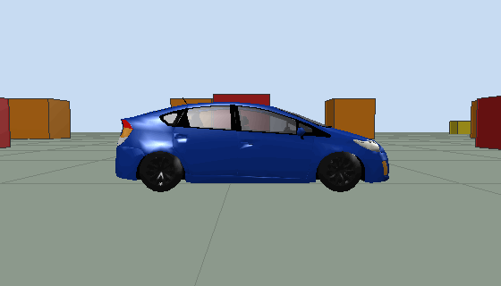
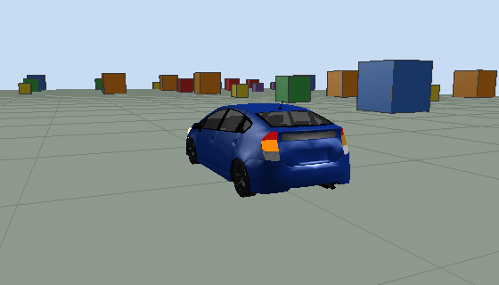
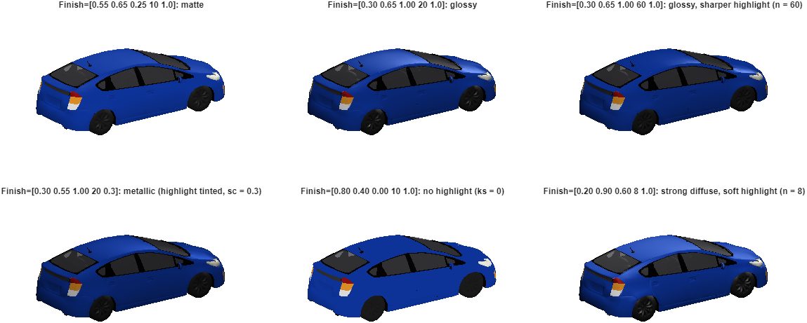
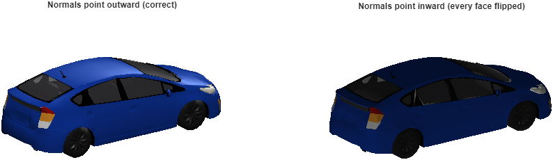
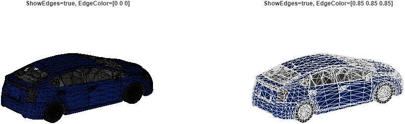
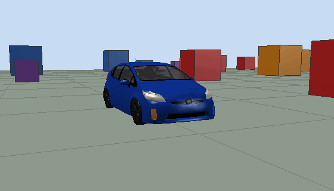
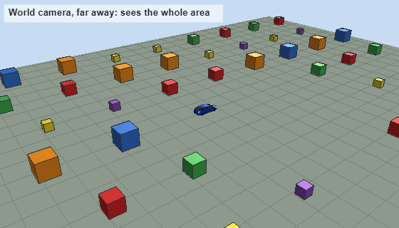
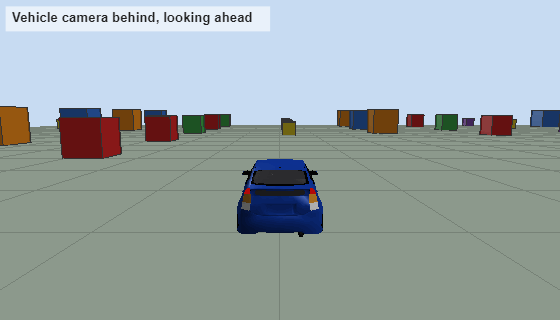
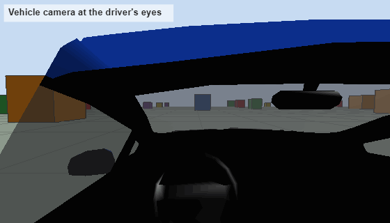
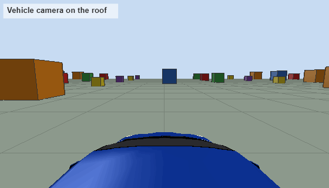

# CarMesh3D

Sparse, correctly scaled 3D vehicle meshes for plotting and animation in MATLAB.

CarMesh3D turns a 3D model of a vehicle (a free download, or the built-in sample) into a light mesh that:

- matches published dimensions: length, width, height, wheelbase, track, tire size, and front overhang;
- has outward-pointing normals, so lighting looks right;
- has vehicle-like colors with see-through glass;
- animates quickly, because the whole vehicle moves by changing one transform matrix.

The workflow is meant to be simple enough for undergraduate students to make a new vehicle quickly from easy-to-find public data.

> **Status:** prototype (2026_11_19). All test scripts pass in MATLAB R2025b, and FBX/GLB conversion was tested with Blender 5.3 on downloaded models.

| Wheels roll, steer, peel out, and lock up | Lights: signals, hazards, brake, backup | Cameras: chase, driver, orbit, ... |
|---|---|---|
|  |  |  |

---

## Getting started

1. Put this folder somewhere whose path has **no minus signs** (spaces are fine).
2. Open MATLAB (R2021a or newer; written for 2025a/2025b) and run `script_demo_CarMesh3D.m` from this folder.
3. The demo walks through every step for a 2013 Toyota Prius Four and ends with an animation. Its starting example is a downloaded low-poly 2010 Prius model (`Data/2010-toyota-prius/source/2010 Toyota Prius.glb`), which needs Blender (see below). If the model or Blender isn't available, the demo uses the built-in sample car instead.

There are no MATLAB toolbox dependencies. The demo only adds `Functions` and `Data` to the MATLAB path.

**For FBX, glTF, GLB, or .blend models**, also install [Blender](https://www.blender.org) (free). CarMesh3D finds it in the usual install folders. If Blender is installed somewhere else, run `setenv('CARMESH3D_BLENDER_PATH','<full path to blender.exe>')` once per MATLAB session, or pass `BlenderPath=...`. The converted `.obj` is saved next to the original as `<name>_converted.obj` and reused on later calls.

## Folders

| Folder | Contents |
|---|---|
| (root) | `script_demo_CarMesh3D.m`, the main overview script (making meshes); `script_demo_CarMesh3D_animation.m` (animation, lights, cameras, GIFs); this README |
| `Functions` | Core functions `fcn_CarMesh3D_<name>.m`, each with a test script `script_CarMesh3D_<name>.m` |
| `Data` | Vehicle specification files (e.g. `vehicleParameters_2013ToyotaPriusFour.mat`), downloaded models, finished meshes |
| `Images` | Images for this README; `Images/animations` holds the GIFs made by the animation demo |

## The workflow

| Step | Function | What it does |
|---|---|---|
| 1. Vehicle spec | `fcn_CarMesh3D_loadVehicleSpec` or `fcn_CarMesh3D_fillVehicleSpec` | Loads an IVSG vehicleParameters `.mat` file, or takes typed-in values. Converts a tire size such as `195/65R15` to a diameter. |
| 2. Shape source | `fcn_CarMesh3D_importMesh` or `fcn_CarMesh3D_fillSampleMesh` | Reads a downloaded OBJ (with materials and groups) or STL, or builds a simple sample car. FBX, glTF, GLB, and .blend files are converted to OBJ first by `fcn_CarMesh3D_convertToOBJ`, which runs Blender in the background. |
| 3. Normalize | `fcn_CarMesh3D_normalizeMesh` | Rotates into the vehicle frame (X forward, Y left, Z up), converts units to meters, and puts the origin on the ground. |
| 4. Label parts | `fcn_CarMesh3D_labelParts` | Marks each face as body, glass, wheel, light, or trim from material and group names. Numbers the wheels FL, FR, RL, RR. Sets colors and glass transparency. |
| 4b. Fix labels | `fcn_CarMesh3D_editLabels` | Corrects labels the name rules got wrong (for example headlights stored as trim), by region in a script or by clicking (see [Fixing labels](#fixing-labels)). Also sets light types for switchable lights. |
| 5. Fit to spec | `fcn_CarMesh3D_fitMeshToSpec` | Scales the body to length, width, and height, then stretches it so the axles land at the true wheelbase. Moves each wheel, without stretching it, to the true track and tire diameter. Puts the origin below the rear axle. |
| 6. Simplify | `fcn_CarMesh3D_simplifyMesh` | Merges duplicate vertices, removes bad faces, reduces to a face budget, and makes all normals point outward. |
| 7. Validate | `fcn_CarMesh3D_validateMesh` | Returns a table of target vs. measured dimensions with percent error, plus side, top, and front views. |
| 8. Plot / animate | `fcn_CarMesh3D_plotVehicle` | Draws the mesh as a few patches under one `hgtransform`. Pass `PlotHandles` back in to move the vehicle quickly. `Finish=` sets how shiny it looks (`'matte'`, `'satin'`, `'glossy'`, `'metallic'`, or `[ka kd ks n sc]`); `ShowEdges=` and `EdgeColor=` control the face edges. |

Labeling comes before fitting so the fit can treat wheels as rigid objects. Label fixes by region are easiest after fitting (regions are then in meters, with the origin below the rear axle) and before simplifying.

**Animation functions** (see `script_demo_CarMesh3D_animation.m`):

| Function | What it does |
|---|---|
| `fcn_CarMesh3D_fillTrajectory` | A motion along a path (straight, circle, figure eight, lane change, waypoints): pose, speed, wheel spin (with slip), and steer angle at every time step |
| `fcn_CarMesh3D_plotScene` | Ground plane, grid, colored cubes, and a path line to drive in |
| `fcn_CarMesh3D_fillCameraSettings` | A camera: where it sits, what it looks at, how wide it sees (presets for 9 common views) |
| `fcn_CarMesh3D_updateCamera` | Points the camera each frame from the settings and the vehicle pose |
| `fcn_CarMesh3D_saveGifFrame` | Adds one frame to an animated GIF |

### Minimal example

```matlab
vehicleSpec = fcn_CarMesh3D_loadVehicleSpec('Data/vehicleParameters_2013ToyotaPriusFour.mat');
vehicleMesh = fcn_CarMesh3D_importMesh('Data/myDownloadedCar.obj', License='CC0');
vehicleMesh = fcn_CarMesh3D_normalizeMesh(vehicleMesh, UpAxis='+y', ForwardAxis='-z');
vehicleMesh = fcn_CarMesh3D_labelParts(vehicleMesh);
vehicleMesh = fcn_CarMesh3D_fitMeshToSpec(vehicleMesh, vehicleSpec);
vehicleMesh = fcn_CarMesh3D_simplifyMesh(vehicleMesh, TargetFaces=3000);
disp(fcn_CarMesh3D_validateMesh(vehicleMesh, vehicleSpec));

h = fcn_CarMesh3D_plotVehicle(vehicleMesh, FigNum=1);
for k = 1:200
    fcn_CarMesh3D_plotVehicle(vehicleMesh, Pose=[0.1*k 0 0], PlotHandles=h, FigNum=-1);
    drawnow limitrate;
end
```

## Lighting, finish, and shading

How a surface looks in MATLAB depends on four things working together. All four are options of `fcn_CarMesh3D_plotVehicle` except the normals, which come from `fcn_CarMesh3D_simplifyMesh`.

| What | Option | What it controls |
|---|---|---|
| Surface finish | `Finish=` | How the surface reflects light: dull or shiny, and the color of the highlights |
| Shading | `FaceLighting=` | Whether each face has one flat shade, or the shade blends smoothly across faces |
| Lights | `SceneLights=` | Which lights shine on the scene |
| Normals | (from `fcn_CarMesh3D_simplifyMesh`) | Which way each face points; the lighting math depends on it |

### Finish: the five numbers

MATLAB lights each face with three parts, added together. `Finish` sets how strong each part is, as five numbers `[ka kd ks n sc]`:

| Number | Name | What it does | Bigger means |
|---|---|---|---|
| `ka` | ambient strength | Light that reaches every face equally, even faces turned away from the lights | Shadowed sides are brighter; less contrast |
| `kd` | diffuse strength | Light that depends on how directly a face points at a light | Faces turned toward the light are brighter |
| `ks` | specular strength | The highlight: the bright spot where light reflects toward the viewer | Brighter highlights (shinier); 0 means no highlight |
| `n` | specular exponent | How tight the highlight is | Smaller, sharper highlights (like polished paint); small `n` gives broad, soft highlights |
| `sc` | specular color reflectance | The color of the highlight | 1: highlights are the light's color (white, like clear-coat). 0: highlights are tinted by the paint color (like metal) |

The named finishes are presets of these numbers:

| `Finish=` | `[ka kd ks n sc]` | Looks like |
|---|---|---|
| `'matte'` (default) | `[0.55 0.65 0.25 10 1.00]` | Flat paint, soft and even |
| `'satin'` | `[0.45 0.70 0.50 15 0.70]` | Some sheen |
| `'glossy'` | `[0.30 0.65 1.00 20 1.00]` | Clear-coated paint: bright white highlights |
| `'metallic'` | `[0.30 0.55 1.00 20 0.30]` | Metal: strong highlights tinted by the paint color |


To make your own finish, start from a preset and change one number at a time. The six examples below vary one number from the glossy preset, and the title of each picture gives the exact `Finish=` used:



```matlab
fcn_CarMesh3D_plotVehicle(vehicleMesh, Finish='glossy');                 % a preset
fcn_CarMesh3D_plotVehicle(vehicleMesh, Finish=[0.30 0.65 1.00 60 1.0]);  % glossy, sharper highlight
fcn_CarMesh3D_plotVehicle(vehicleMesh, Finish=[0.30 0.55 1.00 20 0.3]);  % metallic
```

Highlights only appear where a light reflects toward the camera, so whether you see them depends on the lights and the view. Rotate the view to find them.

### Shading: flat or smooth

`FaceLighting=` sets how the lighting is spread across each face:

- `'flat'`: one shade per face. Gives a crisp low-poly look, but highlights appear as single bright faces.
- `'gouraud'`: the shade blends smoothly from corner to corner. Shiny finishes need this to look smooth.
- `'auto'` (default): `'flat'` for the matte finish, `'gouraud'` for the others.
- `'none'`: no lighting at all; every face is drawn in its plain color. This is how lights that are switched on are drawn, so they look like they glow.


### Lights in the scene

With `SceneLights='auto'` (the default), the first vehicle plotted in an axes adds two lights:
- a white **main light** from above, to the front-left of the default view (`light('Style','infinite','Position',[-1 -2 3])`);
- a dim gray **fill light** from the other side, so shadowed faces are not black (`Position [2 1.5 1]`, `Color [0.45 0.45 0.45]`).

With `SceneLights='none'`, no lights are added, so you can place your own with MATLAB's `light` and `camlight`:

```matlab
h = fcn_CarMesh3D_plotVehicle(vehicleMesh, Finish='glossy', SceneLights='none');
camlight(h.Axes, 'headlight');                                   % a light at the camera
light(h.Axes, 'Style','infinite', 'Position',[1 1 0.3]);         % a low light from behind
```

A light low and behind the vehicle makes long highlights along the roof (right picture):


### Warning: the surface normals must point outward

Every lighting calculation uses each face's **normal**, the direction the face points. If the normals point into the vehicle, the lights hit the "inside" of every surface: the vehicle looks dark and dull, and no finish setting makes it shiny.



Things to know:
- **A normal comes from the order of a face's corners** (the right-hand rule: curl your fingers along corners 1, 2, 3 and your thumb is the normal). Reversing two corners flips the normal.
- **Downloaded models often have mixed or flipped normals.** `fcn_CarMesh3D_simplifyMesh` fixes this: it makes neighboring faces agree, then turns each closed surface so it points out. Always run it before plotting. Its plot (with `FigNum`) draws every normal as a short red line, and they should all point outward.
- **MATLAB uses the opposite convention.** If MATLAB computes normals itself, they point opposite to the right-hand rule, so highlights end up on the inside. `fcn_CarMesh3D_plotVehicle` avoids this by giving MATLAB the outward normals directly (the patch `FaceNormals` and `VertexNormals` properties). If you draw a mesh with your own `patch` call, do the same, or highlights will not appear.
- **Both sides of a face are lit** (`BackFaceLighting='lit'`), so a mesh with wrong normals still looks roughly right with a matte finish. This hides the problem until you try a shiny finish.

### Mesh edges

`ShowEdges=true` draws the edges of every face, in `EdgeColor=` (any `[r g b]`, default dark gray). Edges help when checking a mesh; leave them off for animation.



## Switchable lights

Light faces have a **light type**: `'headlight'`, `'turnsignal'`, `'running'`, `'tail'`, or `'backup'`. `fcn_CarMesh3D_labelParts` sets the type from names (for example `TurnSignal`, `Reverse`, `TailLight`); a light with no recognized name becomes a headlight in the front half and a tail light in the rear half. Fix any mistakes with `fcn_CarMesh3D_editLabels`.

Switch the lights with `LightStates`, a structure. Leave out any field to keep that light off:

| Field | Values | Light |
|---|---|---|
| `Headlights` | `'off'`, `'low'`, `'high'` | Headlights |
| `TurnLeft`, `TurnRight` | `true` / `false` | Turn signals. Left and right are found from position, so mark the turn signal lenses once |
| `Running` | `true` / `false` | Front running lights |
| `Tail` | `'off'`, `'on'`, `'brake'` | Rear lights: dim red when on, bright red when braking |
| `Backup` | `true` / `false` | Backup (reverse) lights |

A light that is on is drawn unshaded (`FaceLighting='none'`) in a bright color, so it appears to glow. Blinking is just switching a light with time:

```matlab
blinkOn = mod(t, 0.8) < 0.4;                                        % 0.4 s on, 0.4 s off
lightStates = struct('Headlights','low', 'Tail','on', 'TurnLeft',blinkOn);   % left signal
lightStates = struct('TurnLeft',blinkOn, 'TurnRight',blinkOn, 'Tail','brake'); % hazards, braking
lightStates = struct('Tail','on', 'Backup',true);                    % backing up
fcn_CarMesh3D_plotVehicle(vehicleMesh, LightStates=lightStates, PlotHandles=h, FigNum=-1);
```

| Signals, hazards, backing up | Headlights off, low, high |
|---|---|
|  |  |

## Fixing labels

Downloaded models are labeled from their material and group names, and those names are often unhelpful. In the 2010 Prius model, the headlights and taillights use the same material as the black bumper trim, so they are labeled trim. `fcn_CarMesh3D_editLabels` fixes this in two ways.

**1. By clicking** (to find what needs fixing):

```matlab
[vehicleMesh, edits] = fcn_CarMesh3D_editLabels(vehicleMesh, Interactive=true);
```

A window shows each part and light type in its own color. Click on the vehicle to select faces: a whole connected piece (the default), a single face, a whole material, or a whole group. Click again to unselect. Choose a label from the menu, press **Apply label to selection**, and repeat. **Undo last label** takes back the last change, and **Rotate view** turns the vehicle (turn it off to click again). Press **Done** when finished. The edits are returned, and also printed as script lines, which brings us to the second way.

**2. By region, in a script** (so the same fixes are made every time):

```matlab
edits = {};
edits{end+1} = struct('Name','headlight housings and lenses', ...
    'Region',[2.90 3.45 0.45 0.82 0.55 0.82], 'BothSides',true, ...
    'Material','color_notint|glass_ex', 'LightType','headlight');
edits{end+1} = struct('Name','tail lights', ...
    'Region',[-0.80 -0.45 0.55 0.80 0.95 1.12], 'BothSides',true, ...
    'Material','color_notint', 'LightType','tail');
vehicleMesh = fcn_CarMesh3D_editLabels(vehicleMesh, Edits=edits);
```

Each edit picks faces with any of these fields (a face must pass all of the ones given), then sets `Part` or `LightType` (and optionally `Color`):

| Field | Picks faces... |
|---|---|
| `Region` | whose centers are inside the box `[xmin xmax ymin ymax zmin zmax]`, in meters |
| `BothSides` | in `Region` *or* its mirror image across the centerline (for left/right pairs) |
| `Material`, `Group` | whose material or group name matches a regular expression |
| `CurrentPart` | that are now labeled as this part |
| `FaceIndices` | in this list |

Use the clicking tool to find the faces and the printed regions, then paste the regions into your script. The full set of Prius light edits is in `script_demo_CarMesh3D_animation.m`.

## Animation: wheels, steering, and slip

`fcn_CarMesh3D_fillTrajectory` gives everything needed for each frame. The pose is the position of the **rear axle** and the heading, which is CarMesh3D's vehicle origin, so:

- **Steering** follows exactly from the path's curvature (kinematic bicycle model): `steerAngle = atan(wheelbase * curvature)`.
- **Wheel spin** is distance traveled divided by tire radius, times `(1 + slip)`:

| `WheelSlip` | Wheels | Use for |
|---|---|---|
| `0` (default) | roll with the ground | normal driving |
| `-1` | do not turn at all | locked brakes, skidding |
| `> 0` (e.g. `2`) | turn faster than the ground moves (3x for 2) | peeling out, wheelspin |

Slip can be one number, one number per wheel `[FL FR RL RR]`, or one row per time step. `Speed` can be a number, one value per time step, or a function of time (e.g. `@(t) min(2*t,10)` to accelerate from rest). Negative speed drives backward.

```matlab
trajectory = fcn_CarMesh3D_fillTrajectory(Path='laneChange', Speed=8, Duration=6, VehicleSpec=vehicleSpec);
h = fcn_CarMesh3D_plotVehicle(vehicleMesh);
for k = 1:length(trajectory.Time)
    fcn_CarMesh3D_plotVehicle(vehicleMesh, Pose=trajectory.Pose(k,:), ...
        WheelSpin=trajectory.WheelSpin(k,:), SteerAngle=trajectory.SteerAngle(k), ...
        PlotHandles=h, FigNum=-1);
    drawnow;
end
```

Each wheel has its own transform inside the vehicle's, so wheels spin and the front wheels steer without redrawing the mesh.

| Rolling and steering (lane change) | Peel out, then lock up (brake lights on) |
|---|---|
|  |  |

## Cameras

Every camera, however different it looks, is described by the same four things:

1. **Where the camera sits** (`Position`), measured in the world or in the vehicle's frame (`PositionFrame='world'` or `'vehicle'`).
2. **What it looks at** (`Target`), also in the world or the vehicle frame (`TargetFrame`).
3. **How wide it sees** (`FieldOfView`, in degrees; smaller means zoomed in).
4. **Optionally, an orbit** (`OrbitRate`, radians per second): a vehicle-frame camera circles the vehicle.

A **world** point stays put; a **vehicle** point rides along with the car (vehicle frame: X forward, Y left, Z up, origin on the ground below the rear axle). So a world camera with a vehicle target is a person at the roadside turning to follow the car, and a camera with both points in the vehicle frame is bolted to the car or flying behind it.

```matlab
cameraSettings = fcn_CarMesh3D_fillCameraSettings(Mode='chase');                 % a preset
cameraSettings = fcn_CarMesh3D_fillCameraSettings(Mode='kite', FieldOfView=30);  % preset, zoomed in
cameraSettings = fcn_CarMesh3D_fillCameraSettings(Mode='chase', ...              % your own camera
    Position=[5.5 3.5 1.3], Target=[2.2 0 0.35], FieldOfView=40);
% in the animation loop:
fcn_CarMesh3D_updateCamera(cameraSettings, pose, Time=t, AxesHandle=h.Axes, FigNum=-1);
```

The presets:

| `Mode` | Position (frame) | Target (frame) | FOV | GIF |
|---|---|---|---|---|
| `'wideFixed'` | `[-35 -45 30]` (world) | `[0 0 0]` (world) | 35 |  |
| `'roadside'` | `[0 -8 1.5]` (world) | `[1.35 0 0.7]` (vehicle) | 40 |  |
| `'overhead'` | `[0 0 60]` (world) | `[0 0 0]` (world) | 40 |  |
| `'overhead'`, `FieldOfView=20` | `[0 0 70]` (world) | `[0 0 0]` (world) | 20 |  |
| `'chase'` | `[-7 0 2.5]` (vehicle) | `[4 0 1]` (vehicle) | 50 |  |
| `'driver'` | `[1.25 0.37 1.15]` (vehicle) | `[20 0.37 0.9]` (vehicle) | 70 |  |
| `'roof'` | `[0.6 0 1.9]` (vehicle) | `[12 0 0.4]` (vehicle) | 65 |  |
| `'side'` | `[1.35 -7 1.2]` (vehicle) | `[1.35 0 0.7]` (vehicle) | 40 |  |
| `'kite'` | `[-14 0 10]` (vehicle) | `[6 0 0]` (vehicle) | 45 |  |
| `'orbit'` (`OrbitRate` 0.4) | `[-9 0 4]` (vehicle) | `[1.35 0 0.7]` (vehicle) | 45 |  |

(The GIFs use the figure eight from `script_demo_CarMesh3D_animation.m`, with some positions changed there to suit it.) Vehicle-frame numbers assume a car about 4.5 m long; scale them for other vehicles. Two tips:

- **Fix the axis limits** to cover the whole scene before animating (`axis([xmin xmax ymin ymax zmin zmax])`), so the axes do not rescale as the camera moves.
- **Give riding cameras something to see.** `fcn_CarMesh3D_plotScene` draws a ground grid and colored cubes; without them, a driver or roof camera shows only an empty plane.

## Saving animations as GIFs

Add one line inside the animation loop, after `drawnow`:

```matlab
fcn_CarMesh3D_saveGifFrame(gcf, 'myAnimation.gif', k, DelayTime=1/12);
```

Frame 1 starts a new file; later frames are added. Smaller figures make smaller files (the demo GIFs are 560 x 320 pixels at 12 frames per second, about 0.5–1.5 MB each). Set `flag_saveGifs = 0` in `script_demo_CarMesh3D_animation.m` to watch without saving.

## Calling convention

All functions follow the IVSG convention: required inputs first, then optional inputs as `Name=Value` pairs.

- `FigNum=[]` (or omitted): no plot, except for `fcn_CarMesh3D_plotVehicle`, which plots into the current figure.
- `FigNum=n`: plot results into figure `n`.
- `FigNum=-1`: fast mode, which skips input checks and plots.
- Input checks can also be turned off for every function with the environment variables `MATLABFLAG_CARMESH3D_FLAG_CHECK_INPUTS` and `MATLABFLAG_CARMESH3D_FLAG_DO_DEBUG`.

Test-script figures are numbered 1xxxx for demos, 2xxxx for tests, 8xxxx for fast mode, and 9xxxx for bugs. Fail conditions are wrapped in `if 1==0` blocks.

## The vehicle frame

Normalized meshes follow ISO 8855: **X forward, Y left, Z up**, in meters, with the tires touching Z = 0. After fitting, the default origin is on the ground below the center of the rear axle (`Origin='center'` is also available).

## The mesh structure

| Field | Size | Set by | Meaning |
|---|---|---|---|
| `Name`, `Source`, `License` | text | import / sample | Where the mesh came from. Always record the license of downloaded models. |
| `Units`, `Frame` | text | import, normalize | `'m'` and `'ISO8855'` after normalizing |
| `Vertices` | N x 3 | all | Vertex positions |
| `Faces` | M x 3 | all | Triangles (indices into `Vertices`) |
| `MaterialNames`, `MaterialColors`, `MaterialAlpha` | K x 1, K x 3, K x 1 | import | Materials from the file (colors are NaN if unknown) |
| `FaceMaterialIndex` | M x 1 | import | Material of each face |
| `GroupNames`, `FaceGroupIndex` | G x 1, M x 1 | import | Group or object of each face |
| `NormalizeInfo` | struct | normalize | Rotation, units scale, offset used |
| `PartNames` | 5 x 1 | label | `{'body';'glass';'wheel';'light';'trim'}` |
| `FacePartIndex` | M x 1 | label | Part of each face |
| `FaceWheelIndex` | M x 1 | label | 0, or 1 FL, 2 FR, 3 RL, 4 RR |
| `FaceColors`, `FaceAlpha` | M x 3, M x 1 | label | Display color and transparency |
| `LightTypeNames`, `FaceLightType` | 5 x 1, M x 1 | label, edit | `{'headlight';'turnsignal';'running';'tail';'backup'}`, and each light face's type (0 = not a switchable light) |
| `VehicleSpec`, `AxleX`, `FitInfo` | struct, 1 x 2, struct | fit | Spec used, axle positions, fit details |
| `FaceNormals`, `SimplifyInfo` | M x 3, struct | simplify | Unit outward normals, face counts |

## Vehicle specification files

`fcn_CarMesh3D_loadVehicleSpec` reads IVSG `vehicleParameters` `.mat` files. Values are converted to meters using their `_Units` fields:

| vehicleParameters field | CarMesh3D spec field |
|---|---|
| `DistancesLength` | `OverallLength` |
| `DistancesWidth` | `OverallWidth` |
| `DistancesWidthWithMirrors` | `WidthWithMirrors` |
| `DistancesHeight` | `OverallHeight` |
| `DistancesWheelbase` | `Wheelbase` |
| `DistancesFrontTrack`, `DistancesRearTrack` | `TrackFront`, `TrackRear` |
| `DistancesFrontOverhang` | `FrontOverhang` |
| `DistancesGroundClearance` | `GroundClearance` |
| `TireSidewallMarkings` | `TireSize` (and so `TireDiameter`) |
| `Year`, `Make`, `Model`, `Trim` | `Name` |

If the file also has `DistancesRearOverhang`, the loader warns when it disagrees with length minus wheelbase minus front overhang.

Note: in the Prius file, the `_Text` descriptions of both overhangs say "from the center of the rear axle." The values use the usual definitions (front axle to front bumper, rear axle to rear bumper), and 0.924 + 2.700 + 0.856 = 4.480. The descriptions should probably be corrected.

## Finding models

- **CC0 (no attribution needed):** Kenney.nl, OpenGameArt.org, and itch.io (search "low poly car" and filter by license). These are mostly generic body types; scaling a generic sedan to a specific car's dimensions works well for plots.
- **Sketchfab:** many specific production models are available. Filter by "Downloadable," check the license (usually CC-BY, which requires attribution), and expect dense meshes that need `TargetFaces`.
- OBJ and STL are read directly. FBX, glTF, GLB, and .blend are converted through Blender, which writes Z-up axes. After converting, normalize with `UpAxis='+z'` and check the plot to find the forward axis (often `'-y'` or `'+y'`).
- Very old ASCII FBX files (version 6.1 and earlier) can't be read by Blender.
- **Always check the normalize plot.** Part names in downloaded files can be misleading. In the test model `Car3.fbx`, the parts named "Front" are actually at the rear. The red X arrow must point at the front bumper (headlights, not the wing or taillights).
- **Textures are not read.** Many downloaded models color their surfaces with texture images (materials named `*_Baked`, or all materials the same gray). Use `UseMaterialColors=false` and `BodyColor=` in `fcn_CarMesh3D_labelParts` to get one clean color per part, and `PartColors=` to choose any part's color (e.g. `PartColors={'body',[0.05 0.2 0.6]; 'glass',[0.3 0.3 0.32]; 'trim',[0 0 0]}`, with `GlassAlpha=0.85` for nearly opaque glass; see Step 10 of the demo). Use `PartRules=` when part names aren't recognized or are misleading (e.g. `PartRules={'17in','wheel'; 'Bumper_Front','body'}`).
- **Mirrors and width.** Published widths usually exclude mirrors. `fcn_CarMesh3D_fitMeshToSpec` has `WidthReference=`:
  - `'all'` (default): fit the whole model to `OverallWidth`.
  - `'body'`: fit only the body faces, when mirrors are labeled trim.
  - `'mirrors'`: fit the whole model to `WidthWithMirrors`, when the mirrors are part of the body mesh. This is what the 2010 Prius model needs; the body width at the front axle then comes out at 1.749 m vs. the spec's 1.745 m.
- Simplifying below the model's face count can shave a little off the wheels and roof (e.g. 0.2–0.5% in the demo at 3000 faces).
- Some models have no separate glass, so there is nothing to make transparent.
- Wheel-named parts near the car's centerline (axles, drive shafts) are labeled trim automatically so they don't throw off the wheel positions.

## TO-DO

- Shape from blueprints: extrude traced side, front, and top silhouettes
- Parametric body template as a fallback shape source
- Overlay a side-view photo during validation
- Box (drag) selection in the interactive label editor
- Ackermann steering, and body roll and pitch from acceleration
- A night scene, to show the lights better
- Labeling of STL files by geometry (they have no material names)
- CSV input for many vehicles at once

## License

To be decided by the project owner (IVSG repositories typically use MIT).
