# CarMesh3D

Sparse, correctly scaled 3D vehicle meshes for plotting and animation in MATLAB.

CarMesh3D turns a 3D model of a vehicle (a free download, or the built-in sample) into a light mesh that:

- matches published dimensions: length, width, height, wheelbase, track, tire size, and front overhang;
- has outward-pointing normals, so lighting looks right;
- has vehicle-like colors with see-through glass;
- animates quickly, because the whole vehicle moves by changing one transform matrix;
- has wheels that roll, slip, and steer (with Ackermann steering), a body that can roll, pitch, and heave on them, and lights that switch on and off.

The workflow is meant to be simple enough for undergraduate students to make a new vehicle quickly from easy-to-find public data.

CarMesh3D works with one vehicle at a time. Scenes with many vehicles (decision branches, surrounding traffic, live data) are handled by the companion repository **AnimateCar3D**, which builds on CarMesh3D.

> **Status:** prototype (2026_11_23). 65 functions, 64 with a test script (`fcn_CarMesh3D_saveCache` is tested by `loadCache`'s); all pass in MATLAB R2025b except two known older failures (see [Tests](#tests)). FBX/GLB conversion was tested with Blender 5.3 on downloaded models. The library holds about 37 finished vehicles in 13 body styles (see `fcn_CarMesh3D_browseLibrary`).

| Wheels roll, steer, peel out, and lock up | Lights at night: beams, signals, brake, backup | Cameras: chase, driver, orbit, ... |
|---|---|---|
|  |  |  |

---

## How the functions fit together

Every vehicle is made by its own copy of one script (`script_CarMesh3D_vehicle_<ID>.m`, from `Data/script_CarMesh3D_vehicle_TEMPLATE.m`). The chart shows which function feeds which, and the files in between (rounded boxes). Solid arrows carry the mesh; dotted arrows are optional or used only by some vehicles. The [Function reference](#function-reference) at the end describes every function, its inputs and outputs, and shows a sample of what it draws.

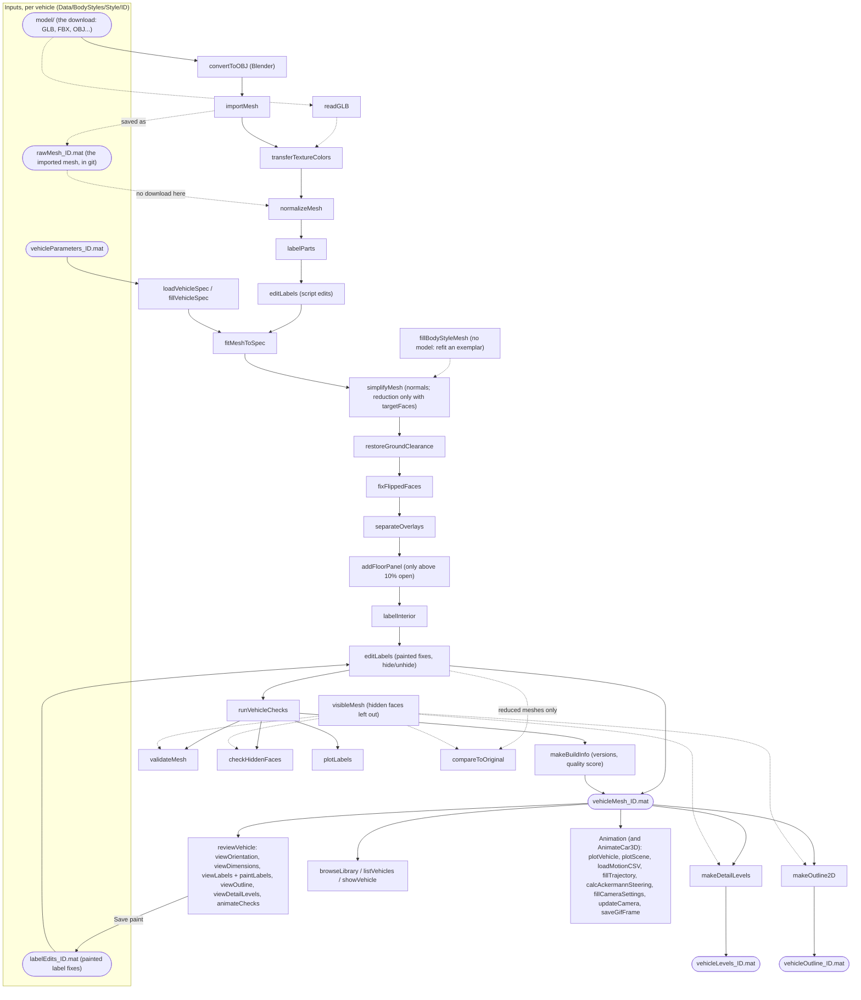

Two loops close the chart. **Painting:** the label painter (in the Model Reviewer, or `fcn_CarMesh3D_paintLabels` alone) saves its fixes in `labelEdits_<ID>.mat`, and the next build applies them, so a fix is never lost when the vehicle is built again. **Caching:** each slow stage (the mesh, the comparison, the checks) is saved in the vehicle's `cache` folder with the dates of every file and function it depends on (`fcn_CarMesh3D_saveCache`, `fcn_CarMesh3D_loadCache`, `fcn_CarMesh3D_fileStamps`), and reused when none of them changed.

## Inputs: what CarMesh3D needs

CarMesh3D draws a vehicle from two kinds of input. Everything else in this README is about how those inputs are turned into pictures and animations.

**1. The vehicle (fixed for a vehicle):**
- A **vehicle specification**: an IVSG `vehicleParameters` structure (or `.mat` file), or an array of them for many vehicles. The fields used are `DistancesLength`, `DistancesWidth`, `DistancesWidthWithMirrors`, `DistancesHeight`, `DistancesWheelbase`, `DistancesFrontTrack`, `DistancesRearTrack`, `DistancesFrontOverhang`, `DistancesGroundClearance` (each with a `_Units` field), `TireSidewallMarkings`, and `Year`, `Make`, `Model`, `Trim` (see [Vehicle specification files](#vehicle-specification-files)).
- A **3D model** of the vehicle's shape (OBJ, STL, FBX, glTF/GLB, or .blend), or the built-in sample car. It is scaled to match the specification.

**2. The motion (one row per time step):** a table, usually a CSV file from a vehicle dynamics simulation, read by `fcn_CarMesh3D_loadMotionCSV`. These are the **motion input columns**. All names are valid MATLAB and Python variable names. Units are SI, with angles in radians.

| # | Column | Units | Meaning | If missing |
|---|---|---|---|---|
| 1 | `time` | s | Time | give `SampleTime=` |
| 2 | `X` | m | Global X of the rear-axle center, on the ground | **required** |
| 3 | `Y` | m | Global Y of the rear-axle center, on the ground | **required** |
| 4 | `Z` | m | Sprung mass: displacement up from static equilibrium | 0 |
| 5 | `roll` | rad | Sprung mass: roll, + right side down | 0 |
| 6 | `pitch` | rad | Sprung mass: pitch, + nose down | 0 |
| 7 | `yaw` | rad | Heading, + counterclockwise from +X | **required** |
| 8 | `U` | m/s | Body-fixed forward speed | from the path |
| 9 | `V` | m/s | Body-fixed lateral speed | not used |
| 10 | `W` | m/s | Body-fixed vertical speed | not used |
| 11 | `roll_rate` | rad/s | Roll rate | not used |
| 12 | `pitch_rate` | rad/s | Pitch rate | not used |
| 13 | `yaw_rate` | rad/s | Yaw rate | (used for steering only if there is no steering column) |
| 14 | `wheelSpeed_FL` | rad/s | Tire 1 (front left) spin rate, + rolling forward | `U` / tire radius |
| 15 | `wheelSpeed_RL` | rad/s | Tire 2 (rear left) | `U` / tire radius |
| 16 | `wheelSpeed_RR` | rad/s | Tire 3 (rear right) | `U` / tire radius |
| 17 | `wheelSpeed_FR` | rad/s | Tire 4 (front right) | `U` / tire radius |
| 18 | `wheelLift_FL` | m | Tire 1 height above the road | 0 |
| 19 | `wheelLift_RL` | m | Tire 2 height above the road | 0 |
| 20 | `wheelLift_RR` | m | Tire 3 height above the road | 0 |
| 21 | `wheelLift_FR` | m | Tire 4 height above the road | 0 |
| 22 | `roadRoll` | rad | Road tilt under the vehicle, about X (unsprung roll) | 0 |
| 23 | `roadPitch` | rad | Road tilt under the vehicle, about Y (unsprung pitch) | 0 |
| 24 | `steer_FL` | rad | Front-left road-wheel angle, + left | see below |
| 25 | `steer_FR` | rad | Front-right road-wheel angle, + left | see below |
| 26 | `headlights` | – | 0 off, 1 low beams, 2 high beams | 0 (off) |
| 27 | `indicator` | – | 0 off, 1 left, 2 right, 3 hazard (both) | 0 (off) |
| 28 | `brakeLight` | – | 0 off, 1 on, 2 strong | 0 (off) |
| 29 | `reverseLight` | – | 0 off, 1 on | 0 (off) |
| 30 | `runningLights` | – | 0 off, 1 on | 0 (off) |

Optional extra columns: `roadZ` (m, ground height under the rear axle; default 0), `steerAngle` (rad, one centerline angle), `steeringWheelAngle` (rad), and `wheelAngle_FL`, `wheelAngle_RL`, `wheelAngle_RR`, `wheelAngle_FR` (rad, wheel rotation angles). Any other column is read and ignored. Columns 1–13 and the four wheel speeds follow the IVSG state vector `[X Y Z roll pitch yaw U V W roll_rate pitch_rate yaw_rate w1 w2 w3 w4]`; `w1`–`w4` are accepted as names for the wheel speeds.

### Assumptions behind the inputs

Read these before writing a file for CarMesh3D:

- **Frames and signs.** ISO 8855: X forward, Y left, Z up. Angles follow the right-hand rule: positive yaw turns left, positive roll lowers the right side, positive pitch lowers the nose, and positive steering turns left.
- **The vehicle's reference point** is the center of the rear axle, on the ground. `X` and `Y` give where that point is; `yaw` gives the heading.
- **Two rigid frames.** The **sprung mass** (body, glass, trim, lights) moves with `Z`, `roll`, and `pitch`. The **unsprung mass** (the four wheels) stays on the road, except for `wheelLift_*`. Both share `X`, `Y`, and `yaw`.
- **`Z` is a displacement from equilibrium**, not a height: 0 means the sprung mass sits at its static ride height, and positive is upward. On a road with changing elevation, it is the motion relative to the road surface; give the road's own height in `roadZ` if it matters.
- **`roll` and `pitch` are the sprung mass's angles. The road tilt is separate** (`roadRoll`, `roadPitch`; zero for normal driving). The body is drawn tilted by `roll − roadRoll` and `pitch − roadPitch` relative to the road under it. This is exact on flat ground and a close approximation on gentle slopes.
- **The road is a flat plane under the vehicle.** Bumps, curbs, and potholes are not modeled.
- **Wheel lift is an input.** CarMesh3D does not work out when a wheel leaves the road; give the height of each tire above the road in `wheelLift_*` (0 for normal driving).
- **Tires are numbered by quadrant**, seen from above: 1 front left, 2 rear left, 3 rear right, 4 front right. The column names say the position (`_FL`, `_RL`, `_RR`, `_FR`), so the numbering cannot be mixed up. (Inside CarMesh3D, wheel options use the order `[FL FR RL RR]`; the reader converts.)
- **Wheel spin.** Wheel speeds are integrated over time to give the rotation angle, so a small drift is possible over long runs; give `wheelAngle_*` to avoid it. With no wheel columns, every wheel rolls without slipping at `U` / tire radius.
- **Steering.** The front road-wheel angles `steer_FL` and `steer_FR` are used as given. Without them, one angle is taken from `steerAngle`, or from `steeringWheelAngle` / `SteeringRatio` (default 15), or from the path's curvature (`yaw_rate / U`, or the change in yaw per meter); that one angle is split into left and right angles with Ackermann steering. The rear wheels do not steer.
- **Lights are inputs, never worked out from the motion.** A vehicle can brake while speeding up (coasting downhill), and can roll backward without being in reverse (parked on a hill), so `brakeLight` and `reverseLight` must come from the simulation or the driver's inputs. A missing light column means that light is off.
- **Turn signals blink by themselves.** `indicator` gives the switch position (off, left, right, hazard); CarMesh3D makes the blinking (`BlinkPeriod=`, default 0.8 s), starting "on" whenever the switch changes. Do not put the blinking itself in the file.
- **Tail lights** are on whenever the headlights or running lights are on, and bright when `brakeLight` is 1 or 2 (2, "strong", is drawn like 1).
- **Names and units.** Columns are found by name, so their order does not matter. Matching ignores upper and lower case and underscores (`yaw_rate`, `Yaw_Rate`, and `yawRate` are the same). A name ending in `_deg` is in degrees (or degrees per second); a wheel speed ending in `_rpm` is in revolutions per minute. Both are converted.
- **Files without a header row** are read with `ColumnNames=` (a list of names in the file's order) and, if there is no time column, `SampleTime=`.
- **Vehicle dimensions** for steering and wheel spin (wheelbase, front track, tire diameter) come from `VehicleSpec=`.

## How to use this repository: three flows

CarMesh3D is used in three ways. Each block below is an action, done by the functions listed in the table under the chart.

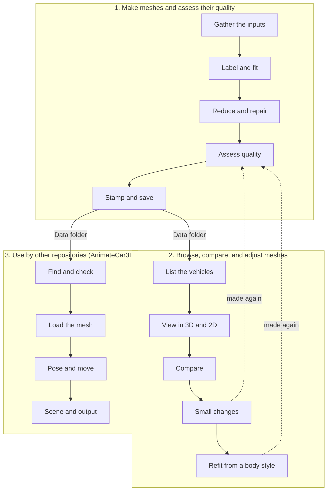

Flow 1 writes each finished vehicle (mesh, detail levels, 2D outline, check pictures, and its build information) into `Data`; flows 2 and 3 only read from there. A small change in flow 2 (a label edit, a body color, a refit) sends the vehicle back through flow 1's last two blocks, so its quality score and version stay current.

| Flow | Block | Functions | Started from |
|---|---|---|---|
| 1 | Gather the inputs | `fcn_CarMesh3D_loadVehicleSpec`, `fcn_CarMesh3D_fillVehicleSpec`, `fcn_CarMesh3D_convertToOBJ` (Blender; its reduced OBJ is reused), `fcn_CarMesh3D_readGLB`, `fcn_CarMesh3D_importMesh`, `fcn_CarMesh3D_normalizeMesh` | `Data/script_CarMesh3D_vehicle_TEMPLATE.m` (one per vehicle) |
| 1 | Label and fit | `fcn_CarMesh3D_labelParts`, `fcn_CarMesh3D_editLabels`, `fcn_CarMesh3D_transferTextureColors`, `fcn_CarMesh3D_fitMeshToSpec` | |
| 1 | Reduce and repair | `fcn_CarMesh3D_simplifyMesh`, `fcn_CarMesh3D_fixFlippedFaces`, `fcn_CarMesh3D_separateOverlays`, `fcn_CarMesh3D_addFloorPanel` | |
| 1 | Assess quality | `fcn_CarMesh3D_compareToOriginal` (holes, label changes, flipped faces, see-through gaps), `fcn_CarMesh3D_validateMesh` (dimensions), `fcn_CarMesh3D_runVehicleChecks` (pictures and GIFs) | |
| 1 | Stamp and save | `fcn_CarMesh3D_makeBuildInfo` (versions and quality score), `fcn_CarMesh3D_makeDetailLevels`, `fcn_CarMesh3D_makeOutline2D`; slow stages cached by `fcn_CarMesh3D_loadCache` / `fcn_CarMesh3D_saveCache` | |
| 2 | List the vehicles | `fcn_CarMesh3D_browseVehicles` (the vehicle browser: a menu with quality scores), `fcn_CarMesh3D_listVehicles` (scores; up to date or not), `fcn_CarMesh3D_loadBodyStyles` | `fcn_CarMesh3D_browseVehicles` (see [Browsing the vehicles](#browsing-the-vehicles)) |
| 2 | View in 3D and 2D | `fcn_CarMesh3D_showVehicle` (3D and 2D, or parts by label or material, with a summary), `fcn_CarMesh3D_plotLabels`, `fcn_CarMesh3D_plotVehicle`, the outline in `vehicleOutline_<ID>.mat` | |
| 2 | Compare | the pictures in each vehicle's `checks` folder; `fcn_CarMesh3D_compareToOriginal`; `fcn_CarMesh3D_validateMesh` | |
| 2 | Small changes | `fcn_CarMesh3D_editLabels` (also clicked, with the interactive label editor), the vehicle script's settings (body color, part rules) | the vehicle's own script |
| 2 | Refit from a body style | `fcn_CarMesh3D_fillBodyStyleMesh` (an approved exemplar refit to new dimensions) | `Data/script_CarMesh3D_bodyStyle_TEMPLATE.m`; the generic vehicles in `Data/Samples` |
| 3 | Find and check | `fcn_CarMesh3D_findVehicleFiles`, `fcn_CarMesh3D_version` (`AtLeast=`, mesh version), `fcn_CarMesh3D_listVehicles` | AnimateCar3D |
| 3 | Load the mesh | `vehicleMesh_<ID>.mat`, `vehicleLevels_<ID>.mat` (detail levels), `vehicleOutline_<ID>.mat` (2D) | |
| 3 | Pose and move | `fcn_CarMesh3D_plotVehicle` (`Pose=`, `WheelSpin=`, `SteerAngle=`, `LightStates=`), `fcn_CarMesh3D_fillTrajectory`, `fcn_CarMesh3D_loadMotionCSV`, `fcn_CarMesh3D_calcAckermannSteering`, `fcn_CarMesh3D_checkGroundContact` | `script_demo_CarMesh3D_animation.m` |
| 3 | Scene and output | `fcn_CarMesh3D_plotScene`, `fcn_CarMesh3D_fillCameraSettings`, `fcn_CarMesh3D_updateCamera`, `fcn_CarMesh3D_saveGifFrame` | |

## Getting started

1. Put this folder somewhere whose path has **no minus signs** (spaces are fine).
2. Open MATLAB (R2021a or newer; written for 2025a/2025b) and run `script_demo_CarMesh3D.m` from this folder.
3. The demo walks through every step for a 2013 Toyota Prius Four and ends with an animation. Its starting example is a downloaded low-poly 2010 Prius model (`Data/BodyStyles/Liftback/2013_Toyota_Prius_Four/model/source/2010 Toyota Prius.glb`), which needs Blender (see below). If the model or Blender isn't available, the demo uses the built-in sample car instead.

There are no MATLAB toolbox dependencies. The one repository dependency is [DebugTools](https://github.com/ivsg-psu/Errata_Tutorials_DebugTools) (the vehicle browser uses its menu). The demo installs it with the standard IVSG installer, as AnimateCar3D does: `Installer/fcn_DebugTools_autoInstallRepos.m` puts the latest DebugTools release in `Utilities` (ignored by git) and adds it to the path; offline, it uses the release already there. The demo then adds `Functions` and `Data` to the path.

**For FBX, glTF, GLB, or .blend models**, also install [Blender](https://www.blender.org) (free). CarMesh3D finds it in the usual install folders. If Blender is installed somewhere else, run `setenv('CARMESH3D_BLENDER_PATH','<full path to blender.exe>')` once per MATLAB session, or pass `BlenderPath=...`. The converted `.obj` is saved next to the original as `<name>_converted.obj` and reused on later calls.

## Vehicles available

These vehicles are finished and checked, and are ready to use. Each one's folder (in `Data/BodyStyles/<Style>`) holds its parameters, its 3D model, its script, its finished mesh (`vehicleMesh_<ID>.mat`), and its check images and animations (`checks`). The same list is kept in the text file `Data/referenceVehicles.csv`, so it can be read without searching the folders. To use a finished vehicle:

```matlab
vehicleFiles = fcn_CarMesh3D_findVehicleFiles('2014_Ford_TransitConnect_XLTCargoLWB');
load(vehicleFiles.MeshFile, 'vehicleMesh', 'vehicleSpec');
fcn_CarMesh3D_plotVehicle(vehicleMesh, FigNum=1);
```

Each animation is the vehicle's `check_09_drive.gif`: the standard test drive (see [Adding a vehicle](#adding-a-vehicle)).

<!-- REFERENCE VEHICLES START -->

| Vehicle | Animation | Size L x W x H (m) | Wheelbase (m) | Faces | Model license |
|---|---|---|---|---|---|
| **2013 Toyota Prius Four**<br>`Data/BodyStyles/Liftback/2013_Toyota_Prius_Four` | 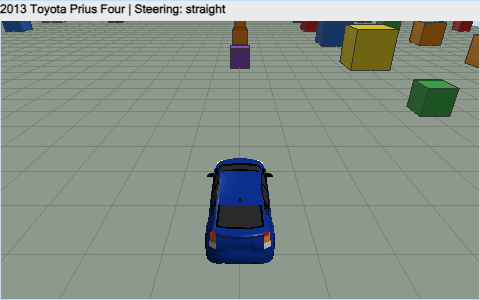 | 4.48 x 2.02 x 1.49 | 2.700 | 6648 | Free Standard |
| **2014 Ford TransitConnect XLTCargoLWB**<br>`Data/BodyStyles/CompactCargoVan/2014_Ford_TransitConnect_XLTCargoLWB` |  | 4.82 x 2.14 x 1.85 | 3.063 | 36062 | 2014 Ford Transit Connect Cargo by tonielpro520 is licensed under Creative Commons Attribution |

(This table is written by fcn_CarMesh3D_addReferenceVehicle from Data/referenceVehicles.csv; 2 vehicles.)

<!-- REFERENCE VEHICLES END -->

### Browsing the vehicles

`fcn_CarMesh3D_browseVehicles` opens a menu, in the command window, of every finished vehicle: its name, body style, quality score (0 to 100), and whether its mesh is up to date. Type a vehicle's number to see it (`fcn_CarMesh3D_showVehicle`: the mesh in 3D in figure 1, its 2D outlines in figure 2); the menu marks it viewed and offers the next one. `v` changes what a number shows (3D and 2D, parts by label, or parts by material), `t` prints the full table, and `q` quits. The menu is DebugTools' `fcn_DebugTools_menuManageSelections`, so run `script_demo_CarMesh3D.m` once first to install DebugTools.

```matlab
fcn_CarMesh3D_browseVehicles;                    % by body style
fcn_CarMesh3D_browseVehicles(SortBy='score');    % best first
fcn_CarMesh3D_showVehicle('2013_Toyota_Prius_Four', View='materials', FigNum=3);   % one vehicle, directly
```

## Adding a vehicle

Every vehicle gets its own folder in `Data` and its own copy of one standard script. Student contributors: please follow this convention exactly, so that every vehicle can be found by its name.

### Folder names: `YEAR_Make_Model_Trimline`

| Part | Rule | Examples |
|---|---|---|
| `YEAR` | The model year, 4 digits | `2013`, `2014` |
| `Make` | The maker's name | `Toyota`, `Ford`, `MercedesBenz` |
| `Model` | The model's name | `Prius`, `TransitConnect`, `F150` |
| `Trimline` | The trim (and anything else needed to tell versions apart, such as body style or wheelbase) | `Four`, `XLTCargoLWB`, `LXSedan` |

- Each part uses only letters and digits: no spaces, hyphens, dots, or underscores inside a part. Write several words in CamelCase (`TransitConnect`, not `Transit Connect` or `Transit-Connect`).
- The four parts are joined by underscores, so a name always has exactly three underscores. The rule as a regular expression: `^\d{4}_[A-Za-z0-9]+_[A-Za-z0-9]+_[A-Za-z0-9]+$`.
- This name is the vehicle's **ID**, and it is used in every file name in the folder. `fcn_CarMesh3D_findVehicleFiles(ID)` checks the name and returns all the file paths (and, called with `''`, lists every vehicle folder).
- Use the year and trim of the vehicle whose parameters you have, even when the 3D model is of a nearby year (the Prius model is a 2010, for a 2013 Prius Four).

### What goes in the folder

| File or folder | Made by | Contents |
|---|---|---|
| `vehicleParameters_<ID>.mat` | you | The IVSG `vehicleParameters` structure (see [Vehicle specification files](#vehicle-specification-files)). Keep notes on where each value came from in `vehicleParameters_sources.md`. |
| `LICENSE.txt` | you | The model's license, written in the [standard license format](#the-licensetxt-file). It stays in the repository. |
| `model/` | you | The downloaded 3D model, as downloaded (zip and all), with the model in `model/source/` (or directly in `model/`). Keep the original download, including its textures: later versions of CarMesh3D may use assets that the current workflow ignores, such as texture maps. **Not kept in git** (see [Large files](#large-files)). |
| `rawMesh_<ID>.mat` | the script | The model as imported (`rawMesh`), before it is labeled and fit. It stays in the repository, so the script runs without the download (see [Large files](#large-files)). |
| `script_CarMesh3D_vehicle_<ID>.m` | you, from the template | The standard script, with this vehicle's settings |
| `vehicleMesh_<ID>.mat` | the script | The finished mesh (`vehicleMesh`, `vehicleSpec`) |
| `vehicleLevels_<ID>.mat` | the script | The detail levels (`detailLevels`): lighter versions of the mesh for animation (see [Detail levels for animation](#detail-levels-for-animation)) |
| `checks/` | the script | The standard check images, animations, and test motion (below) |

### The LICENSE.txt file

Every downloaded model comes with a `LICENSE.txt`, written in this format: five labeled lines, in this order, copied from the model's download page.

```
License: (the license type, as the download page names it)
License meaning: (what the license imposes, as the download page explains it)
Credits: (the required credit line; left empty for a license that requires none, such as Free Standard)
Source website: (the link to the model's page)
Author: (the author's name as the website lists it)
```

Two examples:

```
License: CC Attribution
License meaning: Author must be credited. Commercial use is allowed.
Credits: 2006 Toyota Camry 24 G by tonielpro520 is licensed under Creative Commons Attribution
Source website: https://sketchfab.com/3d-models/2006-toyota-camry-24-g-e47c4e766b104f8f9a095810e3b83459
Author: tonielpro520
```

```
License: Free Standard
License meaning: Under basic restrictions, use worldwide, on all types of media, commercially or not, and in all types of derivative works
Credits: 
Source website: https://sketchfab.com/3d-models/2010-toyota-prius-f4ed90af97264198b65f28a7532be138#download
Author: ActsOfDoge
```

The whole file becomes the mesh's `License` field. The [Vehicles available](#vehicles-available) table shows the `Credits` line, or the `License` line when no credit is required. Avoid NonCommercial (NC) and ShareAlike (SA) licenses if the repository is shared publicly or used in funded work: their terms carry over to every mesh, image, and GIF made from the model.

### Steps

1. Make the folder `Data/BodyStyles/<Style>/<ID>` (the style folders are listed in `Data/bodyStyles.csv`; for example `Data/BodyStyles/Sedan/2025_Toyota_Camry_XV80`), and put the parameters file and the model in it as above. `fcn_CarMesh3D_findVehicleFiles(ID)` finds the folder wherever it is filed, so scripts and functions only need the ID. A download left directly in the vehicle folder (not yet moved into `model/`) is found too (`ModelFiles`).
2. Copy `Data/script_CarMesh3D_vehicle_TEMPLATE.m` into the folder as `script_CarMesh3D_vehicle_<ID>.m`. Change only its **Vehicle settings** section: the ID, the model file, the import axes, any faces to delete (`removeFaces`: stray pieces that would spoil the fit, such as a lone point above the roof), the part rules, and the width reference. Keep the standard blue body color (`[0.05 0.20 0.60]`) at least until every check looks right: against the blue, trim (near black), glass (gray, see-through), and panels shaded wrongly stand out. The color can be changed later.
3. Run it, and look at the checks it writes (`check_00_orientation.png`, `check_02_dimensions.png`, `check_03_labels.png`; see [Mesh families and the checks to run](#mesh-families-and-the-checks-to-run)), or open the vehicle in the Model Reviewer, `fcn_CarMesh3D_reviewVehicle(ID)`. The first run usually shows something to fix: the orientation, the labels, or the lamps (`fcn_CarMesh3D_viewLabels`, "Nighttime view").
4. Fix the settings and run again. Most fixes are label fixes, painted in the label painter (`fcn_CarMesh3D_paintLabels(ID)`; saved in `labelEdits_<ID>.mat` and applied by every later build), or written as regions in the script (`labelEditsAfterFit`: meters, with the origin on the ground below the rear axle). Pieces that should not be seen are **hidden, not deleted** (see [Hidden faces](#hidden-faces-never-deleted)); `removeFaces` is only for stray pieces that would spoil the fit (a lone point above the roof, a ground plane). Fixes that must move with the wheels (for example, tires that are stored as part of the body) go in `fcn_INTERNAL_editsBeforeFit` at the end of the script; the Transit Connect script has an example.
5. When every check looks right, set `flag_addThisVehicleToReferenceList = 1` and run it once more (this also makes its drive GIF). This copies `check_09_drive.gif` to `Images/vehicles/<ID>.gif`, adds (or updates) the vehicle's row in `Data/referenceVehicles.csv`, and rewrites the [Vehicles available](#vehicles-available) table in this README (`fcn_CarMesh3D_addReferenceVehicle`).

### No model of the vehicle? Use its body style

When no 3D model of a vehicle can be found, it can be made from its **body style**: a finished vehicle of the same style (an **exemplar**: any vehicle in the style's folder with a finished mesh; the one closest in size is used) is refit to this vehicle's published dimensions, labels, lights, and all. In the vehicle's script, set `modelFile = ''` and `bodyStyle` to the style's ID; everything else (parameters file, checks, detail levels, reference list) is the same. From MATLAB directly:

```matlab
vehicleSpec = fcn_CarMesh3D_loadVehicleSpec('vehicleParameters_2020_Toyota_Corolla_HatchbackSE.mat');
vehicleMesh = fcn_CarMesh3D_fillBodyStyleMesh('liftback', vehicleSpec, FigNum=1);
```

| A Corolla hatchback and a ProMaster City, each from its style's exemplar |
|---|
| 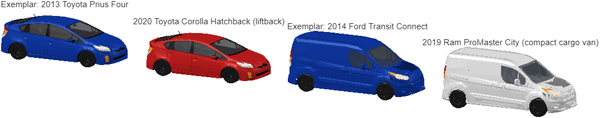 |

The styles are the folders of `Data/BodyStyles`; their names and descriptions are in `Data/bodyStyles.csv` (`fcn_CarMesh3D_loadBodyStyles` reads both and lists each style's vehicles, `VehicleIDs`, and finished ones, `ExemplarIDs`; with a figure number it shows every exemplar). A style is only as good as its exemplars, so each is a finished, checked vehicle, made the usual way from a downloaded model.

**When a style has several exemplars**, the one closest in size to the new vehicle is refit: the smallest root-mean-square relative difference in length, width, height, and wheelbase (each candidate and its difference are kept in `BodyStyleInfo.CandidateIDs` and `SizeDifference`). `ExemplarID=` picks one instead. One exemplar is enough for a style to work; two or three that span small to large help most (one each is plenty for the optional styles).

| Style ID (folder) | Body style | Exemplars (finished) | Good exemplars still to add |
|---|---|---|---|
| `sedan` | Sedan (separate trunk) | 2025 Toyota Camry XV80 | Toyota Camry, Honda Accord |
| `hatchback` | Hatchback (5-door) | (none yet) | Honda Civic hatchback, VW Golf |
| `liftback` | Liftback (sloped rear hatch) | 2013 Toyota Prius Four |  |
| `stationWagon` | Station wagon | 2021 Subaru Outback Limited XT | Subaru Outback, VW Golf SportWagen, Volvo V60 |
| `coupe` | Coupe (2-door) | 2006 Ford Mustang GT, 2012 Honda Civic Si | Ford Mustang, Honda Civic coupe |
| `convertible` | Convertible or roadster | (none yet) | Mazda MX-5 Miata |
| `sportsCar` | Sports car (low, often mid-engine) | (none yet) | Chevrolet Corvette C8, Acura NSX |
| `crossover` | Crossover or compact SUV | 2004 Toyota RAV4 L, 2014 Honda CR-V EX-L, 2017 Toyota RAV4 XLE | Toyota RAV4, Honda CR-V |
| `fullSizeSUV` | Full-size SUV | (none yet) | Chevrolet Tahoe, Ford Expedition |
| `minivan` | Minivan | (none yet) | Honda Odyssey, Chrysler Pacifica, Toyota Sienna |
| `pickupCrewCab` | Full-size pickup (crew cab) | 2015 Ford F-150 Lariat | Ford F-150 SuperCrew |
| `compactCargoVan` | Compact cargo van | 2014 Ford Transit Connect XLT Cargo LWB |  |
| `fullSizeCargoVan` | Full-size cargo van (high roof) | 2005 Toyota HiAce H200 DX | Ford Transit, Mercedes Sprinter, Ram ProMaster |
| `midsizeSUV` | Midsize three-row SUV (optional) | (none yet) | Ford Explorer, Toyota Highlander |
| `pickupMidsize` | Midsize pickup (optional) | (none yet) | Toyota Tacoma |
| `passengerVan` | Passenger van (optional) | (none yet) | Ford Transit passenger van |
| `microcar` | Microcar or city car (optional) | (none yet) | Smart Fortwo |
| `boxTruck` | Box truck or cutaway (optional) | (none yet) | Isuzu NPR, Ford E-350 cutaway |
| `stepVan` | Step van (optional) | (none yet) | Freightliner MT45 |
| `schoolBus` | School bus, type C (optional) | (none yet) | Blue Bird Vision, Thomas C2 |
| `transitBus` | Transit bus, 40 ft (optional) | (none yet) | New Flyer Xcelsior, Gillig Low Floor |
| `semiTractor` | Semi tractor (optional) | (none yet) | Freightliner Cascadia |

Each style's folder is its ID with a capital first letter (`compactCargoVan` is `Data/BodyStyles/CompactCargoVan`). The exemplars listed are the approved ones (`Data/bodyStyles.csv`); the library holds more finished vehicles (`fcn_CarMesh3D_browseLibrary`), and exemplar approvals for the remaining styles wait until the review tools are done. The optional styles' larger vehicles (box truck to semi) need multi-axle fitting first.

To add an exemplar: file the vehicle under its style's folder and finish it as usual; nothing else is needed. A style without one makes the sample car at the vehicle's size, with a warning (`Fallback='error'` stops instead).

Notes:
- **The width** is fit the way the exemplar's was. Both exemplars were fit with their mirrors (their mirrors are part of the body mesh), so if the new vehicle's parameters give only the width without mirrors, the width with mirrors is estimated from the exemplar's own ratio of the two (written in the mesh's `BodyStyleInfo.WidthNote`). The width check then shows the width with mirrors as measured but not compared.
- **The license** of a refit mesh is the exemplar's (its `License` field is copied): a CC-BY exemplar's attribution goes with every vehicle made from it.
- The shape between the measured points (hood length, roof line, glass) is the exemplar's, stretched; a vehicle whose shape differs much from its style's exemplar is better made from its own model.

### Mesh families and the checks to run

Most downloads are already light "game" models (a few thousand to 25,000 faces). Changing them (reducing, mirroring, patching) only adds mistakes, so **the default build keeps the download as it is** and runs only the checks that have ever found a problem. A vehicle falls in one of three families:

| Family | What it is | What the build does | Checks to look at |
|---|---|---|---|
| **1. Low-poly, unmodified** (the default) | A download under about 50,000 faces | Import, turn to X forward, label, fit to the specs, turn faces seen only from behind, save. No reduction, no mirroring; a floor panel only if more than 10% of the floor is open (`floorPanelMinOpen`) | **Required:** orientation (first look only), dimensions, labels (with the lamps: the "Nighttime view" in `fcn_CarMesh3D_viewLabels`), 2D outline |
| **2. Low-poly, modified** | Family 1 with a floor panel, mirroring, or hidden faces | The same, plus that change | Family 1's, plus **Differences** (`fcn_CarMesh3D_compareToOriginal`) and the hidden-face warnings |
| **3. Dense** (experimental) | A download far over the budget (73,000 to 1,000,000 faces) | Reduced in Blender to `targetFaces`, mirrored (`symmetricMesh`), compared with the download | Family 2's. Reduction has worked for only 3 of 8 dense downloads: **look for a low-poly download first** |

A model is never rejected for having an open underside. The checks every build writes are set in the vehicle script (`checksToRun`):

| File | Check | Written |
|---|---|---|
| `check_00_orientation.png` | The model after turning it to X forward, Y left, Z up: the front must be toward +X | always |
| `check_02_dimensions.png`, `.txt` | Target vs. measured length, widths, height, wheelbase, tracks, tire diameter, overhang, ground clearance (on the shown faces) | **default** |
| `check_03_labels.png` | Parts and lamp types in color, from four sides | **default** |
| `check_11_detailLevels.png` | The finished mesh and its detail levels side by side | always |
| `check_12_outline2D.png` | The top-down outlines | always |
| `check_04_compare_*.png` | Differences from the download: holes, label changes, flipped faces, see-through gaps | reduced meshes (`flag_compareToOriginal`) |
| `check_summary.txt`, `testMotion.csv` | The files written, the dimension result, any hidden-face warnings; the standard test motion | always |
| `check_01_inputs.png`, `check_04_lightStates.png`, `check_10_groundContact.png` | The standard test motion's inputs, each light alone, body contact with the road | **optional**: `checksToRun = 'all'` |
| `check_05_lights.gif` to `check_09_drive.gif` | The test motion's lights, body, steering, wheels, and drive segments | **optional**: `checksToRun = 'all'` and `flag_saveGifs = 1` (about 30 MB per vehicle). `check_09_drive.gif` is made when the vehicle is added to the reference list |

The optional checks have never failed on a vehicle that passed the required ones, so they stay off unless asked for; the Model Reviewer (`fcn_CarMesh3D_reviewVehicle`) draws them live under "More checks". `.fig` copies of the pictures are saved only with `flag_saveFigs = 1`.

The **standard test motion** (`fcn_CarMesh3D_fillTestMotion`, in the [motion CSV format](#inputs-what-carmesh3d-needs)) drives the vehicle through four segments in the standard scene (a gray grid with colored cubes), with cameras placed as fractions of the vehicle's size:

| Segment | Vehicle | Tests |
|---|---|---|
| `lights` | parked | Each light alone for 1.2 s: off, low beams, high beams, running lights, left signal, right signal, hazards, brake, backup |
| `body` | parked | Body roll ±5°, pitch ±3°, heave ±5 cm, then each tire lifted 8 cm in turn (FL, FR, RL, RR) |
| `steering` | 2 m/s | A 90° left turn then a 90° right turn, at a radius of 1.5 wheelbases, with the turn signals on |
| `wheels` | driving | A peel-out, cruising, a locked-wheel stop (brake lights), stopped, and backing up (backup lights) |

#### Mesh size and drawing speed

How many faces is "too many" depends on the computer and on how many vehicles are drawn at once. Drawing time grows with **all the faces in view**, not with the number of vehicles. Measured on one example machine (copies of the 2009 Fit, 22,782 faces each, each under its own moving transform, one `drawnow` per frame):

| Faces in the scene | Frames per second |
|---|---|
| 23,000 (1 vehicle) | 614 |
| 91,000 (4) | 184 |
| 228,000 (10) | 96 |
| 501,000 (22) | 52 |
| 1,000,000 (44) | 27 |
| 2,000,000 (88) | 14 |

That machine draws about 27 million faces per second, so 25 frames per second holds up to about 1 million faces in view. A student laptop may be several times slower. **A quick test on your own computer:** open the vehicle in `fcn_CarMesh3D_viewLabels` and rotate it. If rotating is not smooth there, the mesh is almost certainly too large for real-time animation on that computer. The build prints a note for meshes over 50,000 faces. There is no face budget for now: one will be set after the animator (AnimateCar3D) is tested with the library.

## Folders

| Folder | Contents |
|---|---|
| (root) | `script_demo_CarMesh3D.m`, the main overview script (making meshes); `script_demo_CarMesh3D_animation.m` (animation, lights, cameras, night scenes, motion from CSV files, GIFs); this README |
| `Functions` | Core functions `fcn_CarMesh3D_<name>.m`, each with a test script `script_test_fcn_CarMesh3D_<name>.m` |
| `Data` | One folder per vehicle, filed by body style: `Data/BodyStyles/<Style>/YEAR_Make_Model_Trimline`, and made-up vehicles in `Data/Samples` (see [Adding a vehicle](#adding-a-vehicle)); the template script `script_CarMesh3D_vehicle_TEMPLATE.m`; the reference list `referenceVehicles.csv`; the body styles, `bodyStyles.csv` |
| `Installer` | `fcn_DebugTools_autoInstallRepos.m`, the standard IVSG installer used by the demo |
| `Utilities` | Installed dependencies (DebugTools), made by the installer; ignored by git |
| `Images` | Images for this README; `Images/animations` holds the GIFs made by the animation demo; `Images/vehicles` holds each reference vehicle's animation; `Images/detailLevels` holds the pictures of the detail-level design; `Images/functions` holds each function's sample output for the [Function reference](#function-reference) |

## Large files

The downloaded models are large (about 4 GB for the library), so they are not kept in git. Each vehicle's download sits in its `model/` folder, which `.gitignore` leaves out; the IVSG large-file storage area (a OneDrive folder) holds a copy of the whole `Data` folder with every `model/` folder in it. The check figures and animations (`checks/*.fig`, `checks/*.gif`), which each script remakes, are left out too; the check pictures (`.png`) stay.

Everything else stays in the repository, including each vehicle's imported mesh, `rawMesh_<ID>.mat` (0.1 to 2 MB each). So a clone without the downloads still works:

- the finished meshes, detail levels and outlines are all there, for plotting and animation;
- a vehicle's script still runs: when its download is not in `model/`, it rebuilds the vehicle from `rawMesh_<ID>.mat` (it says so when it starts) and skips only the comparison with the download (`check_04_compare_*`).

The large-file area is the IVSG OneDrive folder `IVSG:\\GitHubRepos\IVSG\VehicleSimulations\VehiclePlotting\CarMesh3D` (the same path as the repository, inside the IVSG OneDrive). It is mounted at a different place on each computer, so below, `<your large-file Data folder>` is that folder's `Data` folder as it is found on yours.

To get the downloads, copy that folder into the repository's `Data` folder with rclone (it adds the `model/` folders and leaves everything else alone):

```
rclone copy "<your large-file Data folder>" "<your clone>\Data" --progress
```

`fcn_CarMesh3D_checkModels` lists which vehicles have their downloads here, which can be rebuilt without them, and which of the missing ones are in the large-file area, and prints these copy commands (for every vehicle, or for one at a time):

```matlab
report = fcn_CarMesh3D_checkModels(LargeFileFolder='<your large-file Data folder>', FigNum=1);
```

When you add a vehicle, put its download in `model/` as usual and run its script once: that makes `rawMesh_<ID>.mat`. Then copy the vehicle's `model/` folder to the large-file area (the same command, with the two folders swapped), so that others can get it.

## The workflow

| Step | Function | What it does |
|---|---|---|
| 1. Vehicle spec | `fcn_CarMesh3D_loadVehicleSpec` or `fcn_CarMesh3D_fillVehicleSpec` | Loads an IVSG vehicleParameters `.mat` file, or takes typed-in values. Converts a tire size such as `195/65R15` to a diameter. |
| 2. Shape source | `fcn_CarMesh3D_importMesh`, `fcn_CarMesh3D_fillBodyStyleMesh`, or `fcn_CarMesh3D_fillSampleMesh` | Reads a downloaded OBJ (with materials and groups) or STL; or, with no model, refits the body style's exemplar (already labeled and fit: steps 3 to 5 are done); or builds a simple sample car. FBX, glTF, GLB, and .blend files are converted to OBJ first by `fcn_CarMesh3D_convertToOBJ`, which runs Blender in the background. |
| 3. Normalize | `fcn_CarMesh3D_normalizeMesh` | Rotates into the vehicle frame (X forward, Y left, Z up), converts units to meters, and puts the origin on the ground. |
| 4. Label parts | `fcn_CarMesh3D_labelParts` | Marks each face as body, glass, wheel, light, or trim from material and group names. Numbers the wheels FL, FR, RL, RR. Sets colors and glass transparency. |
| 4b. Fix labels | `fcn_CarMesh3D_editLabels` | Corrects labels the name rules got wrong (for example headlights stored as trim), by region in a script or by clicking (see [Fixing labels](#fixing-labels)). Also sets light types for switchable lights. |
| 5. Fit to spec | `fcn_CarMesh3D_fitMeshToSpec` | Scales the body to length, width, and height, then stretches it so the axles land at the true wheelbase. Moves each wheel, without stretching it, to the true track and tire diameter. Puts the origin below the rear axle. |
| 6. Simplify | `fcn_CarMesh3D_simplifyMesh` | Merges duplicate vertices, removes bad faces, makes all normals point outward, and (only when `targetFaces` is given) reduces to a face budget. Last, it checks what can be seen: a face that can only be seen from behind is turned around (`VisibilityCheck=`, up to 30,000 faces; `fcn_CarMesh3D_fixFlippedFaces` does this for larger meshes). |
| 6b. Repair | `fcn_CarMesh3D_restoreGroundClearance`, `fcn_CarMesh3D_fixFlippedFaces`, `fcn_CarMesh3D_separateOverlays`, `fcn_CarMesh3D_addFloorPanel`, `fcn_CarMesh3D_labelInterior` | Puts the ground clearance back after a reduction, turns inside-out panels, lifts overlays 2 mm off the surface under them, adds a floor panel when more than 10% of the floor is open, and labels the interior seen through the glass. |
| 6c. Painted fixes | `fcn_CarMesh3D_editLabels` | Applies the vehicle's `labelEdits_<ID>.mat` (painted in the label painter), including hidden faces. |
| 7. Validate | `fcn_CarMesh3D_validateMesh`, `fcn_CarMesh3D_checkHiddenFaces` | Returns a table of target vs. measured dimensions with percent error (on the shown faces), plus side, top, and front views; warns about hidden faces that could mislead. |
| 7b. Check the outline | `fcn_CarMesh3D_plotSideImage` | Puts a side-view photo of the real vehicle on the centerline plane, with its wheel centers on the mesh's axles, so the outlines can be compared (see [Checking against a side photo](#checking-against-a-side-photo)). |
| 8. Plot / animate | `fcn_CarMesh3D_plotVehicle` | Draws the mesh as a few patches under one `hgtransform`. Pass `PlotHandles` back in to move the vehicle quickly. `Finish=` sets how shiny it looks (`'matte'`, `'satin'`, `'glossy'`, `'metallic'`, or `[ka kd ks n sc]`); `ShowEdges=` and `EdgeColor=` control the face edges. Also moves the wheels (`WheelSpin=`, `SteerAngle=`, `WheelLift=`), the body (`BodyRoll=`, `BodyPitch=`, `BodyHeave=`), switches the lights (`LightStates=`), and adds glows and light pools for night scenes (`LightEffects=`). |

Labeling comes before fitting so the fit can treat wheels as rigid objects. Label fixes by region are easiest after fitting (regions are then in meters, with the origin below the rear axle) and before simplifying.

**Animation functions** (see `script_demo_CarMesh3D_animation.m`):

| Function | What it does |
|---|---|
| `fcn_CarMesh3D_fillTrajectory` | A motion along a path (straight, circle, figure eight, lane change, waypoints): pose, speed, wheel spin (with slip), and left and right steer angles at every time step |
| `fcn_CarMesh3D_calcAckermannSteering` | The left and right (inside and outside) front tire steer angles for a turn |
| `fcn_CarMesh3D_loadMotionCSV` | Reads a motion from a CSV file (for example, a vehicle dynamics simulation's output): pose, body roll/pitch/heave, wheel spin and lift, steering, lights |
| `fcn_CarMesh3D_saveMotionCSV` | Writes a motion to a CSV file in the same column convention |
| `fcn_CarMesh3D_checkGroundContact` | Flags the time steps where body roll, pitch, and heave push part of the body to the road |
| `fcn_CarMesh3D_plotScene` | Ground plane, grid, colored cubes, and a path line to drive in, by day or by night (`TimeOfDay=`) |
| `fcn_CarMesh3D_fillCameraSettings` | A camera: where it sits, what it looks at, how wide it sees (presets for 9 common views) |
| `fcn_CarMesh3D_updateCamera` | Points the camera each frame from the settings and the vehicle pose |
| `fcn_CarMesh3D_saveGifFrame` | Adds one frame to an animated GIF |

**Vehicle library functions** (used by each vehicle's script; see [Adding a vehicle](#adding-a-vehicle)):

| Function | What it does |
|---|---|
| `fcn_CarMesh3D_findVehicleFiles` | Checks a `YEAR_Make_Model_Trimline` ID and returns the paths of all of that vehicle's files (or lists every vehicle folder) |
| `fcn_CarMesh3D_fillTestMotion` | The standard test motion: lights, body, steering, and wheels segments |
| `fcn_CarMesh3D_runVehicleChecks` | Runs the standard test motion in the standard scene and saves the check images and GIFs |
| `fcn_CarMesh3D_addReferenceVehicle` | Adds a finished vehicle to `Data/referenceVehicles.csv`, `Images/vehicles`, and the table in this README |
| `fcn_CarMesh3D_makeDetailLevels` | Makes the vehicle's detail levels: lighter versions of its mesh for animation, each made for a range of sizes on screen (see [Detail levels for animation](#detail-levels-for-animation)) |
| `fcn_CarMesh3D_loadDetailLevels` | Loads a vehicle's detail levels from its folder (or makes them, with a warning, if it has none yet) |
| `fcn_CarMesh3D_version` | This copy's version (its release date, `'YYYY_MM_DD'`), and whether it is at least a given one |
| `fcn_CarMesh3D_makeOutline2D` | Makes the vehicle's top-down (2D) outlines from its finished mesh: body, upward glass, wheels, lights (see [Top-down (2D) outlines](#top-down-2d-outlines)) |
| `fcn_CarMesh3D_loadOutline2D` | Loads a vehicle's top-down outlines from its folder (or makes them, with a warning, if it has none yet) |
| `fcn_CarMesh3D_loadBodyStyles` | Lists the body styles (`Data/bodyStyles.csv` and the folders of `Data/BodyStyles`), each one's vehicles and exemplars (and shows the exemplars) |
| `fcn_CarMesh3D_fillBodyStyleMesh` | Makes a vehicle's mesh from its body style: the style's exemplar closest in size refit to the vehicle's dimensions (see [No model of the vehicle? Use its body style](#no-model-of-the-vehicle-use-its-body-style)) |

### Minimal example

```matlab
priusFiles = fcn_CarMesh3D_findVehicleFiles('2013_Toyota_Prius_Four');   % (wherever it is filed under Data)
vehicleSpec = fcn_CarMesh3D_loadVehicleSpec(priusFiles.ParametersFile);
vehicleMesh = fcn_CarMesh3D_importMesh('Data/myDownloadedCar.obj', License='CC0');
vehicleMesh = fcn_CarMesh3D_normalizeMesh(vehicleMesh, UpAxis='+y', ForwardAxis='-z');
vehicleMesh = fcn_CarMesh3D_labelParts(vehicleMesh);
vehicleMesh = fcn_CarMesh3D_fitMeshToSpec(vehicleMesh, vehicleSpec);
vehicleMesh = fcn_CarMesh3D_simplifyMesh(vehicleMesh, TargetFaces=3000);
disp(fcn_CarMesh3D_validateMesh(vehicleMesh, vehicleSpec));

h = fcn_CarMesh3D_plotVehicle(vehicleMesh, FigNum=1);
for k = 1:200
    fcn_CarMesh3D_plotVehicle(vehicleMesh, Pose=[0.1*k 0 0], PlotHandles=h, FigNum=-1);
    drawnow limitrate;
end
```

## Lighting, finish, and shading

How a surface looks in MATLAB depends on four things working together. All four are options of `fcn_CarMesh3D_plotVehicle` except the normals, which come from `fcn_CarMesh3D_simplifyMesh`.

| What | Option | What it controls |
|---|---|---|
| Surface finish | `Finish=` | How the surface reflects light: dull or shiny, and the color of the highlights |
| Shading | `FaceLighting=` | Whether each face has one flat shade, or the shade blends smoothly across faces |
| Lights | `SceneLights=` | Which lights shine on the scene |
| Normals | (from `fcn_CarMesh3D_simplifyMesh`) | Which way each face points; the lighting math depends on it |

### Finish: the five numbers

MATLAB lights each face with three parts, added together. `Finish` sets how strong each part is, as five numbers `[ka kd ks n sc]`:

| Number | Name | What it does | Bigger means |
|---|---|---|---|
| `ka` | ambient strength | Light that reaches every face equally, even faces turned away from the lights | Shadowed sides are brighter; less contrast |
| `kd` | diffuse strength | Light that depends on how directly a face points at a light | Faces turned toward the light are brighter |
| `ks` | specular strength | The highlight: the bright spot where light reflects toward the viewer | Brighter highlights (shinier); 0 means no highlight |
| `n` | specular exponent | How tight the highlight is | Smaller, sharper highlights (like polished paint); small `n` gives broad, soft highlights |
| `sc` | specular color reflectance | The color of the highlight | 1: highlights are the light's color (white, like clear-coat). 0: highlights are tinted by the paint color (like metal) |

The named finishes are presets of these numbers:

| `Finish=` | `[ka kd ks n sc]` | Looks like |
|---|---|---|
| `'matte'` (default) | `[0.55 0.65 0.25 10 1.00]` | Flat paint, soft and even |
| `'satin'` | `[0.45 0.70 0.50 15 0.70]` | Some sheen |
| `'glossy'` | `[0.30 0.65 1.00 20 1.00]` | Clear-coated paint: bright white highlights |
| `'metallic'` | `[0.30 0.55 1.00 20 0.30]` | Metal: strong highlights tinted by the paint color |

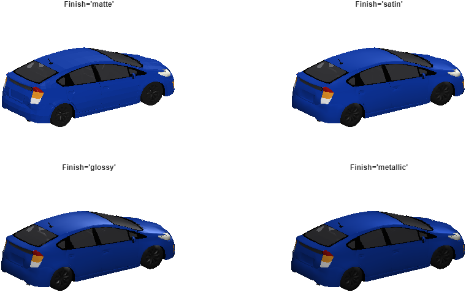

To make your own finish, start from a preset and change one number at a time. The six examples below vary one number from the glossy preset, and the title of each picture gives the exact `Finish=` used:


```matlab
fcn_CarMesh3D_plotVehicle(vehicleMesh, Finish='glossy');                 % a preset
fcn_CarMesh3D_plotVehicle(vehicleMesh, Finish=[0.30 0.65 1.00 60 1.0]);  % glossy, sharper highlight
fcn_CarMesh3D_plotVehicle(vehicleMesh, Finish=[0.30 0.55 1.00 20 0.3]);  % metallic
```

Highlights only appear where a light reflects toward the camera, so whether you see them depends on the lights and the view. Rotate the view to find them.

### Shading: flat or smooth

`FaceLighting=` sets how the lighting is spread across each face:

- `'flat'`: one shade per face. Gives a crisp low-poly look, but highlights appear as single bright faces.
- `'gouraud'`: the shade blends smoothly from corner to corner. Shiny finishes need this to look smooth.
- `'auto'` (default): `'flat'` for the matte finish, `'gouraud'` for the others.
- `'none'`: no lighting at all; every face is drawn in its plain color. This is how lights that are switched on are drawn, so they look like they glow.


### Lights in the scene

With `SceneLights='auto'` (the default), the first vehicle plotted in an axes adds two lights:
- a white **main light** from above, to the front-left of the default view (`light('Style','infinite','Position',[-1 -2 3])`);
- a dim gray **fill light** from the other side, so shadowed faces are not black (`Position [2 1.5 1]`, `Color [0.45 0.45 0.45]`).

With `SceneLights='none'`, no lights are added, so you can place your own with MATLAB's `light` and `camlight`:

```matlab
h = fcn_CarMesh3D_plotVehicle(vehicleMesh, Finish='glossy', SceneLights='none');
camlight(h.Axes, 'headlight');                                   % a light at the camera
light(h.Axes, 'Style','infinite', 'Position',[1 1 0.3]);         % a low light from behind
```

A light low and behind the vehicle makes long highlights along the roof (right picture):

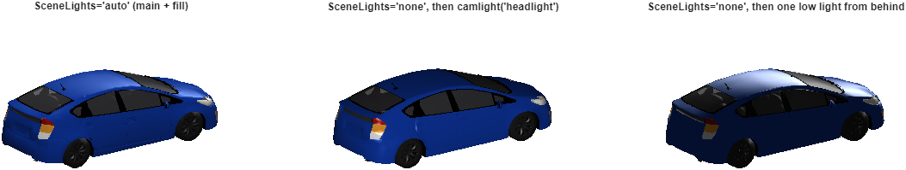

### Warning: the surface normals must point outward

Every lighting calculation uses each face's **normal**, the direction the face points. If the normals point into the vehicle, the lights hit the "inside" of every surface: the vehicle looks dark and dull, and no finish setting makes it shiny.


Things to know:
- **A normal comes from the order of a face's corners** (the right-hand rule: curl your fingers along corners 1, 2, 3 and your thumb is the normal). Reversing two corners flips the normal.
- **Downloaded models often have mixed or flipped normals.** `fcn_CarMesh3D_simplifyMesh` fixes this: it makes neighboring faces agree, then turns each closed surface so it points out. Many bodies are made of separate open panels (hood, doors, roof), and an open panel has no inside or outside to go by, so it then sends a ray from each face in both directions: a face that can only be seen from its back is turned around. **The sign of a wrong panel** is a body that is one color in the file but shows panels of different shades in a plot, which is how this was found on the Transit Connect model (864 faces were turned). Always run it before plotting. Its plot (with `FigNum`) draws every normal as a short red line, and they should all point outward.
- **MATLAB uses the opposite convention.** If MATLAB computes normals itself, they point opposite to the right-hand rule, so highlights end up on the inside. `fcn_CarMesh3D_plotVehicle` avoids this by giving MATLAB the outward normals directly (the patch `FaceNormals` and `VertexNormals` properties). If you draw a mesh with your own `patch` call, do the same, or highlights will not appear.
- **Both sides of a face are lit** (`BackFaceLighting='lit'`), so a mesh with wrong normals still looks roughly right with a matte finish. This hides the problem until you try a shiny finish.

### Mesh edges

`ShowEdges=true` draws the edges of every face, in `EdgeColor=` (any `[r g b]`, default dark gray). Edges help when checking a mesh; leave them off for animation.


## Switchable lights

Two words are kept apart: a **lamp** is hardware (what a light face *is*, set by labeling), and a **signal** is behavior (what the driver or the animation tells the lamps to do). Hazards and braking are signals; there is no "hazard lamp" or "brake lamp".

**Lamp types.** Light faces have a lamp type (`LightTypeNames`, `FaceLightType`):

| Type | Lamp | Lit color |
|---|---|---|
| `'headlight'` | Low beam (both beams, on a vehicle with no high-beam faces) | warm white |
| `'highbeam'` | High beam, a lamp of its own | white |
| `'turnsignal'` | Turn signal; left and right are found from position (Y > 0 is left), so a turn signal is labeled once | amber |
| `'running'` | Front running lights | white |
| `'tail'` | Tail lights (and the brake lights: braking makes them bright) | dark red; bright red braking |
| `'backup'` | Backup (reverse) lights | white |

`fcn_CarMesh3D_labelParts` sets the type from names (`TurnSignal`, `Reverse`, `TailLight`, `HighBeam`...); a light with no recognized name becomes a headlight in the front half and a tail light in the rear half. **High beams are found automatically** where a headlight's faces clearly form two clusters (`AutoHighBeams`, on by default): the cluster nearer the middle of the car (or the upper one) becomes the high beam. This is a starting point; check it in `fcn_CarMesh3D_viewLabels` ("high beam") and fix it in the label painter. Planned (task 8): fog, license plate, marker (side markers, clearance lamps), and warning lamps (beacons, light bars).

**One lamp, several functions.** A lamp that is tail, brake, and turn signal at once (common on US cars) keeps one type and lists the others in `FaceLightFunctions` (M x number of types, logical), set with `fcn_CarMesh3D_editLabels`'s `AlsoLightTypes`. It glows in the color of the first function that is on: turn signal, tail, high beam, low beam, running, backup (a turn signal that is also a tail light flashes red).

**Clear covers over lamps.** A clear cover lying over a lamp lens is labeled as that lamp *and* as glass (`FaceAlsoParts`, M x number of parts, logical): it is drawn as glass while the lamp is off, and lit while it is on.

**Switching the lights.** `LightStates` is a structure; leave out a field to keep that light off:

| Field | Values | Signal |
|---|---|---|
| `Headlights` | `'off'`, `'low'`, `'high'` | Headlights (`'high'` is both beams) |
| `LowBeam`, `HighBeam` | `true` / `false` | Each beam alone (overrides `Headlights` for it) |
| `TurnLeft`, `TurnRight` | `true` / `false` | Turn signals (blink them in your loop; both together are the hazards) |
| `Running` | `true` / `false` | Front running lights |
| `Tail` | `'off'`, `'on'`, `'brake'` | Rear lights: dim red when on, bright red when braking |
| `Backup` | `true` / `false` | Backup (reverse) lights |

A light that is on is drawn unshaded (`FaceLighting='none'`) in a bright color, so it appears to glow. Blinking is just switching a light with time:

```matlab
blinkOn = mod(t, 0.8) < 0.4;                                        % 0.4 s on, 0.4 s off
lightStates = struct('Headlights','low', 'Tail','on', 'TurnLeft',blinkOn);   % left signal
lightStates = struct('TurnLeft',blinkOn, 'TurnRight',blinkOn, 'Tail','brake'); % hazards, braking
lightStates = struct('LowBeam',false, 'HighBeam',true);              % high beams alone
fcn_CarMesh3D_plotVehicle(vehicleMesh, LightStates=lightStates, PlotHandles=h, FigNum=-1);
```

Flash patterns for warning lamps and hazards (steady, single, double, alternating, rotating) belong to the animation inputs, not the mesh; they are planned for after the animator is integrated.

These are easiest to see at night (see [Night scenes](#night-scenes)).

| Signals, hazards, backing up | Headlights off, low, high |
|---|---|
|  |  |

## Night scenes

Lights are much easier to see at night. Two options make a night scene:

```matlab
fcn_CarMesh3D_plotScene(GroundExtent=[-40 60 -40 40], Cubes=cubes, TimeOfDay='night');   % scene first
h = fcn_CarMesh3D_plotVehicle(vehicleMesh, Finish='glossy', LightEffects=true);
% ... then the usual animation loop, switching LightStates
```

**`TimeOfDay='night'`** in `fcn_CarMesh3D_plotScene` makes a dark sky and dark asphalt ground, dims the axes ambient light (`AmbientLightColor`), and adds two dim, bluish "moonlight" lights. Plot the scene before the vehicle: the axes then already has lights, so `fcn_CarMesh3D_plotVehicle` does not add its bright daytime lights.

**`LightEffects=true`** in `fcn_CarMesh3D_plotVehicle` fakes light shining out of the lamps. MATLAB `light` objects cannot make a headlight beam: they shine in every direction, do not get dimmer with distance, and cast no shadows. So, as in many video games, the light is *drawn* instead:

| Effect | How it is made | Shown when |
|---|---|---|
| Glow around a lamp | A copy of the lamp's faces pushed 2.5 cm outward along their normals, in the lamp's color, 35% opaque, unlit | That lamp is on |
| Low-beam pool | A fan-shaped grid on the ground ahead, 15 m long, widening 16° each side. Each vertex has its own transparency (`FaceVertexAlphaData` with `FaceAlpha='interp'`): it rises quickly near the lamps and fades to clear at the far end and at the sides | `Headlights` is `'low'` or `'high'` |
| High-beam pool | The same, 40 m long and narrower (6°), added on top of the low beam | `Headlights` is `'high'` |
| Tail and brake pools | Short, wide red fans behind the car: faint when `Tail='on'`, stronger when `Tail='brake'` | `Tail` |
| Backup pool | A white fan behind the car, 6 m long | `Backup` is true |
| Turn-signal pools | A small fan at that side's front corner (amber) and rear corner (red), placed from the turn-signal lamps, or from the headlights and tail lights | `TurnLeft` or `TurnRight` is true |

The pools are flat on the ground and ride with the vehicle's ground frame, so they stay on the ground when the body rolls or pitches. They do not light up other objects such as cubes. Each pool sits at a slightly different height (1 to 2.5 cm) so that two pools that are on at the same time do not flicker (z-fighting). The sizes, colors, and transparencies are in one table in `fcn_INTERNAL_makeLightEffects` in `fcn_CarMesh3D_plotVehicle.m`; change them there to change the look.


**To check one vehicle's lamps at night**, open it in `fcn_CarMesh3D_viewLabels` (or the label painter) and tick **Nighttime view**: the same scene as the animator's light check, with a lamp list to switch each lamp, and **Show** boxes to take the glass away and see the bulbs.

| Headlights off, low, high | Signal, change lanes, hazards and brake, back up |
|---|---|
| 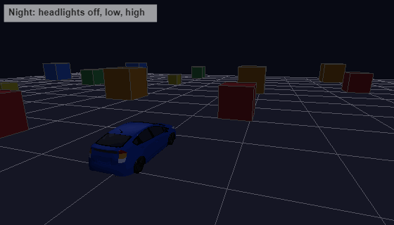 |  |

## Hidden faces (never deleted)

Sometimes part of a download should not be seen: a hard top taken off a convertible, a rear wiper, a stand or a stray piece. **CarMesh3D never deletes such faces from a finished mesh; it hides them.** A deleted face would leave a hole that no tool downstream could repair, and the same vehicle name would mean two different shapes. A hidden face keeps its part, lamp type, and color, and stays in `vehicleMesh`:

- `FaceHiddenSet` (M x 1): 0 for a shown face, else the number of its **hidden set**;
- `HiddenSetNames` (cell): each set's name, such as `'hard top'` or `'hidden'`.

**Hiding and showing faces.** In the label painter, pick **hide**, type the set's name in **Hide as**, and paint the faces; **unhide** shows them again (tick **Show hidden faces** to see them first). In a script, the same edits are `fcn_CarMesh3D_editLabels` edits:

```matlab
edits = {struct('Name','top off', 'Material','HardTop', 'Hide','hard top'), ...
         struct('Name','wiper back', 'Material','Wiper', 'Unhide',true)};
vehicleMesh = fcn_CarMesh3D_editLabels(vehicleMesh, Edits=edits);
```

Edits files written before hiding existed used `Part='delete'`; such an edit now hides its faces in the set `'hidden'`.

**What hidden faces do downstream:**

| Where | Hidden faces |
|---|---|
| `fcn_CarMesh3D_plotVehicle` | Not drawn. Each set is a patch of its own, switched off, so it costs nothing to draw. `ShowHidden={'hard top'}` (or `true` for all) switches a set on, also on the fast path, so an animation can put the top up when it starts to rain. A hidden lamp does not light |
| Measuring: `validateMesh`, `makeOutline2D`, `makeDetailLevels`, `checkGroundContact`, `compareToOriginal` | Left out: they measure the vehicle **as shown**, through `fcn_CarMesh3D_visibleMesh` |
| The fit to the specs (`fitMeshToSpec`) | Kept: the vehicle is sized as the real car, with every piece, so a convertible compares to the manufacturer's data |
| `fcn_CarMesh3D_viewLabels`, the label painter | Listed as "hidden (not drawn)", out of view until ticked |

**Warnings.** Every build runs `fcn_CarMesh3D_checkHiddenFaces`, which prints a warning (and writes it to `check_summary.txt`) when:

1. more than 10% of the faces are hidden;
2. the hidden faces change a dimension by more than 1 cm. Both values are given. For example, a hidden muffler that hangs below the body: "GroundClearance: 0.140 m shown; 0.080 m with the hidden faces";
3. hidden faces reach outside the shown vehicle's bounding box. Each set, side, and distance is given. **This matters for collision checks**, which use a vehicle's bounding box: if the box were taken from all of the mesh's vertices, a hidden piece (a hard top, a tow bar) would make collisions with something nobody can see, which is very hard to debug. Take the box from the shown faces (`fcn_CarMesh3D_visibleMesh`), or keep hidden pieces inside the shown vehicle.

## Checking against a side photo

The dimension table from `fcn_CarMesh3D_validateMesh` checks lengths, but not shape. To check the shape, `fcn_CarMesh3D_plotSideImage` puts a side-view picture of the real vehicle on a vertical plane through the vehicle's centerline (Y = 0), and draws the vehicle partly see-through around it:

```matlab
overlayHandles = fcn_CarMesh3D_plotSideImage('Data/BodyStyles/Liftback/2013_Toyota_Prius_Four/sideView.jpg', vehicleMesh, FigNum=1);
% First time: click the REAR wheel center, then the FRONT one. The values are printed,
% so later runs can skip the clicking:
overlayHandles = fcn_CarMesh3D_plotSideImage('Data/BodyStyles/Liftback/2013_Toyota_Prius_Four/sideView.jpg', vehicleMesh, ...
    WheelCentersPixels=[1210 655; 395 652], FigNum=1);
```

**How the picture is placed.** The two wheel centers in the picture must land on the mesh's two axles, at wheel-center height (half the tire diameter). Two points set:
- the **scale**: meters per pixel = wheelbase / (pixel distance between the wheel centers);
- a small **rotation**, if the picture is tilted (`TiltDegrees` in the output);
- the **position**.

If the vehicle faces left in the picture, the picture is flipped left-to-right first, so the front always points to +X.

**One plane works from both sides.** A picture on a plane looks mirrored from the back, and a vehicle's left side is (nearly) the mirror image of its right side. So the same picture lines up from both sides; only lettering reads backwards from the far side.

| Option | Default | Use |
|---|---|---|
| `WheelCentersPixels` | `[]` (click) | `[colRear rowRear; colFront rowFront]` in pixels, row 1 at the top |
| `VehicleAlpha` | `0.4` | How solid the vehicle is drawn, so the picture shows through |
| `PlaneY` | `0` | Move the picture outside the vehicle (e.g. `-1.5`) to see it in front of the mesh |
| `ImageAlpha` | `1` | Make the picture see-through (useful with `PlaneY` outside the vehicle) |
| `ShowVehicle`, `SetView` | `true` | Also draw the vehicle; look from the side without perspective |

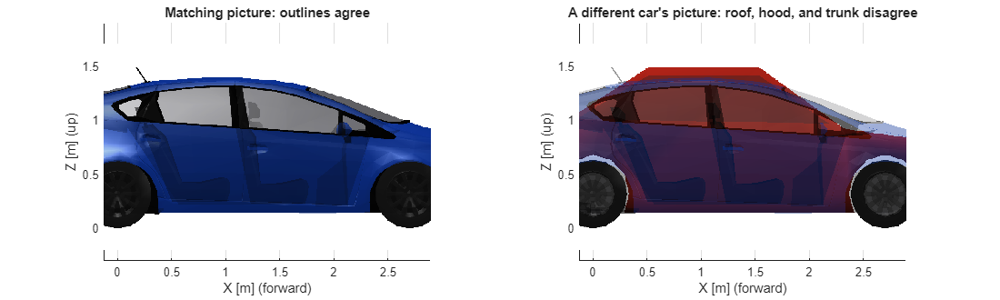

In the left picture, the outlines agree. On the right, a picture of a different body shape (the sample sedan, stretched to the same wheelbase) shows where it disagrees with the Prius: the roof line, hood, and trunk.

**Tips for photos.** Use a photo taken from far away with a zoom lens, level with the wheel centers and square to the side of the vehicle. Close-up photos have perspective (the near wheel looks bigger and the ends of the car shrink), which no flat overlay can remove. Manufacturer press photos and car-review "profile" shots often work well; check their license before adding them to the repository.

## Fixing labels

Downloaded models are labeled from their material and group names, and those names are often unhelpful. In the 2010 Prius model, the headlights and taillights use the same material as the black bumper trim, so they are labeled trim. `fcn_CarMesh3D_editLabels` fixes this in three ways.

**1. By clicking** (to find what needs fixing):

```matlab
[vehicleMesh, edits] = fcn_CarMesh3D_editLabels(vehicleMesh, Interactive=true);
```

A window shows each part and light type in its own color. Click on the vehicle to select faces: a whole connected piece (the default), a single face, a whole material, or a whole group. Click again to unselect. Choose a label from the menu, press **Apply label to selection**, and repeat. **Undo last label** takes back the last change, and **Rotate view** turns the vehicle (turn it off to click again). Press **Done** when finished. The edits are returned, and also printed as script lines, which brings us to the second way.

**2. By region, in a script** (so the same fixes are made every time):

```matlab
edits = {};
edits{end+1} = struct('Name','headlight housings and lenses', ...
    'Region',[2.90 3.45 0.45 0.82 0.55 0.82], 'BothSides',true, ...
    'Material','color_notint|glass_ex', 'LightType','headlight');
edits{end+1} = struct('Name','tail lights', ...
    'Region',[-0.80 -0.45 0.55 0.80 0.95 1.12], 'BothSides',true, ...
    'Material','color_notint', 'LightType','tail');
vehicleMesh = fcn_CarMesh3D_editLabels(vehicleMesh, Edits=edits);
```

**3. By painting, in the Model Reviewer or the label painter** (the usual way for a finished vehicle):

```matlab
fcn_CarMesh3D_reviewVehicle('2009_Honda_Fit_Sport');   % every check of one vehicle, with the painter in its Labels panel
fcn_CarMesh3D_paintLabels('2009_Honda_Fit_Sport');     % the painter alone
fcn_CarMesh3D_viewLabels('2009_Honda_Fit_Sport');      % look only
```

`fcn_CarMesh3D_viewLabels` shows the mesh in label colors, with the vehicle's photos beside it (a dial picks the photo by angle; the photo can be resized from its bottom-left corner). The list beside the model shows each label in its color, with a **Show** box to take a label out of view (to reach faces behind it). **Show mesh boundaries** draws the face edges. The **lamp list** under the labels switches each lamp: by day the lamps are drawn lit on the model; with **Nighttime view**, the scene turns to night (as in the animator's light check) and each lamp throws its light on the ground. Lamps with no labeled faces are marked "(no faces)" and still show where their light would land.

`fcn_CarMesh3D_paintLabels` adds a **Paint as** row: body, glass, trim, interior, wheel, low beam, high beam, tail, running, turn signal, backup, **hide**, and **unhide**. Ctrl+drag paints faces (Ctrl+Shift+drag erases), a click paints one face, and a double-click a whole connected piece; **Mirror to the other side** paints both sides at once. Paint is pending (yellow edges) until **Apply**; **Save** writes the edits to the vehicle's `labelEdits_<ID>.mat` (by face centers, `Points`, so they survive a rebuild), and the next build applies them after simplifying. **Undo**, **Revert to save**, **Revert to start**, and timestamped copies of each save are there too. Nothing is ever deleted: see [Hidden faces](#hidden-faces-never-deleted).

Each edit picks faces with any of these fields (a face must pass all of the ones given), then sets what the edit says:

| Field | Picks faces... |
|---|---|
| `Region` | whose centers are inside the box `[xmin xmax ymin ymax zmin zmax]`, in meters |
| `BothSides` | in `Region` *or* its mirror image across the centerline (for left/right pairs) |
| `Material`, `Group` | whose material or group name matches a regular expression |
| `CurrentPart` | that are now labeled as this part |
| `FaceIndices` | in this list |
| `Points` (with `PointTolerance`) | whose centers are at these points (how the painter saves its edits) |

| Field | Sets... |
|---|---|
| `Part` | the part: `'body'`, `'glass'`, `'wheel'`, `'light'`, `'trim'`, `'interior'` |
| `LightType` | the lamp type (this also makes the part `'light'`) |
| `AlsoLightTypes` | more functions of the same lamp (`FaceLightFunctions`) |
| `AlsoParts` | more parts the faces also belong to, such as `'glass'` for a clear lamp cover (`FaceAlsoParts`) |
| `Color` | the display color |
| `Hide`, `Unhide` | hides the faces in a named set, or shows them again |

Use the clicking tool to find the faces and the printed regions, then paste the regions into your script. The full set of Prius light edits is in `script_demo_CarMesh3D_animation.m`.

## Animation: wheels, steering, slip, and body motion

`fcn_CarMesh3D_fillTrajectory` gives everything needed for each frame. The pose is the position of the **rear axle** and the heading, which is CarMesh3D's vehicle origin, so:

- **Steering** follows exactly from the path's curvature (kinematic bicycle model): `bicycleSteerAngle = atan(wheelbase * curvature)`. This is the angle of one imaginary tire on the centerline; the real left and right tires get different angles from Ackermann steering (below), returned as `SteerAngle` (K x 2, `[left right]`).
- **Wheel spin** is distance traveled divided by tire radius, times `(1 + slip)`:

| `WheelSlip` | Wheels | Use for |
|---|---|---|
| `0` (default) | roll with the ground | normal driving |
| `-1` | do not turn at all | locked brakes, skidding |
| `> 0` (e.g. `2`) | turn faster than the ground moves (3x for 2) | peeling out, wheelspin |

Slip can be one number, one number per wheel `[FL FR RL RR]`, or one row per time step. `Speed` can be a number, one value per time step, or a function of time (e.g. `@(t) min(2*t,10)` to accelerate from rest). Negative speed drives backward.

```matlab
trajectory = fcn_CarMesh3D_fillTrajectory(Path='laneChange', Speed=8, Duration=6, VehicleSpec=vehicleSpec);
h = fcn_CarMesh3D_plotVehicle(vehicleMesh);
for k = 1:length(trajectory.Time)
    fcn_CarMesh3D_plotVehicle(vehicleMesh, Pose=trajectory.Pose(k,:), ...
        WheelSpin=trajectory.WheelSpin(k,:), SteerAngle=trajectory.SteerAngle(k,:), ...
        PlotHandles=h, FigNum=-1);
    drawnow;
end
```

Each wheel has its own transform inside the vehicle's, so wheels spin and the front wheels steer without redrawing the mesh.

### Ackermann steering: inside and outside tires

In a turn, all four wheels roll on circles around one **turn center**, which lies on the line of the rear axle. The inside front tire is closer to the turn center, so it must steer more than the outside tire; otherwise one tire would slide sideways. `fcn_CarMesh3D_calcAckermannSteering` calculates both angles:

| Quantity | Formula |
|---|---|
| Turn radius of the rear axle center | `R = wheelbase / tan(bicycleSteerAngle)` |
| Inside front tire | `atan(wheelbase / (R - track/2))` |
| Outside front tire | `atan(wheelbase / (R + track/2))` |

```matlab
[steerAngles, insideOutsideAngles, turnRadius] = fcn_CarMesh3D_calcAckermannSteering( ...
    deg2rad(20), vehicleSpec.Wheelbase, vehicleSpec.TrackFront, FigNum=1);
rad2deg(steerAngles)    % [left right]: for the 2013 Prius, about [22.1 18.3] degrees
```

`steerAngles(k,:)` can be passed straight to `fcn_CarMesh3D_plotVehicle(..., SteerAngle=steerAngles(k,:))`. `AckermannFraction=` blends from parallel steering (`0`, both tires at the bicycle angle) to full Ackermann (`1`, the default); many real cars use something in between. `fcn_CarMesh3D_fillTrajectory` calls this function for you and also accepts `AckermannFraction=`.


In motion (Step 9 of `script_demo_CarMesh3D_animation.m`): a 5 m radius turn seen from above, with dashed lines from the turn center to each wheel. Each front tire points at right angles to its own line, so the inside (left, blue) tire steers more than the outside (right, red) one.


| Rolling and steering (lane change) | Peel out, then lock up (brake lights on) |
|---|---|
|  |  |

### Body roll, pitch, and heave

The vehicle is drawn as two kinds of rigid frames inside one moving transform:

```
Transform            ground frame: moved by Pose [x y yaw]
├── BodyTransform    sprung mass: body, glass, trim, lights  ← BodyRoll, BodyPitch, BodyHeave
└── WheelTransforms  unsprung mass: the four wheels          ← WheelSpin, SteerAngle
```

The wheels stay on the ground while the body rolls, pitches, and moves up and down on them. CarMesh3D does not calculate these motions; take them from your vehicle dynamics model and pass them in each frame:

```matlab
fcn_CarMesh3D_plotVehicle(vehicleMesh, Pose=pose, WheelSpin=spin, SteerAngle=steer, ...
    BodyRoll=roll(k), BodyPitch=pitch(k), BodyHeave=heave(k), PlotHandles=h, FigNum=-1);
```

| Option | Units | Positive means (ISO 8855) |
|---|---|---|
| `BodyRoll` | rad | rotation about +X: the right side goes down (as in a left turn) |
| `BodyPitch` | rad | rotation about +Y: the nose goes down (as in braking) |
| `BodyHeave` | m | the body moves up |
| `BodyPivot` | m, `[x y z]` | the point the body rotates about; default is midway between the axles, on the centerline, at wheel-center height |

## Motion from a CSV file

Vehicle dynamics simulations usually save their results as a table, one row per time step. `fcn_CarMesh3D_loadMotionCSV` reads such a file and returns everything `fcn_CarMesh3D_plotVehicle` needs at each step. It also takes the motion already in memory, as a table or as a matrix of numbers (with `ColumnNames=`, or in the usual column order), read exactly as a file would be. `fcn_CarMesh3D_saveMotionCSV` writes the same format (a worked example of the convention, and a way to save any motion made in MATLAB).

```matlab
motion = fcn_CarMesh3D_loadMotionCSV('myRun.csv', VehicleSpec=vehicleSpec, FigNum=1);
h = fcn_CarMesh3D_plotVehicle(vehicleMesh);
for k = 1:length(motion.Time)
    fcn_CarMesh3D_plotVehicle(vehicleMesh, Pose=motion.Pose(k,:), ...
        WheelSpin=motion.WheelSpin(k,:), SteerAngle=motion.SteerAngle(k,:), WheelLift=motion.WheelLift(k,:), ...
        BodyRoll=motion.BodyRoll(k), BodyPitch=motion.BodyPitch(k), BodyHeave=motion.BodyHeave(k), ...
        LightStates=motion.LightStates(k), PlotHandles=h, FigNum=-1);
    drawnow;
end
```

**The columns** are listed in [Inputs: what CarMesh3D needs](#inputs-what-carmesh3d-needs), with the [assumptions](#assumptions-behind-the-inputs) behind each. Files with **no header row** are read by naming the columns:

```matlab
motion = fcn_CarMesh3D_loadMotionCSV('legacyRun.csv', SampleTime=0.01, ColumnNames= ...
    {'X','Y','Z','roll','pitch','yaw','U','V','W','roll_rate','pitch_rate','yaw_rate','w1','w2','w3','w4'});
```

**What the reader returns.** It turns `[X Y roadZ roadRoll roadPitch yaw]` into the ground frame (`Pose`, K x 6), gives the body motion relative to it (`BodyHeave = Z`, `BodyRoll = roll − roadRoll`, `BodyPitch = pitch − roadPitch`), and converts the wheels to CarMesh3D's `[FL FR RL RR]` order (`WheelSpin`, `WheelLift`), the steering to `SteerAngle` (`[FL FR]`, with `SteerSource` saying which column it came from), and the light columns to one `LightStates` structure per row.

**How this compares to other tools.** CarSim names the sprung-mass position `Xo`, `Yo`, `Zo`, writes angles in degrees, and labels wheels by side and axle (`L1`, `R1`, `L2`, `R2`). ASAM OSI numbers wheels by axle (0 = front) and then right-to-left along the axle, uses rad/s with the right-hand rule for wheel spin, and has light states (indicator off/left/right/warning; brake light off/normal/strong) that the light columns above follow. Use `_deg` names or `ColumnNames=` to read such files.

| Front: roll and pitch | Inside of the turn: the front wheel lifts | Behind: roll, pitch, and lift |
|---|---|---|
|  |  | 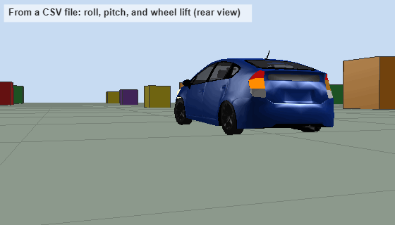 |

(In this example, from Step 8 of `script_demo_CarMesh3D_animation.m`, the body motion is made up and exaggerated in place of a real dynamics model: roll grows with lateral acceleration, pitch follows longitudinal acceleration, and the inside front wheel lifts 10 cm in the tightest part. The three views ride with the vehicle.)

### Checking for body contact with the road

Large roll, pitch, and heave together can push part of the body down to the road, for example a front corner of the bumper in hard braking while turning. `fcn_CarMesh3D_checkGroundContact` checks this at every time step, using the vehicle's own shape:

```matlab
[flagContact, clearance, lowestPoint] = fcn_CarMesh3D_checkGroundContact(vehicleMesh, ...
    motion.BodyRoll, motion.BodyPitch, motion.BodyHeave, Time=motion.Time, FigNum=1);
```

- `flagContact` (N x 1, true/false) is true where the body reaches the road; a warning is printed if any are true, since body damage is likely there unless that part is protected (for example, by a skid plate).
- `clearance` (N x 1, meters) is the height of the lowest body point above the road (negative means it would be below the road surface). `MinimumClearance=` sets a safety margin (default 0).
- `lowestPoint` (N x 3) says which part of the body is lowest, in the vehicle frame.

It moves every body vertex exactly as `fcn_CarMesh3D_plotVehicle` does (roll and pitch about `BodyPivot`, then heave), so what it reports matches what is drawn. The road is treated as flat under the vehicle, and the wheels are not checked.

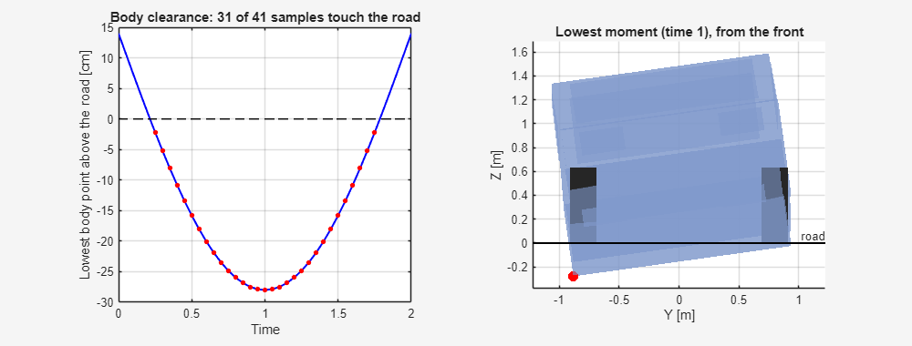

(Made-up, very large body motion: 8° of roll, 6° of nose-down pitch, and 6 cm of drop together push the front right corner below the road.)

## Cameras

`fcn_CarMesh3D_updateCamera` places the camera each frame from the vehicle's pose. With a six-value pose it rides at the vehicle's height (`FollowHeight`, on by default), so it stays above the vehicle on a hilly road; `FollowPitch=true` also tilts it with the vehicle's pitch.

Every camera, however different it looks, is described by the same four things:

1. **Where the camera sits** (`Position`), measured in the world or in the vehicle's frame (`PositionFrame='world'` or `'vehicle'`).
2. **What it looks at** (`Target`), also in the world or the vehicle frame (`TargetFrame`).
3. **How wide it sees** (`FieldOfView`, in degrees; smaller means zoomed in).
4. **Optionally, an orbit** (`OrbitRate`, radians per second): a vehicle-frame camera circles the vehicle.

A **world** point stays put; a **vehicle** point rides along with the car (vehicle frame: X forward, Y left, Z up, origin on the ground below the rear axle). So a world camera with a vehicle target is a person at the roadside turning to follow the car, and a camera with both points in the vehicle frame is bolted to the car or flying behind it.

```matlab
cameraSettings = fcn_CarMesh3D_fillCameraSettings(Mode='chase');                 % a preset
cameraSettings = fcn_CarMesh3D_fillCameraSettings(Mode='kite', FieldOfView=30);  % preset, zoomed in
cameraSettings = fcn_CarMesh3D_fillCameraSettings(Mode='chase', ...              % your own camera
    Position=[5.5 3.5 1.3], Target=[2.2 0 0.35], FieldOfView=40);
% in the animation loop:
fcn_CarMesh3D_updateCamera(cameraSettings, pose, Time=t, AxesHandle=h.Axes, FigNum=-1);
```

The presets:

| `Mode` | Position (frame) | Target (frame) | FOV | GIF |
|---|---|---|---|---|
| `'wideFixed'` | `[-35 -45 30]` (world) | `[0 0 0]` (world) | 35 |  |
| `'roadside'` | `[0 -8 1.5]` (world) | `[1.35 0 0.7]` (vehicle) | 40 | 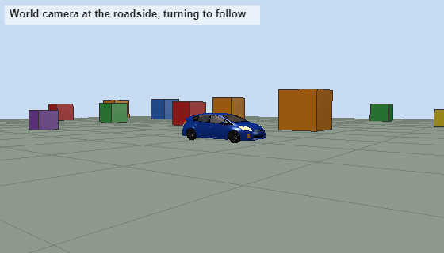 |
| `'overhead'` | `[0 0 60]` (world) | `[0 0 0]` (world) | 40 | 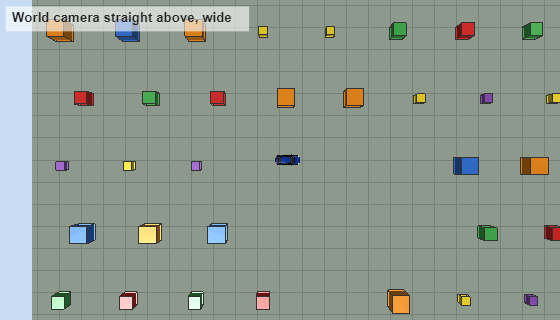 |
| `'overhead'`, `FieldOfView=20` | `[0 0 70]` (world) | `[0 0 0]` (world) | 20 | 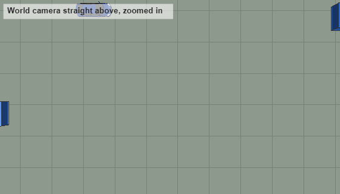 |
| `'chase'` | `[-7 0 2.5]` (vehicle) | `[4 0 1]` (vehicle) | 50 |  |
| `'driver'` | `[1.5 0.37 1.15]` (vehicle) | `[20 0.37 0.9]` (vehicle) | 70 |  |
| `'roof'` | `[0.6 0 1.9]` (vehicle) | `[12 0 0.4]` (vehicle) | 65 |  |
| `'side'` | `[1.35 -7 1.2]` (vehicle) | `[1.35 0 0.7]` (vehicle) | 40 |  |
| `'kite'` | `[-14 0 10]` (vehicle) | `[6 0 0]` (vehicle) | 45 |  |
| `'orbit'` (`OrbitRate` 0.4) | `[-9 0 4]` (vehicle) | `[1.35 0 0.7]` (vehicle) | 45 |  |

(The GIFs use the figure eight from `script_demo_CarMesh3D_animation.m`, with some positions changed there to suit it: the overhead cameras sit above the middle of the figure eight, `[11 -11]`, rather than above `[0 0]`.) Vehicle-frame numbers assume a car about 4.5 m long; scale them for other vehicles. Two tips:

- **Fix the axis limits** to cover the whole scene before animating (`axis([xmin xmax ymin ymax zmin zmax])`), so the axes do not rescale as the camera moves.
- **Give riding cameras something to see.** `fcn_CarMesh3D_plotScene` draws a ground grid and colored cubes; without them, a driver or roof camera shows only an empty plane.

## Saving animations as GIFs

Add one line inside the animation loop, after `drawnow`:

```matlab
fcn_CarMesh3D_saveGifFrame(gcf, 'myAnimation.gif', k, DelayTime=1/12);
```

Frame 1 starts a new file; later frames are added. Each frame is reduced to 256 colors (a GIF limit); by default each frame gets its own 256, so small colored details can shift from frame to frame. `ColorMap='fixed'` uses one standard map for every frame (a 6 x 7 x 6 color cube and 4 grays), `'firstFrame'` reuses frame 1's map, and an N x 3 map uses your own. Smaller figures make smaller files (the demo GIFs are 560 x 320 pixels at 12 frames per second, about 0.5–1.5 MB each). Set `flag_saveGifs = 0` in `script_demo_CarMesh3D_animation.m` to watch without saving.

## Calling convention

All functions follow the IVSG convention: required inputs first, then optional inputs as `Name=Value` pairs.

- `FigNum=[]` (or omitted): no plot, except for `fcn_CarMesh3D_plotVehicle`, which plots into the current figure.
- `FigNum=n`: plot results into figure `n`.
- `FigNum=-1`: fast mode, which skips input checks and plots.
- Input checks can also be turned off for every function with the environment variables `MATLABFLAG_CARMESH3D_FLAG_CHECK_INPUTS` and `MATLABFLAG_CARMESH3D_FLAG_DO_DEBUG`.

**File names:**
- Functions: `fcn_CarMesh3D_<name>.m`.
- Scripts that test a function: `script_test_fcn_CarMesh3D_<name>.m`, next to the function in `Functions`.
- Scripts that demonstrate the code more generally: `script_CarMesh3D_<name>.m` (for example each vehicle's `script_CarMesh3D_vehicle_<ID>.m`). The two overview demos in the root folder keep the `script_demo_` names.

Test-script figures are numbered 1xxxx for demos, 2xxxx for tests, 8xxxx for fast mode, and 9xxxx for bugs. Fail conditions are wrapped in `if 1==0` blocks.

## Tests

Every function `fcn_CarMesh3D_<name>.m` has a test script `script_test_fcn_CarMesh3D_<name>.m` beside it in `Functions` (64 pairs; `fcn_CarMesh3D_saveCache` is tested with `fcn_CarMesh3D_loadCache`). Run one by name, or all of them:

```matlab
script_test_fcn_CarMesh3D_plotVehicle            % one function
testFiles = dir('Functions/script_test_fcn_CarMesh3D_*.m');   % all of them, as scripts
for ii = 1:numel(testFiles), run(fullfile(testFiles(ii).folder, testFiles(ii).name)); end
```

Each test script runs as a plain script, top to bottom: its sections share variables, so run it as a script (not with `runtests`, which runs each section alone and so fails sections that use earlier ones). Its sections are numbered by figure: **1xxxx demos** (these draw the pictures in the [Function reference](#function-reference)), **2xxxx tests**, **8xxxx fast mode**, **9xxxx bugs**; fail conditions are kept in `if 1==0` blocks. A test passes when it reaches its last line, `All tests of fcn_CarMesh3D_<name> passed`.

**Required before a commit:** the tests of every function changed, and of the functions that call it (the [chart](#how-the-functions-fit-together) shows them). **Optional:** the full set, about 10 minutes (the GUI tests open hidden windows; `fcn_CarMesh3D_compareToOriginal`'s takes about 2 minutes).

**Known failures** (both fail on the committed code too, and are on the TO-DO list): `script_test_fcn_CarMesh3D_makeOutline2D` at line 220 (the one-sided interior case), and `script_test_fcn_CarMesh3D_runVehicleChecks` at line 83 (its figure-number check).

These tests check the code. The checks of a *vehicle* (is its mesh right?) are the pictures its build writes: see [Mesh families and the checks to run](#mesh-families-and-the-checks-to-run).

## The vehicle frame

Normalized meshes follow ISO 8855: **X forward, Y left, Z up**, in meters, with the tires touching Z = 0. After fitting, the default origin is on the ground below the center of the rear axle (`Origin='center'` is also available).

Angles follow the right-hand rule about these axes: positive yaw and steering turn left, positive roll lowers the right side, and positive pitch lowers the nose.

## The mesh structure

A finished `vehicleMesh` (here the 2009 Fit: N = 31,293 vertices, M = 22,276 faces) holds:

| Field | Class, size | Set by | Meaning |
|---|---|---|---|
| `Name`, `Source`, `License` | char | import | Where the mesh came from; `License` is the whole LICENSE.txt |
| `Units`, `Frame` | char | import, normalize | `'m'` and `'ISO8855'` (X forward, Y left, Z up) |
| `Vertices` | double, N x 3 | all | Vertex positions [m] |
| `Faces` | double, M x 3 | all | Triangles (indices into `Vertices`) |
| `MaterialNames`, `MaterialColors`, `MaterialAlpha` | cell K x 1, double K x 3, K x 1 | import | Materials from the file (colors NaN if unknown) |
| `FaceMaterialIndex` | double, M x 1 | import | Material of each face |
| `GroupNames`, `FaceGroupIndex` | cell G x 1, double M x 1 | import | Group or object of each face |
| `SeeThroughReliable` | logical, 1 x 1 | readGLB | Whether the download marks its see-through faces |
| `NormalizeInfo` | struct | normalize | Rotation, units scale, and offset used |
| `PartNames` | cell, 6 x 1 | label | `{'body';'glass';'wheel';'light';'trim';'interior'}` |
| `FacePartIndex` | double, M x 1 | label, edit | Part of each face |
| `FaceAlsoParts` | logical, M x parts | label, edit | More parts a face belongs to (a clear lamp cover is light and glass) |
| `FaceWheelIndex` | double, M x 1 | label | 0, or 1 FL, 2 FR, 3 RL, 4 RR |
| `LightTypeNames` | cell, 6 x 1 | label | `{'headlight';'turnsignal';'running';'tail';'backup';'highbeam'}` |
| `FaceLightType` | double, M x 1 | label, edit | Each light face's lamp type (0: not a lamp) |
| `FaceLightFunctions` | logical, M x types | edit | A lamp's other functions (only when a lamp has several) |
| `FaceColors`, `FaceAlpha` | double, M x 3, M x 1 | label | Display color and transparency |
| `TextureColorParts` | cell | label | Parts shown in the download's texture colors |
| `VehicleSpec`, `AxleX`, `FitInfo` | struct, double 1 x 2, struct | fit | Spec used, axle positions, fit details |
| `FaceNormals`, `SimplifyInfo` | double M x 3, struct | simplify | Unit outward normals; face counts |
| `FloorPanel`, `InteriorInfo` | struct | addFloorPanel, labelInterior | What the floor panel and interior steps did |
| `FaceHiddenSet`, `HiddenSetNames` | double M x 1, cell | edit | Hidden faces and their sets (see [Hidden faces](#hidden-faces-never-deleted)) |
| `BuildInfo` | struct | makeBuildInfo | `CarMesh3DVersion`, `MeshVersion`, `Date`, `Script`, `MATLABRelease`, `Settings`, `ExemplarID`, `ExemplarMeshVersion`, `Quality` |

Every per-face field has one row per face, so a function that removes or reorders faces must cut them all; `fcn_CarMesh3D_simplifyMesh` and `fcn_CarMesh3D_visibleMesh` carry every `Face*` field.

## Detail levels for animation

> **Status:** built 2026_11_19 (`fcn_CarMesh3D_makeDetailLevels`, `fcn_CarMesh3D_loadDetailLevels`), with levels for both reference vehicles. Agreed with AnimateCar3D, which will choose among the levels (see its README, "Design: detail levels set by size on screen").

A finished mesh has a few thousand faces: right for a vehicle seen up close, far too many for a vehicle 100 m away that covers a few dozen pixels. For animations with many vehicles, CarMesh3D makes, for each vehicle, a **ladder of lighter versions** of its mesh, each made for a range of sizes on screen, and saves them with the vehicle. The animation chooses among them; CarMesh3D only makes, saves, and checks them.

```matlab
detailLevels = fcn_CarMesh3D_loadDetailLevels('2013_Toyota_Prius_Four');   % from the vehicle's folder, vehicleLevels_<ID>.mat
[detailLevels.Levels.MaxScreenSize]    % 105  74.2  52.5  37.1  26.2  18.6  13.1  9.3 (pixels)
[detailLevels.Levels.Faces]            % 1026  512   256   128   64    32    16    5 (a box)
fcn_CarMesh3D_plotVehicle(detailLevels.Levels(3).Mesh, FigNum=1);         % any level is a normal mesh
```

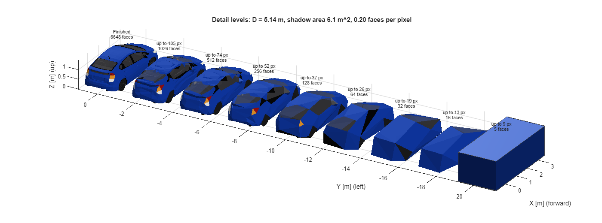

### The size-on-screen standard

Both repositories measure an object's size on screen the same way:

- **D**, the object's size: the diagonal of its bounding box, from (minX, minY, minZ) to (maxX, maxY, maxZ) of its vertices **in its own frame** (so it does not change as the object turns). One number per object, worked out once. It works for any object (vehicle, pedestrian, gate arm, building). Mirrors and antennas count; that only overstates the size a little (the Prius: D = 5.14 m, against a length of 4.48 m), which gives slightly more detail, never less. Long, thin objects (poles, gate arms) are overstated more; that costs a few faces and is accepted.
- **Distance:** from the camera to the **center of that bounding box** (not the vehicle's origin, which is below the rear axle).
- **Size on screen**, in pixels:

  ```
  size = D x (the axes' smaller side, pixels) / (2 x distance x tan(CameraViewAngle / 2))
  ```

  **MATLAB's `CameraViewAngle` spans the smaller side of the axes** (its `Position` in pixels, not the figure). This was measured with axes 800 x 450, 450 x 800, 600 x 600, and 1200 x 400, filling their figures and inside them: in every case a 2 m bar at 10 m covered the pixels predicted from the smaller side (for example 124 px in an 800 x 450 axes, and also 124 px in a 450 x 800 one).

**Reference view** for the examples below: an axes 450 px on its smaller side (an 800 x 450 axes filling its figure) with a 40 degree view angle, where size = D x 618 / distance; a Prius 30 m away is 105 px across by this measure. (A figure 800 x 450 with MATLAB's default axes, as in the AnimateCar3D demos, has axes only 620 x 367 inside it, so there size = D x 504 / distance.)

### The rule: about 0.2 visible faces per pixel

The finished Prius mesh (6648 faces), seen from 10 m in an 800 x 450 figure (default axes, 367 px on the smaller side) with a 40 degree view angle, covers 15315 pixels: about 0.2 visible faces (half its faces) per pixel, or one visible face per 4.6 pixels. That is the density standard, for every vehicle:

```
faces(level) = 2 x 0.2 x A x (S / D)^2
```

where S is the largest size on screen (pixels) the level is made for, and A is the vehicle's mean shadow area (m^2): the area it covers, seen from 12 directions around it at 10, 30, and 50 degrees above it, worked out from the filled solid that the hull method builds anyway (the Prius: 6.13 m^2, close to the 6.03 m^2 that the 15315 pixels above give). Adding up face areas would not do: downloaded meshes have hidden inner surfaces (inner panels, glass behind body), and adding up the faces facing a viewer gives 12.6 m^2 for the Prius. No level has more faces than the finished mesh.

Measured on the Prius (pixels counted in rendered frames): the pixels a vehicle covers fall with the square of its distance (1588 at 30 m and 279 at 70 m, against 1702 and 313 predicted from 15315 at 10 m), and meshes made by this rule keep the density (0.213 visible faces per pixel at both 30 m and 70 m, in the test before the ladder was settled).

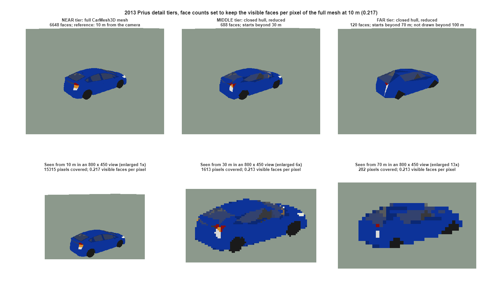

### The ladder

- **The full (finished) mesh is the top level.** It is the only level with wheels that spin and steer, a body that rolls, pitches, and heaves, and lights that switch, so it is drawn whenever the vehicle is larger on screen than the ladder's top (`TopScreenSize`, default 105 px).
- **Reduced levels** go down from there, each made for a size `Step` (default sqrt(2)) times smaller than the one above, so each has about half the faces: small steps, so the change when the animation switches level is small, and a vehicle drawn with the level made for the next size up carries at most about twice the faces it needs. All of them together have fewer faces than the full mesh.
- **The last level is a box** (5 faces), once the rule gives fewer than `MinFaces` (default 15) faces.
- A level that would need as many faces as the finished mesh is not made (for a light mesh, the finished mesh is used there).

The two reference vehicles (the reference view distances are for the Prius):

| Made for sizes up to | Prius faces | Prius distance (reference view) | Transit Connect faces |
|---|---|---|---|
| (larger than 105 px) | 6648 (finished mesh) | within 30 m | 14984 (finished mesh) |
| 105 px | 1026 | 30 m | 1144 |
| 74 px | 512 | 43 m | 572 |
| 52 px | 256 | 60 m | 286 |
| 37 px | 128 | 86 m | 142 |
| 26 px | 64 | 121 m | 70 |
| 19 px | 32 | 171 m | 36 |
| 13 px | 16 | 242 m | 18 |
| 9 px and below | box (5) | from 342 m | box (5) |

(Prius: D = 5.14 m, A = 6.14 m^2, made in 4 s. Transit Connect: D = 5.58 m, A = 8.07 m^2, made in 4 s. Each levels file is about 80 kB.) A bus (D about 12.7 m) gets the same sizes at about 2.5 times the distances, with more faces at each (a larger A).

**The animation uses the coarsest level made for at least the vehicle's current size**, so a vehicle is never drawn with less than the standard density; the ladder's spacing only affects speed and how noticeable a switch is. The animation may also use only some of the levels.

### Making the reduced levels: a closed hull

Reducing a downloaded mesh directly (as `fcn_CarMesh3D_simplifyMesh` does, part by part with `reducepatch`) opens gaps: bodies are made of many separate open panels, and reducing an open panel pulls its edges in. Instead, the vehicle is wrapped in one closed surface first:

1. Sample points over every face of the finished mesh, at most half a voxel apart (voxels of 3 cm, `VoxelSize`).
2. Mark the voxels the points fall in, and grow the marks by half of `GapSize` (default 0.36 m), closing seams, gaps between panels, and openings up to that size, such as a window with no glass in the model.
3. Fill the outside from the edge of the voxel grid; everything not reached is solid. Shrink the solid back by the same amount (undoing the growth). The solid also gives A, the shadow area, and `SolidFraction`, its volume over its bounding box's (about 0.55 for a car or van).

**Why `GapSize` matters:** the first version closed only 6 cm gaps. The Transit Connect model has openings between about 0.2 and 0.3 m across (its front windows), so the outside flowed into the cab: the solid was then only the body panels (17% of the box instead of 54%), and each level was a hollow shell with see-through holes where the windows are, which the face-edge check could not catch (a hollow shell is still closed). Closing openings up to 0.3 m fixed it; the default, 0.36 m, leaves a margin. It barely changes a sealed model (the Prius's solid: 7.41 m^3 with 6 cm gaps closed, 7.44 m^3 with 30 cm). Concave parts narrower than `GapSize` (the gap between a tire and its wheel arch) are filled too, which cannot be seen at the sizes the levels are made for. The test now also checks each level's enclosed volume.
4. Smooth it and take its isosurface: one closed surface.
5. Reduce that surface with `reducepatch` to each level's face count. A closed surface has no open edges to pull in, so no gaps open, and it can go as low as wanted. (The test checks that no edge of any level is used by only one face, and that each level encloses a solid volume; reducing can pinch a thin part, such as a mirror, to an edge shared by four faces, which does no harm.)
6. Give each new face the part, light type, color, and opacity of the outer surface of the finished mesh under it, by a vote of seven points on the face (so a small lamp cannot color a large face). Only the outer surface is used (the sampled points next to the outside), so hidden inner surfaces cannot color the hull; the nearest point is found by looking in the 27 voxels around each point, which is what makes it fast.
7. Outward normals (from the closed surface's signed volume).

Each level is a normal CarMesh3D mesh structure, so `fcn_CarMesh3D_plotVehicle` draws it like any other. Its wheels are part of the hull: `FaceWheelIndex` is 0 everywhere, so the level moves as one piece (the wheel faces keep the wheel part, and their color). Lamp faces keep their light types.


### Window colors: examined, left as they are

A reduced face can only have one color, and reducing does not follow the edges between colors, so close up the windows of the reduced levels look blotchy. A fix was built and tested on the Prius: **windows and lamps as decals.** The hull was colored from the body, wheels, and trim only, and each window pane and lamp of the finished mesh was reduced on its own (keeping its outline), pushed out to 1 cm past the hull (checked at 7 points per face by casting rays, capped at 8 cm), and added within the same face budget, with the glass opaque in a color measured to render like the see-through glass.

Close up, the decal windows are clean; at each level's true size on screen they look nearly the same as without them (at 70 m the only visible change was one tail lamp pixel; at 200 m none). Since a level is never drawn larger than the size it was made for, the close-up view does not occur in an animation, and the decals add real work (an extra making step, ray tests for every pane, panes a few centimeters off the body, slivers still to remove). **So the reduced levels have no decals** (decided 2026_11_19).

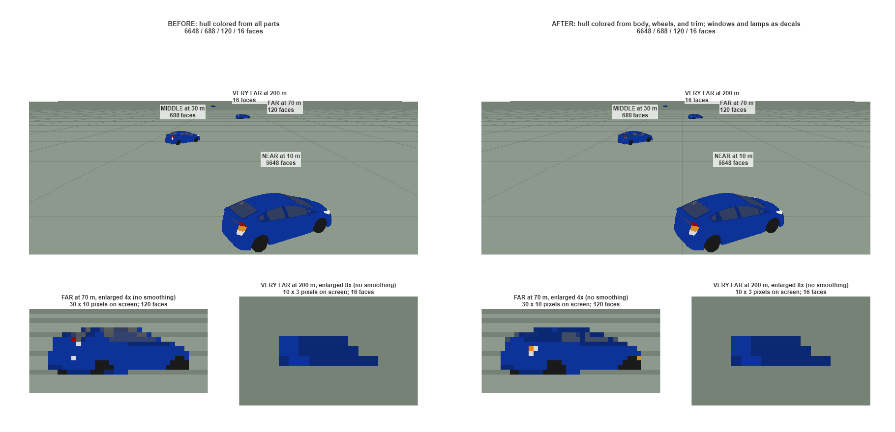


(One more close-up: `Images/detailLevels/windows_beforeAfter_closeUp.png`.)

### The levels file and functions

- **`vehicleLevels_<ID>.mat`** (in the vehicle's folder), next to the finished mesh (separate, so the levels can be remade without touching it), holding `detailLevels`, a structure with:
  - `Levels`: an array, finest first, each with `MaxScreenSize` (pixels: the largest size on screen it is made for), `Faces`, `IsBox`, and `Mesh` (a CarMesh3D mesh structure; empty for the box)
  - `SizeDiagonal` (D, m), `BoxCenter` (the bounding box's center, in the vehicle frame), `BoxSize` (its length, width, and height), `ShadowArea` (A, m^2)
  - `SolidFraction` (the hull's volume over its box's), the settings used (`FacesPerPixel`, `TopScreenSize`, `Step`, `MinFaces`, `VoxelSize`, `GapSize`), `FullFaces`, `Method` (`'closedHull'`), `FormatVersion` (1), `MadeBy`, `MadeOn`, and `MakeSeconds`
- **`fcn_CarMesh3D_makeDetailLevels(vehicleMesh, ...)`** makes the ladder (options `TopScreenSize=105`, `Step=sqrt(2)`, `FacesPerPixel=0.2`, `VoxelSize=0.03`, `GapSize=0.36`, `MinFaces=15`; `FigNum=` shows every level side by side). Each vehicle's script calls it (Step 6b), saves the file, and saves the picture as `checks/check_11_detailLevels.png`.
- **`fcn_CarMesh3D_loadDetailLevels(vehicleID)`** returns the structure (adding `VehicleID`, and `Source`: `'file'` or `'made'`). If a vehicle has a finished mesh but no levels file yet, it warns and makes them (`MakeIfMissing=true`; `SaveIfMade=false`); a levels file older than the finished mesh gives a warning to run the vehicle's script again.
- `fcn_CarMesh3D_findVehicleFiles` also returns `LevelsFile` and `HasLevels`.

AnimateCar3D's contract check will check these functions and fields, so a change on either side is caught.

## Top-down (2D) outlines

For plotting and animating vehicles in 2D (top-down), each vehicle also has XY outlines, made from its finished mesh by `fcn_CarMesh3D_makeOutline2D` and saved by its script as `vehicleOutline_<ID>.mat` (Step 6c; picture `checks/check_12_outline2D.png`). `fcn_CarMesh3D_loadOutline2D(vehicleID)` loads them (or makes them, with a warning, for a vehicle finished before outlines existed).

**The format: XY points, not graphics objects.** Every shape is an N x 2 array of `[x y]` points in meters (MATLAB `double`), a closed polygon (the first point repeated at the end), counterclockwise. No patches or other graphics objects are saved; a 2D plotter builds its own (`fill`, `patch`, `polyshape`) from the points when it draws. The `.mat` file holds one variable, `vehicleOutline`, a structure:

| Field | What it holds |
|---|---|
| `Body` | N x 2: the whole vehicle seen from above, mirrors included (about 40 points; within `Tolerance`, 1 cm, of the mesh's outline) |
| `Windows(k)` | `Name` (`'glass 1'`, ... front to rear) and `Polygon` (N x 2): each piece of glass that faces up (windshield, roof glass, rear window) |
| `Wheels(k)` | `Name` (`'FL'`, `'FR'`, `'RL'`, `'RR'`), `Center` ([x y]), `Length` (the tire's diameter), `Width`, `Steers` (true for the front wheels), and `Rectangle` (5 x 2: the corners around [0 0]) |
| `Lights(k)` | `Type` (`'headlight'`, `'turnsignal'`, `'running'`, `'tail'`, `'backup'`, or `'other'`), `Side` (`'left'` or `'right'`), and `Polygon` (N x 2): each lamp's convex outline from above |
| `Name`, `Units` (`'m'`), `Frame`, `Source` | Descriptions |
| `Length`, `Width`, `PointCount` | The body's size (before thinning) and the number of points in all the polygons (215 for the Prius) |
| `Symmetry` | How far the traced outlines were from symmetric, and what was done about it (see **Symmetry** below) |

**Symmetry.** Vehicles are (nearly always) mirror images about their centerline, but a downloaded model, or the simplified mesh made from it, often is not quite: a window split into slivers, a lamp labeled on one side only, a wheel arch thinned more on one side. So each outline is made symmetric by joining it with its mirror image (`Symmetric=true`, the default): the body takes the wider side at each slice; each window is joined with its twin's mirror image, and window slivers that then overlap become one window; each lamp is joined with its twin of the same type; a window or lamp with no twin gets a mirrored copy. Nothing is cut away. `vehicleOutline.Symmetry` records how much each outline changed (`Body`, `Windows`, `Lights`, `Added`, `Worst`), and a warning (`CarMesh3D:asymmetricOutline`) names any that changed by more than `SymmetryTolerance` (5 percent): those are worth a look at the labels on both sides. `Symmetric=false` keeps the outlines as traced (the warning still names the asymmetric ones). The steering wheel, when interior outlines are added, will be the one exception.

The points are in the vehicle frame, the same as the 3D mesh's (origin on the ground below the rear axle, X forward, Y left), so a 2D pose `[x y yaw]` places them exactly where the mesh would be: turn by yaw, then add x and y. Each wheel's `Rectangle` is kept around [0 0] so a front wheel can be turned by its steer angle first, then moved to its `Center`:

```matlab
vehicleOutline = fcn_CarMesh3D_loadOutline2D('2013_Toyota_Prius_Four');
pose = [10 5 pi/6];                                         % x, y, yaw
turn = @(angle) [cos(angle) sin(angle); -sin(angle) cos(angle)];   % (for row points: points*turn)
place = @(points) points*turn(pose(3)) + pose(1:2);
hold on
for k = 1:4                                                 % wheels first, the body over them
    wheel = vehicleOutline.Wheels(k);
    steer = 0.3*wheel.Steers;                               % (front wheels turned 0.3 rad)
    corners = place(wheel.Rectangle*turn(steer) + wheel.Center);
    fill(corners(:,1), corners(:,2), 'k');
end
body = place(vehicleOutline.Body);
fill(body(:,1), body(:,2), [0.05 0.2 0.6]);
for k = 1:numel(vehicleOutline.Windows)
    glass = place(vehicleOutline.Windows(k).Polygon);
    fill(glass(:,1), glass(:,2), [0.3 0.33 0.38]);
end
axis equal
```

The outlines alone, read back from each vehicle's file (left: filled, as a 2D plot would draw them; right: the saved points):

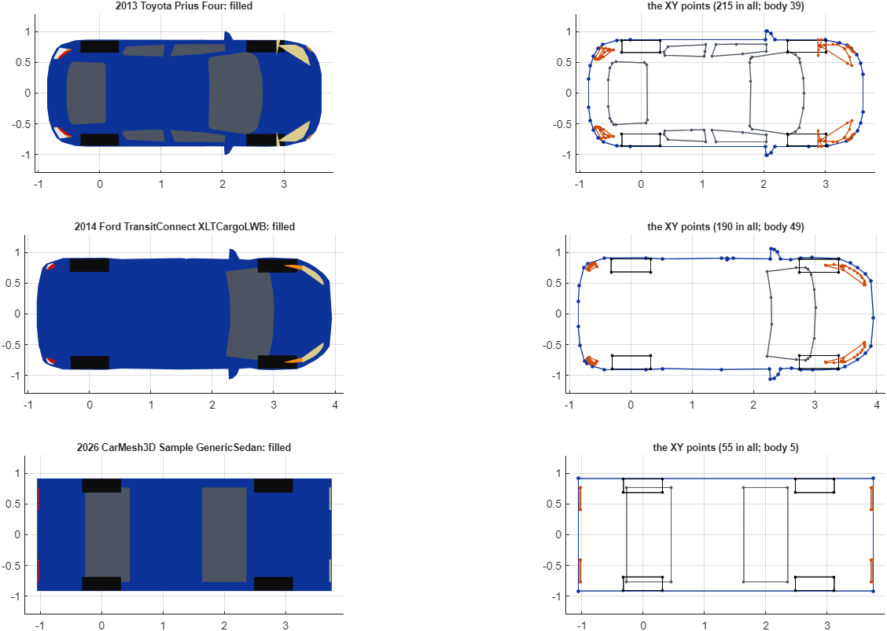

And over each mesh seen from above (faded), to check them against it:

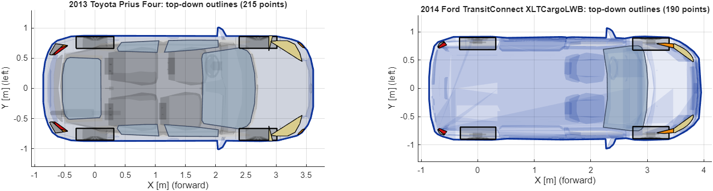

Things to know:
- **Side windows** are seen edge-on from above, so most are left out; curved side glass (the Prius's) faces up enough to show as thin strips along the sides.
- **The wheels** reach inside the body outline, as on the real vehicle (under the wheel arches). Draw them first and the body over them, as above, or only their parts outside the body.
- **A lamp made of several pieces** gives several small, overlapping polygons (the clusters at the Prius's corners).
- **The pictures above** were made before outlines were made symmetric (2026-11-20); the saved outlines of every vehicle have since been remade.
- **The sample car's** body outline is a plain rectangle (5 points): its body is a side profile pushed straight across, so it has no curves seen from above.

## Vehicle specification files

`fcn_CarMesh3D_loadVehicleSpec` reads IVSG `vehicleParameters` `.mat` files. Values are converted to meters using their `_Units` fields:

| vehicleParameters field | CarMesh3D spec field |
|---|---|
| `DistancesLength` | `OverallLength` |
| `DistancesWidth` | `OverallWidth` |
| `DistancesWidthWithMirrors` | `WidthWithMirrors` |
| `DistancesHeight` | `OverallHeight` |
| `DistancesWheelbase` | `Wheelbase` |
| `DistancesFrontTrack`, `DistancesRearTrack` | `TrackFront`, `TrackRear` |
| `DistancesFrontOverhang` | `FrontOverhang` |
| `DistancesGroundClearance` | `GroundClearance` |
| `TireSidewallMarkings` | `TireSize` (and so `TireDiameter`); for different front and rear tires, a cell array `{front, rear}`, read to `TireSize` and `TireSizeRear` (and so `TireDiameterRear`) |
| `TireSidewallMarkingsFront`, `TireSidewallMarkingsRear` (optional) | `TireSize`, `TireSizeRear` (override the above) |
| `EngineType` | `EngineType`: `'sparkIgnition'` (gasoline), `'diesel'`, `'wankel'` (rotary), `'hybrid'`, or `'electric'` (battery electric, no engine) |
| `EngineHybridEngineType` | `HybridEngineType`: for a hybrid, its engine's type (`'sparkIgnition'`, `'diesel'`, or `'wankel'`) |
| `Year`, `Make`, `Model`, `Trim` | `Name` |

**Different front and rear tires** (a staggered fitment, common on sports cars): `TireSize` and `TireDiameter` are the front tires'; `TireSizeRear` and `TireDiameterRear` are the rear's, and equal the front's when only one size is given. Fitting sizes each axle's wheels to its own tires, the dimension check measures each axle (a `TireDiameterRear` row), and wheel spin from speed uses each tire's own radius. `fcn_CarMesh3D_fillVehicleSpec` takes `TireSizeRear=` and `TireDiameterRear=` directly. **The engine type** is carried with the spec for other tools (it does not change the shape); the Prius file says `'hybrid'` (`'sparkIgnition'` engine) and the Transit Connect's `'sparkIgnition'`.

If the file also has `DistancesRearOverhang`, the loader warns when it disagrees with length minus wheelbase minus front overhang.

**Many vehicles at once.** `fcn_CarMesh3D_loadVehicleSpec` also takes a vehicleParameters structure directly, or an **array** of them (all with the same fields), from the workspace or saved in a `.mat` file. It returns an array of specs in the same order:

```matlab
allParameters = [priusParameters, camryParameters, f150Parameters];
vehicleSpecs = fcn_CarMesh3D_loadVehicleSpec(allParameters);
vehicleSpecs(3).Wheelbase
```

Overhangs use the usual definitions: **front overhang** is from the center of the front axle to the front bumper, and **rear overhang** from the center of the rear axle to the rear bumper, so length = front overhang + wheelbase + rear overhang (for the Prius, 0.924 + 2.700 + 0.856 = 4.480 m). (The Prius file's front-overhang description once said "from the center of the rear axle"; it was corrected on 2026_11_19, and the earlier file is kept as `vehicleParameters_2013_Toyota_Prius_Four_OLD.mat`.)

**Vehicle files in `Data`:** each vehicle's parameters are in its own folder as `vehicleParameters_<ID>.mat` (see [Adding a vehicle](#adding-a-vehicle) and [Vehicles available](#vehicles-available)):

| Folder | Vehicle | 3D model |
|---|---|---|
| `Data/BodyStyles/Liftback/2013_Toyota_Prius_Four` | 2013 Toyota Prius Four | A 2010 Toyota Prius (same generation), from Sketchfab (ActsOfDoge) |
| `Data/BodyStyles/CompactCargoVan/2014_Ford_TransitConnect_XLTCargoLWB` | 2014 Ford Transit Connect XLT Cargo Van, long wheelbase | From Sketchfab (CC-BY, tonielpro520). Sources and estimates for each parameter value: `vehicleParameters_sources.md` in that folder |

## Finding models

- **CC0 (no attribution needed):** Kenney.nl, OpenGameArt.org, and itch.io (search "low poly car" and filter by license). These are mostly generic body types; scaling a generic sedan to a specific car's dimensions works well for plots.
- **Sketchfab:** many specific production models are available. Filter by "Downloadable," check the license (usually CC-BY, which requires attribution), and expect dense meshes that need `TargetFaces`.
- OBJ and STL are read directly. FBX, glTF, GLB, and .blend are converted through Blender, which writes Z-up axes. After converting, normalize with `UpAxis='+z'` and check the plot to find the forward axis (often `'-y'` or `'+y'`).
- Very old ASCII FBX files (version 6.1 and earlier) can't be read by Blender.
- **Always check the normalize plot.** Part names in downloaded files can be misleading: a part named "Front" can turn out to be at the rear. The red X arrow must point at the front bumper (headlights, not the wing or taillights).
- **Textures are not read** (yet: the original downloads, with their textures, are kept in each vehicle's `model` folder in case a later version uses them). Many downloaded models color their surfaces with texture images (materials named `*_Baked`, or all materials the same gray). Use `UseMaterialColors=false` and `BodyColor=` in `fcn_CarMesh3D_labelParts` to get one clean color per part, and `PartColors=` to choose any part's color (e.g. `PartColors={'body',[0.05 0.2 0.6]; 'glass',[0.3 0.3 0.32]; 'trim',[0 0 0]}`, with `GlassAlpha=0.85` for nearly opaque glass; see Step 10 of the demo). Use `PartRules=` when part names aren't recognized or are misleading (e.g. `PartRules={'17in','wheel'; 'Bumper_Front','body'}`).
- **Mirrors and width.** Published widths usually exclude mirrors. `fcn_CarMesh3D_fitMeshToSpec` has `WidthReference=`:
  - `'all'` (default): fit the whole model to `OverallWidth`.
  - `'body'`: fit only the body faces, when mirrors are labeled trim.
  - `'mirrors'`: fit the whole model to `WidthWithMirrors`, when the mirrors are part of the body mesh. This is what the 2010 Prius model needs; the body width at the front axle then comes out at 1.749 m vs. the spec's 1.745 m.
- Simplifying below the model's face count can shave a little off the wheels and roof (e.g. 0.2–0.5% in the demo at 3000 faces).
- Some models have no separate glass, so there is nothing to make transparent.
- Wheel-named parts near the car's centerline (axles, drive shafts) are labeled trim automatically so they don't throw off the wheel positions.

## Function reference

Each function has a test script of the same name with `script_test_` in front (in `Functions/`); the test script is the best example of its use, and the picture under each entry is the first figure its test draws (a window's picture for the GUIs). Click an entry to open it: what the function does, its call (FORMAT), its inputs, options and outputs (name, meaning, MATLAB class, size), and the assumptions it makes.

Rules shared by every function, so they are not repeated below:

- **Options** are `Name=Value` pairs after the required inputs, in any order; an option not given takes its default.
- **`FigNum`** (option, double, 1 x 1 or empty) is always last: `[]` (the default) means no plot; a number plots into that figure; `-1` is **fast mode**, with no input checks and no plots (for use inside loops).
- **Flags** (options named `...=flag`, or `Show...`, `Wait`, `Visible`) are logical 1 x 1: `true` turns the behavior on.
- **Lengths are meters** and the mesh is in the CarMesh3D vehicle frame (x forward, y left, z up, origin on the ground under the middle of the rear axle), unless an entry says otherwise.
- **Debug switches:** the environment variables `MATLABFLAG_CARMESH3D_FLAG_CHECK_INPUTS` and `MATLABFLAG_CARMESH3D_FLAG_DO_DEBUG` turn input checks and debug printing on or off for every function.
- **Hidden faces:** functions that measure (validate, outlines, detail levels, ground contact, comparison) use only the shown faces, through `fcn_CarMesh3D_visibleMesh`; the fit and the drawing functions keep every face (see [Hidden faces](#hidden-faces-never-deleted)).

### Gather the inputs

<details><summary><b><code>fcn_CarMesh3D_loadVehicleSpec</code></b> (test: <code>script_test_fcn_CarMesh3D_loadVehicleSpec.m</code>): Loads one or many vehicle specifications, from a .mat file or from a structure already in the workspace, and returns CarMesh3D vehicle specification structures (the same structure made by fcn_CarMesh3D_fillVehicleSpec).</summary>

Loads one or many vehicle specifications, from a .mat file or from a structure already in the workspace, and returns CarMesh3D vehicle specification structures (the same structure made by fcn_CarMesh3D_fillVehicleSpec). Two kinds of structures are read (listed in the function's header).

```matlab
vehicleSpec = fcn_CarMesh3D_loadVehicleSpec(specSource,...
    (BodyColor=[r g b]),...
    (FigNum=figNum))
```

| Variable | Kind | Meaning | Class | Size |
|---|---|---|---|---|
| `specSource` | input | the full or relative path to a .mat file, or a structure (or array of structures) of either kind above. | char or struct | 1 x n, or 1 x N |
| `BodyColor` | option | a 1 x 3 RGB paint color (values from 0 to 1) to add to the spec, since vehicleParameters files do not store a color. Default is [] (none). | double | 1 x 3 |
| `FigNum` | option | a figure number to plot the dimensioned specification (for an array, the first vehicle's). If empty or omitted, no plot is made. Default `[]`. | double | 1 x 1 (or empty) |
| `vehicleSpec` | output | a CarMesh3D vehicle specification structure, with Source set to the file name (or '(structure)'), or an array of them (the same size as the input array). | struct | 1 x 1 |

**Assumptions:** The file holds either a CarMesh3D spec or a vehicleParameters structure (the IVSG format); lengths are converted to meters.

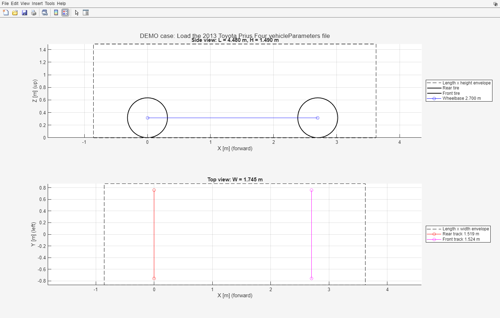

</details>

<details><summary><b><code>fcn_CarMesh3D_fillVehicleSpec</code></b> (test: <code>script_test_fcn_CarMesh3D_fillVehicleSpec.m</code>): Creates a vehicle specification structure that holds the published geometric data for one vehicle: overall length, width, height, wheelbase, track widths, tire size, and similar values.</summary>

Creates a vehicle specification structure that holds the published geometric data for one vehicle: overall length, width, height, wheelbase, track widths, tire size, and similar values. This structure is the "ground truth" that every mesh in the CarMesh3D library is scaled to agree with. All lengths are stored in meters.

```matlab
vehicleSpec = fcn_CarMesh3D_fillVehicleSpec(...
    (Preset=presetName),...
    (Name=nameString),...
    (OverallLength=L), (OverallWidth=W), (OverallHeight=H), (WidthWithMirrors=WM),...
    (Wheelbase=WB), (TrackFront=TF), (TrackRear=TR),...
    (TireSize=tireSizeString), (TireDiameter=D),...
    (TireSizeRear=tireSizeString), (TireDiameterRear=D),...
    (FrontOverhang=FOH), (GroundClearance=GC),...
    (EngineType=engineString), (HybridEngineType=engineString),...
    (BodyColor=[r g b]), (Source=sourceString),...
    (FigNum=figNum))
```

| Variable | Kind | Meaning | Class | Size |
|---|---|---|---|---|
| `Preset` | option | a character string naming a set of default values to start from. Allowed values are '' (the default, no preset), 'genericSedan', and 'genericSUV'. Default `''`. | char | 1 x n |
| `Name` | option | a character string naming the vehicle, for example '2024 Example Sedan'. Default is '' or the preset name. | char or string | 1 x n |
| `OverallLength` | option | bumper-to-bumper length, in meters. Default `[]`. | double | 1 x 1 |
| `OverallWidth` | option | body width, in meters. Note: most published widths EXCLUDE the side mirrors. If a mesh includes mirrors, the fitted body will be slightly narrow; see TO-DO in fcn_CarMesh3D_fitMeshToSpec. Default `[]`. | double | 1 x 1 |
| `OverallHeight` | option | ground to top of roof, in meters. Default `[]`. | double | 1 x 1 |
| `WidthWithMirrors` | option | width including the side mirrors, in meters. Stored for reference (and for future mirror-aware fitting). Default `[]`. | double | 1 x 1 |
| `Wheelbase` | option | front axle to rear axle distance, in meters. Default `[]`. | double | 1 x 1 |
| `TrackFront` | option | center-to-center distance between the front tires, in meters. Default `[]`. | double | 1 x 1 |
| `TrackRear` | option | center-to-center distance between the rear tires, in meters. If empty and TrackFront is given, TrackRear = TrackFront. Default `[]`. | double | 1 x 1 |
| `TireSize` | option | a standard tire size string, for example '225/45R17' or 'P225/45ZR17': the FRONT tires' size, and the rear tires' too unless TireSizeRear is given. Default `[]`. | char | 1 x n |
| `TireDiameter` | option | overall tire diameter, in meters: the front tires' (and the rear's, unless TireDiameterRear or TireSizeRear is given). If given, this takes priority over the value computed from TireSize. Default `[]`. | double | 1 x 1 |
| `TireSizeRear` | option | the rear tires' size, for vehicles with different front and rear tires (a staggered fitment). Default: TireSize. | char | 1 x n |
| `TireDiameterRear` | option | the rear tires' overall diameter, in meters. If given, this takes priority over the value computed from TireSizeRear. Default: from TireSizeRear, else TireDiameter. | double | 1 x 1 |
| `EngineType` | option | what powers the vehicle: 'sparkIgnition' (gasoline), 'diesel', 'wankel' (rotary), 'hybrid', or 'electric' (battery electric, no engine). Default '' (not given). Not used for the shape; carried with the spec. | char | 1 x n |
| `HybridEngineType` | option | for EngineType 'hybrid', the hybrid's engine: 'sparkIgnition', 'diesel', or 'wankel'. Default ''. | char | 1 x n |
| `FrontOverhang` | option | front bumper to front axle distance, in meters. If empty, later steps keep the axle placement of the mesh (or assume equal front and rear overhangs). Default `[]`. | double | 1 x 1 |
| `GroundClearance` | option | ground to lowest point of the body, in meters. Used only for validation. Default `[]`. | double | 1 x 1 |
| `BodyColor` | option | a 1 x 3 RGB color, each value from 0 to 1, for the body paint. Used by fcn_CarMesh3D_labelParts if given. Default `[]`. | double | 1 x 3 |
| `Source` | option | a character string noting where the data came from (a URL or citation). Strongly recommended for student work. Default `[]`. | char | 1 x n |
| `FigNum` | option | a figure number to plot a dimensioned side and top view of the specification. If empty or omitted, no plot is made. Default `[]`. | double | 1 x 1 (or empty) |
| `vehicleSpec` | output | a structure with the fields Name, Units ('m'), OverallLength, OverallWidth, WidthWithMirrors, OverallHeight, Wheelbase, TrackFront, TrackRear, TireSize, TireDiameter, TireSizeRear, TireDiameterRear, FrontOverhang, RearOverhang, GroundClearance, EngineType, HybridEngineType, BodyColor, Source TireSize and TireDiameter are the front tires'; TireSizeRear and TireDiameterRear the rear's (the same as the front's unless given). | struct | 1 x 1 |

**Assumptions:** Published values are given in meters (tire sizes as text, such as 'P185/55R16'); values not given stay NaN and are skipped by the fit and the checks.

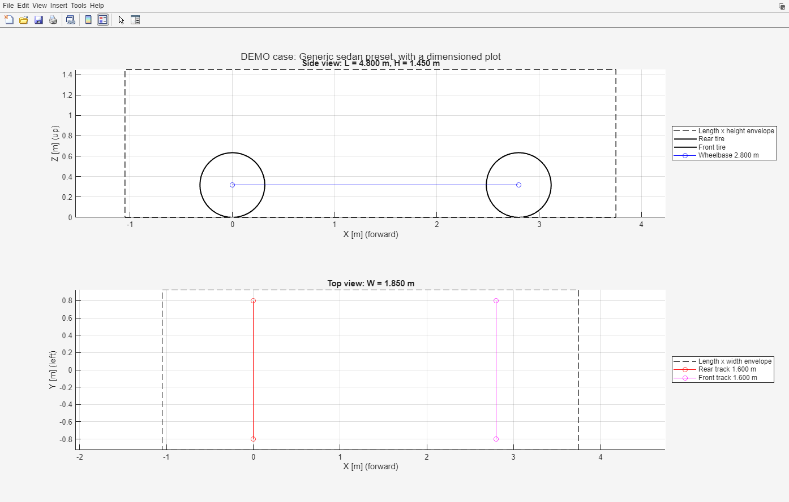

</details>

<details><summary><b><code>fcn_CarMesh3D_findVehicleFiles</code></b> (test: <code>script_test_fcn_CarMesh3D_findVehicleFiles.m</code>): Returns the standard file and folder names for a vehicle stored in the Data folder, or lists every vehicle stored there.</summary>

Returns the standard file and folder names for a vehicle stored in the Data folder, or lists every vehicle stored there. This function is the CarMesh3D naming convention, in code.

```matlab
vehicleFiles = fcn_CarMesh3D_findVehicleFiles(vehicleID,...
    (BodyStyle=style), (DataFolder=folder), (FigNum=figNum))
```

**Assumptions:** This name is the vehicle ID, and it must be used by only one folder.

| Variable | Kind | Meaning | Class | Size |
|---|---|---|---|---|
| `vehicleID` | input | the vehicle ID, such as '2013_Toyota_Prius_Four', or '' (empty) to list every vehicle folder below the Data folder. | char or string | 1 x n |
| `BodyStyle` | option | for a NEW vehicle (no folder yet), the body style it will be filed under, such as 'sedan' or 'compactCargoVan': its paths are then in Data\BodyStyles\<Style>\<ID>. | char | 1 x n |
| `DataFolder` | option | the Data folder. Default [] uses the Data folder next to the Functions folder that holds this function. | char or string | 1 x n |
| `FigNum` | option | if given (and not -1), the vehicles are also printed as a table in the command window. If set to -1, input checking is skipped (fast mode). Default `[]`. | double | 1 x 1 (or empty) |
| `vehicleFiles` | output | a structure (or, when listing, a structure array, one element per vehicle folder) with fields: ID, Year (number), Make, Model, Trim, Name ('2013 Toyota Prius Four') Folder, ParametersFile, ScriptFile, MeshFile, LevelsFile, OutlineFile, ModelFolder, ChecksFolder: full paths, following the convention above (ModelFolder is the vehicle's folder itself when it has no model subfolder) ModelFiles: the 3D model files found (glb, gltf, obj, stl, ply, fbx, blend) in ModelFolder and its source subfolder, as full paths in a cell array BodyStyle: the style ID from the folder it is filed under, such as 'sedan' ('' if not under Data\BodyStyles) BodyStyleFolder: that folder's name, such as 'Sedan' IsSample: true for a vehicle under Data\Samples Found: true if the vehicle's folder exists HasParameters, HasScript, HasMesh, HasLevels, HasOutline: true if those files exist For a new vehicle the paths are returned even if nothing exists yet. | struct | 1 x 1 |

</details>

<details><summary><b><code>fcn_CarMesh3D_convertToOBJ</code></b> (test: <code>script_test_fcn_CarMesh3D_convertToOBJ.m</code>): Converts a 3D model file that MATLAB cannot read (FBX, glTF, GLB, or a Blender .blend file) into a Wavefront OBJ file with a matching .mtl material file, by running Blender in the background.</summary>

Converts a 3D model file that MATLAB cannot read (FBX, glTF, GLB, or a Blender .blend file) into a Wavefront OBJ file with a matching .mtl material file, by running Blender in the background. The OBJ file can then be read by fcn_CarMesh3D_importMesh. (importMesh calls this function automatically for these file types.)

```matlab
objFile = fcn_CarMesh3D_convertToOBJ(inputFile,...
    (OutputFile=outputFileName),...
    (BlenderPath=blenderExecutable),...
    (Overwrite=flagOverwrite),...
    (TargetFaces=numFaces), (WheelPattern=regexp),...
    (WheelFaces=numFaces), (RemovePattern=regexp),...
    (FigNum=figNum))
```

| Variable | Kind | Meaning | Class | Size |
|---|---|---|---|---|
| `inputFile` | input | the full or relative path to a .fbx, .glb, .gltf, .blend, or .obj file. (An .obj input is re-written by Blender, which can repair files that fcn_CarMesh3D_importMesh cannot read.) | char or string | 1 x n |
| `OutputFile` | option | the .obj file to write. Default is the input file name with '_converted.obj' added (or '_reduced<TargetFaces>.obj' when reducing), in the same folder. | char | 1 x n |
| `BlenderPath` | option | the full path to the Blender program. Default is '' (search for it). The search order is: the environment variable CARMESH3D_BLENDER_PATH; then on Windows, the newest | char | 1 x n |
| `Overwrite` | option | false (default) to reuse an existing output file that is newer than the input file (and, when reducing, was made with the same reduction settings), which skips the slow conversion; true to always convert again. Default `false`. | logical | 1 x 1 |
| `TargetFaces` | option | about how many faces to reduce the model to, in Blender (see REDUCTION IN BLENDER above). Default [] (no reduction). | double | 1 x 1 |
| `WheelPattern` | option | a regular expression for the wheel objects, which keep at least WheelFaces faces per wheel. Default '' (no wheels known). | char | 1 x n |
| `WheelFaces` | option | the fewest faces per wheel (the four wheels together), at most TargetFaces/8 each. Default 2000. | double | 1 x 1 |
| `RemovePattern` | option | a regular expression for faces to delete before the reduction (a hidden interior, stray pieces), so they take none of the face budget. Default ''. | char | 1 x n |
| `FigNum` | option | a figure number to plot the converted mesh. If empty or omitted, no plot is made. Default `[]`. | double | 1 x 1 (or empty) |
| `objFile` | output | the full path of the OBJ file that was written (or reused). | char or string | 1 x n |

**Assumptions:** Blender (free, blender.org) is installed, in a usual location or given with BlenderPath; the OBJ comes out in Blender's axes (Z up), and the input file is not changed.


</details>

<details><summary><b><code>fcn_CarMesh3D_readGLB</code></b> (test: <code>script_test_fcn_CarMesh3D_readGLB.m</code>): Reads a binary glTF file (.glb) directly in MATLAB, with no Blender, keeping what the OBJ conversion loses: each material's base color and transparency, and the colors of its texture images.</summary>

Reads a binary glTF file (.glb) directly in MATLAB, with no Blender, keeping what the OBJ conversion loses: each material's base color and transparency, and the colors of its texture images. Each face gets the color of its texture under it (sampled at its center and corners), so parts painted into one texture (lamps, trim, and body in one material, as in many low-poly downloads) can be told apart by color.

```matlab
vehicleMesh = fcn_CarMesh3D_readGLB(fileName,...
    (Name=nameString), (License=licenseString), (FigNum=figNum))
```

| Variable | Kind | Meaning | Class | Size |
|---|---|---|---|---|
| `fileName` | input | the path to a .glb file. | char or string | 1 x n |
| `Name` | option | a name for the mesh. Default is the file name. | char or string | 1 x n |
| `License` | option | the license of the downloaded model. Default 'unknown'. | char | 1 x n |
| `FigNum` | option | a figure to plot the mesh in its face colors. If empty or omitted, no plot is made. Default `[]`. | double | 1 x 1 (or empty) |
| `vehicleMesh` | output | a CarMesh3D mesh structure (the fields are listed in [The mesh structure](#the-mesh-structure)). | struct | 1 x 1 |

**Assumptions:** A binary glTF file (.glb); the mesh comes back in Blender's axes (Z up), the same as a .glb converted by convertToOBJ, so the vehicle script's axis settings do not change.

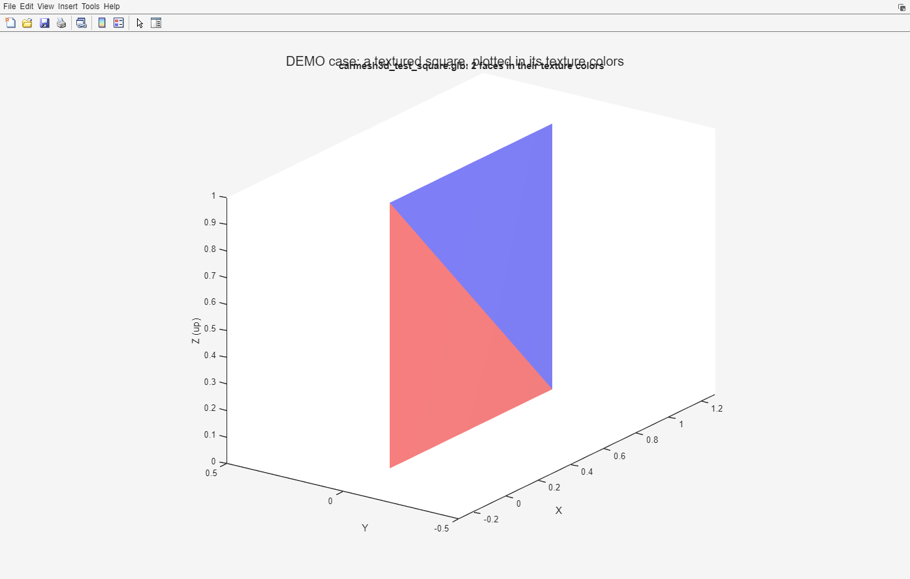

</details>

<details><summary><b><code>fcn_CarMesh3D_importMesh</code></b> (test: <code>script_test_fcn_CarMesh3D_importMesh.m</code>): Reads a 3D model file into a CarMesh3D mesh structure. Supported formats.</summary>

Reads a 3D model file into a CarMesh3D mesh structure. Supported formats (listed in the function's header).

```matlab
vehicleMesh = fcn_CarMesh3D_importMesh(fileName,...
    (Name=nameString),...
    (License=licenseString),...
    (BlenderPath=blenderExecutable),...
    (FigNum=figNum))
```

| Variable | Kind | Meaning | Class | Size |
|---|---|---|---|---|
| `fileName` | input | the full or relative path to a .obj, .stl, .fbx, .glb, .gltf, or .blend file. | char or string | 1 x n |
| `Name` | option | a name for the mesh. Default is the file name. | char or string | 1 x n |
| `License` | option | the license of the downloaded model, for example 'CC0' or 'CC-BY 4.0, author: ...'. Default is 'unknown'. Recording this is strongly recommended for any model that will be shared. | char | 1 x n |
| `BlenderPath` | option | the full path to the Blender program, used only for .fbx, .glb, .gltf, and .blend files. Default is '' (search for it; see fcn_CarMesh3D_convertToOBJ). | char | 1 x n |
| `FigNum` | option | a figure number to plot the imported mesh. If empty or omitted, no plot is made. Default `[]`. | double | 1 x 1 (or empty) |
| `vehicleMesh` | output | a CarMesh3D mesh structure with the fields Name, Source, License, Units ('unknown'), Frame ('source'), Vertices (N x 3), Faces (M x 3), MaterialNames (K x 1 cell), MaterialColors (K x 3, NaN if unknown), MaterialAlpha (K x 1), FaceMaterialIndex (M x 1), GroupNames (G x 1 cell), FaceGroupIndex (M x 1) | struct | 1 x 1 |

**Assumptions:** An OBJ (its .mtl next to it, for colors), STL (no colors), or a format Blender converts (FBX, GLB/GLTF, BLEND); units are whatever the file uses, set to meters later by normalizeMesh.

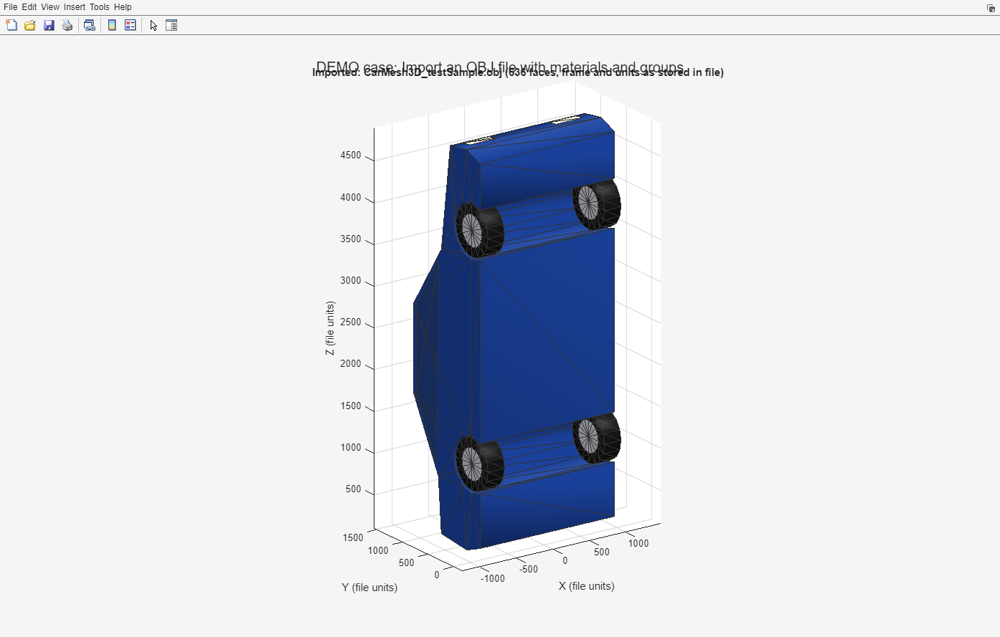

</details>

<details><summary><b><code>fcn_CarMesh3D_transferTextureColors</code></b> (test: <code>script_test_fcn_CarMesh3D_transferTextureColors.m</code>): Gives each face of a mesh the texture color and transparency of the nearest face of another mesh of the same model, read with fcn_CarMesh3D_readGLB.</summary>

Gives each face of a mesh the texture color and transparency of the nearest face of another mesh of the same model, read with fcn_CarMesh3D_readGLB. Used when a model is reduced in Blender (whose OBJ keeps no texture colors): the reduced faces lie on the download's surface, so the nearest download face facing the same way has the color painted there.

```matlab
vehicleMesh = fcn_CarMesh3D_transferTextureColors(vehicleMesh, textureMesh,...
    (MaxDistance=meters), (FigNum=figNum))
```

**Assumptions:** Both meshes must be in the same axes (as they are straight from fcn_CarMesh3D_readGLB and fcn_CarMesh3D_importMesh of the Blender conversion, before normalizing).

| Variable | Kind | Meaning | Class | Size |
|---|---|---|---|---|
| `vehicleMesh` | input | a CarMesh3D mesh structure (for example, imported from the Blender-reduced OBJ). | struct | 1 x 1 |
| `textureMesh` | input | the download read by fcn_CarMesh3D_readGLB (it has the fields FaceTextureColors, FaceTextureAlpha, SeeThroughReliable). | struct | 1 x 1 |
| `MaxDistance` | option | faces whose center is farther than this from every download face center (in the meshes' units) get a neutral gray and alpha 1. | double | 1 x 1 |
| `FigNum` | option | a figure to plot the mesh in the transferred colors. If empty or omitted, no plot is made. Default `[]`. | double | 1 x 1 (or empty) |
| `vehicleMesh` | output | the same structure with FaceTextureColors (M x 3), FaceTextureAlpha (M x 1), and SeeThroughReliable added. | struct | 1 x 1 |

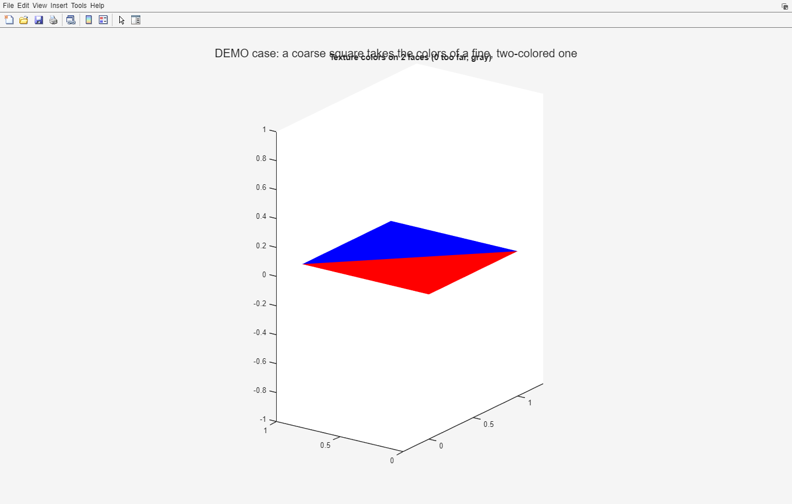

</details>

<details><summary><b><code>fcn_CarMesh3D_normalizeMesh</code></b> (test: <code>script_test_fcn_CarMesh3D_normalizeMesh.m</code>): Puts a mesh into the CarMesh3D vehicle frame, which follows the ISO 8855 vehicle convention.</summary>

Puts a mesh into the CarMesh3D vehicle frame, which follows the ISO 8855 vehicle convention (listed in the function's header).

```matlab
vehicleMesh = fcn_CarMesh3D_normalizeMesh(vehicleMesh,...
    (UpAxis=upAxisString),...
    (ForwardAxis=forwardAxisString),...
    (Units=unitsSetting),...
    (FigNum=figNum))
```


| Variable | Kind | Meaning | Class | Size |
|---|---|---|---|---|
| `vehicleMesh` | input | a CarMesh3D mesh structure, for example from fcn_CarMesh3D_importMesh. | struct | 1 x 1 |
| `UpAxis` | option | the file axis that points up, as a string with a sign: '+x', '-x', '+y', '-y', '+z', or '-z'. Default is '+z'. | char | 1 x n |
| `ForwardAxis` | option | the file axis that points toward the FRONT of the vehicle, in the same format. Default is '+x'. Must be a different axis than UpAxis. | char | 1 x n |
| `Units` | option | the length units of the file: 'm', 'cm', 'mm', 'in', or 'auto' (the default). A positive number may also be given, as the number of meters per file unit. Default `'auto'`. | char | 1 x n |
| `Yaw` | option | degrees to turn the model about its up axis, after the axes above (counterclockwise seen from above), for a download whose front is not along one of its axes. | double | 1 x 1 |
| `FigNum` | option | a figure number to plot the result. If empty or omitted, no plot is made. If set to -1, input checking is skipped and no plot is made (fast mode). Default `[]`. | double | 1 x 1 (or empty) |
| `vehicleMesh` | output | the same structure with Vertices (and FaceNormals, if present) changed, Units set to 'm', Frame set to 'ISO8855', and a new field NormalizeInfo with fields RotationMatrix, MetersPerFileUnit, and OffsetMeters (the shift that was applied after rotating and scaling). | struct | 1 x 1 |

**Assumptions:** The up and forward axes are known (given, or the defaults for the download's format); the vehicle sits on its tires.

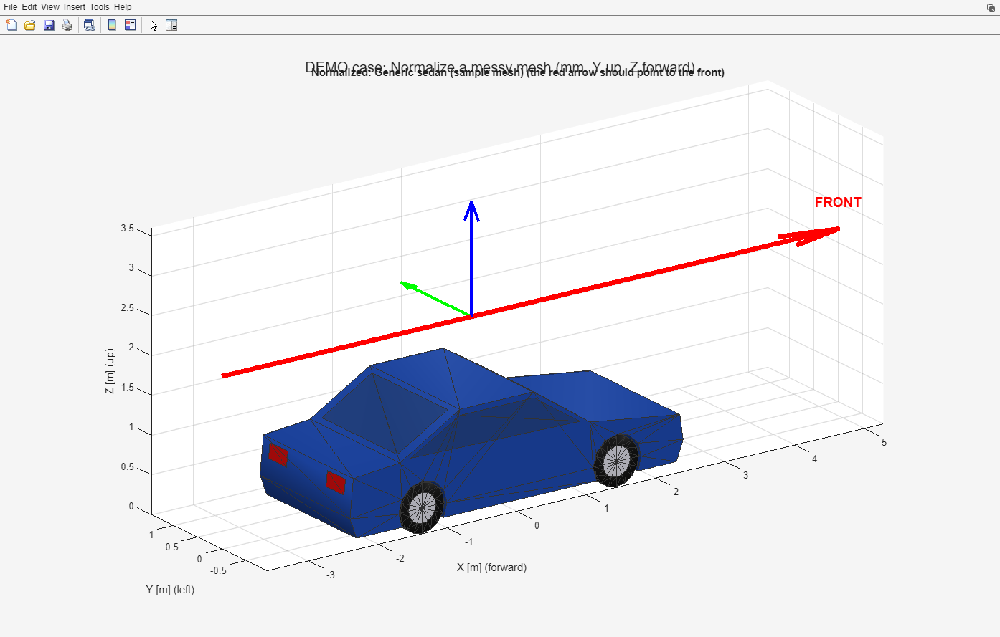

</details>

<details><summary><b><code>fcn_CarMesh3D_fillSampleMesh</code></b> (test: <code>script_test_fcn_CarMesh3D_fillSampleMesh.m</code>): Builds a simple, low-poly sample car mesh directly from a vehicle specification.</summary>

Builds a simple, low-poly sample car mesh directly from a vehicle specification. The sample has a body extruded from a side profile with wheel arches, glass panes (windshield, rear window, side windows), head and tail lights, and four wheels made of tire and rim materials. Materials and groups are named the way downloaded models often name them, so the sample can be used to test every step of the CarMesh3D workflow without downloading anything.

```matlab
vehicleMesh = fcn_CarMesh3D_fillSampleMesh(...
    (VehicleSpec=vehicleSpec),...
    (Style=styleString),...
    (NumWheelSegments=numSegments),...
    (FigNum=figNum))
```

**Assumptions:** It must contain OverallLength, OverallWidth, OverallHeight, and Wheelbase.

| Variable | Kind | Meaning | Class | Size |
|---|---|---|---|---|
| `VehicleSpec` | option | a vehicle specification structure from fcn_CarMesh3D_fillVehicleSpec. It must contain OverallLength, OverallWidth, OverallHeight, and Wheelbase. If empty or omitted, the 'genericSedan' preset is used. Default `[]`. | struct | 1 x 1 |
| `Style` | option | 'clean' (default) or 'messy'. 'clean': CarMesh3D vehicle frame (ISO 8855: X forward, Y left, Z up), meters, origin on the ground at the center of the length and width. Default `'clean'`. | char | 1 x n |
| `NumWheelSegments` | option | the number of flat segments around each wheel. Default is 16. | double | 1 x 1 |
| `FigNum` | option | a figure number to plot the result. If empty or omitted, no plot is made. If set to -1, input checking is skipped and no plot is made (fast mode). Default `[]`. | double | 1 x 1 (or empty) |
| `vehicleMesh` | output | a CarMesh3D mesh structure with the fields Name, Source, License, Units, Frame, Vertices (N x 3), Faces (M x 3, triangles), MaterialNames (K x 1 cell), MaterialColors (K x 3, RGB), MaterialAlpha (K x 1), FaceMaterialIndex (M x 1), GroupNames (G x 1 cell), FaceGroupIndex (M x 1) See README.md for the full description of the mesh structure. | struct | 1 x 1 |


</details>

<details><summary><b><code>fcn_CarMesh3D_fillBodyStyleMesh</code></b> (test: <code>script_test_fcn_CarMesh3D_fillBodyStyleMesh.m</code>): Makes a vehicle's mesh from its body style when no 3D model of the vehicle itself is found: one of the style's exemplars (the finished, checked vehicles filed in Data\BodyStyles\<Style>; see fcn_CarMesh3D_loadBodyStyles) is refit to this vehicle's specification: its length, width, height, wheelbase, tracks, overhangs, ground clearance, and tire size, the wheels moved and sized as rigid parts (fcn_CarMesh3D_fitMeshToSpec).</summary>

Makes a vehicle's mesh from its body style when no 3D model of the vehicle itself is found: one of the style's exemplars (the finished, checked vehicles filed in Data\BodyStyles\<Style>; see fcn_CarMesh3D_loadBodyStyles) is refit to this vehicle's specification: its length, width, height, wheelbase, tracks, overhangs, ground clearance, and tire size, the wheels moved and sized as rigid parts (fcn_CarMesh3D_fitMeshToSpec).

```matlab
vehicleMesh = fcn_CarMesh3D_fillBodyStyleMesh(bodyStyle, vehicleSpec,...
    (ExemplarID=id), (BodyColor=rgb), (Fallback=choice), (DataFolder=folder),...
    (FigNum=figNum))
```

| Variable | Kind | Meaning | Class | Size |
|---|---|---|---|---|
| `bodyStyle` | input | a style's ID from Data\bodyStyles.csv, such as 'liftback' or 'compactCargoVan' (case is ignored). See fcn_CarMesh3D_loadBodyStyles. | char | 1 x n |
| `vehicleSpec` | input | the vehicle's specification (fcn_CarMesh3D_fillVehicleSpec or fcn_CarMesh3D_loadVehicleSpec). OverallLength, OverallWidth, OverallHeight, and Wheelbase are needed; the other dimensions are used when given. | struct | 1 x 1 |
| `ExemplarID` | option | the exemplar to use, one of the style's finished vehicles, such as '2013_Toyota_Prius_Four'. Default '' picks the one closest in size. | char | 1 x n |
| `BodyColor` | option | an RGB color for the body faces. Default [] uses the spec's BodyColor, or keeps the exemplar's. | double | 1 x 3 |
| `Fallback` | option | 'sample' (default) or 'error', for a style with no exemplar. Default `'sample'`. | char | 1 x n |
| `DataFolder` | option | the Data folder. Default [] uses the one next to the Functions folder. | char or string | 1 x n |
| `FigNum` | option | a figure to plot the result. If empty or omitted, no plot is made. If set to -1, input checking is skipped and no plot is made (fast mode). Default `[]`. | double | 1 x 1 (or empty) |
| `vehicleMesh` | output | a CarMesh3D mesh structure, fit to the spec (with VehicleSpec, AxleX, and FitInfo as from fcn_CarMesh3D_fitMeshToSpec), with Name from the spec, Source naming the exemplar, the exemplar's License (its attribution carries over), and BodyStyleInfo: BodyStyle, ExemplarID, ExemplarName, WidthReference, and WidthNote (how the width was fit), CandidateIDs (the style's exemplars) and SizeDifference (each one's root-mean-square relative size difference from this vehicle, the same order) | struct | 1 x 1 |

**Assumptions:** The body style has an approved exemplar with a finished mesh (Data/bodyStyles.csv); the result is a stand-in shaped like the exemplar, not like the vehicle.

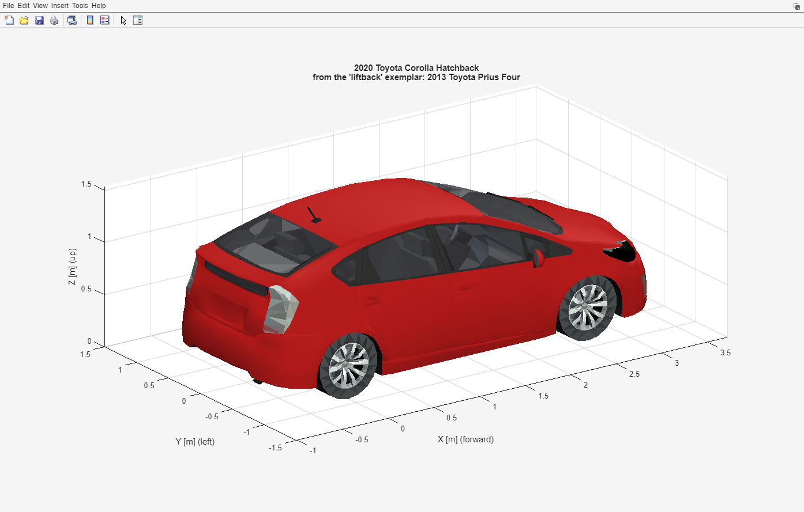

</details>

<details><summary><b><code>fcn_CarMesh3D_loadBodyStyles</code></b> (test: <code>script_test_fcn_CarMesh3D_loadBodyStyles.m</code>): Lists the vehicle body styles (sedan, hatchback, minivan, pickup, and so on) and the finished vehicles filed under each.</summary>

Lists the vehicle body styles (sedan, hatchback, minivan, pickup, and so on) and the finished vehicles filed under each. Vehicles are kept in Data\BodyStyles\<Style>\<ID> (see fcn_CarMesh3D_findVehicleFiles). An EXEMPLAR of a style is a finished vehicle used as a starting shape that can be refit to any vehicle of that style when no model of the vehicle itself is found (fcn_CarMesh3D_fillBodyStyleMesh picks the exemplar closest in size).

```matlab
bodyStyles = fcn_CarMesh3D_loadBodyStyles(...
    (DataFolder=folder), (FigNum=figNum))
```

| Variable | Kind | Meaning | Class | Size |
|---|---|---|---|---|
| `DataFolder` | option | the Data folder. Default [] uses the one next to the Functions folder. | char or string | 1 x n |
| `FigNum` | option | a figure to show every exemplar, one row per style, each labeled (styles without one are listed in the title). If empty or omitted, no plot is made. Default `[]`. | double | 1 x 1 (or empty) |
| `bodyStyles` | output | a structure array, one element per style, with BodyStyle: the style's ID, such as 'sedan' or 'minivan' Name: a readable name, such as 'Full-size pickup (crew cab)' Description: what sets the style apart Core: true for the 13 core light-vehicle styles, false for the optional ones Folder: the style's folder, Data\BodyStyles\<Style> VehicleIDs: every vehicle filed there (a cell array of IDs) ExemplarIDs: the approved exemplars (named in the Exemplars column) with a finished mesh; without that column, every vehicle in the folder with a finished mesh HasExemplar: true if there is at least one exemplar SuggestedVehicles: vehicles that would make good exemplars A folder under Data\BodyStyles that is not in the list is added at the end (its name as its Name), with a warning ('CarMesh3D:unlistedStyle'). | logical | 1 x 1 |

**Assumptions:** Data/bodyStyles.csv is present and lists each style's ID, name and exemplars.

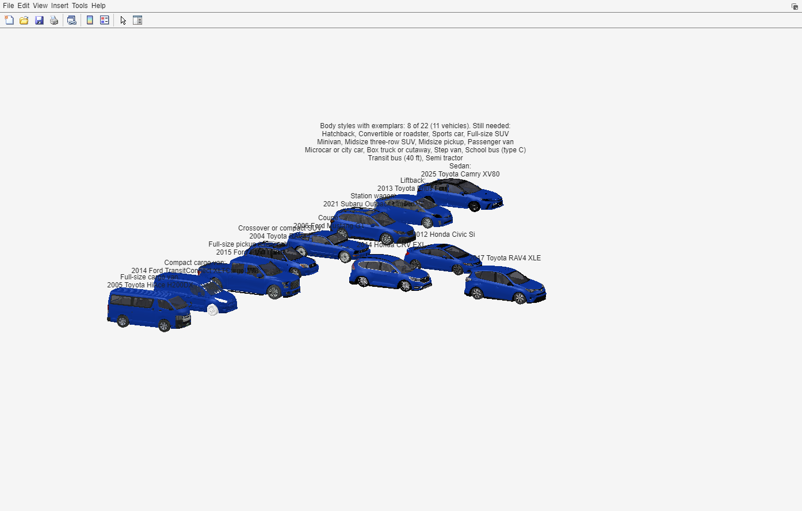

</details>

### Label and fit

<details><summary><b><code>fcn_CarMesh3D_labelParts</code></b> (test: <code>script_test_fcn_CarMesh3D_labelParts.m</code>): Labels every face of a mesh as one of five vehicle parts.</summary>

Labels every face of a mesh as one of five vehicle parts (listed in the function's header).

```matlab
vehicleMesh = fcn_CarMesh3D_labelParts(vehicleMesh,...
    (PartRules=partRules),...
    (BodyColor=[r g b]),...
    (GlassAlpha=alpha),...
    (UseMaterialColors=flag),...
    (PartColors=partColors),...
    (SeeThroughGlass=flag),...
    (TextureColorParts=partList),...
    (FigNum=figNum))
```

**Assumptions:** This needs the mesh to be in the CarMesh3D vehicle frame (run fcn_CarMesh3D_normalizeMesh first).

| Variable | Kind | Meaning | Class | Size |
|---|---|---|---|---|
| `vehicleMesh` | input | a CarMesh3D mesh structure, normalized with fcn_CarMesh3D_normalizeMesh. | struct | 1 x 1 |
| `PartRules` | option | an N x 2 cell array of extra rules, checked BEFORE the default rules. | double | N x 2 |
| `BodyColor` | option | a 1 x 3 RGB color (values from 0 to 1) applied to ALL body faces, replacing material colors. | double | 1 x 3 |
| `GlassAlpha` | option | the transparency of glass faces, from 0 (invisible) to 1 (opaque). Default is 0.35. | double | 1 x 1 |
| `UseMaterialColors` | option | true (default) to color faces from the file's material colors where known. Default `true`. | logical | 1 x 1 |
| `PartColors` | option | an N x 2 cell array of {partName, [r g b]} pairs that set the color of every face of a part, for example PartColors = {'glass',[0.35 0.35 0.38]; 'trim',[0 0 0]} These are applied last, so they override material colors and BodyColor. | double | N x 2 |
| `SeeThroughGlass` | option | true (default) to use the see-through marks of a mesh read with fcn_CarMesh3D_readGLB (its FaceTextureAlpha, when Default `true`. | logical | 1 x 1 |
| `LampCovers` | option | true (default) to make each separate piece of glass that lies over a lamp part of that lamp: a piece (glass faces joined by shared corners) at least half of whose faces are within 2% of the vehicle's length of a light face. Default `true`. | logical | 1 x 1 |
| `AutoHighBeams` | option | Split each headlight into low and high beams by position? Default `true`. | logical | 1 x 1 |
| `TextureColorParts` | option | a cell array of part names whose faces take their texture colors (FaceTextureColors, from fcn_CarMesh3D_readGLB or fcn_CarMesh3D_transferTextureColors), for example TextureColorParts = {'light','trim','wheel'} applied after PartColors. Default is {} (none). | cell | 1 x n |
| `FigNum` | option | a figure number to plot the labeled parts. If empty or omitted, no plot is made. Default `[]`. | double | 1 x 1 (or empty) |
| `vehicleMesh` | output | the same structure with these fields added: PartNames (5 x 1 cell): {'body';'glass';'wheel';'light';'trim'} FacePartIndex (M x 1): index into PartNames for each face FaceWheelIndex (M x 1): 0 for non-wheel faces, else 1 to 4 (1 FL, 2 FR, 3 RL, 4 RR) FaceColors (M x 3): RGB display color of each face FaceAlpha (M x 1): transparency of each face LightTypeNames (6 x 1 cell): {'headlight';'turnsignal'; 'running';'tail';'backup';'highbeam'} FaceLightType (M x 1): index into LightTypeNames for light faces, 0 for all other faces TextureColorParts (cell): the TextureColorParts option FaceAlsoParts (M x numel(PartNames) logical): the other parts each face also belongs to (one column per part). | struct | 1 x 1 |

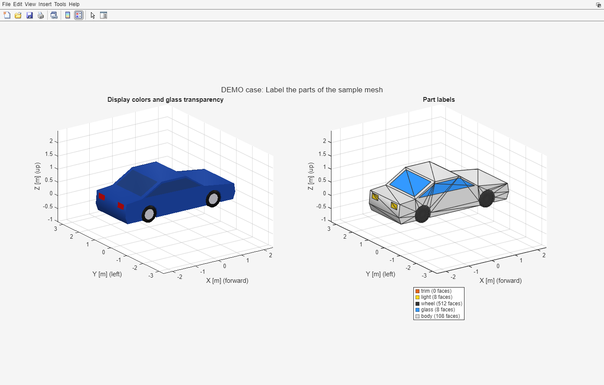

</details>

<details><summary><b><code>fcn_CarMesh3D_editLabels</code></b> (test: <code>script_test_fcn_CarMesh3D_editLabels.m</code>): Corrects part labels (and light types) that fcn_CarMesh3D_labelParts got wrong, for example headlights that a downloaded model put in the same material as its black trim.</summary>

Corrects part labels (and light types) that fcn_CarMesh3D_labelParts got wrong, for example headlights that a downloaded model put in the same material as its black trim. Edits can be given in a script, so they are repeatable, or made by clicking on the vehicle.

```matlab
[vehicleMesh, appliedEdits] = fcn_CarMesh3D_editLabels(vehicleMesh,...
    (Edits=edits),...
    (Interactive=flagInteractive),...
    (GlassAlpha=alpha),...
    (FigNum=figNum))
```


| Variable | Kind | Meaning | Class | Size |
|---|---|---|---|---|
| `vehicleMesh` | input | a labeled CarMesh3D mesh structure (from fcn_CarMesh3D_labelParts). | struct | 1 x 1 |
| `Edits` | option | a cell array of edit structures (or a structure array), as described above. They are applied in order. Default is {}. | cell | 1 x n (structs) |
| `Interactive` | option | true to open the click-to-select editor after the scripted edits are applied. Default is false. | logical | 1 x 1 |
| `GlassAlpha` | option | the transparency given to faces that are changed to glass. Default is 0.35. | double | 1 x 1 |
| `FigNum` | option | a figure number to plot the labels after editing. If empty or omitted, no plot is made. Default `[]`. | double | 1 x 1 (or empty) |
| `vehicleMesh` | output | the mesh with FacePartIndex, FaceLightType, FaceWheelIndex, FaceColors, and FaceAlpha updated (and FaceLightFunctions, an Nfaces x numel(LightTypeNames) logical matrix, when an edit gives AlsoLightTypes: each light face's functions, its FaceLightType among them; and FaceAlsoParts, an Nfaces x numel(PartNames) logical matrix, when an edit gives AlsoParts or the mesh has it: the other parts of each face. | struct | 1 x 1 |
| `appliedEdits` | output | a structure array with one element per edit made (scripted and interactive), with the fields Name, Part, LightType, and FaceIndices (the faces that were changed). | struct | 1 x n |

**Assumptions:** The mesh is labeled (labelParts); regions are in meters in the mesh's current frame (after the fit: origin on the ground under the rear axle). Faces are never deleted: Hide moves them to a hidden set.

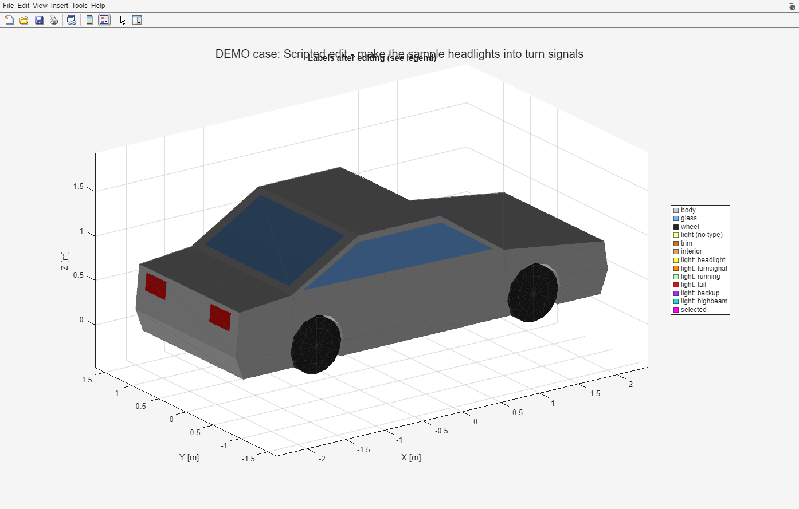

</details>

<details><summary><b><code>fcn_CarMesh3D_fitMeshToSpec</code></b> (test: <code>script_test_fcn_CarMesh3D_fitMeshToSpec.m</code>): Scales and shifts a normalized mesh so that its size agrees with a vehicle specification (from fcn_CarMesh3D_fillVehicleSpec).</summary>

Scales and shifts a normalized mesh so that its size agrees with a vehicle specification (from fcn_CarMesh3D_fillVehicleSpec).

```matlab
vehicleMesh = fcn_CarMesh3D_fitMeshToSpec(vehicleMesh, vehicleSpec,...
    (FitMethod=methodString),...
    (Origin=originString),...
    (WidthReference=widthString),...
    (Symmetric=flag),...
    (FigNum=figNum))
```

**Assumptions:** Needs wheel faces numbered by fcn_CarMesh3D_labelParts. Needs a Wheelbase in the spec.

| Variable | Kind | Meaning | Class | Size |
|---|---|---|---|---|
| `vehicleMesh` | input | a CarMesh3D mesh structure in the vehicle frame (from fcn_CarMesh3D_normalizeMesh), ideally labeled (from fcn_CarMesh3D_labelParts). | struct | 1 x 1 |
| `vehicleSpec` | input | a vehicle specification structure. OverallLength, OverallWidth, and OverallHeight are required. | struct | 1 x 1 |
| `FitMethod` | option | 'auto' (default), 'wheels', or 'box'. Default `'auto'`. | char | 1 x n |
| `Origin` | option | where to put the origin after fitting: 'rearAxle' (default): on the ground, below the center of the rear axle (the usual vehicle dynamics convention). Needs a Wheelbase in the spec. Default `'rearAxle'`. | char | 1 x n |
| `WidthReference` | option | what is scaled to OverallWidth: 'all' (default): the whole mesh. 'body': only the faces labeled 'body'. Default `'all'`. | char | 1 x n |
| `Symmetric` | option | true when the mesh will later be made symmetric by reducing its left half and mirroring it (fcn_CarMesh3D_simplifyMesh Symmetric=true). | logical | 1 x 1 |
| `FigNum` | option | a figure number to plot the fitted mesh. If empty or omitted, no plot is made. Default `[]`. | double | 1 x 1 (or empty) |
| `vehicleMesh` | output | the same structure with Vertices changed, and these fields added or updated: VehicleSpec: a copy of the spec that was used AxleX: [rearAxleX frontAxleX] in the output frame (NaN if unknown) FitInfo: a structure with Method, Origin, BoxScale ([sx sy sz]), and WheelScale (4 x 1, NaN for wheels not found) Any FaceNormals field is cleared, since stretching changes normals; fcn_CarMesh3D_simplifyMesh recomputes them. | struct | 1 x 1 |

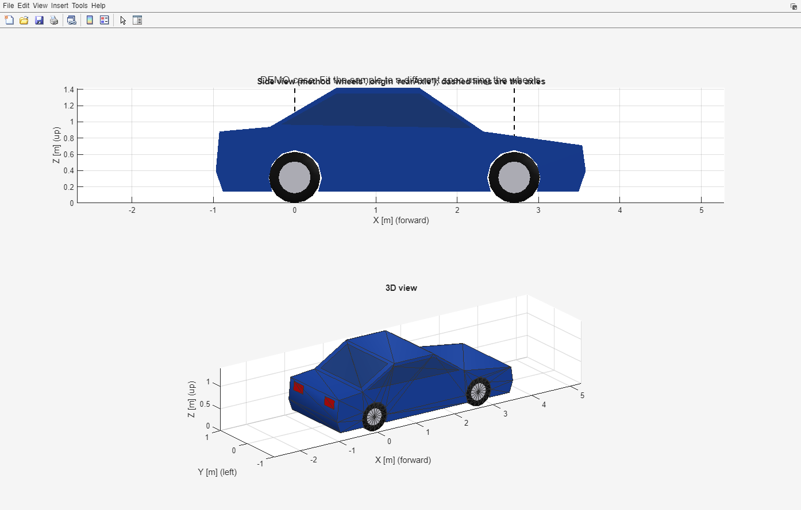

</details>

<details><summary><b><code>fcn_CarMesh3D_visibleMesh</code></b> (test: <code>script_test_fcn_CarMesh3D_visibleMesh.m</code>): The vehicle as it is shown: the mesh without its hidden faces.</summary>

The vehicle as it is shown: the mesh without its hidden faces.

```matlab
[visibleMesh, flagShown] = fcn_CarMesh3D_visibleMesh(vehicleMesh,...
    (ShowSets=setNames), (FigNum=figNum))
```

| Variable | Kind | Meaning | Class | Size |
|---|---|---|---|---|
| `vehicleMesh` | input | a CarMesh3D mesh (Vertices, Faces, and the per-face fields), with or without FaceHiddenSet. | struct | 1 x 1 |
| `ShowSets` | option | hidden sets to show anyway, by name (a cell array, such as {'hard top'}), or true for all of them. Default {} (none). | cell or logical | 1 x n |
| `FigNum` | option | a figure to show the visible mesh (gray) and the hidden faces (red). If empty or omitted, no plot is made. Default `[]`. | double | 1 x 1 (or empty) |
| `visibleMesh` | output | the mesh with the hidden faces taken out. | struct | 1 x 1 |
| `flagShown` | output | one flag per face of vehicleMesh: true for the faces kept. | logical | M x 1 |

**Assumptions:** FaceHiddenSet is present (a mesh without it is returned unchanged); every per-face field (Face*) has one row per face.

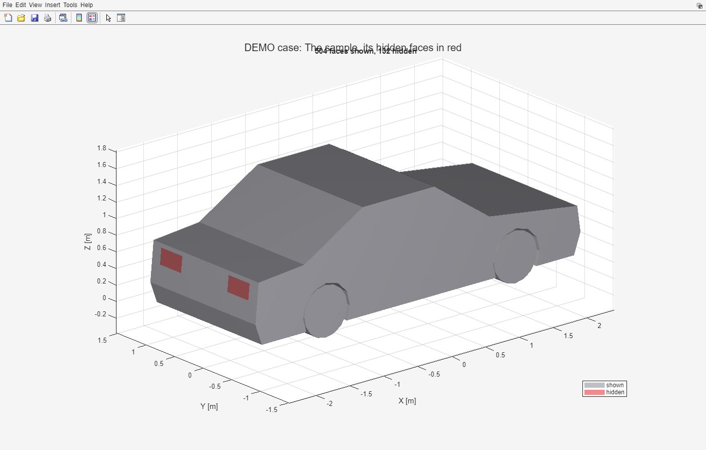

</details>

### Reduce and repair

<details><summary><b><code>fcn_CarMesh3D_simplifyMesh</code></b> (test: <code>script_test_fcn_CarMesh3D_simplifyMesh.m</code>): Cleans and simplifies a labeled mesh for fast plotting and animation, and makes every face normal point outward.</summary>

Cleans and simplifies a labeled mesh for fast plotting and animation, and makes every face normal point outward. The mesh is split into groups that share a part, a wheel number, and a color/alpha, and each group is processed separately so that parts, wheels, and colors stay intact (listed in the function's header).

```matlab
vehicleMesh = fcn_CarMesh3D_simplifyMesh(vehicleMesh,...
    (TargetFaces=numFaces), (WheelFaces=numFaces),...
    (Symmetric=flag), (KeepOneSided=flag), (PartShares=shares),...
    (MergeTolerance=tolerance), (ClearWheels=flag),...
    (RestoreTolerance=meters), (EdgeSmoothing=passes),...
    (StitchTolerance=meters),...
    (VisibilityCheck=flag), (MaxVisibilityFaces=numFaces),...
    (FigNum=figNum))
```


| Variable | Kind | Meaning | Class | Size |
|---|---|---|---|---|
| `vehicleMesh` | input | a labeled CarMesh3D mesh structure (from fcn_CarMesh3D_labelParts), usually already fitted to the spec. | struct | 1 x 1 |
| `TargetFaces` | option | the approximate total number of faces wanted. If the mesh already has fewer faces, it is cleaned but not reduced. Default is 5000 (a good size for animation). | double | 1 x 1 |
| `WheelFaces` | option | the fewest faces each wheel keeps (tire and rim together), so the tires stay round when a dense download is reduced a lot; a wheel with fewer faces keeps all of them. | double | 1 x 1 |
| `Symmetric` | option | true to reduce the left half and mirror it (see SYMMETRIC above); the mesh must be in the vehicle frame (centerline at Y = 0, as after fcn_CarMesh3D_fitMeshToSpec). Default false. | logical | 1 x 1 |
| `KeepOneSided` | option | with Symmetric=true, true (default) to keep pieces that are on one side only (see ONE-SIDED PIECES above) where they are, instead of mirroring the left half's copy. Default `true`. | logical | 1 x 1 |
| `PartShares` | option | an N x 2 cell array of {partName, fraction}: the fraction of the budget (after the wheels) that a part gets, for example {'body',0.6; 'trim',0.15} to give the painted body most of the faces when a download has a dense hidden interior (labeled trim). | double | N x 2 |
| `MergeTolerance` | option | vertices closer than this distance (in mesh units, normally meters) are merged. Default is 1e-4 (0.1 mm). | double | 1 x 1 |
| `ClearWheels` | option | true (default) to delete faces of other parts that pass through a tire. Default `true`. | logical | 1 x 1 |
| `RestoreTolerance` | option | meters. | double | 1 x 1 |
| `EdgeSmoothing` | option | passes of smoothing along each reduced piece's open Default `3`. | double | 1 x 1 |
| `StitchTolerance` | option | meters. | double | 1 x 1 |
| `VisibilityCheck` | option | true (default) to do step 4b. Default `true`. | logical | 1 x 1 |
| `MaxVisibilityFaces` | option | the largest face count for step 4b. Default 30000. | double | 1 x 1 |
| `FigNum` | option | a figure number to plot the mesh before and after. If empty or omitted, no plot is made. Default `[]`. | double | 1 x 1 (or empty) |
| `vehicleMesh` | output | the same structure with new Vertices, Faces, and per-face fields (FacePartIndex, FaceWheelIndex, FaceColors, FaceAlpha, FaceMaterialIndex, FaceGroupIndex, and any other per-face field named Face..., such as FaceAlsoParts and | struct | 1 x 1 |

**Assumptions:** The mesh is labeled and in the vehicle frame; reduction runs only when targetFaces is given, and parts, wheels and colors are reduced separately so they stay intact.

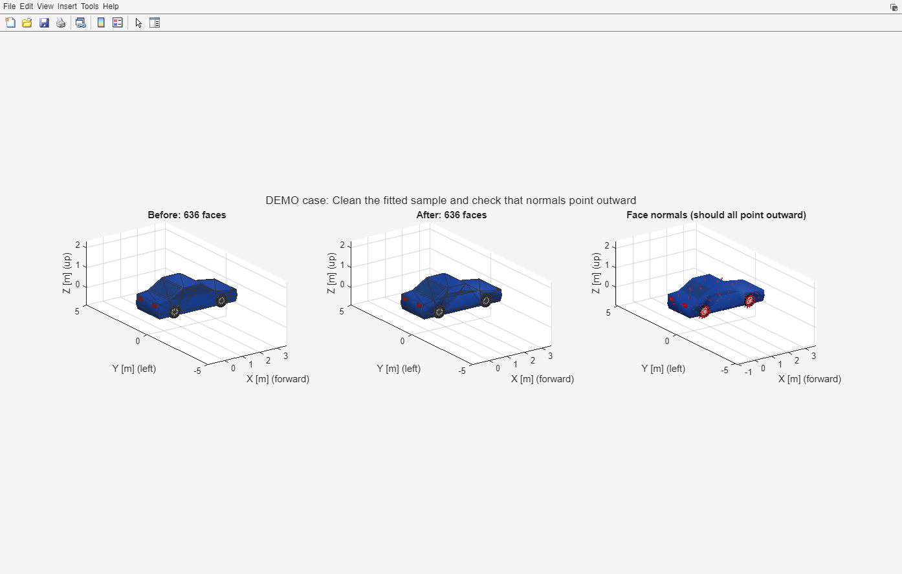

</details>

<details><summary><b><code>fcn_CarMesh3D_restoreGroundClearance</code></b> (test: <code>script_test_fcn_CarMesh3D_restoreGroundClearance.m</code>): Puts the lowest point of the body back at the ground clearance after a reduction raised it.</summary>

Puts the lowest point of the body back at the ground clearance after a reduction raised it. A reduction (Blender's, especially of a dense download) can collapse the thin bottom edge of the rocker panels, so the lowest body point ends up a few millimeters above where the fit put it (the 2025 Camry: 5 mm, failing its dimension check).

```matlab
[vehicleMesh, shiftDistance] = fcn_CarMesh3D_restoreGroundClearance(...
    vehicleMesh, groundClearance, (Tolerance=meters), (FigNum=figNum))
```

| Variable | Kind | Meaning | Class | Size |
|---|---|---|---|---|
| `vehicleMesh` | input | a fitted, labeled vehicle mesh (FacePartIndex, with the body as part 1 and the wheels as part 3), in meters with the ground at Z = 0. | struct | 1 x 1 |
| `groundClearance` | input | the ground clearance, in meters (the fit's target, `vehicleSpec.GroundClearance`). | double | 1 x 1 |
| `Tolerance` | option | how far (m) the lowest body point may be from the ground clearance before it is moved. Default 0.0005 (half a millimeter). | double | 1 x 1 |
| `FigNum` | option | if given (not -1), the change is printed. If set to -1, input checking is skipped (fast mode). Default `[]`. | double | 1 x 1 (or empty) |
| `vehicleMesh` | output | the mesh, with its non-wheel vertices stretched. Its face normals are kept: the stretch moves the lowest points by millimeters, which does not change which way the faces point. | struct | 1 x 1 |
| `shiftDistance` | output | how far (m) the lowest body point was moved. | double | 1 x 1 |

**Assumptions:** The spec's GroundClearance is known; only the body (not the wheels) is moved.

</details>

<details><summary><b><code>fcn_CarMesh3D_fixFlippedFaces</code></b> (test: <code>script_test_fcn_CarMesh3D_fixFlippedFaces.m</code>): Finds the faces of a mesh that are seen only from behind (inside-out panels, which look dark), and flips them, quickly: the mesh is drawn from 14 directions (the six sides and eight corners) with each face in its own color, so each pixel tells which face is seen.</summary>

Finds the faces of a mesh that are seen only from behind (inside-out panels, which look dark), and flips them, quickly: the mesh is drawn from 14 directions (the six sides and eight corners) with each face in its own color, so each pixel tells which face is seen. A face seen mostly from behind (more than twice as many pixels from behind as from the front, over all views) is flipped.

```matlab
[vehicleMesh, numFlipped, numRemoved] = fcn_CarMesh3D_fixFlippedFaces(vehicleMesh,...
    (ImageWidth=pixels), (Symmetric=flag), (RemoveDoubleLayers=flag),...
    (FigNum=figNum))
```

| Variable | Kind | Meaning | Class | Size |
|---|---|---|---|---|
| `vehicleMesh` | input | a CarMesh3D mesh (Vertices, Faces; FaceAlpha if it has see-through faces; FaceNormals is updated if present). | struct | 1 x 1 |
| `ImageWidth` | option | pixels across each picture. Default 700. | double | 1 x 1 |
| `Symmetric` | option | 'auto' (default) pairs faces with their mirror twins when at least 90% of the faces have one; true always pairs the faces that have one; false never pairs. Default `'auto'`. | char | 1 x n |
| `RemoveDoubleLayers` | option | true to delete the inner skin of back-to-back double layers; false (default) keeps every face. Default `false`. | logical | 1 x 1 |
| `FigNum` | option | a figure to plot the mesh with the flipped faces marked in red. If empty or omitted, no plot is made. Default `[]`. | double | 1 x 1 (or empty) |
| `vehicleMesh` | output | the mesh with those faces flipped (their corner order reversed) and FaceNormals updated. | struct | 1 x 1 |
| `numFlipped` | output | how many faces were flipped. | double | 1 x 1 |
| `numRemoved` | output | how many inner-skin faces of double layers were deleted (every per-face field is cut the same way). | double | 1 x 1 |

**Assumptions:** Faces are mostly outward already (after simplifyMesh); a face counts as flipped when, over 14 views from outside, it is seen from behind more than twice as often as from the front.

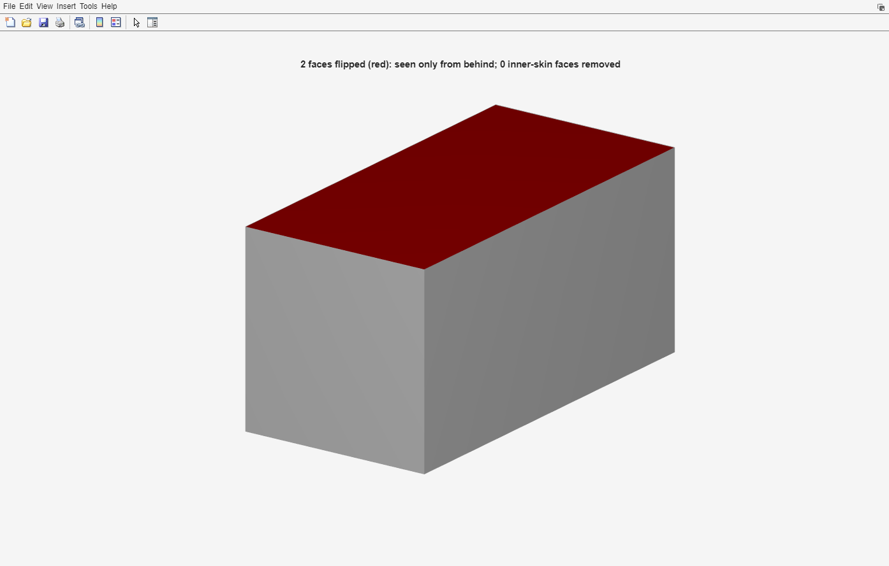

</details>

<details><summary><b><code>fcn_CarMesh3D_separateOverlays</code></b> (test: <code>script_test_fcn_CarMesh3D_separateOverlays.m</code>): Lifts overlays off the surfaces they lie on.</summary>

Lifts overlays off the surfaces they lie on. Many downloads paint details as separate faces lying exactly on another part's surface (a black bumper insert on the painted bumper, a window's black border on the glass, a lamp lens on the trim). Two faces at the same depth are drawn in whichever order the graphics card picks, so the overlay flickers, shows in patches, or vanishes, and the result changes when the faces are reordered (as the simplification does).

```matlab
[vehicleMesh, numLifted] = fcn_CarMesh3D_separateOverlays(vehicleMesh,...
    (Distance=meters), (Offset=meters), (FigNum=figNum))
```


| Variable | Kind | Meaning | Class | Size |
|---|---|---|---|---|
| `vehicleMesh` | input | a labeled CarMesh3D mesh (Vertices, Faces, PartNames, FacePartIndex), fit to its spec (in meters). | struct | 1 x 1 |
| `Distance` | option | how close (meters) a face's center must be to another face's plane to count as lying on it. Default 0.004. | double | 1 x 1 |
| `Offset` | option | how far (meters) the top face is moved outward. Default 0.002. | double | 1 x 1 |
| `FigNum` | option | a figure to plot the lifted faces in red. If empty or omitted, no plot is made. Default `[]`. | double | 1 x 1 (or empty) |
| `vehicleMesh` | output | the mesh with the overlays' corners moved outward (corners shared with other faces move too, by the same small amount). FaceNormals, if present, is unchanged (the faces keep their directions). | struct | 1 x 1 |
| `numLifted` | output | how many faces were moved. | double | 1 x 1 |

**Assumptions:** The mesh is labeled and fitted (meters). An overlay is a face of another part within Distance (4 mm) of a surface and facing the same way; it is lifted Offset (2 mm) outward.

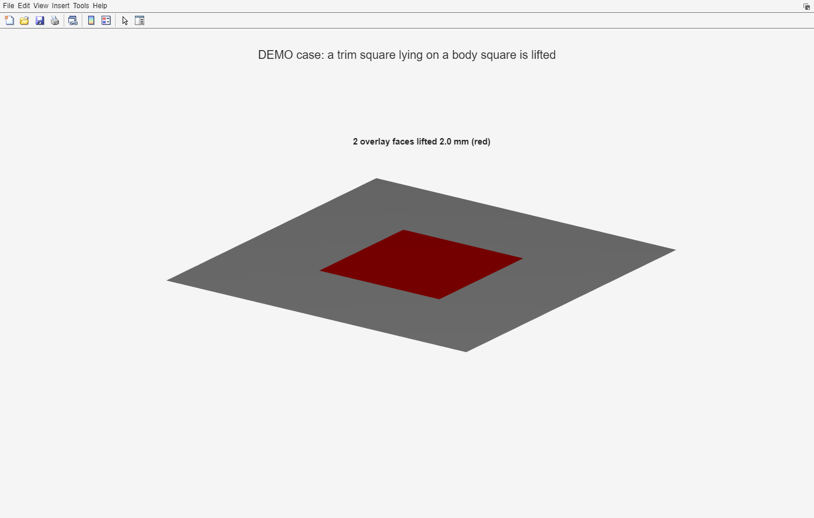

</details>

<details><summary><b><code>fcn_CarMesh3D_addFloorPanel</code></b> (test: <code>script_test_fcn_CarMesh3D_addFloorPanel.m</code>): Adds a flat floor panel under a vehicle: one polygon at the ground clearance height, the shape of the lower body seen from above, with each wheel's footprint cut out.</summary>

Adds a flat floor panel under a vehicle: one polygon at the ground clearance height, the shape of the lower body seen from above, with each wheel's footprint cut out. Downloaded models often have no underside (the cabin is open from below), so a reduced mesh can be seen through from below or through its windows; the panel closes it.

```matlab
vehicleMesh = fcn_CarMesh3D_addFloorPanel(vehicleMesh,...
    (Height=meters), (LowerBodyHeight=meters), (Inset=meters),...
    (WheelClearance=meters), (SteerRoom=meters),...
    (BlendWidth=meters), (MaxRise=meters), (Color=rgb),...
    (Symmetric=flag), (OnlyWhereOpen=flag),...
    (CoverHeight=meters), (GridSpacing=meters), (Overlap=meters),...
    (MinCovered=squareMeters), (FigNum=figNum))
```

| Variable | Kind | Meaning | Class | Size |
|---|---|---|---|---|
| `vehicleMesh` | input | a finished CarMesh3D mesh (labeled and fit to its spec, in the vehicle frame: origin on the ground below the rear axle, X forward, Y left, Z up). | struct | 1 x 1 |
| `Height` | option | meters above the ground for the panel. Default: the spec's GroundClearance (vehicleMesh.VehicleSpec), or the lowest point of the body (not the wheels) if there is none. | double | varies |
| `LowerBodyHeight` | option | meters; the outline is traced from the faces whose centers are below this. Default 0.6. | double | 1 x 1 |
| `Inset` | option | meters the outline is shrunk by. Default 0.03. | double | 1 x 1 |
| `WheelClearance` | option | meters added around each wheel's cutout. Default 0.05. | double | 1 x 1 |
| `SteerRoom` | option | meters added to the width of the front wheels' cutouts, so a steered tire does not cut through the panel. Default 0.15. | double | 1 x 1 |
| `BlendWidth` | option | meters; a strip this wide along the panel's edges rises to meet the body: each edge point (every 5 cm) goes up to the lowest body corner within 6 cm of it (seen from above), up or down (to at most half the panel height), so the panel joins the body's lower edge with no gap seen from the side; the edge heights are then smoothed along the edge (the median within 15 cm each way, then a running mean), so no spikes rise where a point found a door skin above the rocker. | double | 1 x 1 |
| `MaxRise` | option | meters; the most an edge point rises above the panel. Default 0.30. | double | 1 x 1 |
| `Color` | option | the panel's color. Default [0.15 0.15 0.15]. | double | 1 x 3 |
| `Symmetric` | option | 'auto' (default) builds the left half of the panel (Y >= 0) and mirrors it when the mesh is its own mirror image (90% of its faces have a mirror twin), so both sides of the car meet the panel the same way; true always does; false never does. Default `'auto'`. | char | 1 x n |
| `OnlyWhereOpen` | option | true (default) to add the panel only where the model is open from below (see ONLY WHERE NEEDED above); false for the whole outline. Default `true`. | logical | 1 x 1 |
| `CoverHeight` | option | meters; an opaque face below this height closes the model from below. Default 0.6. | double | 1 x 1 |
| `GridSpacing` | option | meters between the rays cast up. Default 0.03. | double | 1 x 1 |
| `Overlap` | option | meters the open area is grown by, under the model's own floor edges. Default 0.03. | double | 1 x 1 |
| `MinCovered` | option | square meters; closed patches smaller than this are ignored. Default 0.01. | double | 1 x 1 |
| `MinOpenFraction` | option | no panel is added unless more than this share of the outline is open from below (with OnlyWhereOpen). Default 0 (any opening gets a panel); the vehicle scripts use 0.10. | double | 1 x 1 |
| `FigNum` | option | a figure to plot the panel (and the mesh, faded) from below. If empty or omitted, no plot is made. Default `[]`. | double | 1 x 1 (or empty) |
| `vehicleMesh` | output | the mesh with the panel's faces added at the end (every per-face field extended), its material named 'CarMesh3D_floorPanel', and FloorPanel set to a structure with Height, Polygon (the panel's outline with holes, a polyshape), Faces (the indices of the panel's faces), and OpenFraction (the share of the full outline that was open from below, so got the panel; 1 with OnlyWhereOpen=false). | struct | 1 x 1 |

**Assumptions:** The vehicle frame (ground at z = 0); a panel is added only when more than 10% of the floor is open from below.

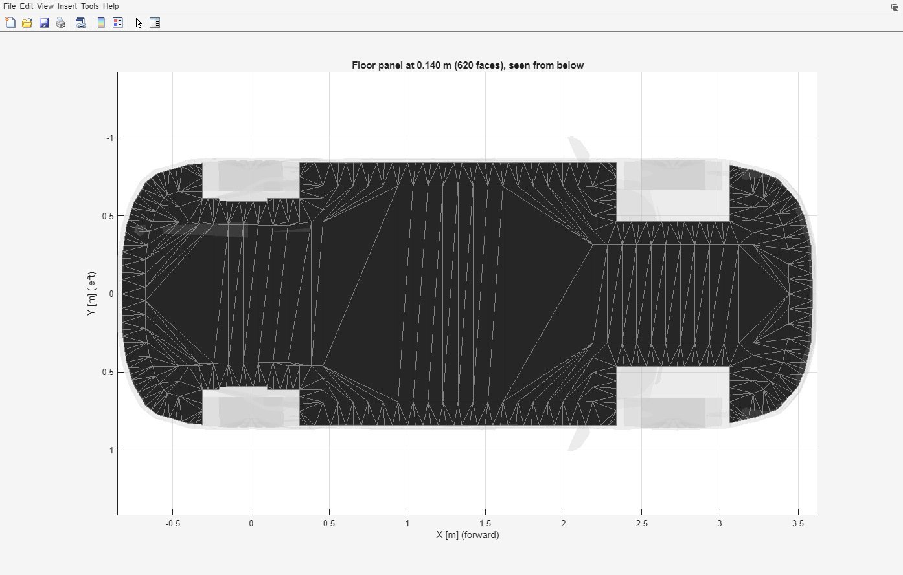

</details>

<details><summary><b><code>fcn_CarMesh3D_labelInterior</code></b> (test: <code>script_test_fcn_CarMesh3D_labelInterior.m</code>): Labels a vehicle's interior (seats, steering wheel, dash, door panels): the faces of the body and trim parts that can be seen from outside only through the glass.</summary>

Labels a vehicle's interior (seats, steering wheel, dash, door panels): the faces of the body and trim parts that can be seen from outside only through the glass. Downloads rarely name their interior materials, so the interior is found from the shape, with voxels (listed in the function's header).

```matlab
[vehicleMesh, interiorInfo] = fcn_CarMesh3D_labelInterior(vehicleMesh,...
    (VoxelSize=meters), (GapSize=meters), (Parts=names),...
    (FigNum=figNum))
```


| Variable | Kind | Meaning | Class | Size |
|---|---|---|---|---|
| `vehicleMesh` | input | a labeled CarMesh3D mesh (Vertices, Faces, PartNames, FacePartIndex, FaceWheelIndex), fit to its spec (in meters). | struct | 1 x 1 |
| `VoxelSize` | option | meters. Default 0.02. | double | 1 x 1 |
| `GapSize` | option | meters; holes and gaps up to this size are closed (steps 2 and 3). Default 0.12. | double | 1 x 1 |
| `Parts` | option | the parts whose faces may become interior. Default {'body','trim'}. | cell | 1 x n |
| `FigNum` | option | a figure to plot the mesh with its interior faces in orange (the rest faded). If empty or omitted, no plot is made. Default `[]`. | double | 1 x 1 (or empty) |
| `vehicleMesh` | output | the mesh with its interior faces' FacePartIndex set to the 'interior' part (added to PartNames if needed), and InteriorInfo set to interiorInfo. | struct | 1 x 1 |
| `interiorInfo` | output | a structure with VoxelSize, GapSize, NumInterior (faces relabeled), NumFromPart (a table-like structure: how many came from each part), and GridSize. | double | 1 x 1 |

**Assumptions:** Glass is labeled; the interior is found from the shape (voxels), since downloads rarely name interior materials.

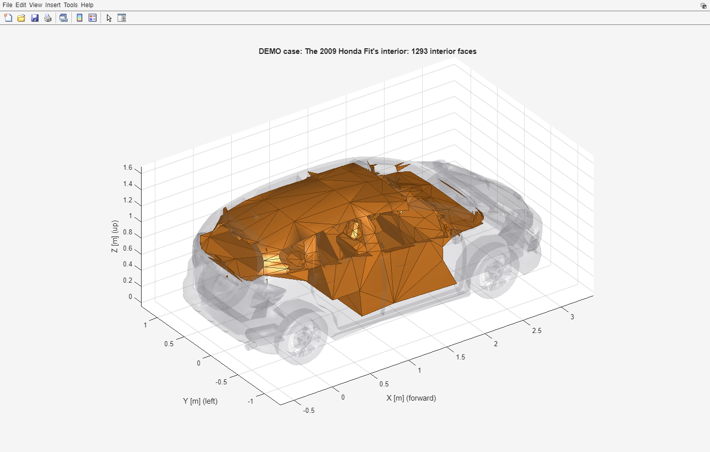

</details>

### Check the mesh

<details><summary><b><code>fcn_CarMesh3D_validateMesh</code></b> (test: <code>script_test_fcn_CarMesh3D_validateMesh.m</code>): Measures a fitted mesh and compares it, value by value, against a vehicle specification.</summary>

Measures a fitted mesh and compares it, value by value, against a vehicle specification. This is the "did it work?" check at the end of the CarMesh3D workflow, and the table it returns is a good thing for students to include in a report.

```matlab
validationTable = fcn_CarMesh3D_validateMesh(vehicleMesh, vehicleSpec,...
    (Tolerance=percentTolerance),...
    (FigNum=figNum))
```


| Variable | Kind | Meaning | Class | Size |
|---|---|---|---|---|
| `vehicleMesh` | input | a CarMesh3D mesh structure in the vehicle frame, usually after fcn_CarMesh3D_fitMeshToSpec. | struct | 1 x 1 |
| `vehicleSpec` | input | a vehicle specification structure from fcn_CarMesh3D_fillVehicleSpec. | struct | 1 x 1 |
| `Tolerance` | option | the percent error at or below which a value is marked as passing. Default is 2 (percent). | double | 1 x 1 |
| `FigNum` | option | a figure number to plot side, top, and front views of the mesh with the target dimensions drawn as dashed lines. If empty or omitted, no plot is made. Default `[]`. | double | 1 x 1 (or empty) |
| `validationTable` | output | a MATLAB table with one row per quantity and the columns Quantity (string), Target_m, Measured_m, Error_m, PercentError, Pass (true, false, or missing) Target_m is NaN when the spec has no value, and Measured_m is NaN when the mesh cannot be measured for that quantity. | table | rows x 5 |

**Assumptions:** The mesh is fitted and in the vehicle frame; only shown faces are measured (visibleMesh); spec values left NaN are skipped.

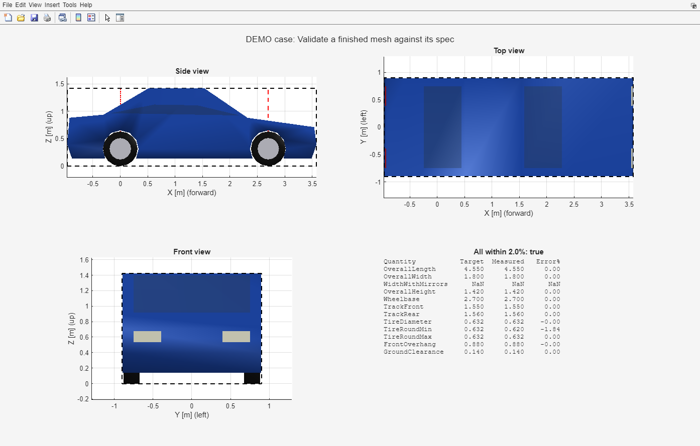

</details>

<details><summary><b><code>fcn_CarMesh3D_compareToOriginal</code></b> (test: <code>script_test_fcn_CarMesh3D_compareToOriginal.m</code>): Compares a reduced (finished) mesh with the original download it came from, both in the vehicle frame, and flags the spots where the reduction went wrong, so a review starts from a short list instead of a search.</summary>

Compares a reduced (finished) mesh with the original download it came from, both in the vehicle frame, and flags the spots where the reduction went wrong, so a review starts from a short list instead of a search. Both meshes are drawn from the same cameras (14 views: the four sides, top, bottom, four corners, and the four sides from 12 degrees below), each face in its own unique color, so each pixel tells which face is seen there.

```matlab
report = fcn_CarMesh3D_compareToOriginal(reducedMesh, originalMesh,...
    (Title=text), (ImageWidth=pixels), (NumSpots=count),...
    (OutputFile=pngPrefix), (OriginalCache=matFile), (FigNum=figNum))
```

| Variable | Kind | Meaning | Class | Size |
|---|---|---|---|---|
| `reducedMesh` | input | the finished (reduced) CarMesh3D mesh, labeled and fit to its spec. | struct | 1 x 1 |
| `originalMesh` | input | the same download, labeled and fit the same way, not reduced. | struct | 1 x 1 |
| `Title` | option | text for the sheets' titles (for example, the vehicle's name). Default ''. | char | 1 x n |
| `ImageWidth` | option | pixels across each view. Default 900. | double | 1 x 1 |
| `NumSpots` | option | how many flagged spots get close-ups. Default 9. | double | 1 x 1 |
| `OutputFile` | option | a file name prefix: the two sheets are saved as <prefix>_views.png and <prefix>_spots.png. Default '' (not saved). | char | 1 x n |
| `OriginalCache` | option | a .mat file in which the download's renders (face numbers and shaded pictures, 28 of the 56 renders) are kept. | char | 1 x n |
| `FigNum` | option | a figure for the views sheet (the spots sheet goes in a figure of its own, named '<Title>: flagged spots'); both are left open. Default `[]`. | double | 1 x 1 (or empty) |
| `report` | output | a structure with Views: a table, one row per view: View, CarPixels, and HolePercent, LabelChangePercent, FlippedPercent, SeeThroughPercent (of the car's pixels in that view) Totals: the same four percentages over all views Spots: a structure array, worst first: View, Box ([row1 row2 col1 col2] in that view's pictures), Holes, LabelChanges, Flipped, SeeThrough (pixel counts) Images: per view, the shaded pictures (Original, Reduced) and the flagged masks (Holes, LabelChanges, Flipped, SeeThrough) Parts: a table, one row per label (part, or light type): Label, OriginalFaces, ReducedFaces, OriginalArea and ReducedArea (m^2), AreaChangePercent, and Missing (true when a label with at least 0.01 m^2 in the download kept less than half of its area: faces lost in the reduction) MissingLabels: the labels flagged Missing | struct | 1 x 1 |

**Assumptions:** Both meshes are labeled and fitted the same way, so their views line up; only shown faces of the reduced mesh are compared.

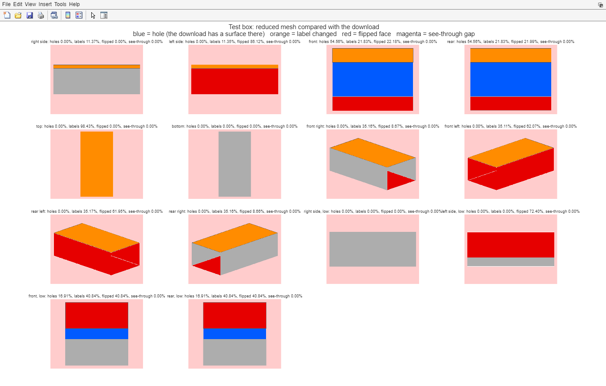

</details>

<details><summary><b><code>fcn_CarMesh3D_checkHiddenFaces</code></b> (test: <code>script_test_fcn_CarMesh3D_checkHiddenFaces.m</code>): Warns about hidden faces (FaceHiddenSet, in named sets: see fcn_CarMesh3D_editLabels's Hide) that could mislead.</summary>

Warns about hidden faces (FaceHiddenSet, in named sets: see fcn_CarMesh3D_editLabels's Hide) that could mislead. The checks and outlines measure the vehicle as it is shown (fcn_CarMesh3D_visibleMesh), which is right for a vehicle shown that way (a coupe with its hard top off), but hidden faces are still in the mesh, so three things are worth knowing (listed in the function's header).

```matlab
report = fcn_CarMesh3D_checkHiddenFaces(vehicleMesh, vehicleSpec,...
    (Tolerance=meters), (ManyFraction=fraction), (Quiet=flag),...
    (FigNum=figNum))
```

| Variable | Kind | Meaning | Class | Size |
|---|---|---|---|---|
| `vehicleMesh` | input | a CarMesh3D mesh, with or without hidden faces. | struct | 1 x 1 |
| `vehicleSpec` | input | the vehicle's parameters (fcn_CarMesh3D_loadVehicleSpec), for the dimensions (fcn_CarMesh3D_validateMesh); [] to skip the dimensions. | struct | 1 x 1 |
| `Tolerance` | option | how much a dimension may change, or a hidden face reach past the shown vehicle, before it is reported [m]. Default 0.01. | double | 1 x 1 |
| `ManyFraction` | option | the share of faces hidden above which it is reported. Default 0.10. | double | 1 x 1 |
| `Quiet` | option | true to return the report without printing warnings. Default false. | logical | 1 x 1 |
| `FigNum` | option | a figure to show the shown faces (gray), the hidden faces (red), and the shown vehicle's bounding box (blue). If empty or omitted, no plot is made. Default `[]`. | double | 1 x 1 (or empty) |
| `report` | output | a structure with NumHidden, NumFaces, HiddenFraction Sets: a table (Name, Faces) of the hidden sets Dimensions: a table (Quantity, Shown_m, WithHidden_m, Difference_m) of the dimensions the hidden faces change OutsideBox: a table (Set, Side, Distance_m) of the hidden sets reaching past the shown vehicle's bounding box ShownBox, FullBox: [xmin ymin zmin; xmax ymax zmax] of the shown faces, and of every face Messages: the findings, as text (a cell array) | struct | 1 x 1 |

**Assumptions:** Warnings only; nothing is changed. Tolerance (0.01 m) is the change in size that counts, and ManyFraction (0.10) is the share of faces that counts as many.

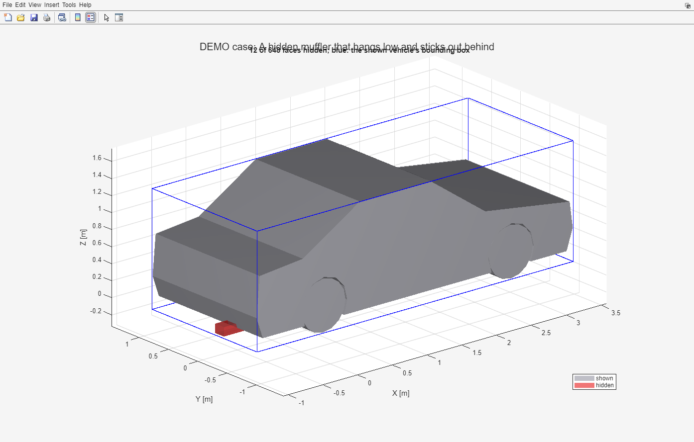

</details>

<details><summary><b><code>fcn_CarMesh3D_runVehicleChecks</code></b> (test: <code>script_test_fcn_CarMesh3D_runVehicleChecks.m</code>): Runs the STANDARD CHECKS on a finished vehicle mesh: the standard test motion (fcn_CarMesh3D_fillTestMotion), in the standard scene, seen through standard cameras, saved as a standard set of images and animated GIFs.</summary>

Runs the STANDARD CHECKS on a finished vehicle mesh: the standard test motion (fcn_CarMesh3D_fillTestMotion), in the standard scene, seen through standard cameras, saved as a standard set of images and animated GIFs. Look through them to confirm that every input works for this vehicle (lights, steering, wheels, body motion) before using it.

```matlab
checkResults = fcn_CarMesh3D_runVehicleChecks(vehicleMesh,...
    vehicleSpec, outputFolder, (Checks=names), (SaveGifs=flag), (SaveFigs=flag),...
    (VehicleName=name), (PanelSize=[w h]), (FigNum=figNum))
```

| Variable | Kind | Meaning | Class | Size |
|---|---|---|---|---|
| `vehicleMesh` | input | a finished mesh (labeled, fitted, simplified). | struct | 1 x 1 |
| `vehicleSpec` | input | the vehicle's spec (for the test motion and the dimension check). | struct | 1 x 1 |
| `outputFolder` | input | where to write the files. It is made if needed. | char or string | 1 x n |
| `Checks` | option | 'all' (default), or a cell array of check names to run: 'inputs','dimensions','labels','lightStates','lights','body', 'steering','wheels','drive','groundContact'. Default `'all'`. | char | 1 x n |
| `SaveGifs` | option | true (default) to save the GIFs; false to only play the animations (faster, for a first look). Default `true`. | logical | 1 x 1 |
| `SaveFigs` | option | true to save a .fig beside each picture (to open with openfig and zoom or rotate); false (default) for the pictures only. Default `false`. | logical | 1 x 1 |
| `VehicleName` | option | a name for the captions. Default is vehicleSpec.Name. | char | 1 x n |
| `PanelSize` | option | [width height] in pixels of each view. Default [480 300]. | double | 1 x 2 |
| `FigNum` | option | the figure number to draw in (all checks reuse it). Default [] uses figure 900. If set to -1, input checking is skipped. | double | 1 x 1 (or empty) |
| `checkResults` | output | a structure with fields Files (cell array of the files written), ValidationTable, ContactFlags (N x 1), TestMotion, and Hidden (fcn_CarMesh3D_checkHiddenFaces's report). | struct | 1 x 1 |

**Assumptions:** The vehicle's build script has run, so its mesh and spec are saved; family-1 vehicles (the download kept as it is) run only the dimension and label checks by default.

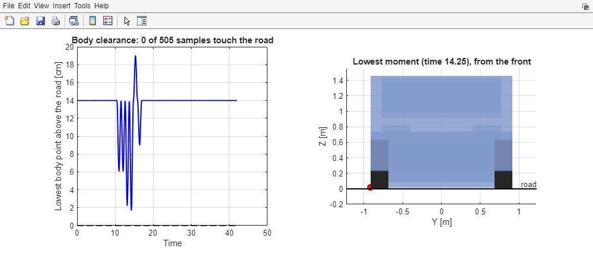

</details>

<details><summary><b><code>fcn_CarMesh3D_animateChecks</code></b> (test: <code>script_test_fcn_CarMesh3D_animateChecks.m</code>): The animation checks of a vehicle's mesh, drawn live from the mesh and the test motion: Lights, Body, Steering, Wheels, or Drive.</summary>

The animation checks of a vehicle's mesh, drawn live from the mesh and the test motion: Lights, Body, Steering, Wheels, or Drive. Two copies of the vehicle side by side, one seen from ahead and to the left, one from behind and to the right, each view following its vehicle, with a caption naming the step.

```matlab
animator = fcn_CarMesh3D_animateChecks(vehicleInput, checkKey,...
    (TestMotion=testMotion), (Rows=rows), (StepRows=stepRows),...
    (Parent=container), (ShowPlayer=flag), (OnStep=function),...
    (OnHint=function), (Visible=flag), (FigNum=figNum))
```

| Variable | Kind | Meaning | Class | Size |
|---|---|---|---|---|
| `vehicleInput` | input | a vehicle ID ('2009_Honda_Fit_Sport'), or a labeled CarMesh3D mesh. | char or struct | 1 x n, or 1 x 1 |
| `checkKey` | input | 'lights', 'body', 'steering', 'wheels', or 'drive' | char | 1 x n |
| `TestMotion` | option | the test motion (as fcn_CarMesh3D_checkVehicle's checkResults.TestMotion). Needed with a mesh; with an ID, the default is from the vehicle's cache. Default `[]`. | struct | 1 x 1 |
| `Rows` | option | the rows of the test motion to animate. Default: the rows whose captions start with the check's name. | char | 1 x n |
| `StepRows` | option | one row per step, the row each step is shown at. | double | N x 1 |
| `Parent` | option | a panel or grid to build into; [] (default) for a window of its own. Default `[]`. | graphics handle | 1 x 1 |
| `ShowPlayer` | option | true to show Play, a time slider, and the inputs plotted over time. Default: true in its own window, false in a parent. | logical | 1 x 1 |
| `OnStep` | option | a function called with a step number as the whole animation plays, when the step showing changes (0 when it stops): the reviewer lights up that step's item. Default `[]`. | function_handle | 1 x 1 |
| `OnHint` | option | a function called with a hint (HTML text) to show; [] to show it in its own window's hint line (or not at all, in a parent). Default `[]`. | function_handle | 1 x 1 |
| `Visible` | option | false to build the window hidden (for tests). Default true. | logical | 1 x 1 |
| `FigNum` | option | not used (a window); [] or -1 (fast mode: no input checks). Default `[]`. | double | 1 x 1 (or empty) |
| `animator` | output | a structure of the animation's handles and functions: Figure, Axes (the two views), InputAxes, Handles (the fcn_CarMesh3D_plotVehicle handles of each view), Mesh, Rows, Steps (Name, Row of each step), CheckKey ShowFrame(frameIndex), Frame(): one time step (an index into Rows) ShowStep(stepIndex): a step's scene; 0 for the whole animation, played over and over Play(), Pause(), IsPlaying() ResetViews(): the cameras back on the vehicle Stop(): stop playing (before the parent is cleared) Close(): close its own window | struct | 1 x 1 |

**Assumptions:** The mesh is finished and labeled (lamp types set for the Lights check); the test motion is fillTestMotion's unless one is given.

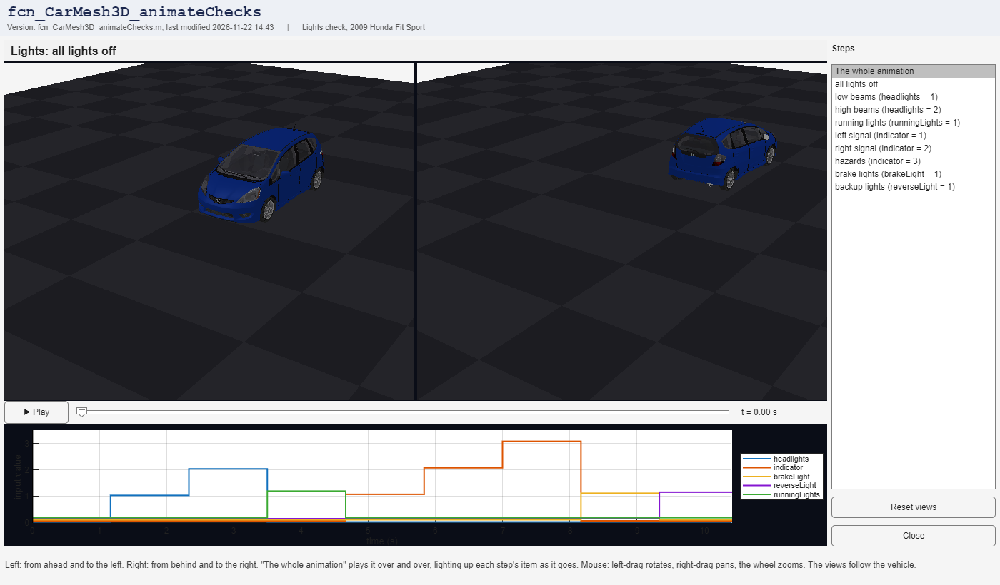

</details>

<details><summary><b><code>fcn_CarMesh3D_checkGroundContact</code></b> (test: <code>script_test_fcn_CarMesh3D_checkGroundContact.m</code>): Checks, at each time step, whether the body (the sprung mass) has rolled, pitched, or dropped so far that part of it reaches the ground: for example, a front corner of the bumper pushed down in hard braking while turning.</summary>

Checks, at each time step, whether the body (the sprung mass) has rolled, pitched, or dropped so far that part of it reaches the ground: for example, a front corner of the bumper pushed down in hard braking while turning. Contact means body damage is likely, unless that part of the vehicle is protected (for example, by a skid plate).

```matlab
[flagContact, clearance, lowestPoint] = ...
    fcn_CarMesh3D_checkGroundContact(vehicleMesh, bodyRoll,...
    bodyPitch, bodyHeave, (BodyPivot=[x y z]),...
    (MinimumClearance=c), (Time=t), (FigNum=figNum))
```

| Variable | Kind | Meaning | Class | Size |
|---|---|---|---|---|
| `vehicleMesh` | input | a fitted mesh (fcn_CarMesh3D_fitMeshToSpec), labeled so the wheels are known (FaceWheelIndex). | struct | 1 x 1 |
| `bodyRoll` | input | N x 1 body roll and pitch relative to the ground frame, in radians (ISO 8855: + roll lowers the right side, + pitch lowers the nose). | double | N x 1 |
| `bodyPitch` | input | N x 1 body roll and pitch relative to the ground frame, in radians (ISO 8855: + roll lowers the right side, + pitch lowers the nose). | double | N x 1 |
| `bodyHeave` | input | N x 1 body displacement up from equilibrium, in meters (motion.BodyHeave), or a scalar (used for every time). | double | N x 1 |
| `BodyPivot` | option | the point [x y z] the body rolls and pitches about, in the vehicle frame. Default [] uses the same point as fcn_CarMesh3D_plotVehicle. | double | 1 x 3 (or empty) |
| `MinimumClearance` | option | the lowest allowed height above the road, in meters. Default 0 (touching the road). Use a positive value for a safety margin. | double | 1 x 1 |
| `Time` | option | N x 1 times, used for the warning message and the plot. Default [] (sample numbers are used). | double | N x 1 |
| `FigNum` | option | a figure number to plot the clearance over time, and a side and front view of the body at the lowest moment. If empty or omitted, no plot is made. Default `[]`. | double | 1 x 1 (or empty) |
| `flagContact` | output | N x 1 logical, true where the body reaches the road. | logical | N x 1 |
| `clearance` | output | N x 1 height of the lowest body point above the road, in meters (negative means it would be below the road surface). | double | N x 1 |
| `lowestPoint` | output | N x 3 position of that lowest point on the body, in the body's own (unmoved) vehicle frame, to tell which part it is (for example, x > front axle and y < 0 is the front right). | double | N x 3 |

**Assumptions:** The body is rigid and moves exactly as plotVehicle moves it (rolled and pitched about BodyPivot, then heaved); the wheels stay on a flat road.

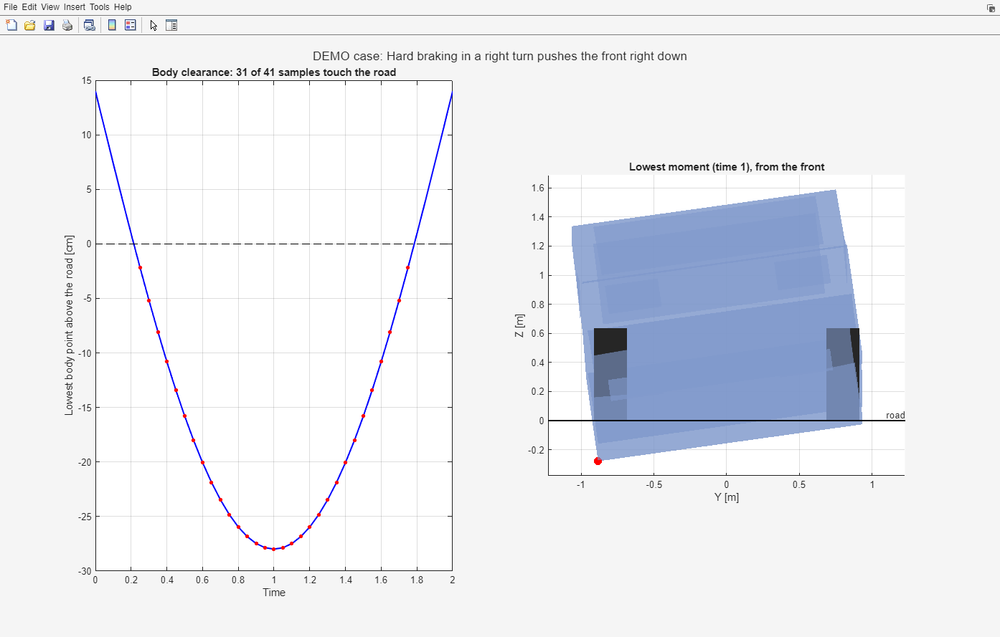

</details>

<details><summary><b><code>fcn_CarMesh3D_fillTestMotion</code></b> (test: <code>script_test_fcn_CarMesh3D_fillTestMotion.m</code>): Makes the STANDARD TEST MOTION: one motion that uses every motion input (see "Inputs" in the README), in short, labeled segments, so that a new vehicle can be checked the same way every time.</summary>

Makes the STANDARD TEST MOTION: one motion that uses every motion input (see "Inputs" in the README), in short, labeled segments, so that a new vehicle can be checked the same way every time. The motion is written to a CSV file in the CarMesh3D column convention and then read back with fcn_CarMesh3D_loadMotionCSV, so the file reader is checked too.

```matlab
testMotion = fcn_CarMesh3D_fillTestMotion(vehicleSpec,...
    (SampleTime=dt), (CSVFile=fileName), (FigNum=figNum))
```

| Variable | Kind | Meaning | Class | Size |
|---|---|---|---|---|
| `vehicleSpec` | input | a CarMesh3D vehicle spec (fcn_CarMesh3D_loadVehicleSpec or fcn_CarMesh3D_fillVehicleSpec). The wheelbase sets the turn radius; the wheelbase and front track set the Ackermann angles; the tire diameter sets the wheel speeds. | struct | 1 x 1 |
| `SampleTime` | option | the time step, in seconds. Default 1/12 (12 frames per second, the rate of the check GIFs). | double | 1 x 1 |
| `CSVFile` | option | where to write the CSV file. Default [] writes it to a temporary file (and deletes it after reading it back). | char or string | 1 x n |
| `FigNum` | option | a figure number to plot the inputs over time, with the segments shaded. If empty or omitted, no plot is made. Default `[]`. | double | 1 x 1 (or empty) |
| `testMotion` | output | the motion as read back by fcn_CarMesh3D_loadMotionCSV (Time, Pose, BodyRoll, BodyPitch, BodyHeave, Speed, SteerAngle, WheelSpin, WheelLift, LightStates, Data, ...), plus: Segments: a structure array with Name, StartTime, EndTime, and Description for each segment Caption: K x 1 cell array describing the inputs at each time step (for captions in the check animations) CSVFile: the file written ('' if it was temporary) | struct | 1 x N |

**Assumptions:** Fixed test steps (lights, body, steering, wheels, drive), the same for every vehicle, so checks can be compared.

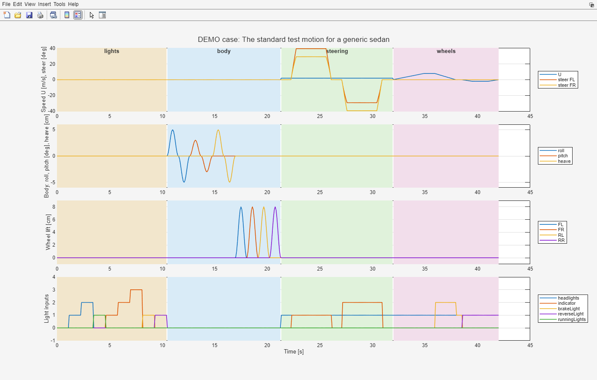

</details>

<details><summary><b><code>fcn_CarMesh3D_plotSideImage</code></b> (test: <code>script_test_fcn_CarMesh3D_plotSideImage.m</code>): Shows a side-view photo (or drawing) of the real vehicle on a vertical plane through the vehicle's centerline, scaled and placed so its wheel centers land on the mesh's wheel centers.</summary>

Shows a side-view photo (or drawing) of the real vehicle on a vertical plane through the vehicle's centerline, scaled and placed so its wheel centers land on the mesh's wheel centers. Looking from the side, the outline of the mesh can then be checked against the real vehicle: the roof line, hood, bumpers, windows, and wheel arches.

```matlab
overlayHandles = fcn_CarMesh3D_plotSideImage(sideImage, vehicleMesh,...
    (WheelCentersPixels=[colRear rowRear; colFront rowFront]),...
    (PlaneY=y), (ImageAlpha=alpha), (VehicleAlpha=alpha),...
    (ShowVehicle=flag), (SetView=flag), (FigNum=figNum))
```


| Variable | Kind | Meaning | Class | Size |
|---|---|---|---|---|
| `sideImage` | input | the side-view picture, as an image file name (any format imread reads, such as .jpg or .png) or an image array (H x W x 3 color, H x W gray). | char | 1 x n |
| `vehicleMesh` | input | a mesh fitted with fcn_CarMesh3D_fitMeshToSpec, which gives the axle positions (AxleX) and the tire diameter (VehicleSpec.TireDiameter). | struct | 1 x 1 |
| `WheelCentersPixels` | option | [colRear rowRear; colFront rowFront], the pixel positions (column, row; row 1 is the top of the image) of the rear and front wheel centers in the picture. | double | 2 x 2 |
| `PlaneY` | option | where the picture plane is, along Y (left), in meters. Default 0, the vehicle centerline. | double | 1 x 1 |
| `ImageAlpha` | option | how solid the picture is, from 0 (clear) to 1 (solid, the default). Default `1`. | double | 1 x 1 |
| `VehicleAlpha` | option | how solid the vehicle is drawn, from 0 to 1. Default 0.4, so the picture shows through. | double | 1 x 1 |
| `ShowVehicle` | option | true (default) to also draw the vehicle with fcn_CarMesh3D_plotVehicle; false to draw only the picture (for example, into an axes where the vehicle is already drawn). Default `true`. | logical | 1 x 1 |
| `SetView` | option | true (default) to look from the vehicle's right side (-Y), with no perspective (orthographic), so the outlines can be compared exactly. Rotate the view to see the other side. Default `true`. | logical | 1 x 1 |
| `FigNum` | option | a figure number to draw into. If empty or omitted, draws into the current figure. If set to -1, input checking is skipped (WheelCentersPixels must then be given). Default `[]`. | double | 1 x 1 (or empty) |
| `overlayHandles` | output | a structure with fields Image: the surface showing the picture Vehicle: the plot handles from fcn_CarMesh3D_plotVehicle (or []) Corners: 4 x 3 corners of the picture in the vehicle frame (top-left, top-right, bottom-left, bottom-right) MetersPerPixel: the scale of the picture TiltDegrees: how much the picture was rotated to level it FlippedImage: true if the picture was flipped left-to-right (the vehicle faced left in it) WheelCentersPixels: the wheel centers used PixelToVehicle: a function that maps [col row] pixel points (N x 2, in the original picture) to [x z] in meters | function_handle | 1 x 1 |

**Assumptions:** A side photo taken square to the vehicle (from far away, to limit perspective), with both wheel centers visible.

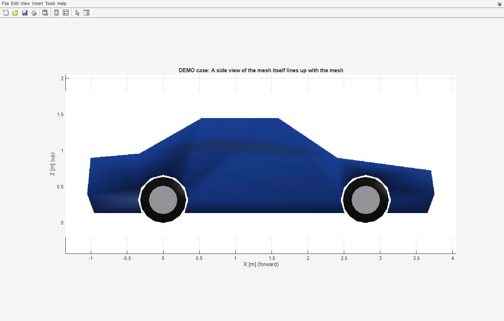

</details>

<details><summary><b><code>fcn_CarMesh3D_checkModels</code></b> (test: <code>script_test_fcn_CarMesh3D_checkModels.m</code>): Lists, for each vehicle in the library, whether its downloaded model is on this computer and whether its imported mesh (rawMesh_<ID>.mat) is.</summary>

Lists, for each vehicle in the library, whether its downloaded model is on this computer and whether its imported mesh (rawMesh_<ID>.mat) is. The downloads are large, so they are not kept in the git repository: they are kept in the IVSG large-file storage area (a OneDrive folder) and copied into each vehicle's model\ folder (see README.md, "Large files"). A vehicle's script runs with either one: from the download, or, without it, from its imported mesh, which is in the repository.

```matlab
report = fcn_CarMesh3D_checkModels(...
    (Vehicles=vehicleIDs), (LargeFileFolder=folder), (DataFolder=folder), (FigNum=figNum))
```

| Variable | Kind | Meaning | Class | Size |
|---|---|---|---|---|
| `Vehicles` | option | a cell array of vehicle IDs to check, such as {'2009_Honda_Fit_Sport'}. Default: {} (every vehicle with a script). | cell | 1 x n |
| `LargeFileFolder` | option | the large-file area's CarMesh3D Data folder, as it is found on this computer (the OneDrive folder is mounted at a different place on each computer). | char | 1 x n |
| `DataFolder` | option | the repository's Data folder. Default: the Data folder next to this function's Functions folder. | char | 1 x n |
| `FigNum` | option | if given (and not -1), the list is printed. If set to -1, input checking is skipped (fast mode) and nothing is printed. Default `[]`. | double | 1 x 1 (or empty) |
| `report` | output | a table, one row per vehicle, with the columns ID: the vehicle ID Folder: the vehicle's folder ModelFile: the script's modelFile ('' for a vehicle made from its body style, or the built-in sample car, which need no download) HasDownload: true if the model file is on this computer HasRawMesh: true if rawMesh_<ID>.mat is in the folder CanBuild: true if the script can run (a download, an imported mesh, or no download needed) InLargeFileFolder: true if the download is in LargeFileFolder (false when no LargeFileFolder is given) | table | vehicles x columns |

**Assumptions:** Each vehicle's download sits in its model/ folder (in the large-file area, not in git).

</details>

### Save, stamp and cache

<details><summary><b><code>fcn_CarMesh3D_makeBuildInfo</code></b> (test: <code>script_test_fcn_CarMesh3D_makeBuildInfo.m</code>): Makes the BuildInfo saved with a finished mesh (vehicleMesh.BuildInfo): the CarMesh3D version and MESH VERSION it was made with (see fcn_CarMesh3D_version), when, by which script, with which main settings, from which exemplar (for a body-style vehicle), and its QUALITY SCORE.</summary>

Makes the BuildInfo saved with a finished mesh (vehicleMesh.BuildInfo): the CarMesh3D version and MESH VERSION it was made with (see fcn_CarMesh3D_version), when, by which script, with which main settings, from which exemplar (for a body-style vehicle), and its QUALITY SCORE. With it, meshes made before a change to CarMesh3D can be found and made again (fcn_CarMesh3D_listVehicles), and vehicles can be compared by quality.

```matlab
buildInfo = fcn_CarMesh3D_makeBuildInfo(...
    (Script=fileName), (Settings=struct), (CompareTotals=totals),...
    (Validation=table), (Exemplar=buildInfo), (FigNum=figNum))
```

| Variable | Kind | Meaning | Class | Size |
|---|---|---|---|---|
| `Script` | option | the script that made the mesh (a file name or path; only the name is kept). Default ''. | char | 1 x n |
| `Settings` | option | a structure of the main settings used (for example TargetFaces, ReduceWithBlender, Symmetric, BodyStyle), kept as given. Default struct(). | struct | 1 x 1 |
| `CompareTotals` | option | the Totals of fcn_CarMesh3D_compareToOriginal (HolePercent, LabelChangePercent, FlippedPercent, SeeThroughPercent). Default [] (no comparison). | struct | 1 x 1 |
| `Validation` | option | the table of fcn_CarMesh3D_validateMesh (its Pass column). Default [] (no dimension checks). | table | rows x 5 |
| `Exemplar` | option | the exemplar's own BuildInfo, for a body-style vehicle (its ID is taken from its Settings, its comparison terms are used when CompareTotals is empty). Default []. | char | 1 x n |
| `FigNum` | option | if given (not -1), the build information is printed. If set to -1, input checking is skipped (fast mode). Default `[]`. | double | 1 x 1 (or empty) |
| `buildInfo` | output | a structure with CarMesh3DVersion, MeshVersion: from fcn_CarMesh3D_version Date: when it was made, 'yyyy-MM-dd HH:mm' Script: the script's file name MATLABRelease: such as '2025b' Settings: as given ExemplarID, ExemplarMeshVersion: for a body-style vehicle ('' otherwise) Quality: Score, HolePercent, LabelChangePercent, FlippedPercent, SeeThroughPercent (NaN if unknown), DimensionChecks and DimensionChecksFailed (counts), Basis ('comparison', 'exemplar', or 'dimensions only'), and Formula (the formula as text) | struct | 1 x 1 |

**Assumptions:** Called at the end of a build; the quality score comes from the checks that ran.

</details>

<details><summary><b><code>fcn_CarMesh3D_makeDetailLevels</code></b> (test: <code>script_test_fcn_CarMesh3D_makeDetailLevels.m</code>): Makes a "ladder" of lighter versions of a finished vehicle mesh, for animations where a vehicle is often far away and small on screen.</summary>

Makes a "ladder" of lighter versions of a finished vehicle mesh, for animations where a vehicle is often far away and small on screen. Each level is made for a range of sizes on screen, with about the same number of visible faces per pixel as the others, so detail is spent only where it can be seen.

```matlab
detailLevels = fcn_CarMesh3D_makeDetailLevels(vehicleMesh,...
    (TopScreenSize=pixels), (Step=ratio), (FacesPerPixel=density),...
    (VoxelSize=meters), (GapSize=meters), (MinFaces=count),...
    (FigNum=figNum))
```


| Variable | Kind | Meaning | Class | Size |
|---|---|---|---|---|
| `vehicleMesh` | input | a finished CarMesh3D mesh (labeled, fitted, and simplified). | struct | 1 x 1 |
| `TopScreenSize` | option | the size on screen (pixels) the top level is made for. | double | 1 x 1 |
| `Step` | option | the ratio between the sizes of two levels. Default sqrt(2). | double | 1 x 1 |
| `FacesPerPixel` | option | visible faces per pixel. Default 0.2. | double | 1 x 1 |
| `VoxelSize` | option | the voxel size of the hull, meters. Default 0.03. | double | 1 x 1 |
| `GapSize` | option | openings up to this size (meters) are closed. Default 0.36. | double | 1 x 1 |
| `MinFaces` | option | below this many faces, the level is a box. Default 15. | double | 1 x 1 |
| `FigNum` | option | a figure number to show every level side by side. Empty (default) for no figure; -1 for fast mode (no input checks). Default `[]`. | double | 1 x 1 (or empty) |
| `detailLevels` | output | a structure with fields Levels: a structure array, finest first, with fields MaxScreenSize (pixels: the largest size it is made for), Faces, IsBox, and Mesh (a CarMesh3D mesh; [] for the box) SizeDiagonal: D, meters BoxCenter: the bounding box's center, in the vehicle frame BoxSize: the bounding box's [length width height], meters ShadowArea: A, m^2 SolidFraction: the hull's volume over its box's (a car or van is about 0.5; much less means the hull is hollow) FacesPerPixel, TopScreenSize, Step, MinFaces, VoxelSize, GapSize FullFaces: the finished mesh's face count Method: 'closedHull' FormatVersion: 1 MadeBy: this function and its date; MadeOn: when it was run MakeSeconds: how long it took | struct | 1 x 1 |

**Assumptions:** The finished mesh, with hidden faces left out; the face budgets follow the size-on-screen standard (about 0.2 shown faces per pixel).

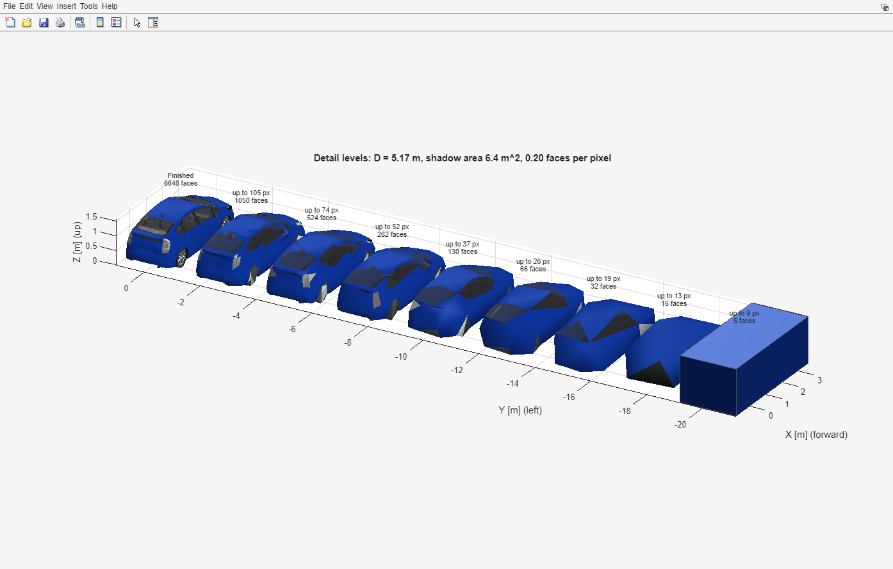

</details>

<details><summary><b><code>fcn_CarMesh3D_loadDetailLevels</code></b> (test: <code>script_test_fcn_CarMesh3D_loadDetailLevels.m</code>): Loads a vehicle's detail levels (the ladder of lighter versions of its mesh, for animation) from its folder in Data: vehicleLevels_<ID>.mat, made by the vehicle's script with fcn_CarMesh3D_makeDetailLevels.</summary>

Loads a vehicle's detail levels (the ladder of lighter versions of its mesh, for animation) from its folder in Data: vehicleLevels_<ID>.mat, made by the vehicle's script with fcn_CarMesh3D_makeDetailLevels. This is how an animation (AnimateCar3D) gets them.

```matlab
detailLevels = fcn_CarMesh3D_loadDetailLevels(vehicleID,...
    (DataFolder=folder), (MakeIfMissing=flag), (SaveIfMade=flag),...
    (FigNum=figNum))
```

| Variable | Kind | Meaning | Class | Size |
|---|---|---|---|---|
| `vehicleID` | input | the vehicle ID, such as '2013_Toyota_Prius_Four' (see fcn_CarMesh3D_findVehicleFiles). | char or string | 1 x n |
| `DataFolder` | option | the Data folder. Default [] uses the one next to the Functions folder. | char or string | 1 x n |
| `MakeIfMissing` | option | make the levels from the finished mesh if there is no levels file. Default true. (False: an error.) | logical | 1 x 1 |
| `SaveIfMade` | option | save the levels made that way to the vehicle's folder. Default false. | logical | 1 x 1 |
| `FigNum` | option | a figure number to show the levels (as fcn_CarMesh3D_makeDetailLevels does). Empty (default) for no figure; -1 for fast mode (no input checks). Default `[]`. | double | 1 x 1 (or empty) |
| `detailLevels` | output | the structure from fcn_CarMesh3D_makeDetailLevels (Levels, SizeDiagonal, BoxCenter, BoxSize, ShadowArea, ...), plus VehicleID and Source ('file', or 'made' when made because the file was missing). | struct | 1 x 1 |

**Assumptions:** The vehicle's vehicleLevels_<ID>.mat was made by makeDetailLevels from its current mesh.

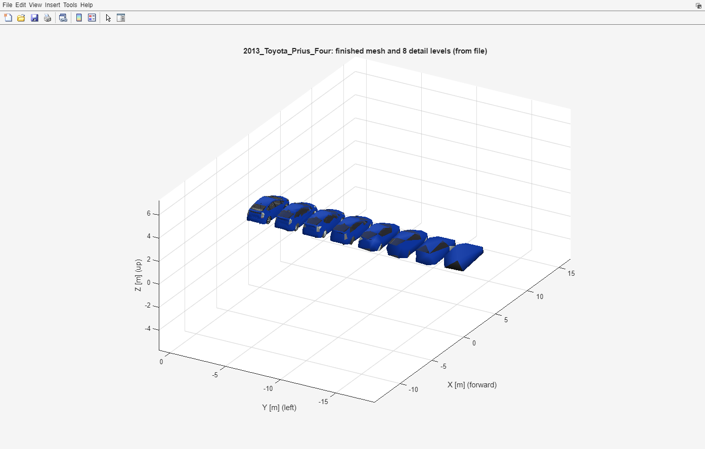

</details>

<details><summary><b><code>fcn_CarMesh3D_makeOutline2D</code></b> (test: <code>script_test_fcn_CarMesh3D_makeOutline2D.m</code>): Makes a vehicle's top-down (2D) outlines from its finished mesh, for plotting and animating vehicles in 2D: XY polygons, not XYZ meshes.</summary>

Makes a vehicle's top-down (2D) outlines from its finished mesh, for plotting and animating vehicles in 2D: XY polygons, not XYZ meshes. The outlines are in the vehicle frame (meters; origin on the ground below the rear axle, X forward, Y left), so a 2D pose [x y yaw] places them exactly as the mesh would be placed.

```matlab
vehicleOutline = fcn_CarMesh3D_makeOutline2D(vehicleMesh,...
    (SliceSpacing=meters), (Tolerance=meters),...
    (MinWindowArea=squareMeters), (Symmetric=flag),...
    (SymmetryTolerance=fraction), (LampGap=meters),...
    (MinInteriorArea=squareMeters), (FigNum=figNum))
```

| Variable | Kind | Meaning | Class | Size |
|---|---|---|---|---|
| `vehicleMesh` | input | a finished CarMesh3D mesh (labeled and fit to its spec, origin below the rear axle). | struct | 1 x 1 |
| `SliceSpacing` | option | meters between the slices along X that find the body outline. Default 0.01. | double | 1 x 1 |
| `Tolerance` | option | meters: the most a thinned outline may stray from the full one (Douglas-Peucker). Default 0.01. | double | 1 x 1 |
| `MinWindowArea` | option | square meters: smaller pieces of upward glass are dropped. Default 0.05. | double | 1 x 1 |
| `LampGap` | option | meters; pieces of lamps of one type and side closer than this are one lamp. Default 0.02. | double | 1 x 1 |
| `MinInteriorArea` | option | square meters; smaller interior pieces (seen from above) are dropped. Default 0.01. | double | 1 x 1 |
| `Symmetric` | option | true (default) to make every outline symmetric about the centerline (see SYMMETRY above); false to keep them as traced. Default `true`. | logical | 1 x 1 |
| `SymmetryTolerance` | option | the fraction of an outline's area (for the body, of its width) above which a change made for symmetry is warned about. Default 0.05 (5 percent). | double | 1 x 1 |
| `FigNum` | option | a figure to plot the outlines, in two panels: alone (as a 2D plot would draw them) and over the mesh seen from above (faded). Default `[]`. | double | 1 x 1 (or empty) |
| `vehicleOutline` | output | a structure with Name, Units ('m'), Frame (the mesh's), Source Body: N x 2 [x y], a closed polygon (first point repeated at the end), counterclockwise Windows: a structure array with Name ('glass 1', ... | struct | 1 x 1 |

**Assumptions:** The finished mesh in the vehicle frame, with hidden faces left out; outlines are seen from above.

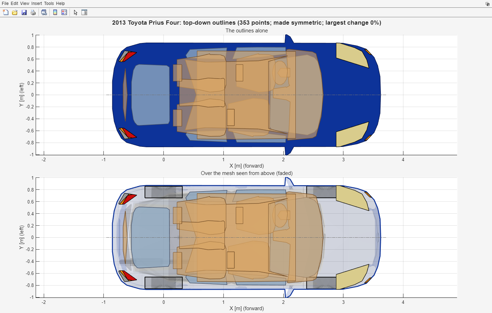

</details>

<details><summary><b><code>fcn_CarMesh3D_loadOutline2D</code></b> (test: <code>script_test_fcn_CarMesh3D_loadOutline2D.m</code>): Loads a vehicle's top-down (2D) outlines from its folder in Data: vehicleOutline_<ID>.mat, made by the vehicle's script with fcn_CarMesh3D_makeOutline2D.</summary>

Loads a vehicle's top-down (2D) outlines from its folder in Data: vehicleOutline_<ID>.mat, made by the vehicle's script with fcn_CarMesh3D_makeOutline2D. This is how a 2D plotting tool gets them.

```matlab
vehicleOutline = fcn_CarMesh3D_loadOutline2D(vehicleID,...
    (DataFolder=folder), (MakeIfMissing=flag), (SaveIfMade=flag),...
    (FigNum=figNum))
```

| Variable | Kind | Meaning | Class | Size |
|---|---|---|---|---|
| `vehicleID` | input | the vehicle ID, such as '2013_Toyota_Prius_Four' (see fcn_CarMesh3D_findVehicleFiles). | char or string | 1 x n |
| `DataFolder` | option | the Data folder. Default [] uses the one next to the Functions folder. | char or string | 1 x n |
| `MakeIfMissing` | option | make the outlines from the finished mesh when there is no outline file. Default true. | logical | 1 x 1 |
| `SaveIfMade` | option | save outlines made that way to the vehicle's folder. Default false. | logical | 1 x 1 |
| `FigNum` | option | a figure to show the outlines, filled, in 2D. If empty or omitted, no plot is made. Default `[]`. | double | 1 x 1 (or empty) |
| `vehicleOutline` | output | the outlines (see fcn_CarMesh3D_makeOutline2D), with VehicleID and Origin ('file' or 'made') added. | struct | 1 x 1 |

**Assumptions:** The vehicle's vehicleOutline_<ID>.mat was made by makeOutline2D.

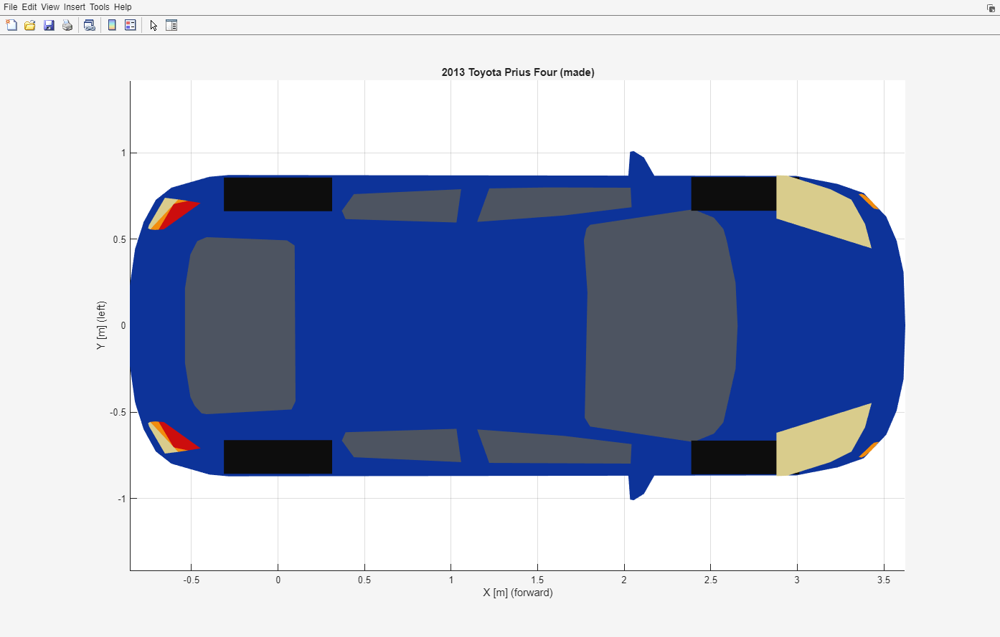

</details>

<details><summary><b><code>fcn_CarMesh3D_loadCache</code></b> (test: <code>script_test_fcn_CarMesh3D_loadCache.m</code>): Reuses the saved results of a slow step (fcn_CarMesh3D_saveCache) when nothing the step depends on has changed: the saved inputs must equal cacheInputs exactly (compared directly, field by field, with NaN equal to NaN; no hashing).</summary>

Reuses the saved results of a slow step (fcn_CarMesh3D_saveCache) when nothing the step depends on has changed: the saved inputs must equal cacheInputs exactly (compared directly, field by field, with NaN equal to NaN; no hashing). Otherwise says what changed, so the step is done again. The vehicle template uses it for three stages of a full run: the finished mesh, the comparison with the download, and the checks.

```matlab
[cacheOutputs, flagReused, reason] = fcn_CarMesh3D_loadCache(...
    cacheFile, cacheInputs, (Enabled=flag), (FigNum=figNum))
```


| Variable | Kind | Meaning | Class | Size |
|---|---|---|---|---|
| `cacheFile` | input | the cache file's path (a .mat file). | char or string | 1 x n |
| `cacheInputs` | input | a structure of everything the step depends on, made the same way as when it was saved. | struct | 1 x 1 |
| `Enabled` | option | false to never reuse (the step is always done; the reason is 'cache not used'). Default true. | logical | 1 x 1 |
| `FigNum` | option | if given (not -1), the decision is printed. If set to -1, input checking is skipped (fast mode). Default `[]`. | double | 1 x 1 (or empty) |
| `cacheOutputs` | output | the saved results (a structure), or [] when not reused. | struct | 1 x 1 |
| `flagReused` | output | true when the saved results were reused. | logical | 1 x 1 |
| `reason` | output | why, as text: 'nothing changed (cached <date>)', 'no cache file', 'cache not used', 'the cache file could not be read', or 'changed: <the top-level inputs that differ>'. | char | 1 x n |

**Assumptions:** The cache file was written by saveCache; inputs are compared exactly, so any change (a file date, a setting) redoes the step.

</details>

<details><summary><b><code>fcn_CarMesh3D_saveCache</code></b> (test: <code>script_test_fcn_CarMesh3D_loadCache.m</code>): Saves the results of a slow step together with everything the step depended on, so the next run can reuse them (fcn_CarMesh3D_loadCache) when nothing has changed.</summary>

Saves the results of a slow step together with everything the step depended on, so the next run can reuse them (fcn_CarMesh3D_loadCache) when nothing has changed. The folder is made if needed.

```matlab
fcn_CarMesh3D_saveCache(cacheFile, cacheInputs, cacheOutputs, (FigNum=figNum))
```

| Variable | Kind | Meaning | Class | Size |
|---|---|---|---|---|
| `cacheFile` | input | the cache file's path (a .mat file). | char or string | 1 x n |
| `cacheInputs` | input | a structure of everything the step depends on (settings, the vehicle specification, fcn_CarMesh3D_fileStamps of the files and functions it reads, the mesh version). | struct | 1 x 1 |
| `cacheOutputs` | input | a structure of the step's results. | struct | 1 x 1 |
| `FigNum` | option | if given (not -1), what was saved is printed. If set to -1, input checking is skipped (fast mode). Default `[]`. | double | 1 x 1 (or empty) |

**Assumptions:** The cache folder is local (ignored by git).

</details>

<details><summary><b><code>fcn_CarMesh3D_fileStamps</code></b> (test: <code>script_test_fcn_CarMesh3D_fileStamps.m</code>): The name, size, and date of each file in a list: a stamp that changes whenever a file is saved again, without reading the file.</summary>

The name, size, and date of each file in a list: a stamp that changes whenever a file is saved again, without reading the file. Used as part of a cached step's inputs (fcn_CarMesh3D_loadCache), so the step is done again when a file it reads, or a function it runs, has changed.

```matlab
fileStamps = fcn_CarMesh3D_fileStamps(fileList, (FigNum=figNum))
```

| Variable | Kind | Meaning | Class | Size |
|---|---|---|---|---|
| `fileList` | input | a cell array of file names or paths (or one as text). A name without a folder that MATLAB can find (a function, such as 'fcn_CarMesh3D_labelParts.m') is found with WHICH. | function_handle | 1 x 1 |
| `FigNum` | option | if given (not -1), the stamps are printed. If set to -1, input checking is skipped (fast mode). Default `[]`. | double | 1 x 1 (or empty) |
| `fileStamps` | output | an N x 1 structure array, one per file, in the list's order, with Name (the file's name), Bytes, and Date (its modification time as a datenum); a file that is not found has Bytes -1 and Date 0 (so two "not found" stamps are equal). | double | N x 1 |

**Assumptions:** A stamp is a file's name, size and date (the file is not read); a function name without a folder is found with WHICH.

</details>

<details><summary><b><code>fcn_CarMesh3D_meshHistory</code></b> (test: <code>script_test_fcn_CarMesh3D_meshHistory.m</code>): A vehicle mesh's history: who changed it and when (its change log), the license of the model it was made from, when it was last built, and whether it has been reviewed by a person since it was made (and by whom, when, and the decision).</summary>

A vehicle mesh's history: who changed it and when (its change log), the license of the model it was made from, when it was last built, and whether it has been reviewed by a person since it was made (and by whom, when, and the decision). Meshes are made by the vehicle's script (automatically); a person's review is what says they are fit to use.

```matlab
history = fcn_CarMesh3D_meshHistory(vehicleInput,...
    (Action=action), (Details=details), (Who=name), (Mesh=mesh),...
    (FigNum=figNum))
```

| Variable | Kind | Meaning | Class | Size |
|---|---|---|---|---|
| `vehicleInput` | input | a vehicle ID ('2009_Honda_Fit_Sport'), a mesh file name (vehicleMesh_<ID>.mat, or a timestamped copy of it, vehicleMesh_<ID>_YYYYMMDDHHMMSS.mat), or a vehicle folder. | char or struct | 1 x n, or 1 x 1 |
| `Action` | option | a change to add to the log, for example 'label edits saved', 'reviewed: approved', 'reviewed: rejected', 'built', or 'note'. '' (default): only read. Default `''`. | char | 1 x n |
| `Details` | option | more about the change (text). Default ''. | char | 1 x n |
| `Who` | option | who made the change. Default: the computer's user name. | char | 1 x n |
| `Mesh` | option | the mesh, if already loaded (its BuildInfo gives the build); [] (default) to read it from the mesh file. Default `[]`. | struct | 1 x 1 |
| `FigNum` | option | not used (no plot); [] or -1 (fast mode: no input checks). Default `[]`. | double | 1 x 1 (or empty) |
| `history` | output | a structure: ID, Folder, HistoryFile Entries: a table (Time, Who, Action, Details), oldest first, with the build (from BuildInfo) put in its place License: Name, Author, Source, Text (from LICENSE.txt; '' if none) Built: Date, Script, MeshVersion ('' if not known) LastChange: Time, Who, Action (the newest entry) Review: Status ('not reviewed', 'approved', 'rejected'), By, Date, Current (false when the mesh changed after it) FinePrint: one line for the bottom of a viewer | struct | 1 x 1 |

**Assumptions:** The change log is meshHistory_<ID>.csv in the vehicle's folder (one row per change); the painter and the Model Reviewer add rows to it.

</details>

<details><summary><b><code>fcn_CarMesh3D_version</code></b> (test: <code>script_test_fcn_CarMesh3D_version.m</code>): The version of this copy of CarMesh3D: the date of its release, as 'YYYY_MM_DD' (the same name its release folder has, such as CarMesh3D_2026_11_20).</summary>

The version of this copy of CarMesh3D: the date of its release, as 'YYYY_MM_DD' (the same name its release folder has, such as CarMesh3D_2026_11_20). Programs that use CarMesh3D (such as AnimateCar3D) can check that the copy they find is new enough. The version is changed in this function when a new release is made.

```matlab
[versionString, flagAtLeast, meshVersion] = fcn_CarMesh3D_version(...
    (AtLeast=versionString), (FigNum=figNum))
```

| Variable | Kind | Meaning | Class | Size |
|---|---|---|---|---|
| `AtLeast` | option | a version, 'YYYY_MM_DD', to compare with. Default '' (no comparison). | char | 1 x n |
| `FigNum` | option | if given (not -1), the version is printed. If set to -1, input checking is skipped (fast mode). Default `[]`. | double | 1 x 1 (or empty) |
| `versionString` | output | this copy's version, such as '2026_11_20'. | char | 1 x 10 |
| `flagAtLeast` | output | true if this copy's version is AtLeast or newer (true when AtLeast is not given). | logical | 1 x 1 |
| `meshVersion` | output | the version of the mesh-making steps, such as '2026_11_21c' (the date of the change, and a letter for several in a day; see MESH VERSIONS above). Versions sort as text. | char | 1 x n |

**Assumptions:** The version is written in this function at each release; the mesh version changes whenever a change to CarMesh3D would make a different finished mesh.

</details>

<details><summary><b><code>fcn_CarMesh3D_addReferenceVehicle</code></b> (test: <code>script_test_fcn_CarMesh3D_addReferenceVehicle.m</code>): Adds a finished, checked vehicle to the REFERENCE VEHICLE LIST: the list of vehicles that are ready to use.</summary>

Adds a finished, checked vehicle to the REFERENCE VEHICLE LIST: the list of vehicles that are ready to use. Three things are updated (listed in the function's header).

```matlab
referenceList = fcn_CarMesh3D_addReferenceVehicle(vehicleID,...
    vehicleMesh, referenceGif, (ListFile=file),...
    (ImagesFolder=folder), (ReadmeFile=file), (FigNum=figNum))
```

| Variable | Kind | Meaning | Class | Size |
|---|---|---|---|---|
| `vehicleID` | input | the vehicle ID (YEAR_Make_Model_Trimline, see fcn_CarMesh3D_findVehicleFiles). | char or string | 1 x n |
| `vehicleMesh` | input | the finished mesh (for its size and face count). | struct | 1 x 1 |
| `referenceGif` | input | the GIF to show for this vehicle. | char or string | 1 x n |
| `ListFile` | option | the list file. Default [] is Data\referenceVehicles.csv. | char or string | 1 x n |
| `ImagesFolder` | option | where reference GIFs are kept. Default [] is Images\vehicles. | char or string | 1 x n |
| `ReadmeFile` | option | the README to update. Default [] is the README.md in the CarMesh3D folder. Use '' to not update a README. | char or string | 1 x n |
| `FigNum` | option | if set to -1, input checking is skipped (fast mode). The function makes no plot. Default `[]`. | double | 1 x 1 (or empty) |
| `referenceList` | output | the list, as a table (one row per vehicle). | table | rows x columns |

**Assumptions:** The vehicle passed its checks; its folder name is its ID.

</details>

<details><summary><b><code>fcn_CarMesh3D_listVehicles</code></b> (test: <code>script_test_fcn_CarMesh3D_listVehicles.m</code>): Lists the finished vehicles (those with a saved mesh) in the Data folder, one row each, with what a user needs to choose among them and to know which must be made again: body style, size, face count, the quality score, and whether the mesh is up to date.</summary>

Lists the finished vehicles (those with a saved mesh) in the Data folder, one row each, with what a user needs to choose among them and to know which must be made again: body style, size, face count, the quality score, and whether the mesh is up to date.

```matlab
vehicleTable = fcn_CarMesh3D_listVehicles(...
    (IncludeUnfinished=flag), (DataFolder=folder), (FigNum=figNum))
```


| Variable | Kind | Meaning | Class | Size |
|---|---|---|---|---|
| `IncludeUnfinished` | option | true to list vehicles without a saved mesh too (Status 'no mesh'). Default false. | logical | 1 x 1 |
| `DataFolder` | option | the Data folder. Default [] uses the one next to the Functions folder. | char or string | 1 x n |
| `FigNum` | option | if given (not -1), the table is printed. If set to -1, input checking is skipped (fast mode). Default `[]`. | double | 1 x 1 (or empty) |
| `vehicleTable` | output | a table, one row per vehicle, sorted by body style and then ID, with ID, Name, BodyStyle (the style ID; for a sample, the style it was made from, or 'sample') IsExemplar: an approved exemplar of its style FromBodyStyle: made from a body style's exemplar (no download) Faces: the finished mesh's face count Length_m, Width_m, Height_m: from the saved specification Score: the quality score, 0 to 100 (NaN without a BuildInfo) ChecksFailed: dimension checks failed (NaN without a BuildInfo) MeshVersion: the mesh version it was made with ('' if none) Made: when it was made ('' if not recorded) Status: 'up to date', 'out of date' (an older mesh version), 'exemplar changed' (its exemplar was made again since), 'no stamp' (made before BuildInfo existed), or 'no mesh' MeshFile: the saved mesh's path | table | rows x columns |

**Assumptions:** Vehicles live in Data/BodyStyles/<Style>/<ID> folders.

</details>

### Review and edit (GUIs)

<details><summary><b><code>fcn_CarMesh3D_reviewVehicle</code></b> (test: <code>script_test_fcn_CarMesh3D_reviewVehicle.m</code>): The MODEL REVIEWER: a window for reviewing a finished vehicle, one check at a time, and recording an approval, a rejection, or a comment for each question.</summary>

The MODEL REVIEWER: a window for reviewing a finished vehicle, one check at a time, and recording an approval, a rejection, or a comment for each question. It replaces looking through the checks folder's pictures.

```matlab
[reviewTable, figureHandle] = fcn_CarMesh3D_reviewVehicle(vehicleID,...
    (Reviewer=name), (Visible=flag), (FigNum=figNum))
```


| Variable | Kind | Meaning | Class | Size |
|---|---|---|---|---|
| `vehicleID` | input | a vehicle ID (its folder name), such as '2009_Honda_Fit_Sport', or the full path of a vehicle's folder kept anywhere (such as the demo's copy, from | char or string | 1 x n |
| `Reviewer` | option | the reviewer's name, saved with each answer. Default: the computer's user name. | char | 1 x n |
| `Visible` | option | true (default) to show the window; false to build it without showing it (for tests). Default `true`. | logical | 1 x 1 |
| `FigNum` | option | not used for plotting (the reviewer is its own window). If set to -1, input checking is skipped. Default `[]`. | double | 1 x 1 (or empty) |
| `reviewTable` | output | the answers so far (one row per question): Check, Item, Question, Status ('', 'approved', 'rejected'), Severity ('minor', 'must fix'), Cause, Comment, Reviewer, Time. | table | questions x 11 |
| `figureHandle` | output | the reviewer's window (a uifigure). | graphics handle | 1 x 1 |

**Assumptions:** The vehicle has a finished mesh and its checks have run; the reviewer's answers are saved beside the vehicle.

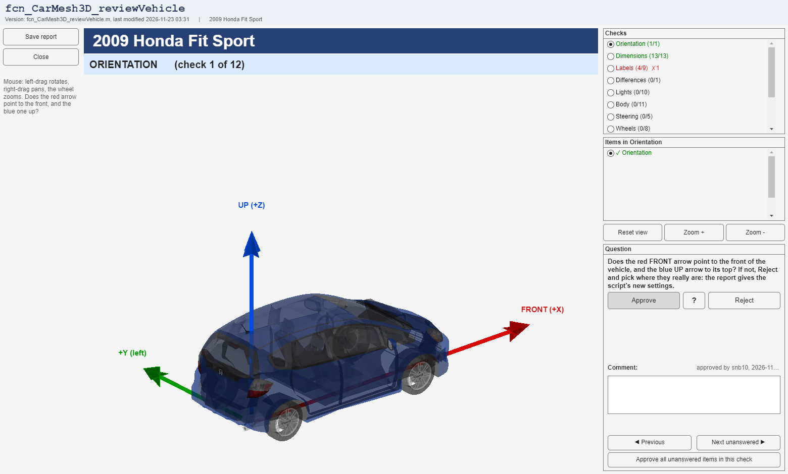

</details>

<details><summary><b><code>fcn_CarMesh3D_viewLabels</code></b> (test: <code>script_test_fcn_CarMesh3D_viewLabels.m</code>): A viewer for looking at a vehicle's labels next to its photos: the mesh with each label in its own color (or in the vehicle's colors), and the photos of the real vehicle with the photo dial (drag its arrow around the vehicle; the model turns to the same side, and turning the model moves the arrow and the photo).</summary>

A viewer for looking at a vehicle's labels next to its photos: the mesh with each label in its own color (or in the vehicle's colors), and the photos of the real vehicle with the photo dial (drag its arrow around the vehicle; the model turns to the same side, and turning the model moves the arrow and the photo). Pick a label to see it alone; untick a label's box to hide it and see what is under it.

```matlab
[viewSettings, viewer] = fcn_CarMesh3D_viewLabels(meshInput,...
    (ViewSettings=viewSettings), (Colors=colors), (Label=key),...
    (Hidden=keys), (PhotoFolder=folder), (Outline=outline),...
    (Parent=container), (LabelListParent=container),...
    (ShowTools=flag), (OnHint=function), (ColorFilter=function),...
    (HiddenFaces=function), (Wait=flag), (Visible=flag),...
    (FigNum=figNum))
```

| Variable | Kind | Meaning | Class | Size |
|---|---|---|---|---|
| `meshInput` | input | the mesh to view, either way: - a file name: a .mat file holding a labeled CarMesh3D mesh (the variable vehicleMesh, else the first mesh in it), such as a vehicle's mesh file or a timestamped copy from the painter. | char or struct | 1 x n, or 1 x 1 |
| `ViewSettings` | option | view settings this viewer returned before: opens at that camera, label, hidden labels, colors and photo. Default `[]`. | struct | 1 x 1 |
| `Colors` | option | 'labels' (default: each label in its own color) or 'vehicle' (the vehicle's own colors). Default `''`. | char | 1 x n |
| `Label` | option | the label shown alone ('part_trim', 'light_tail', ...; as the list's keys), or 'all' (default). Default `''`. | char | 1 x n |
| `Hidden` | option | labels whose faces are hidden (a cell array of keys). Default `[]`. | cell | 1 x n |
| `PhotoFolder` | option | a folder of ViewInDegrees_<angle> photos. Default: a folder "photos" beside the mesh file (a file given), else none. | char or string | 1 x n |
| `Outline` | option | the vehicle's 2D outline (fcn_CarMesh3D_makeOutline2D's output, or a .mat file holding vehicleOutline), drawn in the photo dial. Default: none (the dial draws the mesh from above). | char | 1 x n |
| `Parent` | option | a panel or grid to build into; [] (default) for a window of its own. Default `[]`. | graphics handle | 1 x 1 |
| `LabelListParent` | option | a panel or grid to put the list of labels in. Default `[]`. | graphics handle | 1 x 1 |
| `ShowTools` | option | false to leave out the row of tools (colors, reset view, copy view call). Default true. | logical | 1 x 1 |
| `OnHint` | option | a function called with a hint (HTML text); [] (default) to show hints in the viewer's own hint line. Default `[]`. | function_handle | 1 x 1 |
| `ColorFilter` | option | for a window that builds the viewer in and colors faces of its own (the painter: painted faces): a function [faceColors, faceAlpha] = f(faceColors, faceAlpha), called each time the model is colored, before hidden faces are made see-through. Default `[]`. | function_handle | 1 x 1 |
| `HiddenFaces` | option | for such a window: a function flagHidden = f(keys) giving the faces hidden for these hidden label keys (one flag per face). Default: the faces with those labels. | function_handle | 1 x 1 |
| `History` | option | the mesh's history (fcn_CarMesh3D_meshHistory's output), shown as fine print at the bottom: the model's license, when the mesh was built, its last change, and whether a person has reviewed it (by whom, when). | char | 1 x n |
| `Wait` | option | true to wait until the window is closed and return the view settings then. | logical | 1 x 1 |
| `Visible` | option | false to build the window hidden (for tests). Default true. | logical | 1 x 1 |
| `FigNum` | option | not used (a window); [] or -1 (fast mode: no input checks). Default `[]`. | double | 1 x 1 (or empty) |
| `viewSettings` | output | a structure: MeshFile ('' for a mesh variable), Camera (CameraPosition, CameraTarget, CameraUpVector, CameraViewAngle, Projection, XLim, YLim, ZLim), Label, Hidden, Colors, PhotoAngle (the photo shown, in degrees; NaN for none), SeeThrough (how see-through the body is drawn: 0 solid, up to 0.9), MeshBoundaries (true when the faces' edges are drawn), NightView (true for the nighttime view), NightLights (the lamps switched on in it: fcn_CarMesh3D_plotVehicle's LightStates), PhotoHeight (the photo's height in pixels, set with the handle at its bottom left corner). | struct | 1 x 1 |
| `viewer` | output | a structure of the viewer's handles and functions: Figure, Axes, Patch GetView(): the view settings now SetView(viewSettings): go to these view settings ViewCall(): the MATLAB call that opens this view, as text ShowLabel(key), Label(), SetHidden(keys), Hidden(), SetColors(colors), Redraw() SetMesh(mesh, labelColors, labelAlpha): a mesh with the same faces and new labels (the painter, after a save) SetPhotoAngle(angle), PhotoAngle() DialMove(), DialUp(), GripDown(): for a window that handles the mouse itself (each says whether it used the event: the dial's arrow, or the photo's corner, is being dragged; call GripDown first in the window's mouse-down) SetHistory(history): new fine print (after a change) ResetView(), SetSeeThrough(fraction), SeeThrough(): how see-through the body is drawn (0 solid, up to 0.9) Stop() (its timer), Close() | struct | 1 x 1 |

**Assumptions:** A labeled mesh (or a vehicle ID with a saved mesh); photos, if any, are in the vehicle's pictures folder.

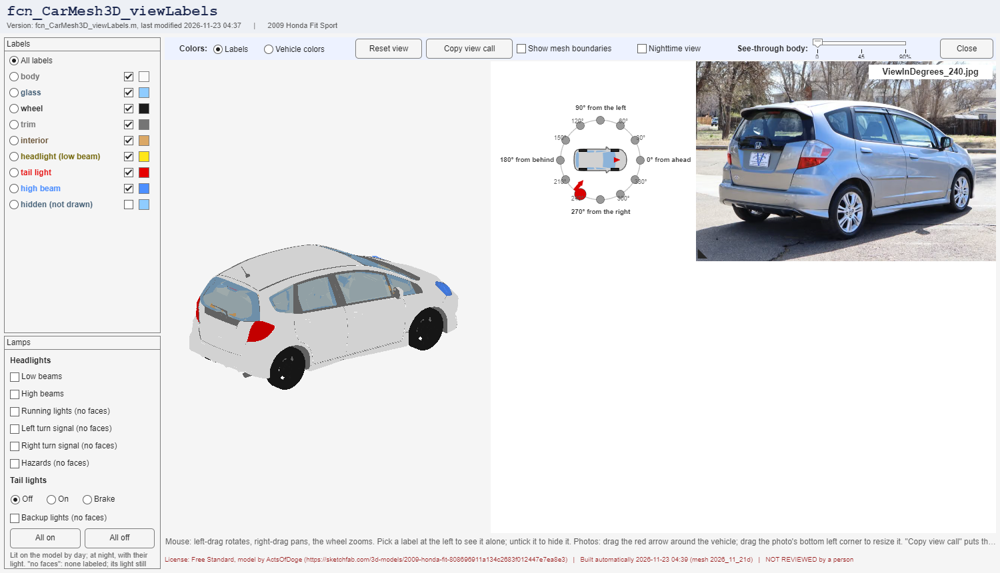

</details>

<details><summary><b><code>fcn_CarMesh3D_paintLabels</code></b> (test: <code>script_test_fcn_CarMesh3D_paintLabels.m</code>): A window for fixing a vehicle's labels by painting its faces: pick a label (body, glass, trim, interior, wheel, a light type), or hide or unhide, then paint the faces that should have it.</summary>

A window for fixing a vehicle's labels by painting its faces: pick a label (body, glass, trim, interior, wheel, a light type), or hide or unhide, then paint the faces that should have it. It works on its own (its own window), or inside another window, such as the Model Reviewer (fcn_CarMesh3D_reviewVehicle), which gives it a panel to build into.

```matlab
[editedMesh, labelEdits, painter] = fcn_CarMesh3D_paintLabels(vehicleInput,...
    (Parent=container), (EditsFile=file), (PhotoFolder=folder),...
    (Wait=flag), (Visible=flag), (OnPaint=function),...
    (OnChange=function), (OnHint=function), (FigNum=figNum))
```

| Variable | Kind | Meaning | Class | Size |
|---|---|---|---|---|
| `vehicleInput` | input | a vehicle ID ('2009_Honda_Fit_Sport') or a vehicle's folder (as fcn_CarMesh3D_findVehicleFiles takes), or a labeled CarMesh3D mesh. | char or struct | 1 x n, or 1 x 1 |
| `Parent` | option | a panel or grid to build into; [] (default) for a window of its own. Default `[]`. | graphics handle | 1 x 1 |
| `EditsFile` | option | where the edits are saved ('' for not saved: with a mesh given, the default). With an ID, the default is the vehicle's labelEdits_<ID>.mat. Default `[]`. | char or string | 1 x n |
| `PhotoFolder` | option | a folder of ViewInDegrees_<angle> photos. Default: the vehicle's photos folder (with an ID), else none. | char or string | 1 x n |
| `Wait` | option | true to wait until the window is closed, and return the edited mesh then (its own window only). Default false: return at once. | logical | 1 x 1 |
| `Versions` | option | true (default) to keep a timestamped copy of the edits and the edited mesh at each save, in the VersionFolder, as <mesh name>_YYYYMMDDHHMMSS.mat (a second save in the same second overwrites the first). Default `true`. | logical | 1 x 1 |
| `VersionFolder` | option | where the timestamped copies go. | char or string | 1 x n |
| `Who` | option | who is painting, for the vehicle's change log (meshHistory_<ID>.csv; fcn_CarMesh3D_meshHistory): each save adds a row. Default: the computer's user name. (With a vehicle ID only.) | char | 1 x n |
| `Visible` | option | false to build the window hidden (for tests). Default true. | logical | 1 x 1 |
| `OnPaint` | option | a function called with no inputs after each click or stroke that paints (the reviewer marks its Labels item rejected). Default `[]`. | function_handle | 1 x 1 |
| `OnChange` | option | a function called with the edited mesh after Apply, Save, Undo of applied paint, or a Revert. Default `[]`. | function_handle | 1 x 1 |
| `OnHint` | option | a function called with a hint (HTML text) to show; [] to show hints in the painter's own hint line. Default `[]`. | function_handle | 1 x 1 |
| `FigNum` | option | not used (the painter is a window); [] or -1 (fast mode: no input checks). Default `[]`. | double | 1 x 1 (or empty) |
| `editedMesh` | output | the mesh with the applied edits (from the edits file, when the painter returns at once; or as left, with Wait=true). | struct | 1 x 1 |
| `labelEdits` | output | the applied edits, as fcn_CarMesh3D_editLabels edits (one per label, faces by their centers). | cell | 1 x n (structs) |
| `painter` | output | a structure of the painter's handles and functions: Figure, Axes, Patch (the model), EditsFile ShowLabel(key): one label colored ('part_body', 'light_tail', ...; as fcn_CarMesh3D_reviewVehicle's label keys), the rest gray, or 'all' for every label in its color SetHidden(keys): hide the faces of these labels (a cell array of keys; {} shows all) EditedMesh(), Edits(), NumPainted(), IsUnsaved(), Status() Apply(), Undo(), Save(), RevertToSaved(), RevertToStart() SaveVersion(): Save, and keep a timestamped copy (returns its file); LastVersionFile(); VersionFolder(); SetVersionFolder(folder) (remembered for next time; '' for the default) WorkingMesh(): the working mesh (the mesh before any edits, with the saved edits taken in; same faces), with the LabelColors the view shows SetTool(name), Paint(tool, points, flagErase): paint the faces nearest these points (for scripts and tests; then Save) SetPhotoAngle(angle), PhotoAngle() StrokeStart(flagErase), MouseMove(), MouseUp(), Click(flagPiece): for a window that holds the painter and handles the mouse itself (MouseMove and MouseUp say whether they used the event) Stop(): stop the painter's timer (before the parent is cleared) Close(): close its own window | struct | 1 x 1 |

**Assumptions:** A vehicle ID with a saved mesh (or a mesh and an EditsFile); edits are saved to labelEdits_<ID>.mat and applied by the next build.

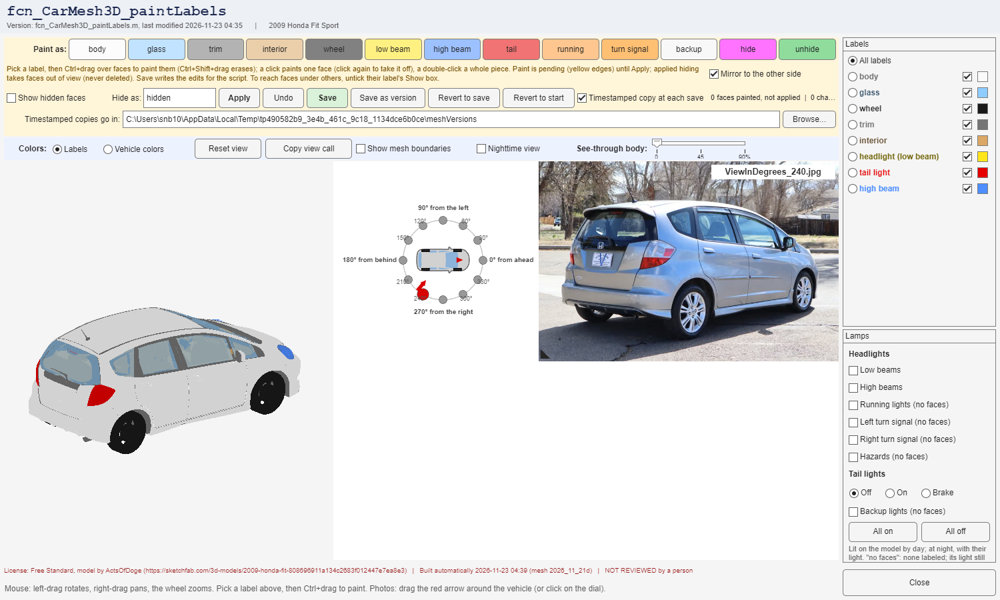

</details>

<details><summary><b><code>fcn_CarMesh3D_viewDimensions</code></b> (test: <code>script_test_fcn_CarMesh3D_viewDimensions.m</code>): A view for checking a vehicle's dimensions against its data, drawn as on a drawing: the side view (top, wide), the front and rear views, and a table of each quantity's target, as measured on the mesh, and error.</summary>

A view for checking a vehicle's dimensions against its data, drawn as on a drawing: the side view (top, wide), the front and rear views, and a table of each quantity's target, as measured on the mesh, and error.

```matlab
viewer = fcn_CarMesh3D_viewDimensions(vehicleInput,...
    (DimensionTable=dimensionTable), (Parent=container),...
    (OnSelect=function), (OnHint=function), (Visible=flag),...
    (FigNum=figNum))
```

| Variable | Kind | Meaning | Class | Size |
|---|---|---|---|---|
| `vehicleInput` | input | a vehicle ID ('2009_Honda_Fit_Sport'), or a labeled CarMesh3D mesh. With an ID, the mesh is the vehicle's mesh file and the dimensions are from its checks' cache (stage 3). | char or struct | 1 x n, or 1 x 1 |
| `DimensionTable` | option | one row per quantity: its name (as fcn_CarMesh3D_validateMesh's ValidationTable.Quantity), target (m), measured (m), error (%), and pass. Default `[]`. | table | rows x columns |
| `Parent` | option | a panel or grid to build into; [] (default) for a window of its own. Default `[]`. | graphics handle | 1 x 1 |
| `OnSelect` | option | a function called with a quantity's name when its row of the table is clicked (the reviewer goes to that item); [] to show that dimension. Default `[]`. | function_handle | 1 x 1 |
| `OnHint` | option | a function called with a hint (HTML text) to show; [] to show it in its own window's hint line (or not at all, in a parent). Default `[]`. | function_handle | 1 x 1 |
| `Visible` | option | false to build the window hidden (for tests). Default true. | logical | 1 x 1 |
| `FigNum` | option | not used (a window); [] or -1 (fast mode: no input checks). Default `[]`. | double | 1 x 1 (or empty) |
| `viewer` | output | a structure of the view's handles and functions: Figure, Axes (side, front, rear), Table, Quantities (the names, in the table's order), Names (as shown) ShowDimension(quantity): that dimension drawn, its view's title bold, its row of the table in bold ('' for none) Shown(): the quantity drawn now ResetViews(): the views as they were made Close(): close its own window | struct | 1 x 1 |

**Assumptions:** The mesh is fitted and its spec is known; only shown faces are measured.


</details>

<details><summary><b><code>fcn_CarMesh3D_viewOrientation</code></b> (test: <code>script_test_fcn_CarMesh3D_viewOrientation.m</code>): A view for checking a vehicle mesh's orientation: the mesh, see-through, with its axes as large arrows from its origin (on the ground, under the middle of the rear axle): FRONT (+X, red) past the front bumper, UP (+Z, blue) above the roof, and +Y (left, green) past the left side.</summary>

A view for checking a vehicle mesh's orientation: the mesh, see-through, with its axes as large arrows from its origin (on the ground, under the middle of the rear axle): FRONT (+X, red) past the front bumper, UP (+Z, blue) above the roof, and +Y (left, green) past the left side. The red arrow should point to the front, the blue one up.

```matlab
viewer = fcn_CarMesh3D_viewOrientation(vehicleInput,...
    (Parent=container), (OnHint=function), (Visible=flag),...
    (FigNum=figNum))
```

| Variable | Kind | Meaning | Class | Size |
|---|---|---|---|---|
| `vehicleInput` | input | a vehicle ID ('2009_Honda_Fit_Sport'), or a CarMesh3D mesh. With an ID, the mesh is the vehicle's mesh file. | char or struct | 1 x n, or 1 x 1 |
| `Parent` | option | a panel or grid to build into; [] (default) for a window of its own. Default `[]`. | graphics handle | 1 x 1 |
| `OnHint` | option | a function called with a hint (HTML text) to show; [] to show it in its own window's hint line (or not at all, in a parent). Default `[]`. | function_handle | 1 x 1 |
| `Visible` | option | false to build the window hidden (for tests). Default true. | logical | 1 x 1 |
| `FigNum` | option | not used (a window); [] or -1 (fast mode: no input checks). Default `[]`. | double | 1 x 1 (or empty) |
| `viewer` | output | a structure of the view's handles and functions: Figure, Axes ResetView(): the view as it was made Close(): close its own window | struct | 1 x 1 |

**Assumptions:** The mesh is in the vehicle frame (normalizeMesh), with its origin on the ground.


</details>

<details><summary><b><code>fcn_CarMesh3D_viewOutline</code></b> (test: <code>script_test_fcn_CarMesh3D_viewOutline.m</code>): A view for checking a vehicle's 2D outline (from fcn_CarMesh3D_makeOutline2D): the outlines from above, in gray, over the vehicle drawn faintly, with one element at a time filled in orange (the body, each window, each wheel, the lights by type and side, the interior).</summary>

A view for checking a vehicle's 2D outline (from fcn_CarMesh3D_makeOutline2D): the outlines from above, in gray, over the vehicle drawn faintly, with one element at a time filled in orange (the body, each window, each wheel, the lights by type and side, the interior). A toggle shows the 3D model, see-through, over the outlines.

```matlab
viewer = fcn_CarMesh3D_viewOutline(vehicleInput,...
    (Mesh=vehicleMesh), (Parent=container), (OnHint=function),...
    (Visible=flag), (FigNum=figNum))
```

| Variable | Kind | Meaning | Class | Size |
|---|---|---|---|---|
| `vehicleInput` | input | a vehicle ID ('2009_Honda_Fit_Sport'), or a 2D outline (fcn_CarMesh3D_makeOutline2D's output). With an ID, the outline and the mesh are the vehicle's files. | char or struct | 1 x n, or 1 x 1 |
| `Mesh` | option | the vehicle's mesh, drawn under the outlines (and in 3D with the toggle). Default: the vehicle's mesh file (with an ID), else none. | struct | 1 x 1 |
| `Parent` | option | a panel or grid to build into; [] (default) for a window of its own. Default `[]`. | graphics handle | 1 x 1 |
| `OnHint` | option | a function called with a hint (HTML text) to show; [] to show it in its own window's hint line (or not at all, in a parent). Default `[]`. | function_handle | 1 x 1 |
| `Visible` | option | false to build the window hidden (for tests). Default true. | logical | 1 x 1 |
| `FigNum` | option | not used (a window); [] or -1 (fast mode: no input checks). Default `[]`. | double | 1 x 1 (or empty) |
| `viewer` | output | a structure of the view's handles and functions: Figure, Axes, Elements (Key, Label, Polygons of each element) ShowElement(key): that element filled in orange ('' for none) SetModel3D(flag): the 3D model over the outlines, or not ResetView(): back to the view from above Close(): close its own window | struct | 1 x 1 |

**Assumptions:** The vehicle's outline was made (makeOutline2D).


</details>

<details><summary><b><code>fcn_CarMesh3D_viewDetailLevels</code></b> (test: <code>script_test_fcn_CarMesh3D_viewDetailLevels.m</code>): A view for checking a vehicle's detail levels (from fcn_CarMesh3D_makeDetailLevels).</summary>

A view for checking a vehicle's detail levels (from fcn_CarMesh3D_makeDetailLevels). Top: the full mesh and every detail level in a line, all at one distance (a line-up, to compare them side by side). Bottom: each level beside the full mesh at the distance where that level is first used, through the animations' camera (645 pixels per radian: what an animation would show). Every vehicle turns slowly, in both.

```matlab
viewer = fcn_CarMesh3D_viewDetailLevels(vehicleInput,...
    (Mesh=vehicleMesh), (Parent=container), (Turn=flag),...
    (OnHint=function), (Visible=flag), (FigNum=figNum))
```

| Variable | Kind | Meaning | Class | Size |
|---|---|---|---|---|
| `vehicleInput` | input | a vehicle ID ('2009_Honda_Fit_Sport'), or detail levels (fcn_CarMesh3D_makeDetailLevels's output: Levels, SizeDiagonal, BoxCenter, BoxSize). With an ID, the levels and the full mesh are the vehicle's files. | char or struct | 1 x n, or 1 x 1 |
| `Mesh` | option | the full mesh, shown beside the levels. Needed with detail levels given; with an ID, the default is the vehicle's mesh file. Default `[]`. | struct | 1 x 1 |
| `Parent` | option | a panel or grid to build into; [] (default) for a window of its own. Default `[]`. | graphics handle | 1 x 1 |
| `Turn` | option | true (default) to turn every vehicle slowly (20 degrees a second). Default `true`. | logical | 1 x 1 |
| `OnHint` | option | a function called with a hint (HTML text) to show; [] to show it in its own window's hint line (or not at all, in a parent). Default `[]`. | function_handle | 1 x 1 |
| `Visible` | option | false to build the window hidden (for tests). Default true. | logical | 1 x 1 |
| `FigNum` | option | not used (a window); [] or -1 (fast mode: no input checks). Default `[]`. | double | 1 x 1 (or empty) |
| `viewer` | output | a structure of the view's handles and functions: Figure, LineupAxes, SceneAxes, Transforms (one per vehicle shown, each turning about its own middle) StartTurning(), Stop(), IsTurning() ResetViews(): both views as they were made Close(): close its own window | struct | 1 x 1 |

**Assumptions:** The vehicle's detail levels were made (makeDetailLevels).


</details>

<details><summary><b><code>fcn_CarMesh3D_browseLibrary</code></b> (test: <code>script_test_fcn_CarMesh3D_browseLibrary.m</code>): A window listing every finished vehicle in the library, one row each, in a scrolling list.</summary>

A window listing every finished vehicle in the library, one row each, in a scrolling list.

```matlab
[selectedNames, browser] = fcn_CarMesh3D_browseLibrary(...
    (Vehicles=names), (SortBy=key), (GroupBy=key), (Order=words),...
    (Descending=flag), (Selected=names), (DefaultVehicle=id), (Wait=flag),...
    (Visible=flag), (DataFolder=folder), (FigNum=figNum))
```

| Variable | Kind | Meaning | Class | Size |
|---|---|---|---|---|
| `Vehicles` | option | a cell array of MATLAB names (vehicle IDs), such as {'2009_Honda_Fit_Sport', '2013_Toyota_Prius_Four'}: the browser shows, sorts, groups, filters and selects only these vehicles. | cell | 1 x n |
| `SortBy` | option | 'make', 'year', 'class' (default), 'length', 'score', 'review' (the percent of review items approved), 'built' (when the mesh was made), or 'reviewDate'. Ties are ordered by name. (Old calls with 'name' sort by make.) Default `'class'`. | char | 1 x n |
| `GroupBy` | option | 'class' (default), 'make', 'year', 'review' (reviewed, partly reviewed, not reviewed), 'exemplar' (exemplars first), 'license', or 'none'. Default `'class'`. | char | 1 x n |
| `Order` | option | how the vehicles are ordered within each group, in the words of the window's Order? drop-down, which depend on SortBy: 'A to Z' or 'Z to A' (make, class); 'Newest first' or 'Oldest first' (year, built, reviewDate); 'Longest first' or 'Shortest first' (length); 'Highest first' or 'Lowest first' (score); 'Most approved first' or 'Least approved first' (review). Default '': the sort's own default, the first of each pair. The groups always keep their own order. | char | 1 x n |
| `Descending` | option | the older way to give the order, kept so old calls work: true for Z to A, newest, longest, highest or most approved first. Default []: the sort's own default. Order, when given, wins. | logical | 1 x 1 (or empty) |
| `Selected` | option | MATLAB names (vehicle IDs) ticked when the window opens. Default {}. | cell | 1 x n |
| `DefaultVehicle` | option | the vehicle copied and returned when none is selected. Default '2009_Honda_Fit_Sport' (the demo menu's test vehicle). | char | 1 x n |
| `Wait` | option | true to wait until the window is closed, and return the selection then. Default: true when Visible, else false. | logical | 1 x 1 |
| `Visible` | option | false to build the window hidden (for tests). Default true. | logical | 1 x 1 |
| `DataFolder` | option | the library's Data folder. Default: the one next to the Functions folder. | char or string | 1 x n |
| `FigNum` | option | not used (a window). If set to -1, input checking is skipped (fast mode). Default `[]`. | double | 1 x 1 (or empty) |
| `selectedNames` | output | a cell array of the selected vehicles' MATLAB names (vehicle IDs), in the order they were shown when the window was closed (vehicles selected but hidden by the filter come last). | cell | 1 x n |
| `browser` | output | a structure of the window's handles and functions: Figure, Vehicles (one element per vehicle: ID, Name, details) Order(): the IDs in the order shown (those the filter hides are left out) SetSort(key, (flagDescending)): with no flag, the sort's own default order; SortOrder(): the Order? words shown; SetGroup(key) ApplyFilter(text): keep, of the vehicles shown, those whose name, MATLAB name or class holds the text (filters stack); a text matching none is not applied (true if applied) ClearFilters(), Filters(): the filters applied, in order Open(name, tool, (flagUseCopy)): open a vehicle in a tool, as its row's buttons do: 'view', 'edit' or 'review'. | struct | 1 x 1 |

**Assumptions:** Vehicles live in Data/BodyStyles/<Style>/<ID> folders with their saved meshes and outlines.


</details>

<details><summary><b><code>fcn_CarMesh3D_browseVehicles</code></b> (test: <code>script_test_fcn_CarMesh3D_browseVehicles.m</code>): A menu, in the command window, of the finished vehicles in the Data folder: one numbered line per vehicle, with its name, body style, quality score (0 to 100, see fcn_CarMesh3D_makeBuildInfo), and whether its mesh is up to date.</summary>

A menu, in the command window, of the finished vehicles in the Data folder: one numbered line per vehicle, with its name, body style, quality score (0 to 100, see fcn_CarMesh3D_makeBuildInfo), and whether its mesh is up to date. Typing a vehicle's number shows it (fcn_CarMesh3D_showVehicle: the mesh in 3D and its 2D outlines) and marks it "viewed"; the menu then offers the next vehicle.

```matlab
[vehicleTable, selections] = fcn_CarMesh3D_browseVehicles(...
    (SortBy=order), (IncludeUnfinished=flag), (Interactive=flag),...
    (ViewFigNum=figNum), (DataFolder=folder), (FigNum=figNum))
```

**Assumptions:** DebugTools must be installed. The menu is DebugTools' fcn_DebugTools_menuManageSelections, so DebugTools must be installed: run script_demo_CarMesh3D once (its installer puts DebugTools in the Utilities folder).

| Variable | Kind | Meaning | Class | Size |
|---|---|---|---|---|
| `SortBy` | option | the order of the list: 'bodyStyle' (default: by body style, then ID), 'score' (best first), or 'name'. Default `'bodyStyle'`. | char | 1 x n |
| `IncludeUnfinished` | option | true to list vehicles without a finished mesh too (they are shown grayed out and cannot be chosen). Default false. | logical | 1 x 1 |
| `Interactive` | option | true (default) to open the menu. False only builds the menu (selections) and returns, for scripts and tests. Default `true`. | logical | 1 x 1 |
| `ViewFigNum` | option | the figure a chosen vehicle is shown in (its 2D outlines go in ViewFigNum+1). Default 1. | double | 1 x 1 |
| `DataFolder` | option | the Data folder. Default [] uses the one next to the Functions folder. | char or string | 1 x n |
| `FigNum` | option | if given (not -1), the vehicle list is also printed before the menu opens. If set to -1, input checking is skipped (fast mode). Default `[]`. | double | 1 x 1 (or empty) |
| `vehicleTable` | output | the vehicles listed, in menu order (the table from fcn_CarMesh3D_listVehicles), with a MenuChar column. | table | rows x columns |
| `selections` | output | the menu definition given to fcn_DebugTools_menuManageSelections (one element per menu line). | struct | 1 x N |

</details>

<details><summary><b><code>fcn_CarMesh3D_showVehicle</code></b> (test: <code>script_test_fcn_CarMesh3D_showVehicle.m</code>): Shows one finished vehicle from the Data folder: its mesh in 3D (as it will be plotted and animated), its 2D outlines, or its parts colored by label or by material, and prints a short summary (name, body style, size, faces, quality score, dimension checks, mesh version).</summary>

Shows one finished vehicle from the Data folder: its mesh in 3D (as it will be plotted and animated), its 2D outlines, or its parts colored by label or by material, and prints a short summary (name, body style, size, faces, quality score, dimension checks, mesh version). This is what the vehicle browser (fcn_CarMesh3D_browseVehicles) calls when a vehicle is chosen, and it can be called directly too.

```matlab
[vehicleMesh, vehicleInfo] = fcn_CarMesh3D_showVehicle(vehicleID,...
    (View=view), (DataFolder=folder), (FigNum=figNum))
```

**Assumptions:** The vehicle must have a saved (finished) mesh.

| Variable | Kind | Meaning | Class | Size |
|---|---|---|---|---|
| `vehicleID` | input | the vehicle ID, such as '2013_Toyota_Prius_Four' (see fcn_CarMesh3D_findVehicleFiles). The vehicle must have a saved (finished) mesh. | char or string | 1 x n |
| `View` | option | what to show: 'both' (default): the 3D mesh in figure FigNum and the 2D outlines in figure FigNum+1 '3d': the 3D mesh only '2d': the 2D outlines only (in figure FigNum) 'labels': the parts colored by label (fcn_CarMesh3D_plotLabels) 'materials': the parts colored by source material Default `'both'`. | char | 1 x n |
| `DataFolder` | option | the Data folder. Default [] uses the one next to the Functions folder. | char or string | 1 x n |
| `FigNum` | option | the figure to show the vehicle in. If empty or omitted, the vehicle is loaded and summarized but not shown. Default `[]`. | double | 1 x 1 (or empty) |
| `vehicleMesh` | output | the finished mesh, as saved. | struct | 1 x 1 |
| `vehicleInfo` | output | a structure with ID, Name, BodyStyle, Faces, Length_m, Width_m, Height_m, Score (NaN without a BuildInfo), ChecksFailed, MeshVersion, Made, and MeshFile. | struct | 1 x 1 |


</details>

<details><summary><b><code>fcn_CarMesh3D_plotLabels</code></b> (test: <code>script_test_fcn_CarMesh3D_plotLabels.m</code>): Colors a finished mesh by its labels (each part and light type in its own color) and plots it in one 3D view that can be rotated and zoomed with the mouse: the interactive version of the check_03_labels.png picture, for reviewing a vehicle's labels in MATLAB.</summary>

Colors a finished mesh by its labels (each part and light type in its own color) and plots it in one 3D view that can be rotated and zoomed with the mouse: the interactive version of the check_03_labels.png picture, for reviewing a vehicle's labels in MATLAB.

```matlab
labelMesh = fcn_CarMesh3D_plotLabels(vehicleMesh,...
    (Title=text), (ColorBy=mode), (FigNum=figNum))
```


| Variable | Kind | Meaning | Class | Size |
|---|---|---|---|---|
| `vehicleMesh` | input | a labeled CarMesh3D mesh (PartNames, FacePartIndex; FaceLightType and LightTypeNames if it has lights). | struct | 1 x 1 |
| `Title` | option | the figure's title (for example, the vehicle's name). Default `''`. | char | 1 x n |
| `ColorBy` | option | 'labels' (default) for the part and light-type colors above, or 'material' for one color per material name (needs MaterialNames and FaceMaterialIndex), with a legend. Default `'labels'`. | char | 1 x n |
| `FigNum` | option | a figure to plot into. The figure is cleared, made visible, and left open: drag to rotate the view, scroll to zoom. If empty or omitted, no plot is made. Default `[]`. | double | 1 x 1 (or empty) |
| `labelMesh` | output | the mesh with FaceColors set to the label colors and FaceAlpha set to 1 (0.6 for glass), ready for fcn_CarMesh3D_plotVehicle. | struct | 1 x 1 |

**Assumptions:** A labeled mesh (PartNames, LightTypeNames and their per-face fields).


</details>

<details><summary><b><code>fcn_CarMesh3D_addTitleBar</code></b> (test: <code>script_test_fcn_CarMesh3D_addTitleBar.m</code>): Puts the standard title bar at the top of a CarMesh3D window: the name of the function that made the window, large, so that a user knows what to call (and what to name when reporting a problem), and under it the date and time that function's file was last changed (its version), and an optional subtitle (such as the vehicle's name).</summary>

Puts the standard title bar at the top of a CarMesh3D window: the name of the function that made the window, large, so that a user knows what to call (and what to name when reporting a problem), and under it the date and time that function's file was last changed (its version), and an optional subtitle (such as the vehicle's name). The rest of the window goes in the panel returned.

```matlab
[contentPanel, titleBar] = fcn_CarMesh3D_addTitleBar(figureHandle,...
    functionName, (Subtitle=text), (FigNum=figNum))
```

| Variable | Kind | Meaning | Class | Size |
|---|---|---|---|---|
| `figureHandle` | input | the window (a uifigure), with nothing in it yet. | graphics handle | 1 x 1 |
| `functionName` | input | the function that made the window, such as 'fcn_CarMesh3D_viewLabels'. | char or string | 1 x n |
| `Subtitle` | option | text shown after the date, such as the vehicle's name. Default ''. | char | 1 x n |
| `FigNum` | option | not used. If set to -1, input checking is skipped (fast mode). Default `[]`. | double | 1 x 1 (or empty) |
| `contentPanel` | output | a panel filling the window under the title bar, for the rest of the window. | graphics handle | 1 x 1 |
| `titleBar` | output | a structure: Grid, NameLabel, VersionLabel, Modified (the file's last change, as text 'yyyy-MM-dd HH:mm'), SetSubtitle(text) | struct | 1 x 1 |

**Assumptions:** An empty uifigure.

</details>

<details><summary><b><code>fcn_CarMesh3D_runDemoExample</code></b> (test: <code>script_test_fcn_CarMesh3D_runDemoExample.m</code>): Runs one of the CarMesh3D demo examples, as chosen in the demo menu of script_demo_CarMesh3D.</summary>

Runs one of the CarMesh3D demo examples, as chosen in the demo menu of script_demo_CarMesh3D. Before running it, the example's commands are printed in the command window, so they can be copied and pasted: * the commands the demo runs, on a temporary copy of a vehicle (fcn_CarMesh3D_makeDemoCopy): changes made with them are NOT saved to the vehicle, and * the same commands for the actual vehicle, whose changes ARE saved in the vehicle's folder.

```matlab
[examples, echoText] = fcn_CarMesh3D_runDemoExample(exampleName,...
    (VehicleID=id), (Run=flag), (FigNum=figNum))
```

| Variable | Kind | Meaning | Class | Size |
|---|---|---|---|---|
| `exampleName` | input | which example (see 'list'): 'library' the library browser: pick vehicles from a list 'viewer' the label viewer, beside the vehicle's photos 'sharedView' the viewer opened at a view another user sent 'editor' the mesh (label) editor on its own 'reviewer' the reviewer 'animate' plot a finished vehicle and drive it around 'history' a mesh's change log, license, and review status 'list' (the example) list every vehicle in the library 'browse' the vehicle browser (a menu of its own) or one of these, which run nothing: 'examples' return the list of examples (for building a menu) 'last' print the last example's commands again 'warning' print what the demo copy is, and that changes made to it are not saved to the vehicle | char | 1 x n |
| `VehicleID` | option | the vehicle the examples use. Default '2009_Honda_Fit_Sport'. | char | 1 x n |
| `Run` | option | false to only print the commands. Default true. | logical | 1 x 1 |
| `FigNum` | option | if set to -1, input checking is skipped (fast mode) and nothing is printed (the commands are still run, if Run is true). Otherwise not used. Default `[]`. | double | 1 x 1 (or empty) |
| `examples` | output | the examples, one element each: Name, Title (one line, for a menu, starting with the function shown, without its fcn_CarMesh3D_ prefix), Description, DemoCommands and VehicleCommands (cell arrays of lines), and SavesChanges (true when the tool can save changes to a vehicle) | cell | 1 x n |
| `echoText` | output | the text printed for the example ('' for 'examples') | char | 1 x n |

**Assumptions:** The demo's vehicles are in the library (or the built-in sample is used).

</details>

<details><summary><b><code>fcn_CarMesh3D_makeDemoCopy</code></b> (test: <code>script_test_fcn_CarMesh3D_makeDemoCopy.m</code>): Makes a fresh, temporary copy of a finished vehicle's folder, for demos and for trying the tools.</summary>

Makes a fresh, temporary copy of a finished vehicle's folder, for demos and for trying the tools. The viewer, the mesh editor and the reviewer can be given the copy's folder or files in place of the vehicle's: any change made with them (painted labels, review answers, the change log) is saved in the copy only, never in the vehicle. Each call replaces the copy with a new one, so changes made to the copy are thrown away.

```matlab
demoFiles = fcn_CarMesh3D_makeDemoCopy(vehicleID,...
    (DemoFolder=folder), (FigNum=figNum))
```

| Variable | Kind | Meaning | Class | Size |
|---|---|---|---|---|
| `vehicleID` | input | the vehicle ID of a finished vehicle, such as '2009_Honda_Fit_Sport'. | char or string | 1 x n |
| `DemoFolder` | option | where the copy is put (as <DemoFolder>\<ID>). Default: a folder CarMesh3D_demo in the computer's temporary folder (tempdir). | char | 1 x n |
| `FigNum` | option | if given (and not -1), a line saying where the copy is, and that changes there are not saved to the vehicle, is printed. Default `[]`. | double | 1 x 1 (or empty) |
| `demoFiles` | output | the copy's file names, as fcn_CarMesh3D_findVehicleFiles gives them for a vehicle (Folder, MeshFile, OutlineFile, ...: all in the copy), with one more field: SourceFolder: the vehicle's own folder, which was copied | char or string | 1 x n |

**Assumptions:** Writes into a temporary folder, so the repository's data are not changed.

</details>

### Draw and animate

<details><summary><b><code>fcn_CarMesh3D_plotVehicle</code></b> (test: <code>script_test_fcn_CarMesh3D_plotVehicle.m</code>): Plots a CarMesh3D vehicle mesh as a small number of patch objects: one patch for the opaque body, one for each level of transparency (typically the glass), one per wheel, and one per group of switchable lights.</summary>

Plots a CarMesh3D vehicle mesh as a small number of patch objects: one patch for the opaque body, one for each level of transparency (typically the glass), one per wheel, and one per group of switchable lights. Everything sits under one hgtransform, so the vehicle moves by changing a single transform matrix.

```matlab
plotHandles = fcn_CarMesh3D_plotVehicle(vehicleMesh,...
    (Pose=pose),...
    (PlotHandles=plotHandles),...
    (ShowEdges=flagShowEdges),...
    (EdgeColor=[r g b]),...
    (Finish=finishSetting),...
    (FaceLighting=lightingString),...
    (SceneLights=sceneLightsString),...
    (WheelSpin=spinAngles),...
    (SteerAngle=steerAngles),...
    (LightStates=lightStates),...
    (AxesHandle=axesHandle),...
    (FigNum=figNum))
```


| Variable | Kind | Meaning | Class | Size |
|---|---|---|---|---|
| `vehicleMesh` | input | a CarMesh3D mesh structure. If it has FaceColors and FaceAlpha fields (from fcn_CarMesh3D_labelParts), those are used. | struct | 1 x 1 |
| `Pose` | option | the vehicle position and orientation, as either [x y yaw] (planar motion, yaw in radians), or [x y z roll pitch yaw] (angles in radians). | double | 1 x 3 or 1 x 6 |
| `PlotHandles` | option | the output of a previous call. If given and still valid, the function ONLY updates the pose of that plot (fast path for animation) and does not redraw the mesh. Default `[]`. | struct | 1 x 1 |
| `ShowEdges` | option | true to draw face edges (useful for checking a mesh), false (default) to hide them. Default `false`. | logical | 1 x 1 |
| `EdgeColor` | option | a 1 x 3 RGB color (values from 0 to 1) for the face edges, used when ShowEdges is true. Default is [0.2 0.2 0.2]. | double | 1 x 3 |
| `Finish` | option | how shiny the surface looks. Default `'matte'`. | char | 1 x n |
| `FaceLighting` | option | 'auto' (default), 'flat', 'gouraud', or 'none'. 'flat' gives a crisp low-poly look, with one shade per face. Default `'auto'`. | char | 1 x n |
| `SceneLights` | option | 'auto' (default) adds two lights to the axes if it has Default `'auto'`. | char | 1 x n |
| `WheelSpin` | option | how far each wheel has rolled, in radians, as a scalar (all four wheels) or a 1 x 4 vector [FL FR RL RR]. Positive is forward rolling. | double | 1 x 1 or 1 x 4 |
| `SteerAngle` | option | the steer angle of the front wheels, in radians, as a scalar (both) or 1 x 2 [FL FR]. Positive steers left. Default 0. | double | K x 2 or 1 x 2 |
| `WheelLift` | option | how far each wheel is lifted off the ground, in meters, as a scalar (all four) or 1 x 4 [FL FR RL RR]. Default 0. | double | 1 x 4 |
| `BodyRoll` | option | Body roll relative to the wheels [rad], + right side down Default `0`. | double | 1 x 1 |
| `BodyPitch` | option | Body pitch relative to the wheels [rad], + nose down Default `0`. | double | 1 x 1 |
| `BodyHeave` | option | Body rise relative to the wheels [m], + up Default `0`. | double | 1 x 1 |
| `BodyPivot` | option | the point [x y z], in the vehicle frame, that the body rolls and pitches about. | double | 1 x 3 (or empty) |
| `LightStates` | option | a structure that switches the vehicle's lights. | struct | 1 x 1 |
| `LightEffects` | option | true to "fake" light shining from the lamps, for night scenes (see fcn_CarMesh3D_plotScene with TimeOfDay='night'). Default is false. | logical | 1 x 1 |
| `ShowHidden` | option | the hidden sets to show (hidden faces: FaceHiddenSet, named in HiddenSetNames, from fcn_CarMesh3D_editLabels's Hide), by name, such as {'hard top'}, or true for all, or false for none. | cell, char or logical | 1 x n |
| `AxesHandle` | option | an axes to plot into, in any figure (a uifigure's uiaxes too, which FigNum cannot reach). If given, FigNum only chooses fast mode (-1) or not. Default `[]`. | graphics handle | 1 x 1 |
| `FigNum` | option | a figure number to plot into. If empty or omitted, plots into the current figure (creating one if none exists). Default `[]`. | double | 1 x 1 (or empty) |
| `plotHandles` | output | a structure with fields Transform: the hgtransform holding the whole vehicle (the ground frame: moved by Pose) BodyTransform: the hgtransform holding the body and lights (the sprung mass: BodyRoll, BodyPitch, BodyHeave). | struct | 1 x 1 |

**Assumptions:** A finished mesh in the vehicle frame (origin on the ground under the rear axle); hidden sets are drawn switched off; the whole vehicle moves by one transform, so a frame costs almost nothing.


</details>

<details><summary><b><code>fcn_CarMesh3D_plotScene</code></b> (test: <code>script_test_fcn_CarMesh3D_plotScene.m</code>): Draws a simple scene for a vehicle to drive in: a flat ground plane with grid lines, optional colored cubes (things for a driver-view or roof camera to "see" go by), and an optional path line.</summary>

Draws a simple scene for a vehicle to drive in: a flat ground plane with grid lines, optional colored cubes (things for a driver-view or roof camera to "see" go by), and an optional path line. The scene is drawn in the current axes (or the given figure), so plot the scene first, then the vehicle.

```matlab
sceneHandles = fcn_CarMesh3D_plotScene(...
    (GroundExtent=[xmin xmax ymin ymax]),...
    (GridSpacing=meters), (GroundColor=[r g b]),...
    (Cubes=cubeList), (PathXY=xy), (TimeOfDay=timeOfDay),...
    (FigNum=figNum))
```

| Variable | Kind | Meaning | Class | Size |
|---|---|---|---|---|
| `GroundExtent` | option | [xmin xmax ymin ymax] of the ground, in meters. Default is [-40 40 -40 40]. | double | 1 x 4 |
| `GridSpacing` | option | the spacing of the grid lines, in meters. Default 5. Set to 0 for no grid lines. | double | 1 x 1 |
| `GroundColor` | option | [r g b] of the ground. Default is [] (automatic): [0.55 0.60 0.55] by day, [0.22 0.22 0.25] (dark asphalt) at night. | double | 1 x 3 |
| `Cubes` | option | an N x 4 list of cubes, [x y size colorIndex], each sitting on the ground. | double | N x 4 |
| `PathXY` | option | an N x 2 list of [x y] points to draw as a dashed line on the ground. Default is [] (no path line). | double | N x 2 |
| `TimeOfDay` | option | 'day' (default) or 'night'. Default `'day'`. | char | 1 x n |
| `FigNum` | option | a figure number to draw into. If empty or omitted, draws into the current figure. Default `[]`. | double | 1 x 1 (or empty) |
| `sceneHandles` | output | a structure with fields Ground (patch), GridLines (line), Cubes (patch, or []), Path (line, or []), Lights (the lights added at night, or []), TimeOfDay, and Axes. | struct | 1 x 1 |

**Assumptions:** An axes to draw into; the scene is drawn once, not every frame.


</details>

<details><summary><b><code>fcn_CarMesh3D_fillTrajectory</code></b> (test: <code>script_test_fcn_CarMesh3D_fillTrajectory.m</code>): Makes a vehicle motion for animation: where the vehicle is (pose), how far each wheel has rolled (wheel spin), and how far the front wheels are steered, at every time step.</summary>

Makes a vehicle motion for animation: where the vehicle is (pose), how far each wheel has rolled (wheel spin), and how far the front wheels are steered, at every time step. The vehicle follows a path at a given speed. The pose is the position of the REAR AXLE center and the heading (yaw), which is the frame used by fcn_CarMesh3D_fitMeshToSpec, so the steering angle follows exactly from the path's curvature with the kinematic bicycle model (listed in the function's header).

```matlab
trajectory = fcn_CarMesh3D_fillTrajectory(...
    (Path=pathName), (Waypoints=xy),...
    (Speed=speed), (Duration=seconds), (SampleTime=dt),...
    (Radius=R), (LaneOffset=offset), (StartPose=[x y yaw]),...
    (VehicleSpec=vehicleSpec), (WheelSlip=slip),...
    (AckermannFraction=fraction), (FigNum=figNum))
```

| Variable | Kind | Meaning | Class | Size |
|---|---|---|---|---|
| `Path` | option | the shape of the path, starting at the origin heading along +X (then moved to StartPose): 'straight' a straight line (default) 'circle' a counterclockwise circle of radius Radius 'figureEight' a figure eight, Radius wide on each loop 'laneChange' straight, with a smooth sideways step of LaneOffset (positive = to the left) 'waypoints' straight lines through the points in Waypoints Default `'straight'`. | char | 1 x n |
| `Waypoints` | option | an N x 2 list of [x y] points, for Path='waypoints'. Default `[]`. | double | N x 2 |
| `Speed` | option | the speed along the path, in m/s. | function_handle | 1 x 1 |
| `Duration` | option | the length of the motion, in seconds. Default is 10. | double | 1 x 1 |
| `SampleTime` | option | the time step, in seconds. Default is 1/20 (20 frames per second). | double | 1 x 1 |
| `Radius` | option | the radius for 'circle', and the loop size for 'figureEight', in meters. Default is 15. | double | 1 x 1 |
| `LaneOffset` | option | the sideways step for 'laneChange', in meters. Default is 3.5 (one lane, to the left). | double | 1 x 1 |
| `StartPose` | option | [x y yaw] where the path starts (yaw in radians). Default is [0 0 0]. | double | 1 x 3 |
| `VehicleSpec` | option | a spec from fcn_CarMesh3D_fillVehicleSpec or fcn_CarMesh3D_loadVehicleSpec, for the wheelbase and tire diameter, and the front track (for Ackermann steering). Default is the 'genericSedan' preset. | char | 1 x n |
| `WheelSlip` | option | slip for each wheel, as a scalar (all wheels), a 1 x 4 vector [FL FR RL RR], or a K x 4 matrix (one row per time step). | double | 1 x 1 |
| `AckermannFraction` | option | how much Ackermann steering to use, passed to Default `1`. | double | 1 x 1 |
| `FigNum` | option | a figure number to plot the path, speed, steering, and wheel spin. If empty or omitted, no plot is made. Default `[]`. | double | 1 x 1 (or empty) |
| `trajectory` | output | a structure with one row per time step: Time (K x 1), Pose (K x 3: [x y yaw] of the rear axle), Speed (K x 1), Distance (K x 1, along the path), Curvature (K x 1, 1/m), SteerAngle (K x 2, rad, [FL FR], with Ackermann steering), BicycleSteerAngle (K x 1, rad, one centerline tire), WheelSpin (K x 4, rad, [FL FR RL RR]), WheelSlip (K x 4) Use row k with fcn_CarMesh3D_plotVehicle: Pose=trajectory.Pose(k,:), WheelSpin=trajectory.WheelSpin(k,:), SteerAngle=trajectory.SteerAngle(k,:) | struct | 1 x 1 |

**Assumptions:** Kinematic bicycle model on a flat road: no tire slip unless given, and the pose is the rear axle's.


</details>

<details><summary><b><code>fcn_CarMesh3D_calcAckermannSteering</code></b> (test: <code>script_test_fcn_CarMesh3D_calcAckermannSteering.m</code>): Calculates the steer angle of each front tire, left and right, so that the two front tires turn about the same point as the rest of the vehicle (Ackermann steering).</summary>

Calculates the steer angle of each front tire, left and right, so that the two front tires turn about the same point as the rest of the vehicle (Ackermann steering).

```matlab
[steerAngles, insideOutsideAngles, turnRadius] = ...
    fcn_CarMesh3D_calcAckermannSteering(bicycleSteerAngle,...
    wheelbase, track, (AckermannFraction=fraction),...
    (FigNum=figNum))
```


| Variable | Kind | Meaning | Class | Size |
|---|---|---|---|---|
| `bicycleSteerAngle` | input | the steer angle of an imaginary single front tire on the centerline, in radians, as a scalar or a K x 1 vector (one per time step). | double | 1 x 1 |
| `wheelbase` | input | the distance from the rear axle to the front axle, in meters (vehicleSpec.Wheelbase). | double | 1 x 1 |
| `track` | input | the distance between the centers of the two front tires, in meters (vehicleSpec.TrackFront). | double | 1 x 1 |
| `AckermannFraction` | option | how much of the Ackermann difference to use: 1 full Ackermann (default): no tire slides sideways 0 parallel steering: both tires steer the bicycle angle 0.5 half way between Values below 0 give "anti-Ackermann" steering (the outside tire steers more), which some race cars use. Default `1`. | double | 1 x 1 |
| `FigNum` | option | a figure number to draw a top view of the steering geometry (for the sample with the largest steer angle) and, for a vector input, a plot of the tire angles against the bicycle angle. Default `[]`. | double | 1 x 1 (or empty) |
| `steerAngles` | output | K x 2 steer angles [left right] of the front tires, in radians. | double | K x 2 |
| `insideOutsideAngles` | output | K x 2 steer angles [inside outside], in radians. In a left turn the inside tire is the left one; in a right turn it is the right one. | double | K x 2 |
| `turnRadius` | output | K x 1 signed turn radius of the rear axle center, in meters. Positive for left turns, negative for right turns, Inf when driving straight. | double | K x 1 |

**Assumptions:** Ideal Ackermann geometry from the wheelbase and the front track; small tire slip.


</details>

<details><summary><b><code>fcn_CarMesh3D_loadMotionCSV</code></b> (test: <code>script_test_fcn_CarMesh3D_loadMotionCSV.m</code>): Reads a vehicle motion from a CSV file (for example, the output of a vehicle dynamics simulation) and converts it into everything fcn_CarMesh3D_plotVehicle needs at each time step: the pose of the ground (unsprung) frame, the body (sprung mass) roll, pitch, and heave relative to it, wheel spin and lift, front-wheel steer angles, and the light states.</summary>

Reads a vehicle motion from a CSV file (for example, the output of a vehicle dynamics simulation) and converts it into everything fcn_CarMesh3D_plotVehicle needs at each time step: the pose of the ground (unsprung) frame, the body (sprung mass) roll, pitch, and heave relative to it, wheel spin and lift, front-wheel steer angles, and the light states.

```matlab
motion = fcn_CarMesh3D_loadMotionCSV(fileName,...
    (VehicleSpec=vehicleSpec), (SampleTime=dt),...
    (ColumnNames=names), (SteeringRatio=ratio),...
    (BlinkPeriod=T), (FigNum=figNum))
```


| Variable | Kind | Meaning | Class | Size |
|---|---|---|---|---|
| `fileName` | input | the CSV file to read; or the motion already in memory: a table (its variable names are the column names), or a matrix of numbers (one column per quantity, named by ColumnNames, or in the usual column order if ColumnNames is not given). | char or string | 1 x n |
| `VehicleSpec` | option | a spec from fcn_CarMesh3D_fillVehicleSpec or fcn_CarMesh3D_loadVehicleSpec, for the wheelbase, front track, and tire diameter. Default is the 'genericSedan' preset. | char | 1 x n |
| `SampleTime` | option | the time step, in seconds, for files with no time column. Default [] (the file must then have a time column). | double | 1 x 1 |
| `ColumnNames` | option | a cell array of column names, for files with NO header row (the first line is numbers). Default is the usual order above. | cell | 1 x n |
| `SteeringRatio` | option | steering-wheel angle / road-wheel angle, used only with a steeringWheelAngle column. Default 15. | double | 1 x 1 |
| `BlinkPeriod` | option | the turn signal on-off period, in seconds. Default 0.8. | double | 1 x 1 |
| `FigNum` | option | a figure number to plot the path, speed, steering, and body motion. If empty or omitted, no plot is made. Default `[]`. | double | 1 x 1 (or empty) |
| `motion` | output | a structure with one row per time step (K rows): Time (K x 1) Pose (K x 6): [x y z roll pitch yaw] of the ground frame BodyRoll, BodyPitch, BodyHeave (K x 1): the body relative to the ground frame Speed (K x 1, U), Distance (K x 1) SteerAngle (K x 2): [FL FR] road-wheel angles SteerSource: which column the steering came from WheelSpin (K x 4), WheelLift (K x 4): in CarMesh3D's [FL FR RL RR] order, ready for fcn_CarMesh3D_plotVehicle LightStates (K x 1 structure array): ready for fcn_CarMesh3D_plotVehicle's LightStates Data: every column read, by its usual name, in SI units ColumnsUsed, ColumnsIgnored: the column names as written in the file FileName, Path ('csv') Use row k with fcn_CarMesh3D_plotVehicle: Pose=motion.Pose(k,:), WheelSpin=motion.WheelSpin(k,:), SteerAngle=motion.SteerAngle(k,:), WheelLift=motion.WheelLift(k,:), BodyRoll=motion.BodyRoll(k), BodyPitch=motion.BodyPitch(k), BodyHeave=motion.BodyHeave(k), LightStates=motion.LightStates(k) | struct | 1 x 1 |

**Assumptions:** A CSV (or a table or matrix) with a header row of the column names saveMotionCSV writes; columns are found by name, and any column but X, Y and yaw may be left out.


</details>

<details><summary><b><code>fcn_CarMesh3D_saveMotionCSV</code></b> (test: <code>script_test_fcn_CarMesh3D_saveMotionCSV.m</code>): Writes a vehicle motion to a CSV file in the CarMesh3D column convention, which fcn_CarMesh3D_loadMotionCSV reads.</summary>

Writes a vehicle motion to a CSV file in the CarMesh3D column convention, which fcn_CarMesh3D_loadMotionCSV reads. Use it to see an example of the convention, to save a motion made with fcn_CarMesh3D_fillTrajectory, or as a template for writing the same columns from a vehicle dynamics simulation.

```matlab
fileName = fcn_CarMesh3D_saveMotionCSV(fileName, motion,...
    (BodyRoll=roll), (BodyPitch=pitch), (BodyHeave=heave),...
    (WheelLift=lift), (Lights=lights), (FigNum=figNum))
```

| Variable | Kind | Meaning | Class | Size |
|---|---|---|---|---|
| `fileName` | input | the .csv file to write (it is replaced if it exists). | char or string | 1 x n |
| `motion` | input | a motion structure with Time, Pose (K x 3 [x y yaw] or K x 6 [x y z roll pitch yaw] of the ground frame), and optionally Speed, WheelSpin (K x 4, [FL FR RL RR]), SteerAngle (K x 1 or K x 2 [FL FR]), BodyRoll, BodyPitch, BodyHeave, and WheelLift (K x 4, [FL FR RL RR]). | struct | 1 x 1 |
| `BodyRoll` | option | K x 1 [rad]; [] to use motion.BodyRoll or 0 Default `[]`. | double | K x 1 |
| `BodyPitch` | option | K x 1 [rad] Default `[]`. | double | K x 1 |
| `BodyHeave` | option | K x 1 [m] Default `[]`. | double | K x 1 |
| `WheelLift` | option | K x 4 wheel lift [FL FR RL RR] in meters. Default []. | double | K x 4 |
| `Lights` | option | a structure of light columns, each a scalar or K x 1: headlights (0/1/2), indicator (0/1/2/3), brakeLight (0/1/2), reverseLight (0/1), runningLights (0/1). Missing fields are 0. Default `struct`. | struct | 1 x 1 |
| `FigNum` | option | if set to -1, input checking is skipped (fast mode). Default `[]`. | double | 1 x 1 (or empty) |
| `fileName` | output | the file that was written. | char or string | 1 x n |

**Assumptions:** A motion structure from fillTrajectory (or one with the same fields).


</details>

<details><summary><b><code>fcn_CarMesh3D_fillCameraSettings</code></b> (test: <code>script_test_fcn_CarMesh3D_fillCameraSettings.m</code>): Makes the settings for a camera that frames a vehicle.</summary>

Makes the settings for a camera that frames a vehicle. Every camera, however different it looks, is described by the same four things (listed in the function's header).

```matlab
cameraSettings = fcn_CarMesh3D_fillCameraSettings(...
    (Mode=modeName),...
    (Position=[x y z]), (PositionFrame=frameName),...
    (Target=[x y z]), (TargetFrame=frameName),...
    (FieldOfView=degrees), (OrbitRate=radPerSec),...
    (UpVector=[x y z]),...
    (FigNum=figNum))
```

| Variable | Kind | Meaning | Class | Size |
|---|---|---|---|---|
| `Mode` | option | one of the preset names above. Default is 'chase'. Position, PositionFrame, Target, TargetFrame, FieldOfView, | char | 1 x n |
| `Position` | option | [x y z] camera position Default `[]`. | double | 1 x 3 |
| `PositionFrame` | option | 'world' or 'vehicle' Default `''`. | char | 1 x n |
| `Target` | option | [x y z] point the camera looks at Default `[]`. | double | 1 x 3 |
| `TargetFrame` | option | 'world' or 'vehicle' Default `''`. | char | 1 x n |
| `FieldOfView` | option | degrees Default `[]`. | double | 1 x 1 |
| `OrbitRate` | option | override the preset values (see above). Frames are 'world' or 'vehicle'. Default `[]`. | char | 1 x n |
| `UpVector` | option | which way is "up" in the picture, in world coordinates. Default is [0 0 1]. | double | 1 x 3 |
| `FigNum` | option | a figure number to draw a picture of the camera setup (the camera, its target, and a car outline, seen from above and from the side). Default `[]`. | double | 1 x 1 (or empty) |
| `cameraSettings` | output | a structure with fields Mode, Position, PositionFrame, Target, TargetFrame, FieldOfView, OrbitRate, UpVector. | struct | 1 x 1 |

**Assumptions:** The vehicle's size is known (from its mesh or spec), so the camera can frame it.


</details>

<details><summary><b><code>fcn_CarMesh3D_updateCamera</code></b> (test: <code>script_test_fcn_CarMesh3D_updateCamera.m</code>): Points the camera of an axes for one animation frame, from camera settings (fcn_CarMesh3D_fillCameraSettings) and the vehicle's pose.</summary>

Points the camera of an axes for one animation frame, from camera settings (fcn_CarMesh3D_fillCameraSettings) and the vehicle's pose. Call it once per frame, after moving the vehicle (listed in the function's header).

```matlab
[cameraPosition, cameraTarget] = fcn_CarMesh3D_updateCamera(...
    cameraSettings, vehiclePose,...
    (Time=t), (AxesHandle=axesHandle),...
    (FollowHeight=flag), (FollowPitch=flag),...
    (FigNum=figNum))
```

| Variable | Kind | Meaning | Class | Size |
|---|---|---|---|---|
| `cameraSettings` | input | from fcn_CarMesh3D_fillCameraSettings. | struct | 1 x 1 |
| `vehiclePose` | input | [x y yaw] or [x y z roll pitch yaw] of the vehicle (the same pose given to fcn_CarMesh3D_plotVehicle). | double | 1 x 3 or 1 x 6 |
| `Time` | option | the animation time, in seconds, for orbiting cameras. Default is 0. | double | 1 x 1 |
| `AxesHandle` | option | the axes to point. Default is the current axes. | graphics handle | 1 x 1 |
| `FollowHeight` | option | true (default) to raise the camera with the pose's z (a six-value pose), so it stays above the vehicle on hills; false for the old behavior (z = 0). Default `true`. | logical | 1 x 1 |
| `FollowPitch` | option | true to tilt the camera with the pose's pitch (a six-value pose; positive pitch is nose down), so the road ahead stays level in the picture on a grade. | logical | 1 x 1 |
| `FigNum` | option | if set to -1, input checking is skipped (fast mode, for animation loops). Otherwise not used; the camera is always set. Default `[]`. | double | 1 x 1 (or empty) |
| `cameraPosition` | output | — | double | 1 x 3 |
| `cameraTarget` | output | — | double | 1 x 3 |

**Assumptions:** Called once per frame, after moving the vehicle; the axes' camera properties are set in manual mode.


</details>

<details><summary><b><code>fcn_CarMesh3D_saveGifFrame</code></b> (test: <code>script_test_fcn_CarMesh3D_saveGifFrame.m</code>): Adds the current picture of a figure to an animated GIF file, for sharing animations (for example in a README).</summary>

Adds the current picture of a figure to an animated GIF file, for sharing animations (for example in a README). Call it once per frame inside an animation loop, after drawnow (listed in the function's header).

```matlab
fcn_CarMesh3D_saveGifFrame(figureHandle, fileName, frameNumber,...
    (DelayTime=seconds), (LoopCount=count), (Scale=scale),...
    (ColorMap=mapChoice),...
    (FigNum=figNum))
```

| Variable | Kind | Meaning | Class | Size |
|---|---|---|---|---|
| `figureHandle` | input | the figure to capture. | graphics handle | 1 x 1 |
| `fileName` | input | the .gif file to write. | char or string | 1 x n |
| `frameNumber` | input | 1 for the first frame (starts the file), then 2, 3, ... | char | 1 x n |
| `DelayTime` | option | seconds each frame is shown. Default is 0.05 (20 frames per second). | double | 1 x 1 |
| `LoopCount` | option | how many times the GIF repeats; Inf (default) repeats forever. Default `Inf`. | double | 1 x 1 |
| `Scale` | option | shrink factor for the image, from 0 to 1, to make smaller files. Default is 1 (full size). | double | 1 x 1 |
| `ColorMap` | option | the 256 colors each frame is reduced to: 'perFrame' (default): chosen for each frame from its own colors (best for each frame alone; colors may shift from frame to frame) 'fixed': one standard map for every frame: a 6 x 7 x 6 cube of colors (252) and 4 grays. Default `'perFrame'`. | char | 1 x n |
| `FigNum` | option | if set to -1, input checking is skipped (fast mode). Default `[]`. | double | 1 x 1 (or empty) |

**Assumptions:** The figure stays the same size while frames are added; frame 1 starts a new file (replacing an old one); colors are reduced to 256 per frame.


</details>


## TO-DO

Six lists, kept in step with the project's work queue: **Claude work** (development in progress, in order), **Sean work now**, **Sean work later**, **Someday**, **End-of-project return-to** (items deliberately left until the animator is integrated or the project closes), and **Updates to other repos**. Each function's header also has its own TO-DO list.

### Claude work

1. **This README** (2026_11_23): the dependency chart, the function reference with sample outputs, hidden faces, tests, mesh families.
2. **Lamp painting** (task 8, first part): paint every lamp type in the label painter, including each side's turn signal.
3. **Clear lamp covers:** a plain-glass cover over a lamp becomes clear glass (about 15% opacity, untinted, found automatically), and covers no longer glow, so the lit bulb shows through.
4. **The Model Reviewer by mesh family** (task 6): Orientation, Dimensions, Labels (with lamp types), 2D outline, and Summary up front; "More checks" for the rest (Differences as one overview picture, for changed meshes only; lights, body, steering, wheels, drive, detail levels); the rotation question ("If rotating is not smooth here, this mesh is almost certainly too large for real-time animation on this computer"); a review older than the last build marked "built since review".
5. **The GUI layout rules applied to the reviewer and the painter** (task 7): read-only text shown as text, controls in the order they are used.
6. **Lamp types and signals** (task 8, the rest): four more lamp types (fog, license plate, marker, warning), each with a color; a lamp-type section in the editor; painting a lamp with several functions.
7. **The steering wheel as an object** (task 9): found automatically as an interior part (painting as the fallback), turned by the road-wheel angle times the steering ratio, riding with the body.
8. **The high-beam split** (`AutoHighBeams`): it looks wrong on the 2009 Fit and 2009 Corolla (most of the lamp became high beam); check whether it picks the wrong cluster or splits lens from housing.
9. **Known test failures** (see [Tests](#tests)): `makeOutline2D` line 220 and `runVehicleChecks` line 83.
10. **Backlog:** process the downloaded models in the download list; wheel-spoke faces drawn backward (the Fit's worst comparison spots); the .glb reader and skins (the 2008 Shelby GT's wheels); `compareToOriginal` additions (a missing-face test, part counts); demo-menu examples for the stand-alone check tools; the viewLabels test needing `clearvars` before a second run.

### Sean work now

- Review this README and commit it (the commit message comes as a `..._PASTE_THIS.txt` file).
- Check the high-beam split on the 2009 Fit and 2009 Corolla in `fcn_CarMesh3D_viewLabels` (pick "high beam").

### Sean work later

- **Exemplar approvals** for each body style, once the review GUIs are done.
- **Downloads** from the download list (CC0 and Free Standard only).
- **Better downloads** for the poor dense meshes (2023 Civic Type R, 2025 Golf R, 2023 Accord); the V60 and Golf R keep 2 failed dimension checks until then.
- **A tagged release** of CarMesh3D, so AnimateCar3D can take it.
- **Scope of the 2D plotting repository.**

### Someday

- A frame-rate checker for a user's own computer, which suggests other vehicles when the rate is low; perhaps a frame-rate readout in the viewer while rotating.
- Better reduction of dense models; double-layer panels (the Outback's cladding).
- Mesh extras: smoothing, pop-up headlights, part shares by area, multi-axle body styles (box truck to semi).
- Recheck estimated ('E') parameter values.
- One-material models (2002 Camry, likely the 2003 Express); the Corolla as the plain-paint sedan exemplar.
- Shape from blueprints: cut out the side, top, and front outlines and keep only the space inside all three. (Free-to-use blueprints are very hard to find.)
- Night scenes: let the light pools brighten objects they reach (for example, the cube faces inside a beam)
- Daytime headlights GIF: low and high beams are hard to tell apart (they are clear in the night GIF)
- GIF colors: tail and brake light pools look slightly speckled, because GIFs have only 256 colors
- A converter for other simulators' output files (for example CarSim's names and degrees) to the CarMesh3D motion columns, if it becomes necessary
- Box (drag) selection in the interactive label editor
- Labeling of STL files by geometry (they have no material names)
- `fcn_CarMesh3D_simplifyMesh` with a low `TargetFaces` opens gaps between open body panels (it reduces part by part); the detail levels avoid it, but its own reduction could use the closed hull too
- Detail levels for very large vehicles (a bus or a truck): the voxel grid and sampled points grow with size; the step could use coarser voxels for them
- Detail levels: the Transit Connect's small lamps do not survive into its reduced levels (the vote gives their faces to the body); a larger level could keep lamp colors with a lower vote threshold for lights

### End-of-project return-to

- **After the animator is integrated and tested:** a face budget per vehicle, if any, and the policy on dense downloads (allowed for now: a student may animate one large vehicle alone); detail levels per vehicle or exemplar rungs for far vehicles (the 2-pixel far switch); the size of finished dense meshes in git; flash patterns for warning lamps and hazards (they belong to the animation inputs, not the mesh); regenerating the generic vehicles once the new exemplars are approved.
- **Before the project ends:** check whether the Sketchfab authors DogeAvalon2006 and ActsOfDoge are the same author, and list good sources and good authors of downloads in this README.

### Updates to other repos

- **AnimateCar3D** takes this release: hidden sets (`ShowHidden=`, a bounding box from the shown faces), high beams (`LowBeam`/`HighBeam`), turn-signal pools; per-axle tire sizes. When it takes the 2026_11_20 or later release it can drop its work-arounds, and its own camera raise must go (`fcn_CarMesh3D_updateCamera` now follows the vehicle's height, or the camera rises twice). Its README lists these under "Changes wanted in CarMesh3D"; all six it asked for were done on 2026_11_20: the sample car as a vehicle folder; `plotVehicle` with hidden-handle scenes; a fixed GIF color map; `fcn_CarMesh3D_version`; `updateCamera` following the vehicle's height; `loadMotionCSV` from a table or numbers.
- **vehicleParameters** (the shared IVSG format): parameter checks (change request 15).
- **AnimateCar3D extras** (Someday): trails, roads, scenarios, terrain, street lights, contact patches.

**Done recently** (2026_11_22 to 2026_11_23)

- Hidden faces in named sets instead of deleted faces (`fcn_CarMesh3D_visibleMesh`, `fcn_CarMesh3D_checkHiddenFaces`, `ShowHidden=`); the painter's hide and unhide tools
- High beams as lamps of their own (`'highbeam'`, `LowBeam`/`HighBeam`, `AutoHighBeams`); turn-signal light pools; lamp covers that are also glass; lamps with several functions
- `fcn_CarMesh3D_viewLabels`: label list in label colors, mesh boundaries, a resizable photo, a lamp list, and the nighttime view; `fcn_CarMesh3D_paintLabels`, `fcn_CarMesh3D_reviewVehicle`, `fcn_CarMesh3D_browseLibrary`
- Simpler verification: mesh families, the download kept as it is by default, only the dimension and label checks written by default, the frame-rate table
- Downloads moved out of git (`model/` folders, the large-file area, `fcn_CarMesh3D_checkModels`); `rawMesh_<ID>.mat` kept
- About 37 vehicles in 13 body styles; the 2006 Camry and 2002 Outback removed

**Done earlier** (2026_11_19)

- Detail levels for animation (`fcn_CarMesh3D_makeDetailLevels`, `fcn_CarMesh3D_loadDetailLevels`, `vehicleLevels_<ID>.mat` for both reference vehicles, Step 6b in every vehicle script, and `check_11_detailLevels.png`); `CameraViewAngle` measured to span the axes' smaller side
- Renamed to the naming convention: test scripts are `script_test_fcn_CarMesh3D_<name>.m`, and vehicle scripts are `script_CarMesh3D_vehicle_<ID>.m`
- Multi-vehicle animation planned as a separate repository (AnimateCar3D)
- Open body panels that were pointed inward (and so looked darker) are found and turned by a visibility check in `fcn_CarMesh3D_simplifyMesh`; every vehicle uses the same blue body color by default
- A vehicle library: one folder per vehicle (`YEAR_Make_Model_Trimline`), a standard script for each, standard checks (test motion, scene, cameras, images, GIFs), and a reference list with an animation of each vehicle
- 2014 Ford Transit Connect added
- Signals GIF camera moved closer; overhead cameras centered; driver camera moved forward toward the windshield; Ackermann steering GIF
- Motion inputs: valid variable names (`roll_rate`, `pitch_rate`, `yaw_rate`); brake and backup lights are inputs only; inputs and assumptions listed near the top of this README
- Body contact with the road (`fcn_CarMesh3D_checkGroundContact`), and three views of the wheel-lift GIF
- Motion from CSV files (`fcn_CarMesh3D_loadMotionCSV`, `fcn_CarMesh3D_saveMotionCSV`), with wheel lift (`WheelLift=`) and a body roll/pitch GIF
- Many vehicles at once: `fcn_CarMesh3D_loadVehicleSpec` takes arrays of vehicleParameters structures
- Side-photo overlay for checking the shape (`fcn_CarMesh3D_plotSideImage`)
- Night scenes (`TimeOfDay='night'`) with drawn light effects: lamp glows and pools of light on the ground (`LightEffects=true`)
- Ackermann steering (`fcn_CarMesh3D_calcAckermannSteering`), used by `fcn_CarMesh3D_fillTrajectory`
- Body roll, pitch, and heave on the wheels (sprung and unsprung frames in `fcn_CarMesh3D_plotVehicle`)
- Switchable lights, the label editor, rolling and slipping wheels, cameras, and GIF saving
- Fitting that accounts for mirrors (`WidthReference='mirrors'`)
- MIT License

## License

CarMesh3D is released under the [MIT License](LICENSE), Copyright (c) 2026 Intelligent Vehicles and Systems Group (Prof. Sean Brennan).

The MIT License covers the CarMesh3D code and the images it made. **Downloaded 3D models in `Data` keep their own licenses**, which can require attribution or forbid redistribution. Record each model's license with `License=` in `fcn_CarMesh3D_importMesh`, and check it before sharing the model, meshes made from it, or images and GIFs of it.
