# CarMesh3D

Sparse, correctly scaled 3D vehicle meshes for plotting and animation in MATLAB.

CarMesh3D turns a 3D model of a vehicle (a free download, or the built-in sample) into a light mesh that:

- matches published dimensions: length, width, height, wheelbase, track, tire size, and front overhang;
- has outward-pointing normals, so lighting looks right;
- has vehicle-like colors with see-through glass;
- animates quickly, because the whole vehicle moves by changing one transform matrix;
- has wheels that roll, slip, and steer (with Ackermann steering), a body that can roll, pitch, and heave on them, and lights that switch on and off.

The workflow is meant to be simple enough for undergraduate students to make a new vehicle quickly from easy-to-find public data.

CarMesh3D works with one vehicle at a time. Scenes with many vehicles (decision branches, surrounding traffic, live data) are handled by the companion repository **AnimateCar3D**, which builds on CarMesh3D.

> **Status:** prototype (2026_11_19). All test scripts pass in MATLAB R2025b, and FBX/GLB conversion was tested with Blender 5.3 on downloaded models.

| Wheels roll, steer, peel out, and lock up | Lights at night: beams, signals, brake, backup | Cameras: chase, driver, orbit, ... |
|---|---|---|
|  | 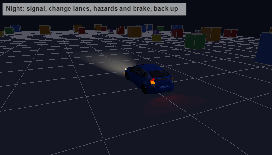 | 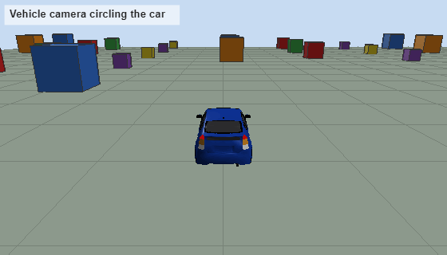 |

---

## Inputs: what CarMesh3D needs

CarMesh3D draws a vehicle from two kinds of input. Everything else in this README is about how those inputs are turned into pictures and animations.

**1. The vehicle (fixed for a vehicle):**
- A **vehicle specification**: an IVSG `vehicleParameters` structure (or `.mat` file), or an array of them for many vehicles. The fields used are `DistancesLength`, `DistancesWidth`, `DistancesWidthWithMirrors`, `DistancesHeight`, `DistancesWheelbase`, `DistancesFrontTrack`, `DistancesRearTrack`, `DistancesFrontOverhang`, `DistancesGroundClearance` (each with a `_Units` field), `TireSidewallMarkings`, and `Year`, `Make`, `Model`, `Trim` (see [Vehicle specification files](#vehicle-specification-files)).
- A **3D model** of the vehicle's shape (OBJ, STL, FBX, glTF/GLB, or .blend), or the built-in sample car. It is scaled to match the specification.

**2. The motion (one row per time step):** a table, usually a CSV file from a vehicle dynamics simulation, read by `fcn_CarMesh3D_loadMotionCSV`. These are the **motion input columns**. All names are valid MATLAB and Python variable names. Units are SI, with angles in radians.

| # | Column | Units | Meaning | If missing |
|---|---|---|---|---|
| 1 | `time` | s | Time | give `SampleTime=` |
| 2 | `X` | m | Global X of the rear-axle center, on the ground | **required** |
| 3 | `Y` | m | Global Y of the rear-axle center, on the ground | **required** |
| 4 | `Z` | m | Sprung mass: displacement up from static equilibrium | 0 |
| 5 | `roll` | rad | Sprung mass: roll, + right side down | 0 |
| 6 | `pitch` | rad | Sprung mass: pitch, + nose down | 0 |
| 7 | `yaw` | rad | Heading, + counterclockwise from +X | **required** |
| 8 | `U` | m/s | Body-fixed forward speed | from the path |
| 9 | `V` | m/s | Body-fixed lateral speed | not used |
| 10 | `W` | m/s | Body-fixed vertical speed | not used |
| 11 | `roll_rate` | rad/s | Roll rate | not used |
| 12 | `pitch_rate` | rad/s | Pitch rate | not used |
| 13 | `yaw_rate` | rad/s | Yaw rate | (used for steering only if there is no steering column) |
| 14 | `wheelSpeed_FL` | rad/s | Tire 1 (front left) spin rate, + rolling forward | `U` / tire radius |
| 15 | `wheelSpeed_RL` | rad/s | Tire 2 (rear left) | `U` / tire radius |
| 16 | `wheelSpeed_RR` | rad/s | Tire 3 (rear right) | `U` / tire radius |
| 17 | `wheelSpeed_FR` | rad/s | Tire 4 (front right) | `U` / tire radius |
| 18 | `wheelLift_FL` | m | Tire 1 height above the road | 0 |
| 19 | `wheelLift_RL` | m | Tire 2 height above the road | 0 |
| 20 | `wheelLift_RR` | m | Tire 3 height above the road | 0 |
| 21 | `wheelLift_FR` | m | Tire 4 height above the road | 0 |
| 22 | `roadRoll` | rad | Road tilt under the vehicle, about X (unsprung roll) | 0 |
| 23 | `roadPitch` | rad | Road tilt under the vehicle, about Y (unsprung pitch) | 0 |
| 24 | `steer_FL` | rad | Front-left road-wheel angle, + left | see below |
| 25 | `steer_FR` | rad | Front-right road-wheel angle, + left | see below |
| 26 | `headlights` | – | 0 off, 1 low beams, 2 high beams | 0 (off) |
| 27 | `indicator` | – | 0 off, 1 left, 2 right, 3 hazard (both) | 0 (off) |
| 28 | `brakeLight` | – | 0 off, 1 on, 2 strong | 0 (off) |
| 29 | `reverseLight` | – | 0 off, 1 on | 0 (off) |
| 30 | `runningLights` | – | 0 off, 1 on | 0 (off) |

Optional extra columns: `roadZ` (m, ground height under the rear axle; default 0), `steerAngle` (rad, one centerline angle), `steeringWheelAngle` (rad), and `wheelAngle_FL`, `wheelAngle_RL`, `wheelAngle_RR`, `wheelAngle_FR` (rad, wheel rotation angles). Any other column is read and ignored. Columns 1–13 and the four wheel speeds follow the IVSG state vector `[X Y Z roll pitch yaw U V W roll_rate pitch_rate yaw_rate w1 w2 w3 w4]`; `w1`–`w4` are accepted as names for the wheel speeds.

### Assumptions behind the inputs

Read these before writing a file for CarMesh3D:

- **Frames and signs.** ISO 8855: X forward, Y left, Z up. Angles follow the right-hand rule: positive yaw turns left, positive roll lowers the right side, positive pitch lowers the nose, and positive steering turns left.
- **The vehicle's reference point** is the center of the rear axle, on the ground. `X` and `Y` give where that point is; `yaw` gives the heading.
- **Two rigid frames.** The **sprung mass** (body, glass, trim, lights) moves with `Z`, `roll`, and `pitch`. The **unsprung mass** (the four wheels) stays on the road, except for `wheelLift_*`. Both share `X`, `Y`, and `yaw`.
- **`Z` is a displacement from equilibrium**, not a height: 0 means the sprung mass sits at its static ride height, and positive is upward. On a road with changing elevation, it is the motion relative to the road surface; give the road's own height in `roadZ` if it matters.
- **`roll` and `pitch` are the sprung mass's angles. The road tilt is separate** (`roadRoll`, `roadPitch`; zero for normal driving). The body is drawn tilted by `roll − roadRoll` and `pitch − roadPitch` relative to the road under it. This is exact on flat ground and a close approximation on gentle slopes.
- **The road is a flat plane under the vehicle.** Bumps, curbs, and potholes are not modeled.
- **Wheel lift is an input.** CarMesh3D does not work out when a wheel leaves the road; give the height of each tire above the road in `wheelLift_*` (0 for normal driving).
- **Tires are numbered by quadrant**, seen from above: 1 front left, 2 rear left, 3 rear right, 4 front right. The column names say the position (`_FL`, `_RL`, `_RR`, `_FR`), so the numbering cannot be mixed up. (Inside CarMesh3D, wheel options use the order `[FL FR RL RR]`; the reader converts.)
- **Wheel spin.** Wheel speeds are integrated over time to give the rotation angle, so a small drift is possible over long runs; give `wheelAngle_*` to avoid it. With no wheel columns, every wheel rolls without slipping at `U` / tire radius.
- **Steering.** The front road-wheel angles `steer_FL` and `steer_FR` are used as given. Without them, one angle is taken from `steerAngle`, or from `steeringWheelAngle` / `SteeringRatio` (default 15), or from the path's curvature (`yaw_rate / U`, or the change in yaw per meter); that one angle is split into left and right angles with Ackermann steering. The rear wheels do not steer.
- **Lights are inputs, never worked out from the motion.** A vehicle can brake while speeding up (coasting downhill), and can roll backward without being in reverse (parked on a hill), so `brakeLight` and `reverseLight` must come from the simulation or the driver's inputs. A missing light column means that light is off.
- **Turn signals blink by themselves.** `indicator` gives the switch position (off, left, right, hazard); CarMesh3D makes the blinking (`BlinkPeriod=`, default 0.8 s), starting "on" whenever the switch changes. Do not put the blinking itself in the file.
- **Tail lights** are on whenever the headlights or running lights are on, and bright when `brakeLight` is 1 or 2 (2, "strong", is drawn like 1).
- **Names and units.** Columns are found by name, so their order does not matter. Matching ignores upper and lower case and underscores (`yaw_rate`, `Yaw_Rate`, and `yawRate` are the same). A name ending in `_deg` is in degrees (or degrees per second); a wheel speed ending in `_rpm` is in revolutions per minute. Both are converted.
- **Files without a header row** are read with `ColumnNames=` (a list of names in the file's order) and, if there is no time column, `SampleTime=`.
- **Vehicle dimensions** for steering and wheel spin (wheelbase, front track, tire diameter) come from `VehicleSpec=`.

## Getting started

1. Put this folder somewhere whose path has **no minus signs** (spaces are fine).
2. Open MATLAB (R2021a or newer; written for 2025a/2025b) and run `script_demo_CarMesh3D.m` from this folder.
3. The demo walks through every step for a 2013 Toyota Prius Four and ends with an animation. Its starting example is a downloaded low-poly 2010 Prius model (`Data/2013_Toyota_Prius_Four/model/source/2010 Toyota Prius.glb`), which needs Blender (see below). If the model or Blender isn't available, the demo uses the built-in sample car instead.

There are no MATLAB toolbox dependencies. The demo only adds `Functions` and `Data` to the MATLAB path.

**For FBX, glTF, GLB, or .blend models**, also install [Blender](https://www.blender.org) (free). CarMesh3D finds it in the usual install folders. If Blender is installed somewhere else, run `setenv('CARMESH3D_BLENDER_PATH','<full path to blender.exe>')` once per MATLAB session, or pass `BlenderPath=...`. The converted `.obj` is saved next to the original as `<name>_converted.obj` and reused on later calls.

## Vehicles available

These vehicles are finished and checked, and are ready to use. Each one's folder in `Data` holds its parameters, its 3D model, its script, its finished mesh (`vehicleMesh_<ID>.mat`), and its check images and animations (`checks`). The same list is kept in the text file `Data/referenceVehicles.csv`, so it can be read without searching the folders. To use a finished vehicle:

```matlab
vehicleFiles = fcn_CarMesh3D_findVehicleFiles('2014_Ford_TransitConnect_XLTCargoLWB');
load(vehicleFiles.MeshFile, 'vehicleMesh', 'vehicleSpec');
fcn_CarMesh3D_plotVehicle(vehicleMesh, FigNum=1);
```

Each animation is the vehicle's `check_09_drive.gif`: the standard test drive (see [Adding a vehicle](#adding-a-vehicle)).

<!-- REFERENCE VEHICLES START -->

| Vehicle | Animation | Size L x W x H (m) | Wheelbase (m) | Faces | Model license |
|---|---|---|---|---|---|
| **2013 Toyota Prius Four**<br>`Data/2013_Toyota_Prius_Four` |  | 4.48 x 2.02 x 1.49 | 2.700 | 6648 | Free Standard |
| **2014 Ford TransitConnect XLTCargoLWB**<br>`Data/2014_Ford_TransitConnect_XLTCargoLWB` | 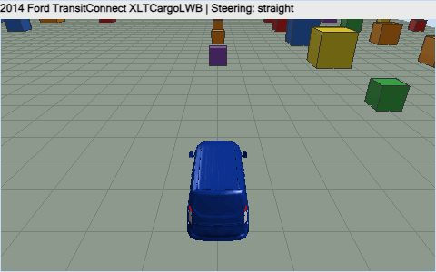 | 4.81 x 2.13 x 1.85 | 3.063 | 14984 | 2014 Ford Transit Connect Cargo by tonielpro520 is licensed under Creative Commons Attribution |

(This table is written by fcn_CarMesh3D_addReferenceVehicle from Data/referenceVehicles.csv; 2 vehicles.)

<!-- REFERENCE VEHICLES END -->

## Adding a vehicle

Every vehicle gets its own folder in `Data` and its own copy of one standard script. Student contributors: please follow this convention exactly, so that every vehicle can be found by its name.

### Folder names: `YEAR_Make_Model_Trimline`

| Part | Rule | Examples |
|---|---|---|
| `YEAR` | The model year, 4 digits | `2013`, `2014` |
| `Make` | The maker's name | `Toyota`, `Ford`, `MercedesBenz` |
| `Model` | The model's name | `Prius`, `TransitConnect`, `F150` |
| `Trimline` | The trim (and anything else needed to tell versions apart, such as body style or wheelbase) | `Four`, `XLTCargoLWB`, `LXSedan` |

- Each part uses only letters and digits: no spaces, hyphens, dots, or underscores inside a part. Write several words in CamelCase (`TransitConnect`, not `Transit Connect` or `Transit-Connect`).
- The four parts are joined by underscores, so a name always has exactly three underscores. The rule as a regular expression: `^\d{4}_[A-Za-z0-9]+_[A-Za-z0-9]+_[A-Za-z0-9]+$`.
- This name is the vehicle's **ID**, and it is used in every file name in the folder. `fcn_CarMesh3D_findVehicleFiles(ID)` checks the name and returns all the file paths (and, called with `''`, lists every vehicle folder).
- Use the year and trim of the vehicle whose parameters you have, even when the 3D model is of a nearby year (the Prius model is a 2010, for a 2013 Prius Four).

### What goes in the folder

| File or folder | Made by | Contents |
|---|---|---|
| `vehicleParameters_<ID>.mat` | you | The IVSG `vehicleParameters` structure (see [Vehicle specification files](#vehicle-specification-files)). Keep notes on where each value came from in `vehicleParameters_sources.md`. |
| `model/` | you | The downloaded 3D model, as downloaded (zip and all), with the model in `model/source/` and its license in `model/LICENSE.txt` (first line: the license name; then the author and download link). Keep the original download, including its textures: later versions of CarMesh3D may use assets that the current workflow ignores, such as texture maps. |
| `script_CarMesh3D_vehicle_<ID>.m` | you, from the template | The standard script, with this vehicle's settings |
| `vehicleMesh_<ID>.mat` | the script | The finished mesh (`vehicleMesh`, `vehicleSpec`) |
| `vehicleLevels_<ID>.mat` | the script | The detail levels (`detailLevels`): lighter versions of the mesh for animation (see [Detail levels for animation](#detail-levels-for-animation)) |
| `checks/` | the script | The standard check images, animations, and test motion (below) |

### Steps

1. Make the folder `Data/<ID>`, and put the parameters file and the model in it as above.
2. Copy `Data/script_CarMesh3D_vehicle_TEMPLATE.m` into the folder as `script_CarMesh3D_vehicle_<ID>.m`. Change only its **Vehicle settings** section: the ID, the model file, the import axes, the part rules, and the width reference. Keep the standard blue body color (`[0.05 0.20 0.60]`) at least until every check looks right: against the blue, trim (near black), glass (gray, see-through), and panels shaded wrongly stand out. The color can be changed later.
3. Run it, and look at every file in `checks/` (the list below). The first run usually shows something to fix: the orientation (`check_00`), labels (`check_03`), or lights (`check_04`).
4. Fix the settings and run again. Most fixes are label edits: regions in meters, with the origin on the ground below the rear axle (`labelEditsAfterFit`), found with `flag_useInteractiveLabelEditor = 1`. Fixes that must move with the wheels (for example, tires that are stored as part of the body) go in `fcn_INTERNAL_editsBeforeFit` at the end of the script; the Transit Connect script has an example.
5. When every check looks right, set `flag_addThisVehicleToReferenceList = 1` and run it once more. This copies `check_09_drive.gif` to `Images/vehicles/<ID>.gif`, adds (or updates) the vehicle's row in `Data/referenceVehicles.csv`, and rewrites the [Vehicles available](#vehicles-available) table in this README (`fcn_CarMesh3D_addReferenceVehicle`).

### The standard checks

`fcn_CarMesh3D_runVehicleChecks` drives every vehicle through the same **standard test motion** (`fcn_CarMesh3D_fillTestMotion`, saved as `checks/testMotion.csv` in the [motion CSV format](#inputs-what-carmesh3d-needs)) in the same **standard scene** (the gray grid with colored cubes on a 10 m grid, kept at least 9 m from the path), with cameras placed as fractions of the vehicle's length and height so that a van and a compact car are framed alike. The test motion has four segments, each testing a group of inputs:

| Segment | Vehicle | Tests |
|---|---|---|
| `lights` | parked | Each light alone for 1.2 s: off, low beams, high beams, running lights, left signal, right signal, hazards, brake, backup |
| `body` | parked | Body roll ±5°, pitch ±3°, heave ±5 cm, then each tire lifted 8 cm in turn (FL, FR, RL, RR) |
| `steering` | 2 m/s | A 90° left turn then a 90° right turn, at a radius of 1.5 wheelbases, with the turn signals on |
| `wheels` | driving | A peel-out (front tires spinning twice as fast as the road), cruising, a locked-wheel stop (brake lights), stopped, and backing up (backup lights) |

| File | What to check |
|---|---|
| `check_00_orientation.png` | The model after turning it to X forward, Y left, Z up: the front must be toward +X |
| `check_01_inputs.png` | Every input of the test motion over time |
| `check_02_dimensions.png`, `.txt` | Target vs. measured length, widths, height, wheelbase, tracks, tire diameter, overhang, and ground clearance |
| `check_03_labels.png` | Parts and light types in color, from four sides: every tire black, every lamp colored by its type |
| `check_04_lightStates.png` | Each light alone, at night: only the named light may be lit |
| `check_05_lights.gif` | The `lights` segment at night, from the front left and from behind |
| `check_06_body.gif` | The `body` segment, from low at the front left and the rear right |
| `check_07_steering.gif` | The `steering` segment from overhead, with lines from the turn center to the wheels (Ackermann) |
| `check_08_wheels.gif` | The `wheels` segment from the side |
| `check_09_drive.gif` | The `steering` and `wheels` segments from a camera following above and behind (the reference animation) |
| `check_10_groundContact.png` | Whether the body touches the road during the body segment |
| `check_11_detailLevels.png` | The finished mesh and its detail levels side by side (made by the vehicle's script, Step 6b): each should still look like the vehicle, down to the box |
| `check_summary.txt` | A summary of the above |

A check that shows a problem is doing its job: for example, a model with one material for all its rear lamps shows the whole lamp lit for every rear light in `check_04` until its lamps are split by label edits.

## Folders

| Folder | Contents |
|---|---|
| (root) | `script_demo_CarMesh3D.m`, the main overview script (making meshes); `script_demo_CarMesh3D_animation.m` (animation, lights, cameras, night scenes, motion from CSV files, GIFs); this README |
| `Functions` | Core functions `fcn_CarMesh3D_<name>.m`, each with a test script `script_test_fcn_CarMesh3D_<name>.m` |
| `Data` | One folder per vehicle, `Data/YEAR_Make_Model_Trimline` (see [Adding a vehicle](#adding-a-vehicle)); the template script `script_CarMesh3D_vehicle_TEMPLATE.m`; the reference list `referenceVehicles.csv` |
| `Images` | Images for this README; `Images/animations` holds the GIFs made by the animation demo; `Images/vehicles` holds each reference vehicle's animation; `Images/detailLevels` holds the pictures of the detail-level design |

## The workflow

| Step | Function | What it does |
|---|---|---|
| 1. Vehicle spec | `fcn_CarMesh3D_loadVehicleSpec` or `fcn_CarMesh3D_fillVehicleSpec` | Loads an IVSG vehicleParameters `.mat` file, or takes typed-in values. Converts a tire size such as `195/65R15` to a diameter. |
| 2. Shape source | `fcn_CarMesh3D_importMesh` or `fcn_CarMesh3D_fillSampleMesh` | Reads a downloaded OBJ (with materials and groups) or STL, or builds a simple sample car. FBX, glTF, GLB, and .blend files are converted to OBJ first by `fcn_CarMesh3D_convertToOBJ`, which runs Blender in the background. |
| 3. Normalize | `fcn_CarMesh3D_normalizeMesh` | Rotates into the vehicle frame (X forward, Y left, Z up), converts units to meters, and puts the origin on the ground. |
| 4. Label parts | `fcn_CarMesh3D_labelParts` | Marks each face as body, glass, wheel, light, or trim from material and group names. Numbers the wheels FL, FR, RL, RR. Sets colors and glass transparency. |
| 4b. Fix labels | `fcn_CarMesh3D_editLabels` | Corrects labels the name rules got wrong (for example headlights stored as trim), by region in a script or by clicking (see [Fixing labels](#fixing-labels)). Also sets light types for switchable lights. |
| 5. Fit to spec | `fcn_CarMesh3D_fitMeshToSpec` | Scales the body to length, width, and height, then stretches it so the axles land at the true wheelbase. Moves each wheel, without stretching it, to the true track and tire diameter. Puts the origin below the rear axle. |
| 6. Simplify | `fcn_CarMesh3D_simplifyMesh` | Merges duplicate vertices, removes bad faces, reduces to a face budget, and makes all normals point outward. Last, it checks what can be seen: a face that can only be seen from behind is turned around (`VisibilityCheck=`). |
| 7. Validate | `fcn_CarMesh3D_validateMesh` | Returns a table of target vs. measured dimensions with percent error, plus side, top, and front views. |
| 7b. Check the outline | `fcn_CarMesh3D_plotSideImage` | Puts a side-view photo of the real vehicle on the centerline plane, with its wheel centers on the mesh's axles, so the outlines can be compared (see [Checking against a side photo](#checking-against-a-side-photo)). |
| 8. Plot / animate | `fcn_CarMesh3D_plotVehicle` | Draws the mesh as a few patches under one `hgtransform`. Pass `PlotHandles` back in to move the vehicle quickly. `Finish=` sets how shiny it looks (`'matte'`, `'satin'`, `'glossy'`, `'metallic'`, or `[ka kd ks n sc]`); `ShowEdges=` and `EdgeColor=` control the face edges. Also moves the wheels (`WheelSpin=`, `SteerAngle=`, `WheelLift=`), the body (`BodyRoll=`, `BodyPitch=`, `BodyHeave=`), switches the lights (`LightStates=`), and adds glows and light pools for night scenes (`LightEffects=`). |

Labeling comes before fitting so the fit can treat wheels as rigid objects. Label fixes by region are easiest after fitting (regions are then in meters, with the origin below the rear axle) and before simplifying.

**Animation functions** (see `script_demo_CarMesh3D_animation.m`):

| Function | What it does |
|---|---|
| `fcn_CarMesh3D_fillTrajectory` | A motion along a path (straight, circle, figure eight, lane change, waypoints): pose, speed, wheel spin (with slip), and left and right steer angles at every time step |
| `fcn_CarMesh3D_calcAckermannSteering` | The left and right (inside and outside) front tire steer angles for a turn |
| `fcn_CarMesh3D_loadMotionCSV` | Reads a motion from a CSV file (for example, a vehicle dynamics simulation's output): pose, body roll/pitch/heave, wheel spin and lift, steering, lights |
| `fcn_CarMesh3D_saveMotionCSV` | Writes a motion to a CSV file in the same column convention |
| `fcn_CarMesh3D_checkGroundContact` | Flags the time steps where body roll, pitch, and heave push part of the body to the road |
| `fcn_CarMesh3D_plotScene` | Ground plane, grid, colored cubes, and a path line to drive in, by day or by night (`TimeOfDay=`) |
| `fcn_CarMesh3D_fillCameraSettings` | A camera: where it sits, what it looks at, how wide it sees (presets for 9 common views) |
| `fcn_CarMesh3D_updateCamera` | Points the camera each frame from the settings and the vehicle pose |
| `fcn_CarMesh3D_saveGifFrame` | Adds one frame to an animated GIF |

**Vehicle library functions** (used by each vehicle's script; see [Adding a vehicle](#adding-a-vehicle)):

| Function | What it does |
|---|---|
| `fcn_CarMesh3D_findVehicleFiles` | Checks a `YEAR_Make_Model_Trimline` ID and returns the paths of all of that vehicle's files (or lists every vehicle folder) |
| `fcn_CarMesh3D_fillTestMotion` | The standard test motion: lights, body, steering, and wheels segments |
| `fcn_CarMesh3D_runVehicleChecks` | Runs the standard test motion in the standard scene and saves the check images and GIFs |
| `fcn_CarMesh3D_addReferenceVehicle` | Adds a finished vehicle to `Data/referenceVehicles.csv`, `Images/vehicles`, and the table in this README |
| `fcn_CarMesh3D_makeDetailLevels` | Makes the vehicle's detail levels: lighter versions of its mesh for animation, each made for a range of sizes on screen (see [Detail levels for animation](#detail-levels-for-animation)) |
| `fcn_CarMesh3D_loadDetailLevels` | Loads a vehicle's detail levels from its folder (or makes them, with a warning, if it has none yet) |

### Minimal example

```matlab
vehicleSpec = fcn_CarMesh3D_loadVehicleSpec('Data/2013_Toyota_Prius_Four/vehicleParameters_2013_Toyota_Prius_Four.mat');
vehicleMesh = fcn_CarMesh3D_importMesh('Data/myDownloadedCar.obj', License='CC0');
vehicleMesh = fcn_CarMesh3D_normalizeMesh(vehicleMesh, UpAxis='+y', ForwardAxis='-z');
vehicleMesh = fcn_CarMesh3D_labelParts(vehicleMesh);
vehicleMesh = fcn_CarMesh3D_fitMeshToSpec(vehicleMesh, vehicleSpec);
vehicleMesh = fcn_CarMesh3D_simplifyMesh(vehicleMesh, TargetFaces=3000);
disp(fcn_CarMesh3D_validateMesh(vehicleMesh, vehicleSpec));

h = fcn_CarMesh3D_plotVehicle(vehicleMesh, FigNum=1);
for k = 1:200
    fcn_CarMesh3D_plotVehicle(vehicleMesh, Pose=[0.1*k 0 0], PlotHandles=h, FigNum=-1);
    drawnow limitrate;
end
```

## Lighting, finish, and shading

How a surface looks in MATLAB depends on four things working together. All four are options of `fcn_CarMesh3D_plotVehicle` except the normals, which come from `fcn_CarMesh3D_simplifyMesh`.

| What | Option | What it controls |
|---|---|---|
| Surface finish | `Finish=` | How the surface reflects light: dull or shiny, and the color of the highlights |
| Shading | `FaceLighting=` | Whether each face has one flat shade, or the shade blends smoothly across faces |
| Lights | `SceneLights=` | Which lights shine on the scene |
| Normals | (from `fcn_CarMesh3D_simplifyMesh`) | Which way each face points; the lighting math depends on it |

### Finish: the five numbers

MATLAB lights each face with three parts, added together. `Finish` sets how strong each part is, as five numbers `[ka kd ks n sc]`:

| Number | Name | What it does | Bigger means |
|---|---|---|---|
| `ka` | ambient strength | Light that reaches every face equally, even faces turned away from the lights | Shadowed sides are brighter; less contrast |
| `kd` | diffuse strength | Light that depends on how directly a face points at a light | Faces turned toward the light are brighter |
| `ks` | specular strength | The highlight: the bright spot where light reflects toward the viewer | Brighter highlights (shinier); 0 means no highlight |
| `n` | specular exponent | How tight the highlight is | Smaller, sharper highlights (like polished paint); small `n` gives broad, soft highlights |
| `sc` | specular color reflectance | The color of the highlight | 1: highlights are the light's color (white, like clear-coat). 0: highlights are tinted by the paint color (like metal) |

The named finishes are presets of these numbers:

| `Finish=` | `[ka kd ks n sc]` | Looks like |
|---|---|---|
| `'matte'` (default) | `[0.55 0.65 0.25 10 1.00]` | Flat paint, soft and even |
| `'satin'` | `[0.45 0.70 0.50 15 0.70]` | Some sheen |
| `'glossy'` | `[0.30 0.65 1.00 20 1.00]` | Clear-coated paint: bright white highlights |
| `'metallic'` | `[0.30 0.55 1.00 20 0.30]` | Metal: strong highlights tinted by the paint color |


To make your own finish, start from a preset and change one number at a time. The six examples below vary one number from the glossy preset, and the title of each picture gives the exact `Finish=` used:


```matlab
fcn_CarMesh3D_plotVehicle(vehicleMesh, Finish='glossy');                 % a preset
fcn_CarMesh3D_plotVehicle(vehicleMesh, Finish=[0.30 0.65 1.00 60 1.0]);  % glossy, sharper highlight
fcn_CarMesh3D_plotVehicle(vehicleMesh, Finish=[0.30 0.55 1.00 20 0.3]);  % metallic
```

Highlights only appear where a light reflects toward the camera, so whether you see them depends on the lights and the view. Rotate the view to find them.

### Shading: flat or smooth

`FaceLighting=` sets how the lighting is spread across each face:

- `'flat'`: one shade per face. Gives a crisp low-poly look, but highlights appear as single bright faces.
- `'gouraud'`: the shade blends smoothly from corner to corner. Shiny finishes need this to look smooth.
- `'auto'` (default): `'flat'` for the matte finish, `'gouraud'` for the others.
- `'none'`: no lighting at all; every face is drawn in its plain color. This is how lights that are switched on are drawn, so they look like they glow.

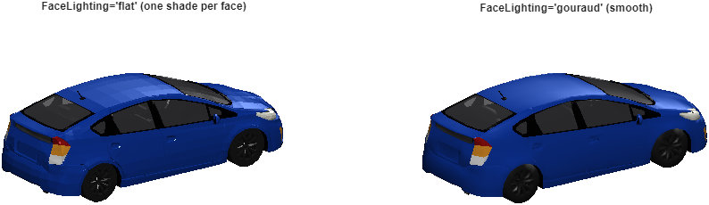

### Lights in the scene

With `SceneLights='auto'` (the default), the first vehicle plotted in an axes adds two lights:
- a white **main light** from above, to the front-left of the default view (`light('Style','infinite','Position',[-1 -2 3])`);
- a dim gray **fill light** from the other side, so shadowed faces are not black (`Position [2 1.5 1]`, `Color [0.45 0.45 0.45]`).

With `SceneLights='none'`, no lights are added, so you can place your own with MATLAB's `light` and `camlight`:

```matlab
h = fcn_CarMesh3D_plotVehicle(vehicleMesh, Finish='glossy', SceneLights='none');
camlight(h.Axes, 'headlight');                                   % a light at the camera
light(h.Axes, 'Style','infinite', 'Position',[1 1 0.3]);         % a low light from behind
```

A light low and behind the vehicle makes long highlights along the roof (right picture):


### Warning: the surface normals must point outward

Every lighting calculation uses each face's **normal**, the direction the face points. If the normals point into the vehicle, the lights hit the "inside" of every surface: the vehicle looks dark and dull, and no finish setting makes it shiny.


Things to know:
- **A normal comes from the order of a face's corners** (the right-hand rule: curl your fingers along corners 1, 2, 3 and your thumb is the normal). Reversing two corners flips the normal.
- **Downloaded models often have mixed or flipped normals.** `fcn_CarMesh3D_simplifyMesh` fixes this: it makes neighboring faces agree, then turns each closed surface so it points out. Many bodies are made of separate open panels (hood, doors, roof), and an open panel has no inside or outside to go by, so it then sends a ray from each face in both directions: a face that can only be seen from its back is turned around. **The sign of a wrong panel** is a body that is one color in the file but shows panels of different shades in a plot, which is how this was found on the Transit Connect model (864 faces were turned). Always run it before plotting. Its plot (with `FigNum`) draws every normal as a short red line, and they should all point outward.
- **MATLAB uses the opposite convention.** If MATLAB computes normals itself, they point opposite to the right-hand rule, so highlights end up on the inside. `fcn_CarMesh3D_plotVehicle` avoids this by giving MATLAB the outward normals directly (the patch `FaceNormals` and `VertexNormals` properties). If you draw a mesh with your own `patch` call, do the same, or highlights will not appear.
- **Both sides of a face are lit** (`BackFaceLighting='lit'`), so a mesh with wrong normals still looks roughly right with a matte finish. This hides the problem until you try a shiny finish.

### Mesh edges

`ShowEdges=true` draws the edges of every face, in `EdgeColor=` (any `[r g b]`, default dark gray). Edges help when checking a mesh; leave them off for animation.


## Switchable lights

Light faces have a **light type**: `'headlight'`, `'turnsignal'`, `'running'`, `'tail'`, or `'backup'`. `fcn_CarMesh3D_labelParts` sets the type from names (for example `TurnSignal`, `Reverse`, `TailLight`); a light with no recognized name becomes a headlight in the front half and a tail light in the rear half. Fix any mistakes with `fcn_CarMesh3D_editLabels`.

Switch the lights with `LightStates`, a structure. Leave out any field to keep that light off:

| Field | Values | Light |
|---|---|---|
| `Headlights` | `'off'`, `'low'`, `'high'` | Headlights |
| `TurnLeft`, `TurnRight` | `true` / `false` | Turn signals. Left and right are found from position, so mark the turn signal lenses once |
| `Running` | `true` / `false` | Front running lights |
| `Tail` | `'off'`, `'on'`, `'brake'` | Rear lights: dim red when on, bright red when braking |
| `Backup` | `true` / `false` | Backup (reverse) lights |

A light that is on is drawn unshaded (`FaceLighting='none'`) in a bright color, so it appears to glow. Blinking is just switching a light with time:

```matlab
blinkOn = mod(t, 0.8) < 0.4;                                        % 0.4 s on, 0.4 s off
lightStates = struct('Headlights','low', 'Tail','on', 'TurnLeft',blinkOn);   % left signal
lightStates = struct('TurnLeft',blinkOn, 'TurnRight',blinkOn, 'Tail','brake'); % hazards, braking
lightStates = struct('Tail','on', 'Backup',true);                    % backing up
fcn_CarMesh3D_plotVehicle(vehicleMesh, LightStates=lightStates, PlotHandles=h, FigNum=-1);
```

These are easiest to see at night (see [Night scenes](#night-scenes)).

| Signals, hazards, backing up | Headlights off, low, high |
|---|---|
|  |  |

## Night scenes

Lights are much easier to see at night. Two options make a night scene:

```matlab
fcn_CarMesh3D_plotScene(GroundExtent=[-40 60 -40 40], Cubes=cubes, TimeOfDay='night');   % scene first
h = fcn_CarMesh3D_plotVehicle(vehicleMesh, Finish='glossy', LightEffects=true);
% ... then the usual animation loop, switching LightStates
```

**`TimeOfDay='night'`** in `fcn_CarMesh3D_plotScene` makes a dark sky and dark asphalt ground, dims the axes ambient light (`AmbientLightColor`), and adds two dim, bluish "moonlight" lights. Plot the scene before the vehicle: the axes then already has lights, so `fcn_CarMesh3D_plotVehicle` does not add its bright daytime lights.

**`LightEffects=true`** in `fcn_CarMesh3D_plotVehicle` fakes light shining out of the lamps. MATLAB `light` objects cannot make a headlight beam: they shine in every direction, do not get dimmer with distance, and cast no shadows. So, as in many video games, the light is *drawn* instead:

| Effect | How it is made | Shown when |
|---|---|---|
| Glow around a lamp | A copy of the lamp's faces pushed 2.5 cm outward along their normals, in the lamp's color, 35% opaque, unlit | That lamp is on |
| Low-beam pool | A fan-shaped grid on the ground ahead, 15 m long, widening 16° each side. Each vertex has its own transparency (`FaceVertexAlphaData` with `FaceAlpha='interp'`): it rises quickly near the lamps and fades to clear at the far end and at the sides | `Headlights` is `'low'` or `'high'` |
| High-beam pool | The same, 40 m long and narrower (6°), added on top of the low beam | `Headlights` is `'high'` |
| Tail and brake pools | Short, wide red fans behind the car: faint when `Tail='on'`, stronger when `Tail='brake'` | `Tail` |
| Backup pool | A white fan behind the car, 6 m long | `Backup` is true |

The pools are flat on the ground and ride with the vehicle's ground frame, so they stay on the ground when the body rolls or pitches. They do not light up other objects such as cubes. Each pool sits at a slightly different height (1 to 2.5 cm) so that two pools that are on at the same time do not flicker (z-fighting). The sizes, colors, and transparencies are in one table in `fcn_INTERNAL_makeLightEffects` in `fcn_CarMesh3D_plotVehicle.m`; change them there to change the look.

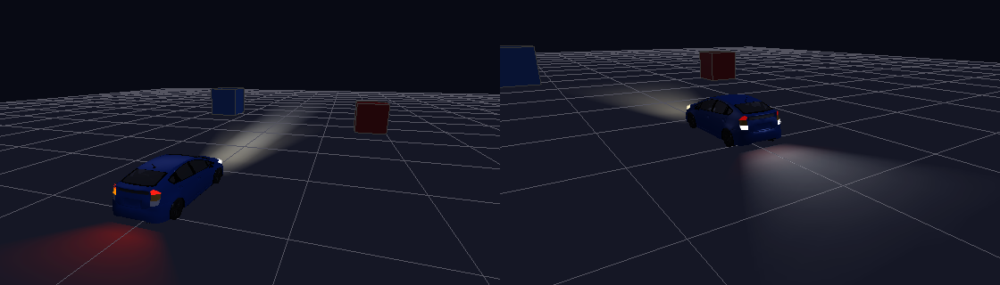

| Headlights off, low, high | Signal, change lanes, hazards and brake, back up |
|---|---|
|  |  |

## Checking against a side photo

The dimension table from `fcn_CarMesh3D_validateMesh` checks lengths, but not shape. To check the shape, `fcn_CarMesh3D_plotSideImage` puts a side-view picture of the real vehicle on a vertical plane through the vehicle's centerline (Y = 0), and draws the vehicle partly see-through around it:

```matlab
overlayHandles = fcn_CarMesh3D_plotSideImage('Data/2013_Toyota_Prius_Four/sideView.jpg', vehicleMesh, FigNum=1);
% First time: click the REAR wheel center, then the FRONT one. The values are printed,
% so later runs can skip the clicking:
overlayHandles = fcn_CarMesh3D_plotSideImage('Data/2013_Toyota_Prius_Four/sideView.jpg', vehicleMesh, ...
    WheelCentersPixels=[1210 655; 395 652], FigNum=1);
```

**How the picture is placed.** The two wheel centers in the picture must land on the mesh's two axles, at wheel-center height (half the tire diameter). Two points set:
- the **scale**: meters per pixel = wheelbase / (pixel distance between the wheel centers);
- a small **rotation**, if the picture is tilted (`TiltDegrees` in the output);
- the **position**.

If the vehicle faces left in the picture, the picture is flipped left-to-right first, so the front always points to +X.

**One plane works from both sides.** A picture on a plane looks mirrored from the back, and a vehicle's left side is (nearly) the mirror image of its right side. So the same picture lines up from both sides; only lettering reads backwards from the far side.

| Option | Default | Use |
|---|---|---|
| `WheelCentersPixels` | `[]` (click) | `[colRear rowRear; colFront rowFront]` in pixels, row 1 at the top |
| `VehicleAlpha` | `0.4` | How solid the vehicle is drawn, so the picture shows through |
| `PlaneY` | `0` | Move the picture outside the vehicle (e.g. `-1.5`) to see it in front of the mesh |
| `ImageAlpha` | `1` | Make the picture see-through (useful with `PlaneY` outside the vehicle) |
| `ShowVehicle`, `SetView` | `true` | Also draw the vehicle; look from the side without perspective |


In the left picture, the outlines agree. On the right, a picture of a different body shape (the sample sedan, stretched to the same wheelbase) shows where it disagrees with the Prius: the roof line, hood, and trunk.

**Tips for photos.** Use a photo taken from far away with a zoom lens, level with the wheel centers and square to the side of the vehicle. Close-up photos have perspective (the near wheel looks bigger and the ends of the car shrink), which no flat overlay can remove. Manufacturer press photos and car-review "profile" shots often work well; check their license before adding them to the repository.

## Fixing labels

Downloaded models are labeled from their material and group names, and those names are often unhelpful. In the 2010 Prius model, the headlights and taillights use the same material as the black bumper trim, so they are labeled trim. `fcn_CarMesh3D_editLabels` fixes this in two ways.

**1. By clicking** (to find what needs fixing):

```matlab
[vehicleMesh, edits] = fcn_CarMesh3D_editLabels(vehicleMesh, Interactive=true);
```

A window shows each part and light type in its own color. Click on the vehicle to select faces: a whole connected piece (the default), a single face, a whole material, or a whole group. Click again to unselect. Choose a label from the menu, press **Apply label to selection**, and repeat. **Undo last label** takes back the last change, and **Rotate view** turns the vehicle (turn it off to click again). Press **Done** when finished. The edits are returned, and also printed as script lines, which brings us to the second way.

**2. By region, in a script** (so the same fixes are made every time):

```matlab
edits = {};
edits{end+1} = struct('Name','headlight housings and lenses', ...
    'Region',[2.90 3.45 0.45 0.82 0.55 0.82], 'BothSides',true, ...
    'Material','color_notint|glass_ex', 'LightType','headlight');
edits{end+1} = struct('Name','tail lights', ...
    'Region',[-0.80 -0.45 0.55 0.80 0.95 1.12], 'BothSides',true, ...
    'Material','color_notint', 'LightType','tail');
vehicleMesh = fcn_CarMesh3D_editLabels(vehicleMesh, Edits=edits);
```

Each edit picks faces with any of these fields (a face must pass all of the ones given), then sets `Part` or `LightType` (and optionally `Color`):

| Field | Picks faces... |
|---|---|
| `Region` | whose centers are inside the box `[xmin xmax ymin ymax zmin zmax]`, in meters |
| `BothSides` | in `Region` *or* its mirror image across the centerline (for left/right pairs) |
| `Material`, `Group` | whose material or group name matches a regular expression |
| `CurrentPart` | that are now labeled as this part |
| `FaceIndices` | in this list |

Use the clicking tool to find the faces and the printed regions, then paste the regions into your script. The full set of Prius light edits is in `script_demo_CarMesh3D_animation.m`.

## Animation: wheels, steering, slip, and body motion

`fcn_CarMesh3D_fillTrajectory` gives everything needed for each frame. The pose is the position of the **rear axle** and the heading, which is CarMesh3D's vehicle origin, so:

- **Steering** follows exactly from the path's curvature (kinematic bicycle model): `bicycleSteerAngle = atan(wheelbase * curvature)`. This is the angle of one imaginary tire on the centerline; the real left and right tires get different angles from Ackermann steering (below), returned as `SteerAngle` (K x 2, `[left right]`).
- **Wheel spin** is distance traveled divided by tire radius, times `(1 + slip)`:

| `WheelSlip` | Wheels | Use for |
|---|---|---|
| `0` (default) | roll with the ground | normal driving |
| `-1` | do not turn at all | locked brakes, skidding |
| `> 0` (e.g. `2`) | turn faster than the ground moves (3x for 2) | peeling out, wheelspin |

Slip can be one number, one number per wheel `[FL FR RL RR]`, or one row per time step. `Speed` can be a number, one value per time step, or a function of time (e.g. `@(t) min(2*t,10)` to accelerate from rest). Negative speed drives backward.

```matlab
trajectory = fcn_CarMesh3D_fillTrajectory(Path='laneChange', Speed=8, Duration=6, VehicleSpec=vehicleSpec);
h = fcn_CarMesh3D_plotVehicle(vehicleMesh);
for k = 1:length(trajectory.Time)
    fcn_CarMesh3D_plotVehicle(vehicleMesh, Pose=trajectory.Pose(k,:), ...
        WheelSpin=trajectory.WheelSpin(k,:), SteerAngle=trajectory.SteerAngle(k,:), ...
        PlotHandles=h, FigNum=-1);
    drawnow;
end
```

Each wheel has its own transform inside the vehicle's, so wheels spin and the front wheels steer without redrawing the mesh.

### Ackermann steering: inside and outside tires

In a turn, all four wheels roll on circles around one **turn center**, which lies on the line of the rear axle. The inside front tire is closer to the turn center, so it must steer more than the outside tire; otherwise one tire would slide sideways. `fcn_CarMesh3D_calcAckermannSteering` calculates both angles:

| Quantity | Formula |
|---|---|
| Turn radius of the rear axle center | `R = wheelbase / tan(bicycleSteerAngle)` |
| Inside front tire | `atan(wheelbase / (R - track/2))` |
| Outside front tire | `atan(wheelbase / (R + track/2))` |

```matlab
[steerAngles, insideOutsideAngles, turnRadius] = fcn_CarMesh3D_calcAckermannSteering( ...
    deg2rad(20), vehicleSpec.Wheelbase, vehicleSpec.TrackFront, FigNum=1);
rad2deg(steerAngles)    % [left right]: for the 2013 Prius, about [22.1 18.3] degrees
```

`steerAngles(k,:)` can be passed straight to `fcn_CarMesh3D_plotVehicle(..., SteerAngle=steerAngles(k,:))`. `AckermannFraction=` blends from parallel steering (`0`, both tires at the bicycle angle) to full Ackermann (`1`, the default); many real cars use something in between. `fcn_CarMesh3D_fillTrajectory` calls this function for you and also accepts `AckermannFraction=`.

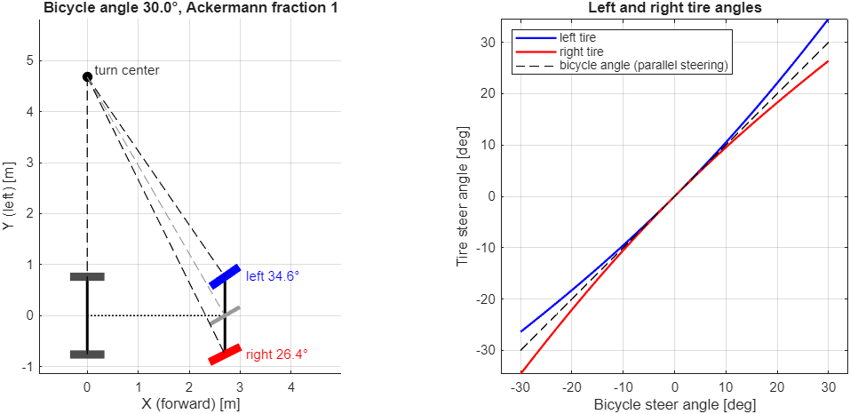

In motion (Step 9 of `script_demo_CarMesh3D_animation.m`): a 5 m radius turn seen from above, with dashed lines from the turn center to each wheel. Each front tire points at right angles to its own line, so the inside (left, blue) tire steers more than the outside (right, red) one.

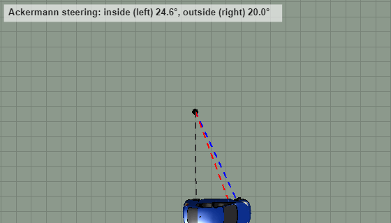

| Rolling and steering (lane change) | Peel out, then lock up (brake lights on) |
|---|---|
| 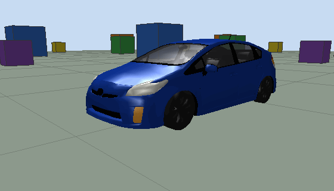 |  |

### Body roll, pitch, and heave

The vehicle is drawn as two kinds of rigid frames inside one moving transform:

```
Transform            ground frame: moved by Pose [x y yaw]
├── BodyTransform    sprung mass: body, glass, trim, lights  ← BodyRoll, BodyPitch, BodyHeave
└── WheelTransforms  unsprung mass: the four wheels          ← WheelSpin, SteerAngle
```

The wheels stay on the ground while the body rolls, pitches, and moves up and down on them. CarMesh3D does not calculate these motions; take them from your vehicle dynamics model and pass them in each frame:

```matlab
fcn_CarMesh3D_plotVehicle(vehicleMesh, Pose=pose, WheelSpin=spin, SteerAngle=steer, ...
    BodyRoll=roll(k), BodyPitch=pitch(k), BodyHeave=heave(k), PlotHandles=h, FigNum=-1);
```

| Option | Units | Positive means (ISO 8855) |
|---|---|---|
| `BodyRoll` | rad | rotation about +X: the right side goes down (as in a left turn) |
| `BodyPitch` | rad | rotation about +Y: the nose goes down (as in braking) |
| `BodyHeave` | m | the body moves up |
| `BodyPivot` | m, `[x y z]` | the point the body rotates about; default is midway between the axles, on the centerline, at wheel-center height |

## Motion from a CSV file

Vehicle dynamics simulations usually save their results as a table, one row per time step. `fcn_CarMesh3D_loadMotionCSV` reads such a file and returns everything `fcn_CarMesh3D_plotVehicle` needs at each step. `fcn_CarMesh3D_saveMotionCSV` writes the same format (a worked example of the convention, and a way to save any motion made in MATLAB).

```matlab
motion = fcn_CarMesh3D_loadMotionCSV('myRun.csv', VehicleSpec=vehicleSpec, FigNum=1);
h = fcn_CarMesh3D_plotVehicle(vehicleMesh);
for k = 1:length(motion.Time)
    fcn_CarMesh3D_plotVehicle(vehicleMesh, Pose=motion.Pose(k,:), ...
        WheelSpin=motion.WheelSpin(k,:), SteerAngle=motion.SteerAngle(k,:), WheelLift=motion.WheelLift(k,:), ...
        BodyRoll=motion.BodyRoll(k), BodyPitch=motion.BodyPitch(k), BodyHeave=motion.BodyHeave(k), ...
        LightStates=motion.LightStates(k), PlotHandles=h, FigNum=-1);
    drawnow;
end
```

**The columns** are listed in [Inputs: what CarMesh3D needs](#inputs-what-carmesh3d-needs), with the [assumptions](#assumptions-behind-the-inputs) behind each. Files with **no header row** are read by naming the columns:

```matlab
motion = fcn_CarMesh3D_loadMotionCSV('legacyRun.csv', SampleTime=0.01, ColumnNames= ...
    {'X','Y','Z','roll','pitch','yaw','U','V','W','roll_rate','pitch_rate','yaw_rate','w1','w2','w3','w4'});
```

**What the reader returns.** It turns `[X Y roadZ roadRoll roadPitch yaw]` into the ground frame (`Pose`, K x 6), gives the body motion relative to it (`BodyHeave = Z`, `BodyRoll = roll − roadRoll`, `BodyPitch = pitch − roadPitch`), and converts the wheels to CarMesh3D's `[FL FR RL RR]` order (`WheelSpin`, `WheelLift`), the steering to `SteerAngle` (`[FL FR]`, with `SteerSource` saying which column it came from), and the light columns to one `LightStates` structure per row.

**How this compares to other tools.** CarSim names the sprung-mass position `Xo`, `Yo`, `Zo`, writes angles in degrees, and labels wheels by side and axle (`L1`, `R1`, `L2`, `R2`). ASAM OSI numbers wheels by axle (0 = front) and then right-to-left along the axle, uses rad/s with the right-hand rule for wheel spin, and has light states (indicator off/left/right/warning; brake light off/normal/strong) that the light columns above follow. Use `_deg` names or `ColumnNames=` to read such files.

| Front: roll and pitch | Inside of the turn: the front wheel lifts | Behind: roll, pitch, and lift |
|---|---|---|
| 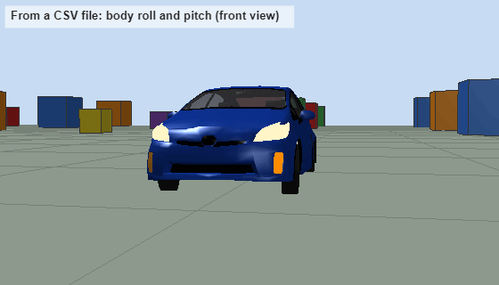 | 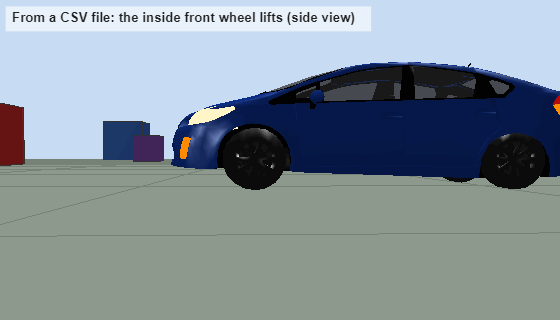 |  |

(In this example, from Step 8 of `script_demo_CarMesh3D_animation.m`, the body motion is made up and exaggerated in place of a real dynamics model: roll grows with lateral acceleration, pitch follows longitudinal acceleration, and the inside front wheel lifts 10 cm in the tightest part. The three views ride with the vehicle.)

### Checking for body contact with the road

Large roll, pitch, and heave together can push part of the body down to the road, for example a front corner of the bumper in hard braking while turning. `fcn_CarMesh3D_checkGroundContact` checks this at every time step, using the vehicle's own shape:

```matlab
[flagContact, clearance, lowestPoint] = fcn_CarMesh3D_checkGroundContact(vehicleMesh, ...
    motion.BodyRoll, motion.BodyPitch, motion.BodyHeave, Time=motion.Time, FigNum=1);
```

- `flagContact` (N x 1, true/false) is true where the body reaches the road; a warning is printed if any are true, since body damage is likely there unless that part is protected (for example, by a skid plate).
- `clearance` (N x 1, meters) is the height of the lowest body point above the road (negative means it would be below the road surface). `MinimumClearance=` sets a safety margin (default 0).
- `lowestPoint` (N x 3) says which part of the body is lowest, in the vehicle frame.

It moves every body vertex exactly as `fcn_CarMesh3D_plotVehicle` does (roll and pitch about `BodyPivot`, then heave), so what it reports matches what is drawn. The road is treated as flat under the vehicle, and the wheels are not checked.


(Made-up, very large body motion: 8° of roll, 6° of nose-down pitch, and 6 cm of drop together push the front right corner below the road.)

## Cameras

Every camera, however different it looks, is described by the same four things:

1. **Where the camera sits** (`Position`), measured in the world or in the vehicle's frame (`PositionFrame='world'` or `'vehicle'`).
2. **What it looks at** (`Target`), also in the world or the vehicle frame (`TargetFrame`).
3. **How wide it sees** (`FieldOfView`, in degrees; smaller means zoomed in).
4. **Optionally, an orbit** (`OrbitRate`, radians per second): a vehicle-frame camera circles the vehicle.

A **world** point stays put; a **vehicle** point rides along with the car (vehicle frame: X forward, Y left, Z up, origin on the ground below the rear axle). So a world camera with a vehicle target is a person at the roadside turning to follow the car, and a camera with both points in the vehicle frame is bolted to the car or flying behind it.

```matlab
cameraSettings = fcn_CarMesh3D_fillCameraSettings(Mode='chase');                 % a preset
cameraSettings = fcn_CarMesh3D_fillCameraSettings(Mode='kite', FieldOfView=30);  % preset, zoomed in
cameraSettings = fcn_CarMesh3D_fillCameraSettings(Mode='chase', ...              % your own camera
    Position=[5.5 3.5 1.3], Target=[2.2 0 0.35], FieldOfView=40);
% in the animation loop:
fcn_CarMesh3D_updateCamera(cameraSettings, pose, Time=t, AxesHandle=h.Axes, FigNum=-1);
```

The presets:

| `Mode` | Position (frame) | Target (frame) | FOV | GIF |
|---|---|---|---|---|
| `'wideFixed'` | `[-35 -45 30]` (world) | `[0 0 0]` (world) | 35 |  |
| `'roadside'` | `[0 -8 1.5]` (world) | `[1.35 0 0.7]` (vehicle) | 40 |  |
| `'overhead'` | `[0 0 60]` (world) | `[0 0 0]` (world) | 40 |  |
| `'overhead'`, `FieldOfView=20` | `[0 0 70]` (world) | `[0 0 0]` (world) | 20 |  |
| `'chase'` | `[-7 0 2.5]` (vehicle) | `[4 0 1]` (vehicle) | 50 |  |
| `'driver'` | `[1.5 0.37 1.15]` (vehicle) | `[20 0.37 0.9]` (vehicle) | 70 |  |
| `'roof'` | `[0.6 0 1.9]` (vehicle) | `[12 0 0.4]` (vehicle) | 65 |  |
| `'side'` | `[1.35 -7 1.2]` (vehicle) | `[1.35 0 0.7]` (vehicle) | 40 | 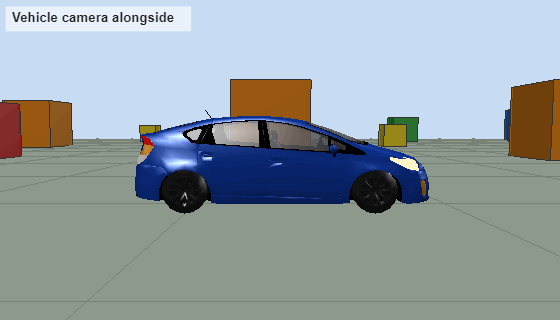 |
| `'kite'` | `[-14 0 10]` (vehicle) | `[6 0 0]` (vehicle) | 45 | 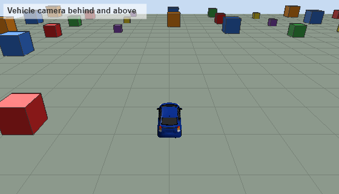 |
| `'orbit'` (`OrbitRate` 0.4) | `[-9 0 4]` (vehicle) | `[1.35 0 0.7]` (vehicle) | 45 |  |

(The GIFs use the figure eight from `script_demo_CarMesh3D_animation.m`, with some positions changed there to suit it: the overhead cameras sit above the middle of the figure eight, `[11 -11]`, rather than above `[0 0]`.) Vehicle-frame numbers assume a car about 4.5 m long; scale them for other vehicles. Two tips:

- **Fix the axis limits** to cover the whole scene before animating (`axis([xmin xmax ymin ymax zmin zmax])`), so the axes do not rescale as the camera moves.
- **Give riding cameras something to see.** `fcn_CarMesh3D_plotScene` draws a ground grid and colored cubes; without them, a driver or roof camera shows only an empty plane.

## Saving animations as GIFs

Add one line inside the animation loop, after `drawnow`:

```matlab
fcn_CarMesh3D_saveGifFrame(gcf, 'myAnimation.gif', k, DelayTime=1/12);
```

Frame 1 starts a new file; later frames are added. Smaller figures make smaller files (the demo GIFs are 560 x 320 pixels at 12 frames per second, about 0.5–1.5 MB each). Set `flag_saveGifs = 0` in `script_demo_CarMesh3D_animation.m` to watch without saving.

## Calling convention

All functions follow the IVSG convention: required inputs first, then optional inputs as `Name=Value` pairs.

- `FigNum=[]` (or omitted): no plot, except for `fcn_CarMesh3D_plotVehicle`, which plots into the current figure.
- `FigNum=n`: plot results into figure `n`.
- `FigNum=-1`: fast mode, which skips input checks and plots.
- Input checks can also be turned off for every function with the environment variables `MATLABFLAG_CARMESH3D_FLAG_CHECK_INPUTS` and `MATLABFLAG_CARMESH3D_FLAG_DO_DEBUG`.

**File names:**
- Functions: `fcn_CarMesh3D_<name>.m`.
- Scripts that test a function: `script_test_fcn_CarMesh3D_<name>.m`, next to the function in `Functions`.
- Scripts that demonstrate the code more generally: `script_CarMesh3D_<name>.m` (for example each vehicle's `script_CarMesh3D_vehicle_<ID>.m`). The two overview demos in the root folder keep the `script_demo_` names.

Test-script figures are numbered 1xxxx for demos, 2xxxx for tests, 8xxxx for fast mode, and 9xxxx for bugs. Fail conditions are wrapped in `if 1==0` blocks.

## The vehicle frame

Normalized meshes follow ISO 8855: **X forward, Y left, Z up**, in meters, with the tires touching Z = 0. After fitting, the default origin is on the ground below the center of the rear axle (`Origin='center'` is also available).

Angles follow the right-hand rule about these axes: positive yaw and steering turn left, positive roll lowers the right side, and positive pitch lowers the nose.

## The mesh structure

| Field | Size | Set by | Meaning |
|---|---|---|---|
| `Name`, `Source`, `License` | text | import / sample | Where the mesh came from. Always record the license of downloaded models. |
| `Units`, `Frame` | text | import, normalize | `'m'` and `'ISO8855'` after normalizing |
| `Vertices` | N x 3 | all | Vertex positions |
| `Faces` | M x 3 | all | Triangles (indices into `Vertices`) |
| `MaterialNames`, `MaterialColors`, `MaterialAlpha` | K x 1, K x 3, K x 1 | import | Materials from the file (colors are NaN if unknown) |
| `FaceMaterialIndex` | M x 1 | import | Material of each face |
| `GroupNames`, `FaceGroupIndex` | G x 1, M x 1 | import | Group or object of each face |
| `NormalizeInfo` | struct | normalize | Rotation, units scale, offset used |
| `PartNames` | 5 x 1 | label | `{'body';'glass';'wheel';'light';'trim'}` |
| `FacePartIndex` | M x 1 | label | Part of each face |
| `FaceWheelIndex` | M x 1 | label | 0, or 1 FL, 2 FR, 3 RL, 4 RR |
| `FaceColors`, `FaceAlpha` | M x 3, M x 1 | label | Display color and transparency |
| `LightTypeNames`, `FaceLightType` | 5 x 1, M x 1 | label, edit | `{'headlight';'turnsignal';'running';'tail';'backup'}`, and each light face's type (0 = not a switchable light) |
| `VehicleSpec`, `AxleX`, `FitInfo` | struct, 1 x 2, struct | fit | Spec used, axle positions, fit details |
| `FaceNormals`, `SimplifyInfo` | M x 3, struct | simplify | Unit outward normals, face counts |

## Detail levels for animation

> **Status:** built 2026_11_19 (`fcn_CarMesh3D_makeDetailLevels`, `fcn_CarMesh3D_loadDetailLevels`), with levels for both reference vehicles. Agreed with AnimateCar3D, which will choose among the levels (see its README, "Design: detail levels set by size on screen").

A finished mesh has a few thousand faces: right for a vehicle seen up close, far too many for a vehicle 100 m away that covers a few dozen pixels. For animations with many vehicles, CarMesh3D makes, for each vehicle, a **ladder of lighter versions** of its mesh, each made for a range of sizes on screen, and saves them with the vehicle. The animation chooses among them; CarMesh3D only makes, saves, and checks them.

```matlab
detailLevels = fcn_CarMesh3D_loadDetailLevels('2013_Toyota_Prius_Four');   % from Data/<ID>/vehicleLevels_<ID>.mat
[detailLevels.Levels.MaxScreenSize]    % 105  74.2  52.5  37.1  26.2  18.6  13.1  9.3 (pixels)
[detailLevels.Levels.Faces]            % 1026  512   256   128   64    32    16    5 (a box)
fcn_CarMesh3D_plotVehicle(detailLevels.Levels(3).Mesh, FigNum=1);         % any level is a normal mesh
```


### The size-on-screen standard

Both repositories measure an object's size on screen the same way:

- **D**, the object's size: the diagonal of its bounding box, from (minX, minY, minZ) to (maxX, maxY, maxZ) of its vertices **in its own frame** (so it does not change as the object turns). One number per object, worked out once. It works for any object (vehicle, pedestrian, gate arm, building). Mirrors and antennas count; that only overstates the size a little (the Prius: D = 5.14 m, against a length of 4.48 m), which gives slightly more detail, never less. Long, thin objects (poles, gate arms) are overstated more; that costs a few faces and is accepted.
- **Distance:** from the camera to the **center of that bounding box** (not the vehicle's origin, which is below the rear axle).
- **Size on screen**, in pixels:

  ```
  size = D x (the axes' smaller side, pixels) / (2 x distance x tan(CameraViewAngle / 2))
  ```

  **MATLAB's `CameraViewAngle` spans the smaller side of the axes** (its `Position` in pixels, not the figure). This was measured with axes 800 x 450, 450 x 800, 600 x 600, and 1200 x 400, filling their figures and inside them: in every case a 2 m bar at 10 m covered the pixels predicted from the smaller side (for example 124 px in an 800 x 450 axes, and also 124 px in a 450 x 800 one).

**Reference view** for the examples below: an axes 450 px on its smaller side (an 800 x 450 axes filling its figure) with a 40 degree view angle, where size = D x 618 / distance; a Prius 30 m away is 105 px across by this measure. (A figure 800 x 450 with MATLAB's default axes, as in the AnimateCar3D demos, has axes only 620 x 367 inside it, so there size = D x 504 / distance.)

### The rule: about 0.2 visible faces per pixel

The finished Prius mesh (6648 faces), seen from 10 m in an 800 x 450 figure (default axes, 367 px on the smaller side) with a 40 degree view angle, covers 15315 pixels: about 0.2 visible faces (half its faces) per pixel, or one visible face per 4.6 pixels. That is the density standard, for every vehicle:

```
faces(level) = 2 x 0.2 x A x (S / D)^2
```

where S is the largest size on screen (pixels) the level is made for, and A is the vehicle's mean shadow area (m^2): the area it covers, seen from 12 directions around it at 10, 30, and 50 degrees above it, worked out from the filled solid that the hull method builds anyway (the Prius: 6.13 m^2, close to the 6.03 m^2 that the 15315 pixels above give). Adding up face areas would not do: downloaded meshes have hidden inner surfaces (inner panels, glass behind body), and adding up the faces facing a viewer gives 12.6 m^2 for the Prius. No level has more faces than the finished mesh.

Measured on the Prius (pixels counted in rendered frames): the pixels a vehicle covers fall with the square of its distance (1588 at 30 m and 279 at 70 m, against 1702 and 313 predicted from 15315 at 10 m), and meshes made by this rule keep the density (0.213 visible faces per pixel at both 30 m and 70 m, in the test before the ladder was settled).


### The ladder

- **The full (finished) mesh is the top level.** It is the only level with wheels that spin and steer, a body that rolls, pitches, and heaves, and lights that switch, so it is drawn whenever the vehicle is larger on screen than the ladder's top (`TopScreenSize`, default 105 px).
- **Reduced levels** go down from there, each made for a size `Step` (default sqrt(2)) times smaller than the one above, so each has about half the faces: small steps, so the change when the animation switches level is small, and a vehicle drawn with the level made for the next size up carries at most about twice the faces it needs. All of them together have fewer faces than the full mesh.
- **The last level is a box** (5 faces), once the rule gives fewer than `MinFaces` (default 15) faces.
- A level that would need as many faces as the finished mesh is not made (for a light mesh, the finished mesh is used there).

The two reference vehicles (the reference view distances are for the Prius):

| Made for sizes up to | Prius faces | Prius distance (reference view) | Transit Connect faces |
|---|---|---|---|
| (larger than 105 px) | 6648 (finished mesh) | within 30 m | 14984 (finished mesh) |
| 105 px | 1026 | 30 m | 1144 |
| 74 px | 512 | 43 m | 572 |
| 52 px | 256 | 60 m | 286 |
| 37 px | 128 | 86 m | 142 |
| 26 px | 64 | 121 m | 70 |
| 19 px | 32 | 171 m | 36 |
| 13 px | 16 | 242 m | 18 |
| 9 px and below | box (5) | from 342 m | box (5) |

(Prius: D = 5.14 m, A = 6.14 m^2, made in 4 s. Transit Connect: D = 5.58 m, A = 8.07 m^2, made in 4 s. Each levels file is about 80 kB.) A bus (D about 12.7 m) gets the same sizes at about 2.5 times the distances, with more faces at each (a larger A).

**The animation uses the coarsest level made for at least the vehicle's current size**, so a vehicle is never drawn with less than the standard density; the ladder's spacing only affects speed and how noticeable a switch is. The animation may also use only some of the levels.

### Making the reduced levels: a closed hull

Reducing a downloaded mesh directly (as `fcn_CarMesh3D_simplifyMesh` does, part by part with `reducepatch`) opens gaps: bodies are made of many separate open panels, and reducing an open panel pulls its edges in. Instead, the vehicle is wrapped in one closed surface first:

1. Sample points over every face of the finished mesh, at most half a voxel apart (voxels of 3 cm, `VoxelSize`).
2. Mark the voxels the points fall in, and grow the marks by half of `GapSize` (default 0.36 m), closing seams, gaps between panels, and openings up to that size, such as a window with no glass in the model.
3. Fill the outside from the edge of the voxel grid; everything not reached is solid. Shrink the solid back by the same amount (undoing the growth). The solid also gives A, the shadow area, and `SolidFraction`, its volume over its bounding box's (about 0.55 for a car or van).

**Why `GapSize` matters:** the first version closed only 6 cm gaps. The Transit Connect model has openings between about 0.2 and 0.3 m across (its front windows), so the outside flowed into the cab: the solid was then only the body panels (17% of the box instead of 54%), and each level was a hollow shell with see-through holes where the windows are, which the face-edge check could not catch (a hollow shell is still closed). Closing openings up to 0.3 m fixed it; the default, 0.36 m, leaves a margin. It barely changes a sealed model (the Prius's solid: 7.41 m^3 with 6 cm gaps closed, 7.44 m^3 with 30 cm). Concave parts narrower than `GapSize` (the gap between a tire and its wheel arch) are filled too, which cannot be seen at the sizes the levels are made for. The test now also checks each level's enclosed volume.
4. Smooth it and take its isosurface: one closed surface.
5. Reduce that surface with `reducepatch` to each level's face count. A closed surface has no open edges to pull in, so no gaps open, and it can go as low as wanted. (The test checks that no edge of any level is used by only one face, and that each level encloses a solid volume; reducing can pinch a thin part, such as a mirror, to an edge shared by four faces, which does no harm.)
6. Give each new face the part, light type, color, and opacity of the outer surface of the finished mesh under it, by a vote of seven points on the face (so a small lamp cannot color a large face). Only the outer surface is used (the sampled points next to the outside), so hidden inner surfaces cannot color the hull; the nearest point is found by looking in the 27 voxels around each point, which is what makes it fast.
7. Outward normals (from the closed surface's signed volume).

Each level is a normal CarMesh3D mesh structure, so `fcn_CarMesh3D_plotVehicle` draws it like any other. Its wheels are part of the hull: `FaceWheelIndex` is 0 everywhere, so the level moves as one piece (the wheel faces keep the wheel part, and their color). Lamp faces keep their light types.

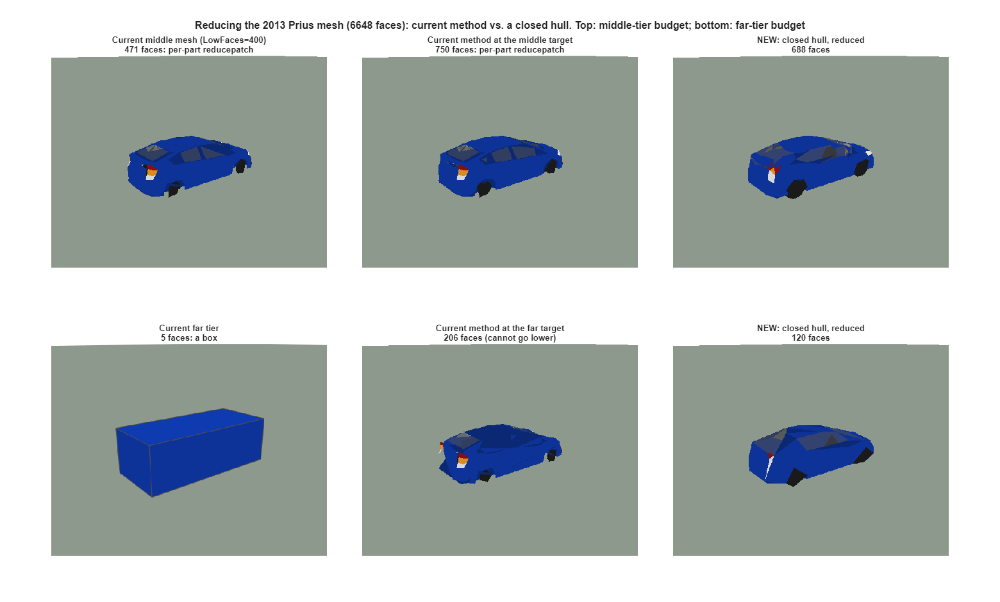

### Window colors: examined, left as they are

A reduced face can only have one color, and reducing does not follow the edges between colors, so close up the windows of the reduced levels look blotchy. A fix was built and tested on the Prius: **windows and lamps as decals.** The hull was colored from the body, wheels, and trim only, and each window pane and lamp of the finished mesh was reduced on its own (keeping its outline), pushed out to 1 cm past the hull (checked at 7 points per face by casting rays, capped at 8 cm), and added within the same face budget, with the glass opaque in a color measured to render like the see-through glass.

Close up, the decal windows are clean; at each level's true size on screen they look nearly the same as without them (at 70 m the only visible change was one tail lamp pixel; at 200 m none). Since a level is never drawn larger than the size it was made for, the close-up view does not occur in an animation, and the decals add real work (an extra making step, ray tests for every pane, panes a few centimeters off the body, slivers still to remove). **So the reduced levels have no decals** (decided 2026_11_19).


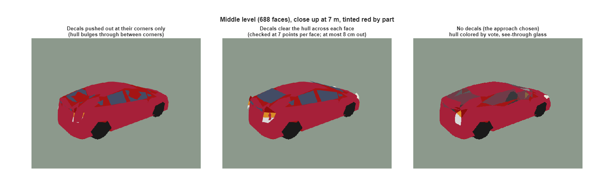

(One more close-up: `Images/detailLevels/windows_beforeAfter_closeUp.png`.)

### The levels file and functions

- **`Data/<ID>/vehicleLevels_<ID>.mat`**, next to the finished mesh (separate, so the levels can be remade without touching it), holding `detailLevels`, a structure with:
  - `Levels`: an array, finest first, each with `MaxScreenSize` (pixels: the largest size on screen it is made for), `Faces`, `IsBox`, and `Mesh` (a CarMesh3D mesh structure; empty for the box)
  - `SizeDiagonal` (D, m), `BoxCenter` (the bounding box's center, in the vehicle frame), `BoxSize` (its length, width, and height), `ShadowArea` (A, m^2)
  - `SolidFraction` (the hull's volume over its box's), the settings used (`FacesPerPixel`, `TopScreenSize`, `Step`, `MinFaces`, `VoxelSize`, `GapSize`), `FullFaces`, `Method` (`'closedHull'`), `FormatVersion` (1), `MadeBy`, `MadeOn`, and `MakeSeconds`
- **`fcn_CarMesh3D_makeDetailLevels(vehicleMesh, ...)`** makes the ladder (options `TopScreenSize=105`, `Step=sqrt(2)`, `FacesPerPixel=0.2`, `VoxelSize=0.03`, `GapSize=0.36`, `MinFaces=15`; `FigNum=` shows every level side by side). Each vehicle's script calls it (Step 6b), saves the file, and saves the picture as `checks/check_11_detailLevels.png`.
- **`fcn_CarMesh3D_loadDetailLevels(vehicleID)`** returns the structure (adding `VehicleID`, and `Source`: `'file'` or `'made'`). If a vehicle has a finished mesh but no levels file yet, it warns and makes them (`MakeIfMissing=true`; `SaveIfMade=false`); a levels file older than the finished mesh gives a warning to run the vehicle's script again.
- `fcn_CarMesh3D_findVehicleFiles` also returns `LevelsFile` and `HasLevels`.

AnimateCar3D's contract check will check these functions and fields, so a change on either side is caught.

## Vehicle specification files

`fcn_CarMesh3D_loadVehicleSpec` reads IVSG `vehicleParameters` `.mat` files. Values are converted to meters using their `_Units` fields:

| vehicleParameters field | CarMesh3D spec field |
|---|---|
| `DistancesLength` | `OverallLength` |
| `DistancesWidth` | `OverallWidth` |
| `DistancesWidthWithMirrors` | `WidthWithMirrors` |
| `DistancesHeight` | `OverallHeight` |
| `DistancesWheelbase` | `Wheelbase` |
| `DistancesFrontTrack`, `DistancesRearTrack` | `TrackFront`, `TrackRear` |
| `DistancesFrontOverhang` | `FrontOverhang` |
| `DistancesGroundClearance` | `GroundClearance` |
| `TireSidewallMarkings` | `TireSize` (and so `TireDiameter`) |
| `Year`, `Make`, `Model`, `Trim` | `Name` |

If the file also has `DistancesRearOverhang`, the loader warns when it disagrees with length minus wheelbase minus front overhang.

**Many vehicles at once.** `fcn_CarMesh3D_loadVehicleSpec` also takes a vehicleParameters structure directly, or an **array** of them (all with the same fields), from the workspace or saved in a `.mat` file. It returns an array of specs in the same order:

```matlab
allParameters = [priusParameters, camryParameters, f150Parameters];
vehicleSpecs = fcn_CarMesh3D_loadVehicleSpec(allParameters);
vehicleSpecs(3).Wheelbase
```

Overhangs use the usual definitions: **front overhang** is from the center of the front axle to the front bumper, and **rear overhang** from the center of the rear axle to the rear bumper, so length = front overhang + wheelbase + rear overhang (for the Prius, 0.924 + 2.700 + 0.856 = 4.480 m). (The Prius file's front-overhang description once said "from the center of the rear axle"; it was corrected on 2026_11_19, and the earlier file is kept as `vehicleParameters_2013_Toyota_Prius_Four_OLD.mat`.)

**Vehicle files in `Data`:** each vehicle's parameters are in its own folder as `vehicleParameters_<ID>.mat` (see [Adding a vehicle](#adding-a-vehicle) and [Vehicles available](#vehicles-available)):

| Folder | Vehicle | 3D model |
|---|---|---|
| `Data/2013_Toyota_Prius_Four` | 2013 Toyota Prius Four | A 2010 Toyota Prius (same generation), from Sketchfab (ActsOfDoge) |
| `Data/2014_Ford_TransitConnect_XLTCargoLWB` | 2014 Ford Transit Connect XLT Cargo Van, long wheelbase | From Sketchfab (CC-BY, tonielpro520). Sources and estimates for each parameter value: `vehicleParameters_sources.md` in that folder |

## Finding models

- **CC0 (no attribution needed):** Kenney.nl, OpenGameArt.org, and itch.io (search "low poly car" and filter by license). These are mostly generic body types; scaling a generic sedan to a specific car's dimensions works well for plots.
- **Sketchfab:** many specific production models are available. Filter by "Downloadable," check the license (usually CC-BY, which requires attribution), and expect dense meshes that need `TargetFaces`.
- OBJ and STL are read directly. FBX, glTF, GLB, and .blend are converted through Blender, which writes Z-up axes. After converting, normalize with `UpAxis='+z'` and check the plot to find the forward axis (often `'-y'` or `'+y'`).
- Very old ASCII FBX files (version 6.1 and earlier) can't be read by Blender.
- **Always check the normalize plot.** Part names in downloaded files can be misleading: a part named "Front" can turn out to be at the rear. The red X arrow must point at the front bumper (headlights, not the wing or taillights).
- **Textures are not read** (yet: the original downloads, with their textures, are kept in each vehicle's `model` folder in case a later version uses them). Many downloaded models color their surfaces with texture images (materials named `*_Baked`, or all materials the same gray). Use `UseMaterialColors=false` and `BodyColor=` in `fcn_CarMesh3D_labelParts` to get one clean color per part, and `PartColors=` to choose any part's color (e.g. `PartColors={'body',[0.05 0.2 0.6]; 'glass',[0.3 0.3 0.32]; 'trim',[0 0 0]}`, with `GlassAlpha=0.85` for nearly opaque glass; see Step 10 of the demo). Use `PartRules=` when part names aren't recognized or are misleading (e.g. `PartRules={'17in','wheel'; 'Bumper_Front','body'}`).
- **Mirrors and width.** Published widths usually exclude mirrors. `fcn_CarMesh3D_fitMeshToSpec` has `WidthReference=`:
  - `'all'` (default): fit the whole model to `OverallWidth`.
  - `'body'`: fit only the body faces, when mirrors are labeled trim.
  - `'mirrors'`: fit the whole model to `WidthWithMirrors`, when the mirrors are part of the body mesh. This is what the 2010 Prius model needs; the body width at the front axle then comes out at 1.749 m vs. the spec's 1.745 m.
- Simplifying below the model's face count can shave a little off the wheels and roof (e.g. 0.2–0.5% in the demo at 3000 faces).
- Some models have no separate glass, so there is nothing to make transparent.
- Wheel-named parts near the car's centerline (axles, drive shafts) are labeled trim automatically so they don't throw off the wheel positions.

## TO-DO

Two lists: **high priority** (the current focus), and **low priority** (parked; may not be needed). Each function's header also has its own TO-DO list.

### High priority

1. **Body-type templates:** a small set of vehicle body types, each with an "exemplar" model, to use as the starting shape for any vehicle of that type when no model of the vehicle itself is found.

Animating **many vehicles in one scene** (decision branches, surrounding traffic, pedestrians, moving items, live data) has moved to a separate repository, **AnimateCar3D**, which uses CarMesh3D's meshes and functions. CarMesh3D stays focused on making, viewing, and checking one vehicle at a time.

### Low priority

- Shape from blueprints: cut out the side, top, and front outlines and keep only the space inside all three. (Free-to-use blueprints are very hard to find.)
- Night scenes: let the light pools brighten objects they reach (for example, the cube faces inside a beam)
- Daytime headlights GIF: low and high beams are hard to tell apart (they are clear in the night GIF)
- GIF colors: tail and brake light pools look slightly speckled, because GIFs have only 256 colors
- A converter for other simulators' output files (for example CarSim's names and degrees) to the CarMesh3D motion columns, if it becomes necessary
- Box (drag) selection in the interactive label editor
- Labeling of STL files by geometry (they have no material names)
- `fcn_CarMesh3D_simplifyMesh` with a low `TargetFaces` opens gaps between open body panels (it reduces part by part); the detail levels avoid it, but its own reduction could use the closed hull too
- Detail levels for very large vehicles (a bus or a truck): the voxel grid and sampled points grow with size; the step could use coarser voxels for them
- Detail levels: the Transit Connect's small lamps do not survive into its reduced levels (the vote gives their faces to the body); a larger level could keep lamp colors with a lower vote threshold for lights

**Done recently** (2026_11_19)

- Detail levels for animation (`fcn_CarMesh3D_makeDetailLevels`, `fcn_CarMesh3D_loadDetailLevels`, `vehicleLevels_<ID>.mat` for both reference vehicles, Step 6b in every vehicle script, and `check_11_detailLevels.png`); `CameraViewAngle` measured to span the axes' smaller side
- Renamed to the naming convention: test scripts are `script_test_fcn_CarMesh3D_<name>.m`, and vehicle scripts are `script_CarMesh3D_vehicle_<ID>.m`
- Multi-vehicle animation planned as a separate repository (AnimateCar3D)
- Open body panels that were pointed inward (and so looked darker) are found and turned by a visibility check in `fcn_CarMesh3D_simplifyMesh`; every vehicle uses the same blue body color by default
- A vehicle library: one folder per vehicle (`YEAR_Make_Model_Trimline`), a standard script for each, standard checks (test motion, scene, cameras, images, GIFs), and a reference list with an animation of each vehicle
- 2014 Ford Transit Connect added
- Signals GIF camera moved closer; overhead cameras centered; driver camera moved forward toward the windshield; Ackermann steering GIF
- Motion inputs: valid variable names (`roll_rate`, `pitch_rate`, `yaw_rate`); brake and backup lights are inputs only; inputs and assumptions listed near the top of this README
- Body contact with the road (`fcn_CarMesh3D_checkGroundContact`), and three views of the wheel-lift GIF
- Motion from CSV files (`fcn_CarMesh3D_loadMotionCSV`, `fcn_CarMesh3D_saveMotionCSV`), with wheel lift (`WheelLift=`) and a body roll/pitch GIF
- Many vehicles at once: `fcn_CarMesh3D_loadVehicleSpec` takes arrays of vehicleParameters structures
- Side-photo overlay for checking the shape (`fcn_CarMesh3D_plotSideImage`)
- Night scenes (`TimeOfDay='night'`) with drawn light effects: lamp glows and pools of light on the ground (`LightEffects=true`)
- Ackermann steering (`fcn_CarMesh3D_calcAckermannSteering`), used by `fcn_CarMesh3D_fillTrajectory`
- Body roll, pitch, and heave on the wheels (sprung and unsprung frames in `fcn_CarMesh3D_plotVehicle`)
- Switchable lights, the label editor, rolling and slipping wheels, cameras, and GIF saving
- Fitting that accounts for mirrors (`WidthReference='mirrors'`)
- MIT License

## License

CarMesh3D is released under the [MIT License](LICENSE), Copyright (c) 2026 Intelligent Vehicles and Systems Group (Prof. Sean Brennan).

The MIT License covers the CarMesh3D code and the images it made. **Downloaded 3D models in `Data` keep their own licenses**, which can require attribution or forbid redistribution. Record each model's license with `License=` in `fcn_CarMesh3D_importMesh`, and check it before sharing the model, meshes made from it, or images and GIFs of it.
